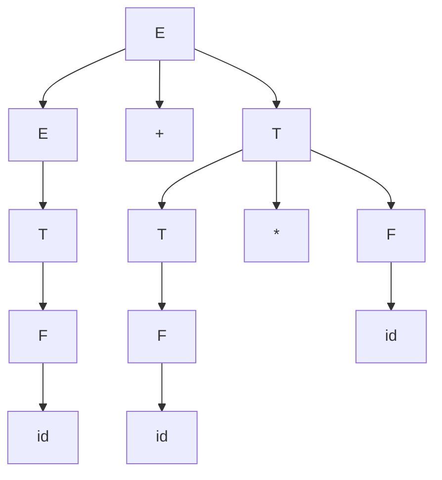
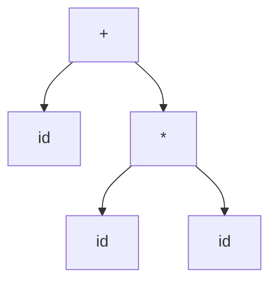

# Autómatas y Lenguajes Formales - Introducción

## 1.9 Árboles de derivación.

---

Una derivación en una gramática libre de contexto es una sucesión de formas sentenciales, pero buena parte de esa información es irrelevante: el orden en que se reescriben no terminales independientes no cambia nada. El **árbol de derivación**, o árbol de análisis sintáctico, conserva solo lo esencial: qué producción se aplicó a cada no terminal. Es la estructura que construye un compilador al analizar un programa, y la que da **significado** a una cadena: en $2 + 3 * 4,$ el árbol dice qué operación se hace primero.

### Definición Formal

Sea $G = (V, \Sigma, P, S)$ una gramática libre de contexto. Un **árbol de derivación** para $G$ es un árbol ordenado en el que:

1. Cada nodo interior está etiquetado con un no terminal.
2. Cada hoja está etiquetada con un terminal, con un no terminal o con $\varepsilon.$
3. Si un nodo interior tiene etiqueta $A$ y sus hijos, de izquierda a derecha, tienen etiquetas $X_1, X_2, \ldots, X_k,$ entonces $A \rightarrow X_1X_2 \cdots X_k$ es una producción de $P.$
4. Una hoja con $\varepsilon$ es el único hijo de su padre, que corresponde a una producción $A \rightarrow \varepsilon.$

La **frontera** o **producto** del árbol es la cadena que se obtiene al leer sus hojas de izquierda a derecha. Un árbol es **completo** si su raíz es $S$ y todas sus hojas son terminales o $\varepsilon;$ su frontera es entonces una sentencia.

### Árboles y derivaciones

**Teorema.** Para una gramática libre de contexto y $w \in \Sigma^*,$ las siguientes afirmaciones son equivalentes:

1. $S \Rightarrow^* w.$
2. Existe un árbol de derivación completo con frontera $w.$
3. $S \Rightarrow_{lm}^* w,$ con una derivación por la izquierda.
4. $S \Rightarrow_{rm}^* w,$ con una derivación por la derecha.

**Idea de la demostración.** De una derivación se construye el árbol: se empieza con la raíz $S$ y, cada vez que la derivación reescribe una aparición de $A$ con $A \rightarrow X_1 \cdots X_k,$ se le cuelgan a la hoja correspondiente $k$ hijos. Del árbol se obtiene una derivación por la izquierda recorriéndolo en **preorden**: cada vez que se visita un nodo interior, se aplica su producción al no terminal más a la izquierda, que es justamente ese nodo. Lo mismo, visitando primero los hijos derechos, da la derivación por la derecha. $\blacksquare$

La correspondencia entre árboles y derivaciones por la izquierda es **biyectiva**: cada árbol da exactamente una derivación por la izquierda, y cada derivación por la izquierda da un árbol. En cambio, un árbol corresponde en general a **muchas** derivaciones arbitrarias, que difieren solo en el orden de los pasos.

### Ejemplo

Con la gramática de expresiones

$$ E \rightarrow E + T \mid T, \qquad T \rightarrow T * F \mid F, \qquad F \rightarrow (E) \mid \text{id} $$

el árbol de $\text{id} + \text{id} * \text{id}$ es



La multiplicación queda **más abajo** en el árbol que la suma: el subárbol de $T$ que contiene $\text{id} * \text{id}$ se resuelve antes de sumar. Así, la gramática codifica la **precedencia** de $*$ sobre $+$ por medio de sus niveles: $E$ para sumas, $T$ para productos, $F$ para factores.

**Medidas del árbol.** Su **altura** es la longitud del camino más largo de la raíz a una hoja; aquí es 4, por el camino $E, E, T, F, \text{id}.$ La altura se relaciona con la longitud de la frontera: si cada lado derecho tiene a lo más $b$ símbolos, un árbol de altura $h$ tiene a lo más $b^h$ hojas. Esta observación es el punto de partida del lema de bombeo para lenguajes libres de contexto (tema 4.6).

### Árbol de derivación y árbol sintáctico abstracto

El árbol de derivación tiene nodos que no aportan significado: las cadenas $E \rightarrow T \rightarrow F$ de producciones unitarias, los paréntesis. Los compiladores suelen trabajar con un **árbol sintáctico abstracto** (AST), que solo guarda los operadores y los operandos:



Los recorridos del AST dan las tres notaciones de la expresión: en **preorden**, $+\ \text{id} * \text{id}\ \text{id}$ (notación prefija o polaca); en **inorden**, $\text{id} + \text{id} * \text{id}$ (infija, que necesita la precedencia o paréntesis para no ser ambigua); en **postorden**, $\text{id}\ \text{id}\ \text{id} * +$ (postfija o polaca inversa). Evaluar una expresión es recorrer su árbol en postorden: un nodo se calcula cuando ya se calcularon sus hijos.

### Ambigüedad

Una gramática es **ambigua** si alguna cadena de su lenguaje tiene **dos o más** árboles de derivación distintos; equivalentemente, dos derivaciones por la izquierda distintas. La gramática

$$ E \rightarrow E + E \mid E * E \mid (E) \mid \text{id} $$

genera las mismas expresiones que la del ejemplo, pero es ambigua: $\text{id} + \text{id} * \text{id}$ tiene dos árboles.


Las dos derivaciones por la izquierda correspondientes empiezan distinto: $E \Rightarrow E * E$ y $E \Rightarrow E + E.$ Si $\text{id}$ vale 2, 3 y 4, el primer árbol da 20 y el segundo 14: la ambigüedad no es un problema estético, sino que deja **indefinido el significado** de la cadena.

La ambigüedad crece muy rápido: una expresión con $n$ operandos y $n - 1$ operadores tiene, en esta gramática, tantos árboles como formas de poner paréntesis, que es el número de Catalan $C_{n-1}.$ Con 8 operandos hay 429 árboles.

**Otros ejemplos clásicos.**

- El **else colgante**: con $S \rightarrow \text{if } c \text{ then } S \mid \text{if } c \text{ then } S \text{ else } S \mid a,$ la cadena $\text{if } c \text{ then if } c \text{ then } a \text{ else } a$ tiene dos árboles, según a cuál de los dos $\text{if}$ pertenezca el $\text{else}.$ Los lenguajes de programación resuelven esto con una regla, "el else va con el if más cercano", y con una gramática que distingue instrucciones con y sin else.
- **Ambigüedad inherente.** Algunos lenguajes libres de contexto solo tienen gramáticas ambiguas. El ejemplo estándar es $\{a^ib^jc^k \mid i = j \text{ o } j = k\}:$ las cadenas $a^nb^nc^n$ están en las dos partes, y cualquier gramática para el lenguaje da dos árboles a casi todas ellas.

Decidir si una gramática libre de contexto es ambigua es un problema **indecidible** (tema 7.5): no hay un algoritmo que lo resuelva para toda gramática. En la práctica se usan clases de gramáticas que no pueden ser ambiguas, como las LL(1) y las LR(1).

### Implementación en Python

El programa construye el árbol de derivación de la gramática no ambigua para una expresión con números, calcula su frontera y su altura, lo evalúa en postorden y da su notación postfija. Al final cuenta los árboles de derivación de $\text{id} + \text{id} + \cdots$ en la gramática ambigua.

```python
import re
from functools import lru_cache

# Un árbol de derivación es (no_terminal, [hijos]); una hoja es un terminal (cadena).

def tokens(texto):
    return re.findall(r"\d+|[()+*]", texto)

def analizar(texto):
    """Construye el árbol de derivación de la gramática no ambigua
       E -> E + T | T,   T -> T * F | F,   F -> ( E ) | num
    La recursión por la izquierda se maneja con ciclos que van
    envolviendo el árbol construido hasta el momento."""
    toks, pos = tokens(texto), 0

    def ver():
        return toks[pos] if pos < len(toks) else None

    def comer(t):
        nonlocal pos
        assert ver() == t, f"se esperaba {t}"
        pos += 1
        return t

    def E():
        arbol = ('E', [T()])                     # E -> T
        while ver() == '+':
            arbol = ('E', [arbol, comer('+'), T()])  # E -> E + T
        return arbol

    def T():
        arbol = ('T', [F()])
        while ver() == '*':
            arbol = ('T', [arbol, comer('*'), F()])
        return arbol

    def F():
        nonlocal pos
        if ver() == '(':
            return ('F', [comer('('), E(), comer(')')])
        pos += 1
        return ('F', [toks[pos - 1]])

    arbol = E()
    assert pos == len(toks), "sobran símbolos"
    return arbol

def frontera(a):
    return a if isinstance(a, str) else ''.join(frontera(h) for h in a[1])

def altura(a):
    return 0 if isinstance(a, str) else 1 + max(altura(h) for h in a[1])

def dibujar(a, sangria=0):
    if isinstance(a, str):
        print('  ' * sangria + a)
    else:
        print('  ' * sangria + a[0])
        for h in a[1]:
            dibujar(h, sangria + 1)

def valor(a):
    """Evalúa recorriendo el árbol en postorden: primero los hijos, luego el padre."""
    if isinstance(a, str):
        return int(a)
    hijos = a[1]
    if len(hijos) == 1:
        return valor(hijos[0])
    if hijos[0] == '(':
        return valor(hijos[1])
    izq, op, der = valor(hijos[0]), hijos[1], valor(hijos[2])
    return izq + der if op == '+' else izq * der

def postfija(a):
    """Notación postfija: el operador se escribe después de sus dos operandos."""
    if isinstance(a, str):
        return [a] if a.isdigit() else []
    hijos = a[1]
    if len(hijos) == 3 and hijos[1] in '+*':
        return postfija(hijos[0]) + postfija(hijos[2]) + [hijos[1]]
    return [x for h in hijos for x in postfija(h)]

arbol = analizar("2+3*4")
dibujar(arbol)
print("frontera:", frontera(arbol), " altura:", altura(arbol))
print("valor:", valor(arbol), " postfija:", ' '.join(postfija(arbol)))
print("valor de (2+3)*4:", valor(analizar("(2+3)*4")))

# Número de árboles de derivación de id op id op ... op id
# en la gramática ambigua E -> E + E | E * E | id
def numero_de_arboles(n_operandos):
    @lru_cache(maxsize=None)
    def cuenta(i, j):          # árboles para los operandos i..j
        if i == j:
            return 1
        return sum(cuenta(i, k) * cuenta(k + 1, j) for k in range(i, j))
    return cuenta(0, n_operandos - 1)

print([numero_de_arboles(n) for n in range(1, 9)])
```

Salida:

```text
E
  E
    T
      F
        2
  +
  T
    T
      F
        3
    *
    F
      4
frontera: 2+3*4  altura: 4
valor: 14  postfija: 2 3 4 * +
valor de (2+3)*4: 20
[1, 1, 2, 5, 14, 42, 132, 429]
```

La función `analizar` es un analizador **descendente recursivo**: tiene una función por no terminal, y la recursión por la izquierda de $E \rightarrow E + T$ se implementa con un ciclo que envuelve el árbol ya construido como hijo izquierdo del nuevo nodo. Por eso la suma asocia a la izquierda. La última línea son los números de Catalan $C_0$ a $C_7.$

### Ejercicios Propuestos

1. **Construcción de árboles.** Para la gramática $S \rightarrow aSb \mid \varepsilon:$
   - a) Dibuja el árbol de derivación de $aaabbb.$
   - b) ¿Cuál es la altura del árbol de $a^nb^n?$

2. **Árbol y derivaciones.** Con la gramática de expresiones no ambigua, dibuja el árbol de $(\text{id} + \text{id}) * \text{id}$ y escribe su derivación por la izquierda.

3. **Recorridos.** Escribe en notación prefija y postfija la expresión $(2 + 3) * (4 + 5)$ y evalúa la postfija con una pila.

4. **Ambigüedad.**
   - a) Muestra que $S \rightarrow SS \mid a$ es ambigua.
   - b) ¿Cuántos árboles tiene $aaaa?$
   - c) Da una gramática no ambigua para el mismo lenguaje.

5. **Ambigüedad y significado.** Muestra que $E \rightarrow E - E \mid \text{num}$ es ambigua con una cadena para la que los dos árboles den valores distintos, y escribe una gramática no ambigua en la que la resta asocie a la izquierda.

### Soluciones

**Ejercicio 1.**

- a) Es una cadena de cuatro nodos $S,$ cada uno con hijos $a,$ $S$ y $b,$ salvo el último, que tiene un solo hijo $\varepsilon.$
- b) La raíz y los $n$ niveles de $S$ debajo de ella forman un camino de $n + 1$ nodos $S$ que termina en la hoja $\varepsilon,$ así que la altura es $n + 1.$

**Ejercicio 2.** La raíz es $E \rightarrow T,$ y $T \rightarrow T * F;$ el $T$ izquierdo baja a $F \rightarrow (E),$ y dentro de los paréntesis está el subárbol de $\text{id} + \text{id}.$ La derivación por la izquierda es la del ejercicio 2 del tema 1.6: $E \Rightarrow T \Rightarrow T * F \Rightarrow F * F \Rightarrow (E) * F \Rightarrow \cdots \Rightarrow (\text{id} + \text{id}) * \text{id}.$

**Ejercicio 3.** Prefija: $*\ +\ 2\ 3\ +\ 4\ 5.$ Postfija: $2\ 3\ +\ 4\ 5\ +\ *.$ Para evaluarla, cada número se apila, y cada operador saca dos números y apila el resultado: se apilan 2 y 3, el $+$ deja 5, se apilan 4 y 5, el $+$ deja 9, y el $*$ deja $45.$

**Ejercicio 4.**

- a) $aaa$ tiene dos árboles: $S \rightarrow SS$ con el hijo izquierdo generando $aa$ o con el hijo derecho generando $aa.$
- b) Tantos como formas de poner paréntesis en un producto de 4 factores: $C_3 = 5.$
- c) $S \rightarrow aS \mid a,$ que genera $a^+$ con un solo árbol por cadena.

**Ejercicio 5.** La cadena $8 - 3 - 2$ tiene los árboles de $(8 - 3) - 2 = 3$ y de $8 - (3 - 2) = 7.$ La gramática $E \rightarrow E - N \mid N,$ $N \rightarrow \text{num}$ no es ambigua: el operando derecho de cada resta es un solo número, así que la única forma de leer $8 - 3 - 2$ es $(8 - 3) - 2.$

### Referencias

1. Hopcroft, J. E., Motwani, R., and Ullman, J., _Introduction to Automata Theory, Languages, and Computation_. Pearson, 2007. Secciones 5.2 y 5.4.
2. Aho, A. V., Lam, M., Sethi, R., and Ullman, J. D., _Compilers: Principles, Techniques, and Tools_. Pearson, 2006. Capítulo 4.
3. Cooper, K. D. and Torczon, L., _Engineering a Compiler_. Morgan Kaufmann, 2011. Capítulo 3.
4. Linz, P., _An Introduction to Formal Languages and Automata_. Jones & Bartlett, 2016. Sección 5.2.

### Para profundizar

- Investiga cómo los generadores de analizadores, como Bison, resuelven la ambigüedad de las expresiones con declaraciones de precedencia y asociatividad en lugar de reescribir la gramática.
- Estudia la demostración de que $\{a^ib^jc^k \mid i = j \text{ o } j = k\}$ es inherentemente ambiguo.
- Explora el uso de los árboles de derivación y de los bosques de análisis en el procesamiento del lenguaje natural, donde la ambigüedad es la regla y no la excepción.
