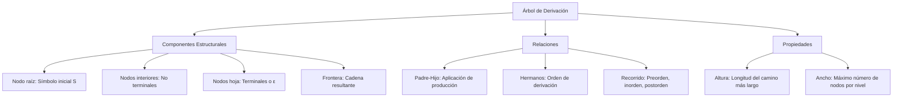
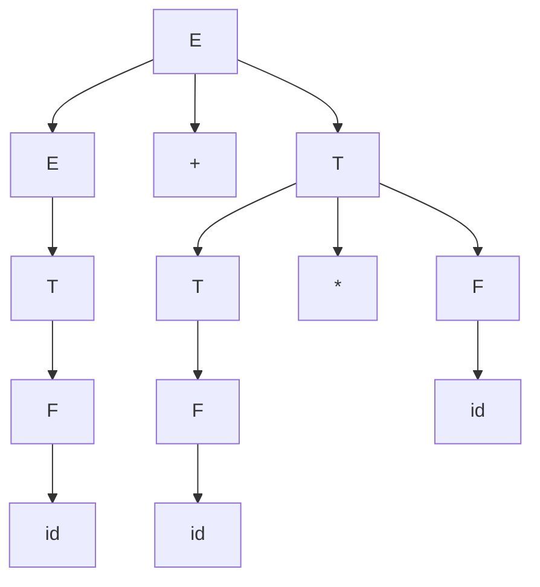
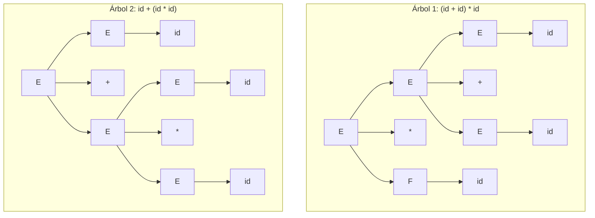

# Autómatas y Lenguajes Formales - Introducción

## 1.9 Árboles de derivación.

---

Los **árboles de derivación** (también llamados árboles de análisis sintáctico) son representaciones gráficas de las derivaciones en gramáticas formales. Proporcionan una visualización estructural de cómo una cadena es generada a partir del símbolo inicial de una gramática.

### Conceptos Fundamentales

#### Definición Formal

Un **árbol de derivación** para una gramática $G = (V, \Sigma, P, S)$ es un árbol donde:

1. Cada **nodo interior** está etiquetado con un símbolo no terminal $(A \in V)$
2. Cada **hoja** está etiquetada con un símbolo terminal $(a \in \Sigma)$ o con $\varepsilon$
3. Si un nodo interior está etiquetado con $A$ y sus hijos están etiquetados con $X_1, X_2, \ldots, X_n$ (de izquierda a derecha), entonces $A \rightarrow X_1 X_2 \ldots X_n$ debe ser una producción en $P$

#### Relación con Derivaciones

Para cualquier derivación $S \Rightarrow^* w$ donde $w \in \Sigma^*$, existe un árbol de derivación con raíz $S$ y frontera $w$.

**Teorema**: Para una gramática libre de contexto $G$ y una cadena $w \in \Sigma^*$, $w \in L(G)$ si y sólo si existe un árbol de derivación con raíz $S$ y frontera $w$.

### Estructura de un Árbol de Derivación



### Ejemplo de Árbol de Derivación

#### Gramática de Ejemplo

$$G = (\{E, T, F\}, \{+, *, (, ), id\}, P, E)$$

con producciones:

$$E \rightarrow E + T \mid T$$

$$T \rightarrow T * F \mid F$$

$$F \rightarrow (E) \mid id$$

#### Árbol para "id + id * id"



### Tipos de Recorridos

#### Recorrido en Preorden (Prefijo)

Visita: raíz, subárbol izquierdo, subárbol derecho
**Resultado**: $+ id * id id$ (notación prefija)

#### Recorrido en Inorden (Infijo)

Visita: subárbol izquierdo, raíz, subárbol derecho  
**Resultado**: $id + id * id$ (notación infija)

#### Recorrido en Postorden (Postfijo)

Visita: subárbol izquierdo, subárbol derecho, raíz
**Resultado**: $id id id * +$ (notación postfija)

### Ambigüedad en Árboles de Derivación

Una gramática es **ambigua** si existe alguna cadena $w \in L(G)$ que tiene dos o más árboles de derivación distintos.

**Ejemplo**: La gramática $E \rightarrow E + E \mid E * E \mid (E) \mid id$ es ambigua para "id + id * id":



### Implementación en Python

```python
class NodoArbol:
    """Nodo de un árbol de derivación"""

    def __init__(self, simbolo, hijos=None):
        self.simbolo = simbolo
        self.hijos = hijos if hijos is not None else []

    def agregar_hijo(self, hijo):
        self.hijos.append(hijo)

    def es_hoja(self):
        return len(self.hijos) == 0

    def frontera(self):
        """Devuelve la cadena de la frontera del árbol"""
        if self.es_hoja():
            return self.simbolo
        return ''.join(hijo.frontera() for hijo in self.hijos)

    def altura(self):
        """Calcula la altura del árbol"""
        if self.es_hoja():
            return 1
        return 1 + max(hijo.altura() for hijo in self.hijos)

    def recorrido_preorden(self):
        """Recorrido en preorden"""
        resultado = [self.simbolo]
        for hijo in self.hijos:
            resultado.extend(hijo.recorrido_preorden())
        return resultado

    def recorrido_inorden(self):
        """Recorrido en inorden (para árboles binarios)"""
        if len(self.hijos) == 0:
            return [self.simbolo]
        elif len(self.hijos) == 1:
            return self.hijos[0].recorrido_inorden()
        else:
            # Asumimos árbol binario para operadores
            izquierdo = self.hijos[0].recorrido_inorden()
            derecho = self.hijos[2].recorrido_inorden() if len(self.hijos) > 2 else []
            return izquierdo + [self.simbolo] + derecho

    def __str__(self):
        return self._str_aux(0)

    def _str_aux(self, nivel):
        indent = "  " * nivel
        resultado = f"{indent}{self.simbolo}\n"
        for hijo in self.hijos:
            resultado += hijo._str_aux(nivel + 1)
        return resultado

class ArbolDerivacion:
    """Árbol de derivación completo"""

    def __init__(self, raiz):
        self.raiz = raiz

    @classmethod
    def desde_derivacion(cls, gramatica, cadena):
        """Construye árbol de derivación (implementación simplificada)"""
        # Esta es una implementación conceptual
        # En la práctica se usaría un algoritmo de parsing
        return cls(_construir_arbol(gramatica, gramatica.S, cadena))

    def frontera(self):
        return self.raiz.frontera()

    def altura(self):
        return self.raiz.altura()

    def __str__(self):
        return str(self.raiz)

def _construir_arbol(gramatica, simbolo, cadena):
    """Función auxiliar para construir árbol (simplificada)"""
    # Implementación simplificada para demostración
    if simbolo in gramatica.Σ or simbolo == 'ε':
        return NodoArbol(simbolo)

    # Buscar una producción que pueda generar la cadena
    for produccion in gramatica.P.get(simbolo, []):
        if produccion == 'ε':
            return NodoArbol('ε')

        # Verificar si esta producción podría generar la cadena
        # (Esta es una simplificación; en la práctica es más complejo)
        nodo = NodoArbol(simbolo)
        for sym in produccion:
            nodo_hijo = _construir_arbol(gramatica, sym, cadena)
            nodo.agregar_hijo(nodo_hijo)
        return nodo

    return NodoArbol(simbolo)

# Ejemplo de uso
if __name__ == "__main__":
    # Crear un árbol de ejemplo manualmente
    # Para la expresión "id + id * id"

    # Subárbol para el primer "id"
    id1 = NodoArbol("id")
    F1 = NodoArbol("F", [id1])
    T1 = NodoArbol("T", [F1])
    E1 = NodoArbol("E", [T1])

    # Subárbol para el segundo "id"
    id2 = NodoArbol("id")
    F2 = NodoArbol("F", [id2])
    T2 = NodoArbol("T", [F2])

    # Subárbol para el tercer "id"
    id3 = NodoArbol("id")
    F3 = NodoArbol("F", [id3])

    # Subárbol para "id * id"
    T3 = NodoArbol("T", [T2, NodoArbol("*"), F3])
    E2 = NodoArbol("E", [T3])

    # Árbol completo
    arbol = NodoArbol("E", [E1, NodoArbol("+"), E2])

    print("Árbol de derivación:")
    print(arbol)
    print("Frontera:", arbol.frontera())
    print("Altura:", arbol.altura())
    print("Recorrido preorden:", arbol.recorrido_preorden())
    print("Recorrido inorden:", arbol.recorrido_inorden())
```

### Ejercicios Propuestos

1. **Construcción de árboles**:
   - Para la gramática $S \rightarrow aSb \mid \varepsilon$:
      - a) Construye el árbol de derivación para "aaabbb"
      - b) ¿Cuál es la altura del árbol para $a^n b^n$?
      - c) Generaliza la estructura del árbol para cualquier $n$

2. **Recorridos**:
   - Para el árbol de derivación de $(id + id) * id$:
      - a) Realiza los recorridos preorden, inorden y postorden
      - b) Convierte cada recorrido a notación prefija, infija y postfija
      - c) Evalúa cada expresión asumiendo valores para los identificadores

3. **Ambigüedad**:
   - Demuestra que la siguiente gramática es ambigua:

     $E \rightarrow E + E \mid E * E \mid (E) \mid id$
   
   - Encuentra dos árboles de derivación diferentes para "id + id * id"
   - Propón una gramática no ambigua equivalente

4. **Implementación**:
   - Extiende la clase ArbolDerivacion para:
      - a) Calcular el número de nodos del árbol
      - b) Encontrar todos los caminos desde la raíz hasta las hojas
      - c) Verificar si el árbol corresponde a una derivación válida

5. **Aplicaciones**:
   - Explica cómo se utilizan los árboles de derivación en:
      - a) Compiladores (análisis sintáctico)
      - b) Procesamiento de lenguaje natural
      - c) Evaluación de expresiones

6. **Análisis de complejidad**:
   - Para una gramática regular, ¿cuál es la altura máxima de un árbol que genera una cadena de longitud $n$?
   - Para una gramática libre de contexto, ¿cómo crece la altura del árbol con la longitud de la cadena?

### Aplicaciones Prácticas

1. **Compiladores**: Los árboles de derivación forman la base del análisis sintáctico
2. **Evaluación de expresiones**: Los recorridos del árbol permiten evaluar expresiones en diferentes notaciones
3. **Optimización de código**: Los compiladores analizan árboles de derivación para optimizar el código generado
4. **Procesamiento de lenguaje natural**: Los árboles sintácticos representan la estructura gramatical de oraciones

### Referencias

1. Aho A.V., Lam M., Sethi S.R. and Ullman J.D., _Compilers: Principles, Techniques, & Tools_. (Capítulo 4: Análisis sintáctico)
2. Hopcroft, J. E., Motwani, R., and Ullman, J., _Introduction to Automata Theory, Languages, and Computation_. (Capítulo 5: Gramáticas libres de contexto)
3. Cooper, K. D. and Torkzon, L., _Engineering a Compiler_. (Capítulo 3: Parsing)
4. Linz, P., _An Introduction to Formal Languages and Automata_. (Capítulo 5: Árboles de derivación)

### Para Profundizar

- **Algoritmos de parsing**: Top-down vs. bottom-up
- **Gramáticas LR**: Construcción de árboles de derivación para gramáticas LR
- **Árboles de derivación abstractos**: Representaciones simplificadas para compiladores
- **Ambiguidad inherente**: Lenguajes que sólo tienen gramáticas ambiguas
