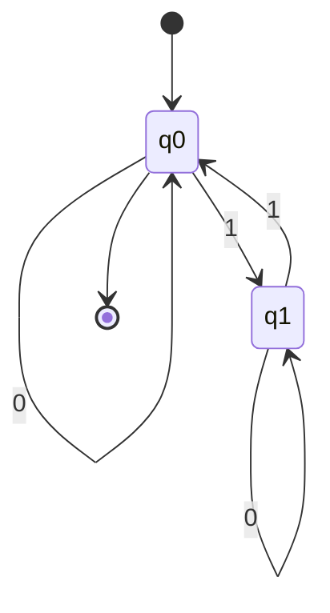

# Autómatas y Lenguajes Formales - Máquinas con un número finito de estados y lenguajes tipo 3

## 2.1 Definición.

---

### Definición

#### Autómatas Finitos (Máquinas con Número Finito de Estados)

Un **autómata finito** (AF) es un modelo matemático que representa un sistema con estados, transiciones entre estados, y una capacidad computacional limitada. Se caracteriza por tener un número finito de estados y procesar cadenas de símbolos de un alfabeto dado.

##### Definición Formal

Un autómata finito determinista (AFD) es una 5-tupla:

$$M = (Q, \Sigma, \delta, q_0, F)$$

donde:

- $Q$: Conjunto finito de estados
- $\Sigma$: Alfabeto finito (símbolos de entrada)
- $\delta$: Función de transición $Q \times \Sigma \rightarrow Q$
- $q_0$: Estado inicial $(q_0 \in Q)$
- $F$: Conjunto de estados finales/aceptadores $(F \subseteq Q)$

**Ejemplo:** AFD que acepta cadenas con un número par de 1's:

$$M = (\{q_0, q_1\}, \{0, 1\}, \delta, q_0, \{q_0\})$$

donde $\delta$ se define como:

- $\delta(q_0, 0) = q_0$
- $\delta(q_0, 1) = q_1$
- $\delta(q_1, 0) = q_1$
- $\delta(q_1, 1) = q_0$

##### Diagrama de Estados



#### Lenguajes Tipo 3 (Lenguajes Regulares)

Los **lenguajes tipo 3** o **lenguajes regulares** son aquellos que pueden ser reconocidos por un autómata finito. Estos lenguajes pueden ser descritos mediante:

- Expresiones regulares
- Autómatas finitos (deterministas o no deterministas)
- Gramáticas regulares

##### Definición Formal

Un lenguaje $L$ sobre un alfabeto $\Sigma$ es regular si existe:

1. Un AFD $M$ tal que $L(M) = L$
2. Una expresión regular $R$ tal que $L(R) = L$
3. Una gramática regular $G$ tal que $L(G) = L$

##### Gramáticas Regulares

Una gramática regular es una 4-tupla:

$$G = (V, T, S, P)$$

donde:

- $V$: Conjunto finito de variables (no terminales)
- $T$: Conjunto finito de terminales $(T = \Sigma)$
- $S$: Símbolo inicial $(S \in V)$
- $P$: Conjunto de producciones de la forma:
  - $A \rightarrow aB$ (lineal por la derecha)
  - $A \rightarrow a$ (lineal por la derecha)
  - $A \rightarrow \varepsilon$ ( si $\varepsilon \in L$ )

**Ejemplo:** Gramática para el lenguaje de cadenas con un número par de 1's:
$$G = (\{S\}, \{0, 1\}, S, P)$$
donde $P$ contiene:

- $S \rightarrow 0S$
- $S \rightarrow 1A$
- $S \rightarrow \varepsilon$
- $A \rightarrow 0A$
- $A \rightarrow 1S$

#### Equivalencia entre Modelos

Los siguientes modelos son equivalentes en poder expresivo:

- Autómatas finitos deterministas (AFD)
- Autómatas finitos no deterministas (AFN)
- Autómatas finitos con transiciones-ε (AFN-ε)
- Expresiones regulares
- Gramáticas regulares

### Código de Ejemplo (Python)

```python
class AFD:
    def __init__(self, estados, alfabeto, transiciones, estado_inicial, estados_finales):
        self.estados = estados
        self.alfabeto = alfabeto
        self.transiciones = transiciones  # Dict: (estado, simbolo) -> estado
        self.estado_inicial = estado_inicial
        self.estados_finales = estados_finales

    def acepta(self, cadena):
        estado_actual = self.estado_inicial
        for simbolo in cadena:
            if (estado_actual, simbolo) not in self.transiciones:
                return False
            estado_actual = self.transiciones[(estado_actual, simbolo)]
        return estado_actual in self.estados_finales

# Ejemplo: AFD para cadenas con número par de 1's
afd_par_unos = AFD(
    estados={'q0', 'q1'},
    alfabeto={'0', '1'},
    transiciones={
        ('q0', '0'): 'q0',
        ('q0', '1'): 'q1',
        ('q1', '0'): 'q1',
        ('q1', '1'): 'q0'
    },
    estado_inicial='q0',
    estados_finales={'q0'}
)

# Probar el AFD
print(afd_par_unos.acepta("010101"))  # True (3 unos = impar)
print(afd_par_unos.acepta("0101011")) # True (4 unos = par)
```

### Ejercicios Propuestos

1. Diseña un AFD que acepte el lenguaje de cadenas sobre $\{0, 1\}$ que terminan en 01.

2. Construye una expresión regular para el lenguaje de cadenas sobre $\{a, b, c\}$ que contienen exactamente dos 'a's.

3. Convierte la siguiente gramática regular a un AFD:

   $S \rightarrow aA | bB$

   $A \rightarrow aS | bC | \varepsilon$
   
   $B \rightarrow aC | bS$
   
   $C \rightarrow aB | bA$

4. Demuestra que el lenguaje $L = \{a^n b^n : n \geq 0\}$ **no** es regular usando el lema de bombeo.

5. Diseña un AFN con transiciones-ε para el lenguaje de cadenas sobre $\{0, 1\}$ que contienen la subcadena 101 en cualquier posición.

### Referencias

1. Viso G., E. (2008). _Introducción a la teoría de la computación_. Las Prensas de Ciencias. (Capítulos 2-3)
2. Rich, E. (2008). _Automata, Computability and Complexity, theory and applications_. Pearson Prentice Hall. (Capítulos 2-4)
3. Hopcroft, J. E., Motwani, R., and Ullman, J. (2007). _Introduction to Automata Theory, Languages, and Computation_. Addison-Wesley. (Capítulos 2-4)
4. Sipser, M. (2005). _Introduction to the Theory of Computation_. PWS Publishing Company. (Capítulo 1)
