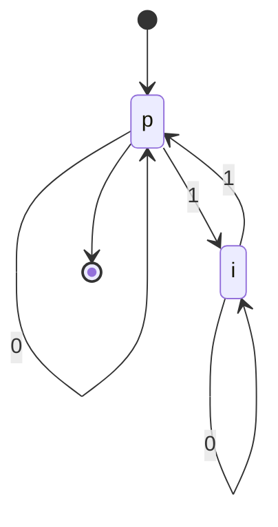

# Autómatas y Lenguajes Formales - Máquinas con un número finito de estados y lenguajes tipo 3

## 2.1 Definición.

---

Un **autómata finito** es el modelo más simple de una máquina que computa: lee su entrada una sola vez, de izquierda a derecha, y lo único que recuerda de lo que ha leído es en qué **estado** está, de entre un número finito de ellos. No tiene memoria adicional: ni pila, ni cinta, ni contadores. Aun así, describe con exactitud una enorme cantidad de sistemas reales, desde un torniquete hasta el analizador léxico de un compilador, y reconoce exactamente los lenguajes de tipo 3 de la jerarquía de Chomsky.

### Definición Formal

Un **autómata finito determinista** (AFD) es una quíntupla

$$ M = (Q, \Sigma, \delta, q_0, F) $$

donde:

- $Q$ es un conjunto finito de **estados**.
- $\Sigma$ es el **alfabeto** de entrada.
- $\delta : Q \times \Sigma \rightarrow Q$ es la **función de transición**: $\delta(q, a)$ es el estado al que pasa el autómata si está en $q$ y lee $a.$
- $q_0 \in Q$ es el **estado inicial**.
- $F \subseteq Q$ es el conjunto de **estados de aceptación** o finales.

Que sea **determinista** significa que $\delta$ es una función total: para cada estado y cada símbolo hay **exactamente un** estado siguiente. No hay elecciones ni transiciones que falten.

### Representaciones

Un AFD se puede dar de tres formas equivalentes. Para el autómata de las cadenas binarias con un número par de unos, con estados $p$ (par) e $i$ (impar):

**Tabla de transición.** Cada fila es un estado y cada columna un símbolo; la flecha marca el estado inicial y el asterisco los de aceptación.

| $\delta$ | 0 | 1 |
| --- | --- | --- |
| $\rightarrow * \, p$ | $p$ | $i$ |
| $i$ | $i$ | $p$ |

**Diagrama de estados.** Un nodo por estado y una flecha etiquetada por cada transición:



**Quíntupla**, con la función escrita explícitamente: $M = (\{p, i\}, \{0, 1\}, \delta, p, \{p\})$ con $\delta(p, 0) = p,$ $\delta(p, 1) = i,$ $\delta(i, 0) = i$ y $\delta(i, 1) = p.$

### Función de transición extendida y lenguaje aceptado

$\delta$ dice qué pasa con un símbolo. Para cadenas completas se define la **función de transición extendida** $\hat{\delta} : Q \times \Sigma^* \rightarrow Q$ por recursión sobre la cadena:

$$ \hat{\delta}(q, \varepsilon) = q, \qquad \hat{\delta}(q, wa) = \delta(\hat{\delta}(q, w), a) $$

Es decir, $\hat{\delta}(q, w)$ es el estado al que llega el autómata si empieza en $q$ y lee toda la cadena $w.$ El AFD **acepta** $w$ si $\hat{\delta}(q_0, w) \in F,$ y el **lenguaje aceptado** o reconocido por $M$ es

$$ L(M) = \{w \in \Sigma^* \mid \hat{\delta}(q_0, w) \in F\} $$

Una propiedad que se usa todo el tiempo, y que se demuestra por inducción sobre $y:$

$$ \hat{\delta}(q, xy) = \hat{\delta}(\hat{\delta}(q, x), y) $$

Leer $xy$ es leer $x$ y luego, desde donde se haya quedado, leer $y.$

**Configuraciones.** Una **configuración** es un par $(q, w)$ con el estado actual y la parte de la entrada que falta por leer. Un paso es $(q, aw) \vdash (\delta(q, a), w),$ y la **computación** sobre $w$ es la sucesión de configuraciones que empieza en $(q_0, w)$ y termina en $(q, \varepsilon);$ se acepta si $q \in F.$

### Ejemplo: divisibilidad entre 3

El AFD con estados $\{0, 1, 2\},$ inicial y de aceptación $0,$ y transición

$$ \delta(r, a) = (2r + a) \bmod 3 $$

acepta las representaciones binarias de los múltiplos de 3. Al leer un bit $a$ después de un número $n,$ el nuevo número es $2n + a;$ si el estado es el residuo $r = n \bmod 3,$ el nuevo residuo es $(2r + a) \bmod 3.$ Así, el autómata solo necesita recordar el residuo, no el número completo. Con la entrada $1001,$ el nueve en binario,

$$ (0, 1001) \vdash (1, 001) \vdash (2, 01) \vdash (1, 1) \vdash (0, \varepsilon) $$

y se acepta.

### Cómo demostrar que un AFD es correcto

Para demostrar que $L(M) = L$ se asigna a cada estado un **significado**, una propiedad de las cadenas que llevan a él, y se demuestra por inducción sobre $|w|$ que $\hat{\delta}(q_0, w) = q$ si y solo si $w$ cumple la propiedad de $q.$

**Proposición.** El AFD de los unos pares cumple $\hat{\delta}(p, w) = p$ si $w$ tiene un número par de unos, y $\hat{\delta}(p, w) = i$ si tiene un número impar.

**Demostración.** Por inducción sobre $|w|.$ Si $w = \varepsilon,$ tiene cero unos y $\hat{\delta}(p, \varepsilon) = p.$ Si $w = xa$ y la afirmación vale para $x:$ si $a = 0,$ la paridad de $w$ es la de $x$ y $\delta$ deja el estado igual; si $a = 1,$ la paridad cambia y $\delta$ cambia de $p$ a $i$ o de $i$ a $p.$ En ambos casos, $\hat{\delta}(p, w) = \delta(\hat{\delta}(p, x), a)$ es el estado que corresponde a la paridad de $w.$ Como $F = \{p\},$ $L(M)$ son las cadenas con un número par de unos. $\blacksquare$

### Estado sumidero y autómatas parciales

Muchas veces es cómodo dibujar solo las transiciones útiles. Un **autómata parcial**, en el que algunas transiciones no están definidas, se interpreta como si las que faltan llevaran a un **estado sumidero** (o de error, o trampa): un estado que no es de aceptación y del que no se sale. Por ejemplo, el autómata de los identificadores que empiezan con letra no tiene transición desde el estado inicial con un dígito; se completa agregando un sumidero $q_\text{err}$ con $\delta(q_0, \text{dígito}) = q_\text{err}$ y $\delta(q_\text{err}, x) = q_\text{err}$ para todo símbolo $x.$

### Lenguajes regulares

Un lenguaje es **regular**, o de tipo 3, si algún autómata finito lo reconoce. Este tema y los siguientes demuestran que la misma clase de lenguajes se obtiene con otras descripciones:

- Autómatas finitos deterministas.
- Autómatas finitos no deterministas, con o sin transiciones $\varepsilon$ (tema 2.5).
- Expresiones regulares (teorema de Kleene, tema 2.8).
- Gramáticas regulares: lineales por la derecha o lineales por la izquierda (tema 2.6).

Por ejemplo, la gramática lineal por la derecha $S \rightarrow 0S \mid 1I \mid \varepsilon,$ $I \rightarrow 0I \mid 1S$ es el mismo autómata de los unos pares escrito como gramática: cada no terminal es un estado, cada producción $A \rightarrow aB$ es una transición y $S \rightarrow \varepsilon$ dice que $S$ es de aceptación.

### Código de Ejemplo (Python)

```python
class AFD:
    """Autómata finito determinista M = (Q, Σ, δ, q0, F)."""

    def __init__(self, estados, alfabeto, delta, inicial, finales):
        self.Q, self.Sigma, self.delta = set(estados), set(alfabeto), dict(delta)
        self.q0, self.F = inicial, set(finales)
        # δ debe ser total: una transición por cada estado y cada símbolo
        faltan = [(q, a) for q in self.Q for a in self.Sigma if (q, a) not in self.delta]
        assert not faltan, f"δ no está definida en {faltan}"

    def delta_ext(self, q, w):
        """Función de transición extendida δ̂(q, w), por recursión sobre w."""
        for a in w:
            q = self.delta[(q, a)]
        return q

    def acepta(self, w):
        return self.delta_ext(self.q0, w) in self.F

    def traza(self, w):
        """Sucesión de configuraciones (estado, entrada que falta) de la computación."""
        q, pasos = self.q0, [(self.q0, w)]
        for i, a in enumerate(w):
            q = self.delta[(q, a)]
            pasos.append((q, w[i + 1:]))
        return pasos

# Cadenas con un número par de unos
par_unos = AFD({'p', 'i'}, '01',
               {('p', '0'): 'p', ('p', '1'): 'i', ('i', '0'): 'i', ('i', '1'): 'p'},
               'p', {'p'})

# Números binarios divisibles entre 3: el estado es el residuo módulo 3
mod3 = AFD({0, 1, 2}, '01',
           {(r, a): (2 * r + int(a)) % 3 for r in range(3) for a in '01'}, 0, {0})

for w in ['', '010101', '0101011', '11']:
    print(f"{w!r:>11}: par de unos = {par_unos.acepta(w)}")
print(' ⊢ '.join(f"({q}, {r or 'ε'})" for q, r in mod3.traza('1001')))
print(all(mod3.acepta(format(n, 'b')) == (n % 3 == 0) for n in range(1000)))
```

Salida:

```text
         '': par de unos = True
   '010101': par de unos = False
  '0101011': par de unos = True
       '11': par de unos = True
(0, 1001) ⊢ (1, 001) ⊢ (2, 01) ⊢ (1, 1) ⊢ (0, ε)
True
```

La cadena $010101$ tiene tres unos y se rechaza; $0101011$ tiene cuatro y se acepta. La última línea comprueba el autómata del residuo módulo 3 con los números del 0 al 999.

### Ejercicios Propuestos

1. Diseña un AFD que acepte las cadenas sobre $\{0, 1\}$ que terminan en $01,$ y demuestra que es correcto asignando un significado a cada estado.

2. Diseña un AFD para las cadenas sobre $\{a, b, c\}$ que contienen exactamente dos $a,$ y da una expresión regular para el mismo lenguaje.

3. Convierte la siguiente gramática regular a un AFD y describe el lenguaje que genera:

   $$ S \rightarrow aA \mid bB, \quad A \rightarrow aS \mid bC \mid \varepsilon, \quad B \rightarrow aC \mid bS, \quad C \rightarrow aB \mid bA $$

4. Demuestra que $\hat{\delta}(q, xy) = \hat{\delta}(\hat{\delta}(q, x), y)$ para todo estado $q$ y todas las cadenas $x$ y $y.$

5. Generaliza el ejemplo de la divisibilidad: da un AFD con $k$ estados que acepte las representaciones en base $b$ de los múltiplos de $k.$

### Soluciones

**Ejercicio 1.** Estados: $q_0$ significa "no termina en 0 ni en 01", $q_1$ "termina en 0" y $q_2$ "termina en 01". Transiciones: con 0, todos van a $q_1;$ con 1, $q_1$ va a $q_2$ y los demás a $q_0.$ El único estado de aceptación es $q_2.$ La corrección se demuestra por inducción, igual que en el ejemplo: si $x$ cumple el significado de su estado, al agregar un símbolo la nueva cadena cumple el del estado siguiente; por ejemplo, si $x$ termina en 0 y se lee un 1, la nueva cadena termina en 01.

**Ejercicio 2.** Cuatro estados que cuentan las $a$ leídas: 0, 1, 2 y "más de 2", que es un sumidero. Las letras $b$ y $c$ no cambian el estado; una $a$ avanza al siguiente. Se acepta en el estado 2. La expresión regular es $(b + c)^*a(b + c)^*a(b + c)^*.$

**Ejercicio 3.** Los estados son $S,$ $A,$ $B$ y $C,$ con $S$ inicial y $A$ de aceptación, por $A \rightarrow \varepsilon.$ Las transiciones son las de las producciones: $\delta(S, a) = A,$ $\delta(S, b) = B,$ $\delta(A, a) = S,$ $\delta(A, b) = C,$ $\delta(B, a) = C,$ $\delta(B, b) = S,$ $\delta(C, a) = B$ y $\delta(C, b) = A.$ Cada $a$ cambia entre $S$ y $A$ o entre $B$ y $C,$ y cada $b$ entre $S$ y $B$ o entre $A$ y $C:$ el estado registra la paridad del número de $a$ y del número de $b,$ con $S$ = (par, par), $A$ = (impar, par), $B$ = (par, impar) y $C$ = (impar, impar). El lenguaje es el de las cadenas con un número **impar** de $a$ y un número **par** de $b.$

**Ejercicio 4.** Por inducción sobre $y.$ Si $y = \varepsilon,$ ambos lados son $\hat{\delta}(q, x).$ Si $y = za,$ entonces

$$ \hat{\delta}(q, xza) = \delta(\hat{\delta}(q, xz), a) = \delta(\hat{\delta}(\hat{\delta}(q, x), z), a) = \hat{\delta}(\hat{\delta}(q, x), za) $$

usando la definición, la hipótesis de inducción y otra vez la definición. $\blacksquare$

**Ejercicio 5.** Estados $\{0, 1, \ldots, k - 1\},$ inicial y de aceptación $0,$ y $\delta(r, d) = (br + d) \bmod k$ para cada dígito $d$ de 0 a $b - 1.$ La corrección es la del ejemplo: el estado es el residuo del número leído hasta el momento.

### Referencias

1. Hopcroft, J. E., Motwani, R., and Ullman, J., _Introduction to Automata Theory, Languages, and Computation_. Pearson, 2007. Sección 2.2.
2. Sipser, M., _Introduction to the Theory of Computation_. Cengage, 2013. Sección 1.1.
3. Viso G., E., _Introducción a la teoría de la computación_. Las Prensas de Ciencias, 2008. Capítulo 3.
4. Rich, E., _Automata, Computability and Complexity: Theory and Applications_. Pearson, 2008. Capítulo 5.

### Para profundizar

- Investiga el origen de los autómatas finitos en el modelo de neuronas de McCulloch y Pitts (1943) y en el trabajo de Kleene (1956).
- Explora los autómatas que leen cadenas infinitas, como los de Büchi, que se usan en verificación.
- Compara un AFD con un circuito secuencial: los estados son los valores de los registros y la función de transición es el circuito combinacional.
