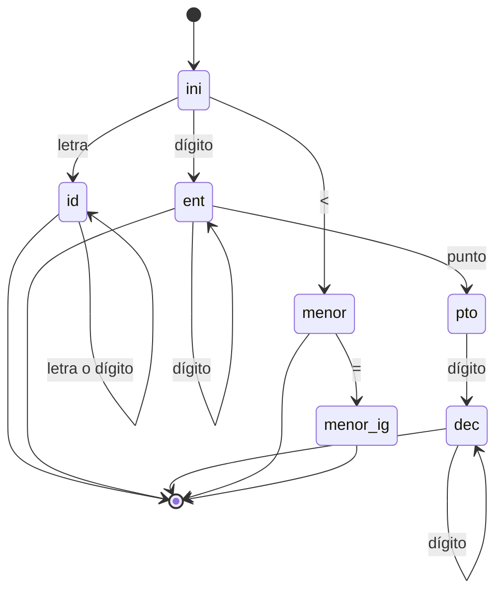
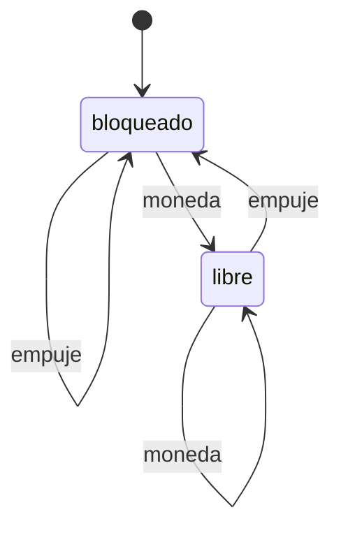

# Autómatas y Lenguajes Formales - Máquinas con un número finito de estados y lenguajes tipo 3

## 2.2 Aplicaciones e instrumentación.

---

Los autómatas finitos son el modelo teórico con más aplicaciones directas en la práctica. Un sistema cuyo comportamiento depende solo de un número finito de situaciones posibles es, en el fondo, una máquina de estados, y describirlo así permite implementarlo de forma sistemática, probarlo con exhaustividad y razonar sobre él. Este tema presenta las aplicaciones principales y, sobre todo, cómo se **instrumentan**: cómo se convierte un autómata en código eficiente.

### Formas de implementar un autómata

Hay tres formas habituales de convertir un AFD en un programa:

| Forma | Idea | Ventajas | Desventajas |
| --- | --- | --- | --- |
| Tabla de transición | Un arreglo `delta[estado][símbolo]` y un ciclo que lo consulta | Genérica; la genera una herramienta; cambiar el autómata no cambia el código | La tabla puede ser grande; los estados pierden su nombre |
| Código directo | Una etiqueta o un `case` por estado, con saltos | Muy rápida; legible para autómatas pequeños | Difícil de modificar a mano |
| Patrón de diseño State | Una clase por estado con un método por evento | Natural en programas orientados a objetos; cada estado encapsula su comportamiento | Más código; menos eficiente |

En todos los casos, el costo de procesar una entrada de longitud $n$ es $O(n):$ un acceso a la tabla por símbolo, sin retroceder nunca. Esa garantía es la razón por la que se prefieren los autómatas para procesar grandes volúmenes de texto o de eventos.

### Aplicación 1: análisis léxico

La primera fase de un compilador, el **analizador léxico**, convierte la secuencia de caracteres del programa en una secuencia de **tokens**: palabras reservadas, identificadores, números, operadores. Cada clase de token se describe con una expresión regular, y el conjunto de todas se compila a un único AFD. Herramientas como `lex`, `flex` o los generadores integrados en ANTLR hacen esa compilación automáticamente.

Dos reglas resuelven los conflictos:

- **Prefijo más largo** (*maximal munch*): de todas las formas de cortar el siguiente token, se toma la más larga. Así, `<=` es un solo token y no `<` seguido de `=`, y `x1` es un identificador y no `x` seguido de `1`. Para implementarla, el autómata avanza mientras pueda, recordando la **última posición en que estuvo en un estado de aceptación**, y al atascarse retrocede hasta ella.
- **Prioridad**: si el mismo lexema corresponde a dos clases, gana la que se declaró primero. Así `if` es palabra reservada y no identificador. En la práctica, las palabras reservadas se reconocen como identificadores y después se buscan en una tabla.



El estado `pto` no es de aceptación: `3.` no es un número válido en este lenguaje. Con la entrada `3.y`, el autómata llega a `pto`, no puede seguir con `y` y retrocede a la última aceptación, después del `3`; entonces el siguiente token empieza en el punto, que no inicia ningún token, y se reporta un error léxico.

### Aplicación 2: búsqueda de patrones

Buscar todas las apariciones de un patrón $p$ de longitud $m$ en un texto de longitud $n$ ingenuamente cuesta $O(nm).$ El algoritmo de **Knuth-Morris-Pratt** construye primero un AFD con $m + 1$ estados que acepta $\Sigma^*p,$ las cadenas que terminan en $p,$ y luego recorre el texto una sola vez, en tiempo $O(n).$

El estado $q$ significa: los últimos $q$ símbolos leídos son el prefijo $p_1 \cdots p_q$ del patrón, y no hay un prefijo más largo con esa propiedad. La transición es

$$ \delta(q, a) = \text{la longitud del prefijo más largo de } p \text{ que es sufijo de } p_1 \cdots p_q a $$

Si $a = p_{q+1},$ se avanza a $q + 1;$ si no, el autómata no vuelve a 0 sin más, sino al prefijo más largo que todavía puede servir. Para $p = ababa$ y $\Sigma = \{a, b\}:$

| $q$ | 0 | 1 | 2 | 3 | 4 | 5 |
| --- | --- | --- | --- | --- | --- | --- |
| $\delta(q, a)$ | 1 | 1 | 3 | 1 | 5 | 1 |
| $\delta(q, b)$ | 0 | 2 | 0 | 4 | 0 | 4 |

Desde el estado 5, una aparición completa, al leer $b$ se pasa a 4 y no a 0: el final $abab$ del texto leído es el inicio de una posible siguiente aparición. Por eso el algoritmo encuentra también apariciones que se **traslapan**.

Las herramientas como `grep` generalizan esta idea a expresiones regulares completas, compilándolas a autómatas (tema 1.3).

### Aplicación 3: protocolos y sistemas reactivos

Un **sistema reactivo** responde a eventos: un torniquete, un semáforo, un elevador, la interfaz de un cajero, una conexión de red. Su especificación natural es una máquina de estados. Por ejemplo, un torniquete tiene dos estados, `bloqueado` y `libre`; una moneda lo libera y el paso de una persona lo vuelve a bloquear; una moneda en `libre` no cambia nada.



Los protocolos de comunicación se especifican así. TCP, por ejemplo, define los estados de una conexión (`LISTEN`, `SYN-SENT`, `ESTABLISHED`, `FIN-WAIT`, `TIME-WAIT` y otros) y qué mensajes provocan cada transición. Tener la especificación como autómata permite **verificar** propiedades revisando todos los estados: que no haya estados sin salida, que todo mensaje esté contemplado en todo estado o que nunca se llegue a una combinación prohibida.

### Otras aplicaciones

- **Validación de formatos** de entrada: fechas, códigos postales, direcciones IP, identificadores fiscales.
- **Procesamiento de lenguaje natural**: los **transductores finitos** (tema 2.5) implementan análisis morfológico, por ejemplo para obtener la raíz de una palabra conjugada.
- **Circuitos digitales**: un circuito secuencial síncrono es un autómata cuyo estado son los valores de sus flip-flops (tema 4.3 de Organización y Arquitectura de Computadoras).
- **Videojuegos y robótica**: el comportamiento de los personajes se modela con máquinas de estados (patrullar, perseguir, huir).
- **Bioinformática**: búsqueda de motivos en secuencias de ADN con autómatas sobre el alfabeto $\{A, C, G, T\}.$

### Implementación en Python

El programa implementa un analizador léxico dirigido por tabla con la regla del prefijo más largo y el autómata de Knuth-Morris-Pratt, comparando sus resultados con una búsqueda ingenua.

```python
# ---------- 1. Analizador léxico dirigido por tabla, con la regla del prefijo más largo ----------
def clase(c):
    if c.isalpha() or c == '_':
        return 'letra'
    if c.isdigit():
        return 'digito'
    return c

# Transiciones del AFD de los tokens: (estado, clase de carácter) -> estado
DELTA = {
    ('ini', 'letra'): 'id',   ('id', 'letra'): 'id',   ('id', 'digito'): 'id',
    ('ini', 'digito'): 'ent', ('ent', 'digito'): 'ent', ('ent', '.'): 'pto',
    ('pto', 'digito'): 'dec', ('dec', 'digito'): 'dec',
    ('ini', '<'): 'menor',    ('menor', '='): 'menor_ig',
    ('ini', '='): 'asig',     ('asig', '='): 'igual',
    ('ini', '+'): 'mas',      ('ini', ' '): 'esp',      ('esp', ' '): 'esp',
}
# Estados de aceptación y el token que reconocen ('pto' no acepta: "3." no es un número)
TOKEN = {'id': 'ID', 'ent': 'ENTERO', 'dec': 'DECIMAL', 'menor': 'MENOR',
         'menor_ig': 'MENOR_IGUAL', 'asig': 'ASIGNA', 'igual': 'IGUAL', 'mas': 'MAS', 'esp': None}
RESERVADAS = {'if', 'while'}

def tokenizar(texto):
    pos, salida = 0, []
    while pos < len(texto):
        estado, i, ultimo = 'ini', pos, None
        # Avanza mientras haya transición, recordando el último estado de aceptación
        while i < len(texto) and (estado, clase(texto[i])) in DELTA:
            estado = DELTA[(estado, clase(texto[i]))]
            i += 1
            if estado in TOKEN:
                ultimo = (estado, i)
        if ultimo is None:
            raise ValueError(f"carácter inesperado en la posición {pos}: {texto[pos]!r}")
        estado, fin = ultimo
        lexema = texto[pos:fin]
        tipo = TOKEN[estado]
        if tipo == 'ID' and lexema in RESERVADAS:
            tipo = lexema.upper()
        if tipo:                              # los espacios se descartan
            salida.append((tipo, lexema))
        pos = fin                             # retrocede hasta el último punto de aceptación
    return salida

print(tokenizar("if x1 <= 3.14 == y"))
print(tokenizar("while n<10 = n+1"))
try:
    tokenizar("x = 3.y")
except ValueError as e:
    print("error:", e)

# ---------- 2. Autómata de búsqueda de un patrón (Knuth-Morris-Pratt) ----------
def automata_patron(p, alfabeto):
    """δ(q, a) = longitud del prefijo más largo de p que es sufijo de p[:q] + a."""
    m = len(p)
    delta = [{a: 0 for a in alfabeto} for _ in range(m + 1)]
    delta[0][p[0]] = 1
    x = 0                                   # estado de reinicio: el autómata sobre p[1:q]
    for q in range(1, m + 1):
        for a in alfabeto:
            delta[q][a] = delta[x][a]
        if q < m:
            delta[q][p[q]] = q + 1
            x = delta[x][p[q]]
    return delta

def buscar(p, texto, alfabeto):
    delta, q, posiciones = automata_patron(p, alfabeto), 0, []
    for i, c in enumerate(texto):
        q = delta[q][c]
        if q == len(p):
            posiciones.append(i - len(p) + 1)
    return posiciones

texto = "abababcababaabababab"
print(buscar("ababa", texto, "abc"))
print([i for i in range(len(texto)) if texto.startswith("ababa", i)])
```

Salida:

```text
[('IF', 'if'), ('ID', 'x1'), ('MENOR_IGUAL', '<='), ('DECIMAL', '3.14'), ('IGUAL', '=='), ('ID', 'y')]
[('WHILE', 'while'), ('ID', 'n'), ('MENOR', '<'), ('ENTERO', '10'), ('ASIGNA', '='), ('ID', 'n'), ('MAS', '+'), ('ENTERO', '1')]
error: carácter inesperado en la posición 5: '.'
[0, 7, 12, 14]
[0, 7, 12, 14]
```

En el texto, $ababa$ aparece en las posiciones 12 y 14, que se traslapan, y el autómata las encuentra ambas.

### Ejercicios Propuestos

1. **Analizador léxico.** Extiende el autómata del analizador para reconocer los operadores `>`, `>=` y `!=`, y comentarios que empiezan con `#` y terminan al final de la línea.

2. **Prefijo más largo.** Con el autómata del programa, ¿cómo se divide en tokens la entrada `x<==3`? ¿Y la entrada `12.5.3`?

3. **Búsqueda de patrones.** Construye la tabla del autómata de Knuth-Morris-Pratt para el patrón $aab$ sobre $\{a, b\}$ y simúlalo con el texto $aaab.$

4. **Sistemas reactivos.** Diseña la máquina de estados de una puerta automática con eventos `persona_cerca`, `sin_persona`, `abierta_del_todo`, `cerrada_del_todo` y estados `cerrada`, `abriendo`, `abierta`, `cerrando`. ¿Qué debe pasar si llega `persona_cerca` mientras se está cerrando?

5. **Validación.** Diseña un AFD que acepte las direcciones IPv4 escritas como cuatro números de 0 a 255 separados por puntos, sin ceros a la izquierda. ¿Cuántos estados necesitas, aproximadamente, para cada octeto?

### Soluciones

**Ejercicio 1.** Se agregan las transiciones $\text{ini} \xrightarrow{>} \text{mayor},$ $\text{mayor} \xrightarrow{=} \text{mayor\_ig},$ $\text{ini} \xrightarrow{!} \text{exc},$ $\text{exc} \xrightarrow{=} \text{distinto},$ con `mayor`, `mayor_ig` y `distinto` de aceptación y `exc` no, porque `!` solo no es un token. Para los comentarios, $\text{ini} \xrightarrow{\#} \text{com}$ y $\text{com}$ va a sí mismo con todo carácter salvo el salto de línea; `com` es de aceptación con un token que se descarta, como los espacios.

**Ejercicio 2.** `x<==3` da `ID x`, `MENOR_IGUAL <=`, `ASIGNA =`, `ENTERO 3`: el prefijo más largo después de `x` es `<=`, no `<`. `12.5.3` da `DECIMAL 12.5` y luego, al empezar en el segundo punto, un error léxico.

**Ejercicio 3.** La tabla es $\delta(0, a) = 1,$ $\delta(0, b) = 0,$ $\delta(1, a) = 2,$ $\delta(1, b) = 0,$ $\delta(2, a) = 2,$ $\delta(2, b) = 3,$ $\delta(3, a) = 1,$ $\delta(3, b) = 0.$ La transición $\delta(2, a) = 2$ es la interesante: después de $aa,$ otra $a$ deja como sufijo útil $aa,$ que sigue siendo el prefijo de longitud 2. Con el texto $aaab$ el autómata recorre $0, 1, 2, 2, 3$ y reporta una aparición que empieza en la posición 1.

**Ejercicio 4.** `cerrada` pasa a `abriendo` con `persona_cerca`; `abriendo` pasa a `abierta` con `abierta_del_todo`; `abierta` pasa a `cerrando` con `sin_persona`; `cerrando` pasa a `cerrada` con `cerrada_del_todo`. Si llega `persona_cerca` en `cerrando`, por seguridad la puerta debe volver a `abriendo`. Los eventos que no tienen sentido en un estado, como `abierta_del_todo` en `cerrada`, dejan el estado igual.

**Ejercicio 5.** Un octeto de 0 a 255 sin ceros a la izquierda se reconoce por casos según su primer dígito: un 0 solo; un 1 seguido de hasta dos dígitos cualesquiera; un 2 seguido de un dígito de 0 a 4 y otro cualquiera, o de un 5 y otro de 0 a 5, o de un 6 a 9 y nada más; un 3 a 9 seguido de a lo más un dígito. Son alrededor de 8 a 10 estados por octeto, y el autómata completo encadena cuatro copias con transiciones por el punto, más un sumidero. Por eso estas validaciones se escriben con expresiones regulares y se dejan compilar a la herramienta.

### Referencias

1. Aho, A. V., Lam, M., Sethi, R., and Ullman, J. D., _Compilers: Principles, Techniques, and Tools_. Pearson, 2006. Capítulo 3.
2. Cormen, T. H., Leiserson, C. E., Rivest, R. L., and Stein, C., _Introduction to Algorithms_. MIT Press, 2009. Capítulo 32.
3. Cooper, K. D. and Torczon, L., _Engineering a Compiler_. Morgan Kaufmann, 2011. Capítulo 2.
4. Knuth, D. E., Morris, J. H., and Pratt, V. R. (1977). Fast pattern matching in strings. _SIAM Journal on Computing_, 6(2), 323-350.
5. Postel, J. (1981). _RFC 793: Transmission Control Protocol_. IETF.

### Para profundizar

- Revisa cómo se especifica un analizador léxico en `flex` y qué código genera.
- Investiga el algoritmo de **Aho-Corasick**, que generaliza el de Knuth-Morris-Pratt para buscar muchos patrones a la vez con un solo autómata.
- Estudia los **statecharts** de Harel, la extensión de las máquinas de estados con jerarquía y concurrencia que usa UML.
