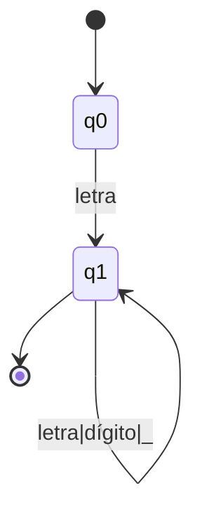

# Autómatas y Lenguajes Formales - Máquinas con un número finito de estados y lenguajes tipo 3

## 2.2 Aplicaciones e instrumentación.

---

Las máquinas con número finito de estados (autómatas finitos) y los lenguajes tipo 3 (lenguajes regulares) tienen numerosas aplicaciones prácticas en informática, especialmente en el procesamiento de lenguajes, compiladores, procesamiento de texto y verificación de sistemas.

### Aplicaciones Prácticas

#### 1. Análisis Léxico en Compiladores

Los autómatas finitos son fundamentales en la fase de análisis léxico de los compiladores, donde se reconocen los tokens (palabras clave, identificadores, números, etc.) del lenguaje de programación.

**Ejemplo:** Autómata para reconocer identificadores en un lenguaje de programación:



Donde:

- $q_0:$ estado inicial
- $q_1:$ estado de aceptación
- Transición: letra → cualquier letra del alfabeto
- Transición: dígito → cualquier dígito del 0-9

#### 2. Expresiones Regulares en Búsqueda de Texto

Las expresiones regulares, que equivalen a lenguajes regulares, se utilizan ampliamente en herramientas de búsqueda y procesamiento de texto como grep, sed, y en lenguajes de programación.

**Fórmula:** Expresión regular para direcciones de email simples:

```
[a-zA-Z0-9._%+-]+@[a-zA-Z0-9.-]+\.[a-zA-Z]{2,}
```

#### 3. Verificación de Formatos

Los autómatas finitos pueden verificar formatos específicos como números de teléfono, direcciones IP, códigos postales, etc.

**Ejemplo:** Autómata para verificar números de teléfono en formato (XXX) XXX-XXXX:


#### 4. Protocolos de Comunicación

En redes de computadoras, los autómatas finitos modelan protocolos de comunicación donde los dispositivos cambian entre estados definidos.

#### 5. Procesamiento de Lenguaje Natural

Para tareas simples de PLN como segmentación de palabras o reconocimiento de patrones básicos.

### Instrumentación y Implementación

#### Implementación de un Autómata Finito Determinista (AFD)

**Código en Python para un AFD genérico:**

```python
class AFD:
    def __init__(self, estados, alfabeto, transiciones, estado_inicial, estados_aceptacion):
        self.estados = estados
        self.alfabeto = alfabeto
        self.transiciones = transiciones  # Diccionario: (estado, símbolo) -> estado
        self.estado_actual = estado_inicial
        self.estado_inicial = estado_inicial
        self.estados_aceptacion = estados_aceptacion

    def reiniciar(self):
        self.estado_actual = self.estado_inicial

    def procesar_simbolo(self, simbolo):
        if simbolo not in self.alfabeto:
            raise ValueError(f"Símbolo {simbolo} no pertenece al alfabeto")

        clave = (self.estado_actual, simbolo)
        if clave not in self.transiciones:
            return False

        self.estado_actual = self.transiciones[clave]
        return True

    def procesar_cadena(self, cadena):
        self.reiniciar()
        for simbolo in cadena:
            if not self.procesar_simbolo(simbolo):
                return False
        return self.estado_actual in self.estados_aceptacion

# Ejemplo de uso: AFD para cadenas con número par de 0s y par de 1s
estados = {'q0', 'q1', 'q2', 'q3'}
alfabeto = {'0', '1'}
transiciones = {
    ('q0', '0'): 'q2',
    ('q0', '1'): 'q1',
    ('q1', '0'): 'q3',
    ('q1', '1'): 'q0',
    ('q2', '0'): 'q0',
    ('q2', '1'): 'q3',
    ('q3', '0'): 'q1',
    ('q3', '1'): 'q2'
}
estado_inicial = 'q0'
estados_aceptacion = {'q0'}

afd = AFD(estados, alfabeto, transiciones, estado_inicial, estados_aceptacion)

# Probar cadenas
test_cases = ["", "00", "11", "0101", "0011", "010101"]
for cadena in test_cases:
    resultado = afd.procesar_cadena(cadena)
    print(f"Cadena '{cadena}': {'Aceptada' if resultado else 'Rechazada'}")
```

#### Implementación de Expresiones Regulares

**Conversión de expresión regular a AFN usando el algoritmo de Thompson:**

El algoritmo de Thompson construye un AFN-ε a partir de una expresión regular mediante la composición de autómatas básicos.

```python
class Estado:
    contador = 0

    def __init__(self):
        self.id = Estado.contador
        Estado.contador += 1
        self.transiciones = {}  # Símbolo -> conjunto de estados

class AFN:
    def __init__(self, inicio, aceptacion):
        self.inicio = inicio
        self.aceptacion = aceptacion

    def basic(simbolo):
        inicio = Estado()
        aceptacion = Estado()
        inicio.transiciones[simbolo] = {aceptacion}
        return AFN(inicio, aceptacion)

    def union(afn1, afn2):
        inicio = Estado()
        aceptacion = Estado()
        inicio.transiciones['ε'] = {afn1.inicio, afn2.inicio}
        afn1.aceptacion.transiciones['ε'] = {aceptacion}
        afn2.aceptacion.transiciones['ε'] = {aceptacion}
        return AFN(inicio, aceptacion)

    def concatenacion(afn1, afn2):
        afn1.aceptacion.transiciones['ε'] = {afn2.inicio}
        return AFN(afn1.inicio, afn2.aceptacion)

    def clausura(afn):
        inicio = Estado()
        aceptacion = Estado()
        inicio.transiciones['ε'] = {afn.inicio, aceptacion}
        afn.aceptacion.transiciones['ε'] = {afn.inicio, aceptacion}
        return AFN(inicio, aceptacion)
```

#### Minimización de AFD usando el algoritmo de particiones

**Algoritmo de minimización de Hopcroft:**

$$ P = \set{F, Q \setminus F} $$

$$ \text{repeat} $$

$$ \quad P_{\text{new}} = P $$

$$ \quad \text{for each grupo } G \in P $$

$$ \quad\quad \text{for each símbolo } a \in \Sigma $$

$$ \quad\quad\quad \text{dividir } G \text{ en subgrupos por transiciones con } a $$

$$ \quad\quad\quad \text{reemplazar } G \text{ por las divisiones en } P $$

$$ \text{until } P == P_{\text{new}} $$

### Ejercicios Propuestos

1. **Implementación de AFD:** Codifica en tu lenguaje preferido un AFD que reconozca direcciones IPv4 válidas.

2. **Conversión de ER a AFN:** Utiliza el algoritmo de Thompson para convertir la expresión regular `(a|b)*abb` a un AFN-ε.

3. **Minimización de AFD:** Dado el siguiente AFD, aplique el algoritmo de minimización:
   - Estados: {A, B, C, D, E, F}
   - Alfabeto: {0, 1}
   - Estado inicial: A
   - Estados de aceptación: {C, D, E}
   - Transiciones:
     - (A,0)=B, (A,1)=C
     - (B,0)=A, (B,1)=D
     - (C,0)=B, (C,1)=C
     - (D,0)=E, (D,1)=F
     - (E,0)=E, (E,1)=F
     - (F,0)=F, (F,1)=F

4. **Aplicación práctica:** Diseña e implementa un autómata finito que valide formatos de matrículas de automóviles de tu país.

5. **Análisis de rendimiento:** Compare el rendimiento de la implementación de un AFD versus el uso de expresiones regulares en tu lenguaje de programación preferido para validar direcciones de correo electrónico.

### Referencias

1. Aho, A. V., Lam, M., Sethi, S. R. & Ullman, J. D. (2007). _Compilers: Principles, Techniques, & Tools_. Pearson Addison-Wesley. (Capítulo 3: Análisis léxico)

2. Cooper, K. D. & Torczon, L. (2004). _Engineering a Compiler_. Morgan Kaufman Publishers. (Sección 2.3: Expresiones regulares y autómatas finitos)

3. Hopcroft, J. E., Motwani, R. & Ullman, J. (2007). _Introduction to Automata Theory, Languages, and Computation_. Addison-Wesley. (Capítulo 3: Expresiones regulares y lenguajes regulares)

4. Rich, E. (2008). _Automata, Computability and Complexity, Theory and Applications_. Pearson Prentice Hall. (Capítulo 6: Aplicaciones de autómatas finitos)

5. Viso G., E. (2008). _Introducción a la teoría de la computación_. Las Prensas de Ciencias. (Capítulo 4: Aplicaciones de los lenguajes regulares)

### Conclusión

Las máquinas con número finito de estados y los lenguajes regulares tienen aplicaciones fundamentales en la informática práctica, desde la implementación de compiladores hasta el procesamiento de texto y la verificación de formatos. Su estudio no solo es teóricamente importante sino también esencial para el desarrollo de software eficiente y robusto.
