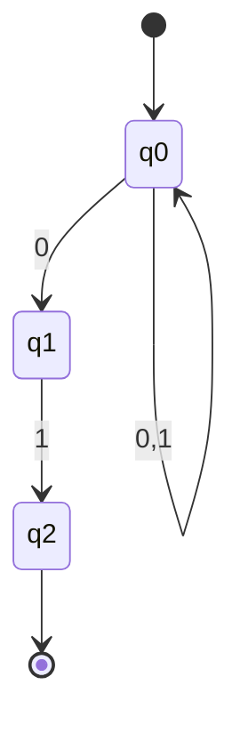
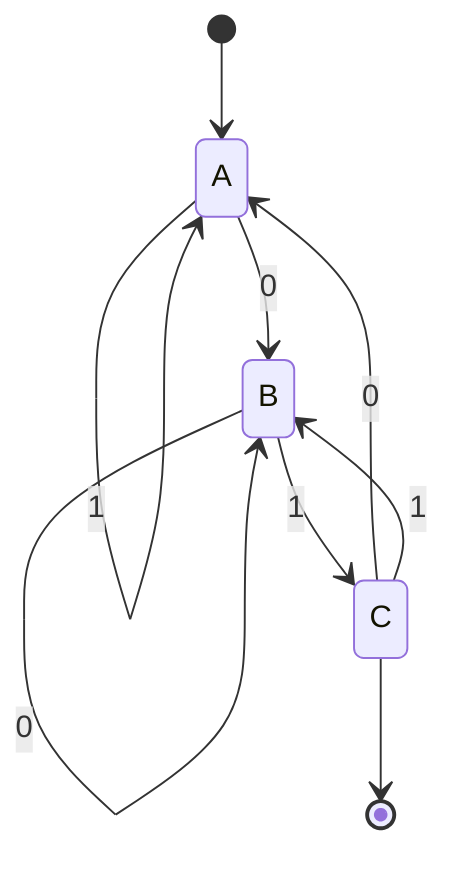
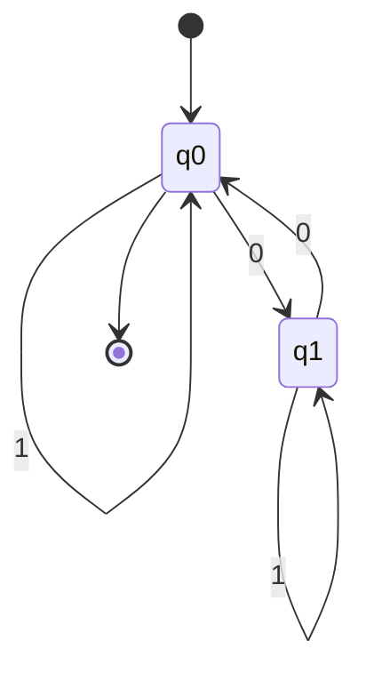

# Autómatas y Lenguajes Formales - Máquinas con un número finito de estados y lenguajes tipo 3

## 2.3 Equivalencia.

---

En el estudio de autómatas finitos y lenguajes regulares, el concepto de **equivalencia** es fundamental. Dos autómatas son equivalentes si reconocen exactamente el mismo lenguaje, y diferentes formalismos (AFD, AFN, AFN-ε, expresiones regulares) pueden ser equivalentes en poder expresivo.

### Equivalencia entre Autómatas

#### Definición Formal

Dos autómatas $M_1$ y $M_2$ son equivalentes si aceptan el mismo lenguaje:

$$L(M_1) = L(M_2)$$

#### Equivalencia entre AFD y AFN

**Teorema:** Para todo autómata finito no determinista (AFN), existe un autómata finito determinista (AFD) equivalente.

**Algoritmo de construcción de subconjuntos:**
Dado un AFN $N = (Q, \Sigma, \delta, q_0, F),$ construimos un AFD $D = (Q', \Sigma, \delta', q_0', F')$ donde:

- $Q' \subseteq 2^Q$ (todos los subconjuntos de estados de N)
- $q_0' = ECLOSURA(q_0)$
- $F' = \{S \in Q' \mid S \cap F \neq \emptyset\}$
- $\delta'(S, a) = ECLOSURA(\bigcup_{q \in S} \delta(q, a))$

**Ejemplo:** Conversión de AFN a AFD

AFN que acepta cadenas que terminan en "01":



AFD equivalente mediante construcción de subconjuntos:



Donde:

- A = {q0}
- B = {q0, q1}
- C = {q0, q2}

#### Equivalencia entre AFN y AFN-ε

**Teorema:** Para todo autómata finito no determinista con transiciones ε (AFN-ε), existe un AFN equivalente sin transiciones ε.

**Algoritmo de eliminación de ε-transiciones:**

1. Calcular la ε-clausura para cada estado
2. Redefinir la función de transición sin ε-transiciones
3. Los estados finales incluyen todos los estados cuya ε-clausura contiene un estado final

### Equivalencia entre Autómatas y Expresiones Regulares

#### Teorema de Kleene

**Teorema:** Un lenguaje es regular si y sólo si es aceptado por algún autómata finito.

**Algoritmo de conversión de AFN a expresión regular:**
Método de eliminación de estados (Algoritmo de estado generalizado)

Para un AFN con estados $q_0, q_1, ..., q_n:$

1. Crear un autómata generalizado con aristas etiquetadas con expresiones regulares
2. Eliminar estados uno por uno, actualizando las transiciones
3. La expresión regular resultante es la unión de todas las transiciones del estado inicial al final

**Ejemplo:** Conversión de AFD a expresión regular

AFD que acepta cadenas con un número par de 0's:



Ecuaciones:

- $ R_0 = 1R_0 + 0R_1 + \varepsilon $
- $ R_1 = 1R_1 + 0R_0$

Resolviendo:

$ R_1 = 1^*0R_0 $
$ R_0 = 1R_0 + 01^*0R_0 + \varepsilon = (1 + 01 ^ * 0 ) R_0 + \varepsilon $

Aplicando el lema de Arden:

$ R_0 = \lparen 1 + 01 ^ * 0 \rparen ^ * $

### Minimización de Autómatas Finitos

#### Algoritmo de Minimización

Dos estados $p$ y $q$ son equivalentes $(p ≡ q)$ si para toda cadena $w:$

$$\hat{\delta}(p, w) \in F \iff \hat{\delta}(q, w) \in F$$

**Algoritmo de partición (Algoritmo de Moore):**

1. Crear partición inicial: $P = \{F, Q-F\}$
2. Refinar iterativamente la partición:
   Para cada grupo $G$ en $P$ y cada símbolo $a:$
   - Dividir $G$ en subgrupos donde los estados tengan transiciones al mismo grupo con $a$
3. Repetir hasta que no haya cambios

**Implementación en Python:**

```python
def minimizar_afd(estados, alfabeto, transiciones, estado_inicial, estados_aceptacion):
    # Partición inicial
    particion = [set(estados_aceptacion), set(estados) - set(estados_aceptacion)]

    cambiado = True
    while cambiado:
        cambiado = False
        nueva_particion = []

        for grupo in particion:
            if len(grupo) <= 1:
                nueva_particion.append(grupo)
                continue

            # Encontrar estados distinguibles
            representantes = {}
            for estado in grupo:
                clave = tuple()
                for simbolo in alfabeto:
                    destino = transiciones.get((estado, simbolo), None)
                    # Encontrar a qué grupo pertenece el destino
                    for i, g in enumerate(particion):
                        if destino in g:
                            clave += (i,)
                            break

                if clave not in representantes:
                    representantes[clave] = []
                representantes[clave].append(estado)

            # Agregar nuevos grupos
            for subgrupo in representantes.values():
                nueva_particion.append(set(subgrupo))
                if len(subgrupo) < len(grupo):
                    cambiado = True

        particion = nueva_particion

    # Construir AFD minimizado
    nuevo_estado_a_grupo = {}
    nuevos_estados = []
    nuevas_transiciones = {}
    nuevo_inicial = None
    nuevos_aceptacion = []

    for i, grupo in enumerate(particion):
        nombre_estado = f"q{i}"
        nuevos_estados.append(nombre_estado)
        for estado in grupo:
            nuevo_estado_a_grupo[estado] = nombre_estado
            if estado == estado_inicial:
                nuevo_inicial = nombre_estado
            if estado in estados_aceptacion and nombre_estado not in nuevos_aceptacion:
                nuevos_aceptacion.append(nombre_estado)

    # Construir nuevas transiciones
    for (estado, simbolo), destino in transiciones.items():
        origen_grupo = nuevo_estado_a_grupo[estado]
        destino_grupo = nuevo_estado_a_grupo[destino]
        nuevas_transiciones[(origen_grupo, simbolo)] = destino_grupo

    return nuevos_estados, alfabeto, nuevas_transiciones, nuevo_inicial, nuevos_aceptacion
```

### Equivalencia entre Expresiones Regulares

#### Principios de Equivalencia

Dos expresiones regulares $R$ y $S$ son equivalentes $(R ≡ S)$ si describen el mismo lenguaje:

$$L(R) = L(S)$$

**Leyes algebraicas de expresiones regulares:**

1. Asociatividad: $(R + S) + T ≡ R + (S + T),$ $(RS)T ≡ R(ST)$
2. Conmutatividad: $R + S ≡ S + R$
3. Distributividad: $R(S + T) ≡ RS + RT,$ $(S + T)R ≡ SR + TR$
4. Identidad: $R + \emptyset ≡ R,$ $Rε ≡ R,$ $R\emptyset ≡ \emptyset$
5. Idempotencia: $R + R ≡ R$
6. Clausura: $( R ^ * ) ^ * ≡ R ^ * ,$ $ \emptyset ^ * ≡ ε ,$ $ ε ^ * ≡ ε $

### Ejercicios Propuestos

1. **Conversión AFN a AFD:** Dado el siguiente AFN, construye el AFD equivalente usando el algoritmo de construcción de subconjuntos:
   - Estados: {q0, q1, q2}
   - Alfabeto: {a, b}
   - Estado inicial: q0
   - Estados de aceptación: {q2}
   - Transiciones:
     - δ(q0, a) = {q0, q1}
     - δ(q0, b) = {q0}
     - δ(q1, b) = {q2}

2. **Eliminación de ε-transiciones:** Dado el siguiente AFN-ε, elimina las ε-transiciones:
   - Estados: {q0, q1, q2}
   - Alfabeto: {a, b}
   - Estado inicial: q0
   - Estados de aceptación: {q2}
   - Transiciones:
     - δ(q0, ε) = {q1}
     - δ(q0, a) = {q0}
     - δ(q1, b) = {q1, q2}
     - δ(q2, a) = {q2}

3. **Minimización de AFD:** Minimiza el siguiente AFD:
   - Estados: {A, B, C, D, E}
   - Alfabeto: {0, 1}
   - Estado inicial: A
   - Estados de aceptación: {C, D, E}
   - Transiciones:
     - δ(A, 0) = B, δ(A, 1) = C
     - δ(B, 0) = A, δ(B, 1) = D
     - δ(C, 0) = E, δ(C, 1) = C
     - δ(D, 0) = E, δ(D, 1) = D
     - δ(E, 0) = E, δ(E, 1) = E

4. **Equivalencia de expresiones regulares:** Demuestra que las siguientes expresiones regulares son equivalentes:
   - $ ( a + b ) ^ * $
   - $ ( a ^ * b ^ * ) ^ * $
   - $ a ^ * ( ba ^ * ) ^ * $

5. **Implementación:** Escribe un programa en Python que determine si dos AFD son equivalentes usando el algoritmo de minimización.

### Referencias

1. Hopcroft, J. E., Motwani, R. & Ullman, J. (2007). _Introduction to Automata Theory, Languages, and Computation_. Addison-Wesley. (Capítulos 2-4)

2. Sipser, M. (2005). _Introduction to the Theory of Computation_. PWS Publishing Company. (Capítulo 1)

3. Kozen, D. C. (1997). _Automata and Computability_. Springer-Verlag. (Capítulos 4-6)

4. Viso G., E. (2008). _Introducción a la teoría de la computación_. Las Prensas de Ciencias. (Capítulo 3)

5. Rich, E. (2008). _Automata, Computability and Complexity, Theory and Applications_. Pearson Prentice Hall. (Capítulos 5-6)
