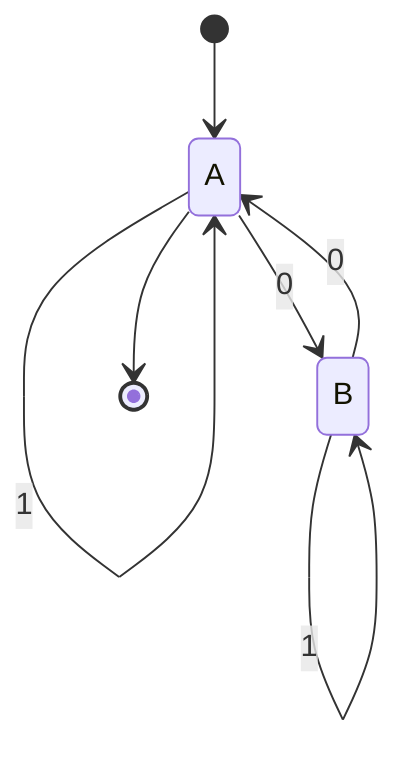

# Autómatas y Lenguajes Formales - Máquinas con un número finito de estados y lenguajes tipo 3

## 2.4 Minimización.

---

La **minimización** de autómatas finitos es el proceso de encontrar el autómata finito determinista (AFD) con el menor número posible de estados que sea equivalente a un AFD dado. Este proceso es fundamental para optimizar el uso de recursos computacionales.

#### Definición Formal

Dado un AFD $M = (Q, \Sigma, \delta, q_0, F)$, queremos encontrar un AFD $M' = (Q', \Sigma, \delta', q_0', F')$ tal que:

1. $L(M) = L(M')$ (equivalencia)
2. Para cualquier otro AFD $M''$ equivalente a $M$, $|Q'| \leq |Q''|$ (minimalidad)

### Equivalencia de Estados

#### Concepto Fundamental

Dos estados $p$ y $q$ son **equivalentes** $(p \equiv q)$ si para toda cadena $w \in \Sigma^*$:

$$\hat{\delta}(p, w) \in F \iff \hat{\delta}(q, w) \in F$$

Es decir, desde ambos estados se aceptan exactamente las mismas cadenas.

#### Algoritmo de Minimización por Partición

El algoritmo más común para minimizar AFD es el **algoritmo de partición** (también conocido como algoritmo de Moore).

##### Descripción del Algoritmo

1. **Partición inicial**:

   $$P_0 = \{F, Q \setminus F\}$$

2. **Refinamiento iterativo**:
   Para cada grupo $G$ en la partición actual $P_i$ y para cada símbolo $a \in \Sigma$:
   - Dividir $G$ en subgrupos donde los estados tengan transiciones al mismo grupo con $a$

3. **Terminación**: El algoritmo termina cuando la partición no cambia en una iteración

##### Pseudocódigo

```
P = {F, Q-F}
cambiado = True

while cambiado:
    cambiado = False
    nueva_P = ∅

    for each grupo G in P:
        if |G| == 1:
            nueva_P = nueva_P ∪ {G}
        else:
            particionar G en subgrupos basados en transiciones
            if se crearon subgrupos:
                cambiado = True
            nueva_P = nueva_P ∪ {subgrupos}

    P = nueva_P
```

### Implementación del Algoritmo

#### Código en Python

```python
def minimizar_afd(estados, alfabeto, transiciones, estado_inicial, estados_aceptacion):
    # Crear partición inicial
    no_aceptacion = [q for q in estados if q not in estados_aceptacion]
    particion = [set(estados_aceptacion), set(no_aceptacion)]

    cambiado = True
    while cambiado:
        cambiado = False
        nueva_particion = []

        for grupo in particion:
            if len(grupo) == 0:
                continue

            if len(grupo) == 1:
                nueva_particion.append(grupo)
                continue

            # Encontrar representantes de equivalencia
            representantes = {}
            for estado in grupo:
                firma = tuple()
                for simbolo in alfabeto:
                    destino = transiciones.get((estado, simbolo))
                    # Encontrar el índice del grupo que contiene el destino
                    for i, g in enumerate(particion):
                        if destino in g:
                            firma += (i,)
                            break

                if firma not in representantes:
                    representantes[firma] = set()
                representantes[firma].add(estado)

            # Agregar los nuevos subgrupos
            for subgrupo in representantes.values():
                nueva_particion.append(subgrupo)
                if len(subgrupo) < len(grupo):
                    cambiado = True

        particion = nueva_particion

    # Construir el AFD minimizado
    estado_a_grupo = {}
    nuevos_estados = []
    nuevas_transiciones = {}
    nuevo_inicial = None
    nuevos_aceptacion = []

    for i, grupo in enumerate(particion):
        nombre_estado = f"q{i}"
        nuevos_estados.append(nombre_estado)

        for estado in grupo:
            estado_a_grupo[estado] = nombre_estado
            if estado == estado_inicial:
                nuevo_inicial = nombre_estado
            if estado in estados_aceptacion and nombre_estado not in nuevos_aceptacion:
                nuevos_aceptacion.append(nombre_estado)

    # Construir nuevas transiciones
    for (estado, simbolo), destino in transiciones.items():
        origen_grupo = estado_a_grupo[estado]
        destino_grupo = estado_a_grupo[destino]
        nuevas_transiciones[(origen_grupo, simbolo)] = destino_grupo

    return nuevos_estados, alfabeto, nuevas_transiciones, nuevo_inicial, nuevos_aceptacion
```

### Ejemplo de Minimización

#### AFD Original

Consideremos un AFD que acepta cadenas con un número par de 0's:



- Estados: {A, B, C, D}
- Alfabeto: {0, 1}
- Estado inicial: A
- Estados de aceptación: {A}
- Transiciones:
  - δ(A, 0) = B, δ(A, 1) = A
  - δ(B, 0) = A, δ(B, 1) = B
  - δ(C, 0) = D, δ(C, 1) = C
  - δ(D, 0) = C, δ(D, 1) = D

#### Proceso de Minimización

1. **Partición inicial**: P₀ = {{A}, {B, C, D}}
   - Grupo 1: {A} (estados de aceptación)
   - Grupo 2: {B, C, D} (estados no de aceptación)

2. **Primera iteración**:
   - Para el grupo {B, C, D}:
     - Con símbolo 0: B→A (grupo 1), C→D (grupo 2), D→C (grupo 2)
     - Con símbolo 1: B→B (grupo 2), C→C (grupo 2), D→D (grupo 2)
   - Dividimos: {B} y {C, D}

3. **Nueva partición**: P₁ = {{A}, {B}, {C, D}}

4. **Segunda iteración**:
   - Para el grupo {C, D}:
     - Con símbolo 0: C→D (grupo 3), D→C (grupo 3)
     - Con símbolo 1: C→C (grupo 3), D→D (grupo 3)
   - No hay división posible

5. **Partición final**: P₂ = {{A}, {B}, {C, D}}

#### AFD Minimizado


- Estados: {A, B, CD}
- Alfabeto: {0, 1}
- Estado inicial: A
- Estados de aceptación: {A}
- Transiciones:
  - δ(A, 0) = B, δ(A, 1) = A
  - δ(B, 0) = A, δ(B, 1) = B
  - δ(CD, 0) = CD, δ(CD, 1) = CD

### Teorema de Myhill-Nerode

#### Relación con la Minimización

El **teorema de Myhill-Nerode** establece que:

1. Un lenguaje L es regular si y sólo si tiene un número finito de clases de equivalencia
2. El número mínimo de estados de un AFD que acepta L es igual al número de clases de equivalencia de L

#### Clases de Equivalencia

Dos cadenas x e y son equivalentes (x ≡ y) respecto a un lenguaje L si:

$$∀z ∈ Σ^*, xz ∈ L ⇔ yz ∈ L$$

### Aplicaciones de la Minimización

1. **Optimización de compiladores**: Minimización de autómatas para análisis léxico
2. **Verificación de hardware**: Reducción de modelos de estados finitos
3. **Procesamiento de texto**: Optimización de motores de búsqueda de patrones
4. **Redes de comunicación**: Optimización de protocolos de comunicación

### Ejercicios Propuestos

1. **Minimización manual**: Minimiza el siguiente AFD:
   - Estados: {1, 2, 3, 4, 5, 6}
   - Alfabeto: {a, b}
   - Estado inicial: 1
   - Estados de aceptación: {1, 3, 5}
   - Transiciones:
     - δ(1, a) = 2, δ(1, b) = 4
     - δ(2, a) = 5, δ(2, b) = 3
     - δ(3, a) = 2, δ(3, b) = 6
     - δ(4, a) = 1, δ(4, b) = 5
     - δ(5, a) = 5, δ(5, b) = 3
     - δ(6, a) = 3, δ(6, b) = 4

2. **Implementación**: Extiende el código Python para que maneje AFD con estados inalcanzables.

3. **Análisis**: Dado el lenguaje L = {w ∈ {0,1}* | w contiene la subcadena 010}, encuentra el número mínimo de estados necesarios para un AFD que reconozca L.

4. **Equivalencia**: Demuestra que los siguientes dos AFD son equivalentes y minimiza ambos:
   - AFD1: Estados {A,B,C}, A inicial, {C} final, δ(A,0)=B, δ(A,1)=A, δ(B,0)=C, δ(B,1)=A, δ(C,0)=C, δ(C,1)=C
   - AFD2: Estados {X,Y,Z}, X inicial, {Z} final, δ(X,0)=Y, δ(X,1)=X, δ(Y,0)=Z, δ(Y,1)=X, δ(Z,0)=Z, δ(Z,1)=Z

5. **Complejidad**: Analiza la complejidad computacional del algoritmo de minimización por partición.

### Referencias

1. Hopcroft, J. E., Motwani, R. & Ullman, J. (2007). _Introduction to Automata Theory, Languages, and Computation_. Addison-Wesley. (Capítulo 4: Minimización de AFD)

2. Sipser, M. (2005). _Introduction to the Theory of Computation_. PWS Publishing Company. (Sección 1.4: Equivalencia y minimización)

3. Kozen, D. C. (1997). _Automata and Computability_. Springer-Verlag. (Capítulo 16: Minimización de autómatas)

4. Viso G., E. (2008). _Introducción a la teoría de la computación_. Las Prensas de Ciencias. (Capítulo 3: Minimización de autómatas finitos)

5. Rich, E. (2008). _Automata, Computability and Complexity, Theory and Applications_. Pearson Prentice Hall. (Capítulo 7: Optimización de autómatas finitos)
