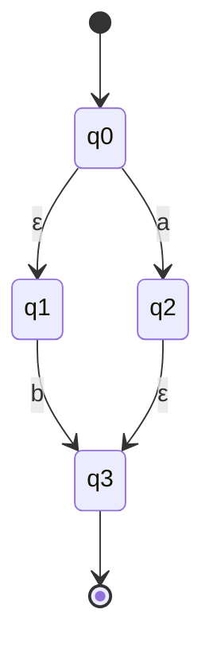
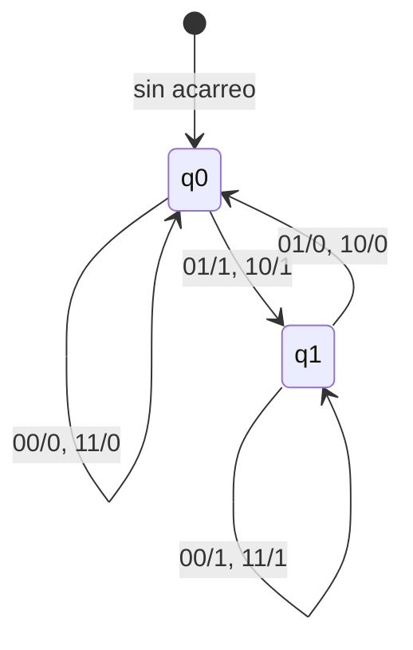

# Autómatas y Lenguajes Formales - Máquinas con un número finito de estados y lenguajes tipo 3
## 2.5 Modelos alternativos.

---

Aunque los autómatas finitos deterministas (AFD) y no deterministas (AFN) son los modelos más comunes para representar lenguajes regulares, existen varios **modelos alternativos** que son equivalentes en poder expresivo pero ofrecen diferentes ventajas conceptuales y prácticas.

### Autómatas Finitos con Transiciones-ε (AFN-ε)

#### Definición Formal

Un AFN-ε es una 5-tupla $M = (Q, \Sigma, \delta, q_0, F)$ donde:
- $Q$: Conjunto finito de estados
- $\Sigma$: Alfabeto finito de entrada
- $\delta$: Función de transición $Q \times (\Sigma \cup \{\varepsilon\}) \rightarrow 2^Q$
- $q_0$: Estado inicial $(q_0 \in Q)$
- $F$: Conjunto de estados de aceptación $(F \subseteq Q)$

#### ε-clausura

La **ε-clausura** de un estado $q$, denotada como $ECLOSE(q)$, es el conjunto de todos los estados alcanzables desde $q$ mediante cero o más transiciones ε.

$$ECLOSE(q) = \{p \in Q \mid q \rightarrow^* p \text{ usando solo transiciones } \varepsilon\}$$

#### Ejemplo de AFN-ε



#### Conversión de AFN-ε a AFN

**Algoritmo de eliminación de ε-transiciones:**
1. Calcular ε-clausura para cada estado
2. Para cada estado $q$ y símbolo $a \in \Sigma$:
   - $\delta'(q, a) = \bigcup_{p \in ECLOSE(q)} ECLOSE(\delta(p, a))$
3. $F' = \{q \in Q \mid ECLOSE(q) \cap F \neq \emptyset\}$

### Autómatas Finitos con Salida

#### Máquinas de Moore

Una **máquina de Moore** es un autómata finito con salida donde la salida depende solo del estado actual.

**Definición formal:**
$$M = (Q, \Sigma, \Delta, \delta, \lambda, q_0)$$
donde:
- $\Delta$: Alfabeto de salida
- $\lambda: Q \rightarrow \Delta$: Función de salida

#### Máquinas de Mealy

Una **máquina de Mealy** es un autómata finito con salida donde la salida depende del estado actual y del símbolo de entrada.

**Definición formal:**
$$M = (Q, \Sigma, \Delta, \delta, \lambda, q_0)$$
donde:
- $\lambda: Q \times \Sigma \rightarrow \Delta$: Función de salida

#### Ejemplo: Máquina de Mealy para sumador binario



### Autómatas Finitos Bidireccionales

#### Definición

Un **autómata finito bidireccional** (2AF) puede mover su cabeza de lectura tanto a la izquierda como a la derecha sobre la cinta de entrada.

**Definición formal:**
$$M = (Q, \Sigma, \delta, q_0, F)$$
donde:
- $\delta: Q \times \Sigma \rightarrow Q \times \{L, R, S\}$ (L: izquierda, R: derecha, S: permanecer)

#### Equivalencia con AFD

**Teorema:** Los autómatas finitos bidireccionales reconocen exactamente los mismos lenguajes que los autómatas finitos unidireccionales (lenguajes regulares).

### Autómatas con Contadores

#### Autómatas Finitos con Contadores

Extensión de los AF que incluyen contadores con operaciones de incremento, decremento y prueba por cero.

**Definición formal:**
$$M = (Q, \Sigma, k, \delta, q_0, F)$$
donde:
- $k$: Número de contadores
- $\delta: Q \times \Sigma \times \{0,1\}^k \rightarrow Q \times \{-1, 0, +1\}^k$

#### Ejemplo: Autómata con contador para $a^nb^n$

Aunque $a^nb^n$ no es regular, podemos usar un autómata con contador:

```python
class ContadorAF:
    def __init__(self):
        self.estados = {'q0', 'q1', 'q2'}
        self.estado_actual = 'q0'
        self.contador = 0
        
    def transicion(self, simbolo):
        if self.estado_actual == 'q0':
            if simbolo == 'a':
                self.contador += 1
            elif simbolo == 'b':
                self.estado_actual = 'q1'
                self.contador -= 1
        elif self.estado_actual == 'q1':
            if simbolo == 'b':
                self.contador -= 1
                if self.contador == 0:
                    self.estado_actual = 'q2'
            else:
                self.estado_actual = 'error'
    
    def acepta(self, cadena):
        for simbolo in cadena:
            self.transicion(simbolo)
        return self.estado_actual == 'q2' and self.contador == 0
```

### Expresiones Regulares como Modelo Alternativo

#### Equivalencia con Autómatas Finitos

**Teorema de Kleene:** Un lenguaje es regular si y sólo si puede ser descrito por una expresión regular.

#### Operaciones de Expresiones Regulares

1. **Unión**: $L(R_1 + R_2) = L(R_1) \cup L(R_2)$
2. **Concatenación**: $L(R_1R_2) = L(R_1) \circ L(R_2)$
3. **Clausura de Kleene**: $ L ( R ^ * ) = ( L ( R ) ) ^ * $

#### Algoritmo de Thompson

Conversión de expresiones regulares a AFN-ε:

```python
def thompson(regex):
    # Construcción recursiva de AFN-ε para una expresión regular
    if regex == '∅':
        return construir_afn_vacio()
    elif len(regex) == 1:
        return construir_afn_basico(regex)
    elif regex.endswith('*'):
        return construir_clausura(thompson(regex[:-1]))
    elif '|' in regex:
        partes = regex.split('|', 1)
        return construir_union(thompson(partes[0]), thompson(partes[1]))
    else:
        # Concatenación
        return construir_concatenacion(thompson(regex[0]), thompson(regex[1:]))
```

### Gramáticas Regulares

#### Definición

Una **gramática regular** es una 4-tupla $G = (V, T, S, P)$ donde:
- $V$: Conjunto finito de variables (no terminales)
- $T$: Conjunto finito de terminales $(T = \Sigma)$
- $S$: Símbolo inicial $(S \in V)$
- $P$: Conjunto de producciones de la forma:
  - $A \rightarrow aB$ o $A \rightarrow a$ (lineal por la derecha)
  - $A \rightarrow Ba$ o $A \rightarrow a$ (lineal por la izquierda)

#### Equivalencia con Autómatas Finitos

**Teorema:** Un lenguaje es generado por una gramática regular si y sólo si es aceptado por un autómata finito.

#### Conversión de AFD a Gramática Regular

Para cada transición $\delta(q_i, a) = q_j$:
- Agregar producción $Q_i \rightarrow aQ_j$
- Si $q_j \in F$, agregar también $Q_i \rightarrow a$
- Para cada $q_f \in F$, agregar producción $Q_f \rightarrow \varepsilon$

### Ejercicios Propuestos

1. **Conversión AFN-ε a AFD**: Convierte el siguiente AFN-ε a un AFD equivalente:
   ```mermaid
   stateDiagram-v2
       [*] --> q0
       q0 --> q0: a
       q0 --> q1: ε
       q1 --> q1: b
       q1 --> q2: ε
       q2 --> q2: c
       q2 --> [*]
   ```

2. **Diseño de Máquina de Mealy**: Diseña una máquina de Mealy que convierta números binarios a su complemento a 2.

3. **Gramática Regular**: Dado el AFD con estados {A,B,C}, A inicial, C final, y transiciones δ(A,0)=B, δ(A,1)=A, δ(B,0)=C, δ(B,1)=A, δ(C,0)=C, δ(C,1)=C, encuentra la gramática regular equivalente.

4. **Expresión Regular a AFN**: Usa el algoritmo de Thompson para convertir la expresión regular $(a|b)^*abb$ a un AFN-ε.

5. **Autómata con Contador**: Diseña un autómata con contador que reconozca el lenguaje $\{a^nb^nc^n \mid n \geq 0\}$ y explica por qué este lenguaje no es regular.

### Referencias

1. Hopcroft, J. E., Motwani, R. & Ullman, J. (2007). *Introduction to Automata Theory, Languages, and Computation*. Addison-Wesley. (Capítulos 3-4)

2. Sipser, M. (2005). *Introduction to the Theory of Computation*. PWS Publishing Company. (Capítulo 1)

3. Kozen, D. C. (1997). *Automata and Computability*. Springer-Verlag. (Capítulos 6-7)

4. Viso G., E. (2008). *Introducción a la teoría de la computación*. Las Prensas de Ciencias. (Capítulo 3)

5. Rich, E. (2008). *Automata, Computability and Complexity, Theory and Applications*. Pearson Prentice Hall. (Capítulos 5-6)

6. Aho, A. V., Lam, M., Sethi, S. R. & Ullman, J. D. (2007). *Compilers: Principles, Techniques, & Tools*. Pearson Addison-Wesley. (Capítulo 3: Análisis léxico)
