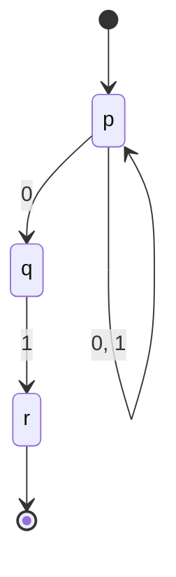
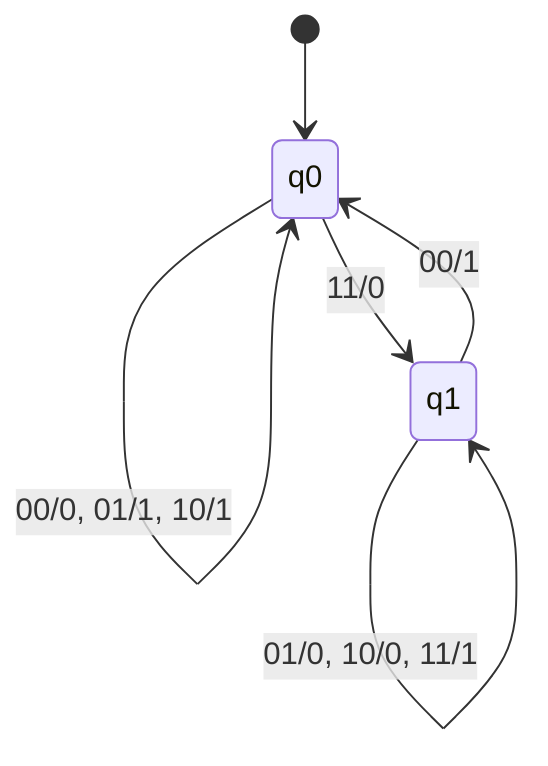

# Autómatas y Lenguajes Formales - Máquinas con un número finito de estados y lenguajes tipo 3

## 2.5 Modelos alternativos.

---

El AFD es el modelo de referencia, pero no siempre es el más cómodo. Este tema presenta variantes de los autómatas finitos: algunas permiten **elegir** entre varias transiciones o moverse sin leer, otras **producen una salida** en lugar de solo aceptar o rechazar, y otras pueden **releer** la entrada. La pregunta en cada caso es si la variante reconoce más lenguajes. Para las que conservan la memoria finita, la respuesta es que no: todas reconocen exactamente los lenguajes regulares. En cuanto se agrega memoria ilimitada, como un contador, el poder cambia.

### Autómatas finitos no deterministas (AFN)

Un **AFN** es una quíntupla $N = (Q, \Sigma, \delta, q_0, F)$ igual a la de un AFD, salvo la función de transición:

$$ \delta : Q \times \Sigma \rightarrow \mathcal{P}(Q) $$

Desde un estado, con un símbolo, el autómata puede pasar a **cualquiera** de los estados de $\delta(q, a),$ que puede tener varios elementos o ninguno. La función extendida da el conjunto de estados a los que se puede llegar:

$$ \hat{\delta}(q, \varepsilon) = \{q\}, \qquad \hat{\delta}(q, wa) = \bigcup_{p \in \hat{\delta}(q, w)} \delta(p, a) $$

y el AFN **acepta** $w$ si **alguna** de las computaciones posibles termina en un estado de aceptación: $\hat{\delta}(q_0, w) \cap F \neq \emptyset.$

El no determinismo no es azar ni paralelismo físico: es una forma de describir lenguajes "adivinando". Por ejemplo, el AFN



acepta las cadenas que terminan en $01:$ se queda en $p$ leyendo y, cuando "adivina" que el 0 que lee es el penúltimo símbolo, pasa a $q.$ Si la adivinanza falla, esa computación muere, pero basta con que una tenga éxito.

#### Construcción de subconjuntos

**Teorema (Rabin y Scott, 1959).** Para todo AFN existe un AFD que reconoce el mismo lenguaje.

**Construcción.** Dado $N = (Q, \Sigma, \delta, q_0, F),$ el AFD $D$ tiene como estados los **subconjuntos** de $Q:$

- Estado inicial: $\{q_0\}.$
- Transición: $\delta_D(S, a) = \bigcup_{p \in S} \delta(p, a).$
- Estados de aceptación: los subconjuntos $S$ con $S \cap F \neq \emptyset.$

**Demostración.** Por inducción sobre $w$ se demuestra que $\hat{\delta}_D(\{q_0\}, w) = \hat{\delta}_N(q_0, w):$ el estado del AFD es exactamente el conjunto de estados en que podría estar el AFN. Entonces $D$ acepta $w$ si y solo si ese conjunto contiene un estado de aceptación, es decir, si y solo si $N$ acepta $w.$ $\blacksquare$

En la práctica solo se construyen los subconjuntos **alcanzables** desde $\{q_0\}.$ Para el AFN anterior:

| | 0 | 1 |
| --- | --- | --- |
| $\rightarrow \{p\}$ | $\{p, q\}$ | $\{p\}$ |
| $\{p, q\}$ | $\{p, q\}$ | $\{p, r\}$ |
| $* \, \{p, r\}$ | $\{p, q\}$ | $\{p\}$ |

Son 3 de los $2^3 = 8$ subconjuntos posibles, y el resultado es el AFD del tema 2.1. Pero en el peor caso la explosión es real: el lenguaje de las cadenas cuyo símbolo en la posición $k$ desde el final es 1 tiene un AFN de $k + 1$ estados (adivina cuál es ese símbolo y cuenta $k - 1$ más) y, como se demostró con Myhill-Nerode en el tema 2.4, todo AFD necesita $2^k$ estados.

### AFN con transiciones $\varepsilon$

Un **AFN-ε** permite además transiciones que no leen ningún símbolo: $\delta : Q \times (\Sigma \cup \{\varepsilon\}) \rightarrow \mathcal{P}(Q).$ Son cómodos para **componer** autómatas, como en la construcción de Thompson (tema 1.3), donde se pegan las piezas con transiciones $\varepsilon.$

La **ε-cerradura** de un conjunto de estados $S,$ $\text{ECL}(S),$ es el conjunto de estados alcanzables desde $S$ usando solo transiciones $\varepsilon,$ incluyendo los de $S.$ Se calcula con un recorrido del grafo de transiciones $\varepsilon.$ Con ella, la construcción de subconjuntos se adapta:

- Estado inicial: $\text{ECL}(\{q_0\}).$
- Transición: $\delta_D(S, a) = \text{ECL}\left(\bigcup_{p \in S} \delta(p, a)\right).$

Por ejemplo, el AFN-ε con estados $x, y, z,$ lazos $x \xrightarrow{a} x,$ $y \xrightarrow{b} y,$ $z \xrightarrow{c} z,$ transiciones $x \xrightarrow{\varepsilon} y \xrightarrow{\varepsilon} z$ y estado final $z$ reconoce $a^*b^*c^*.$ Su ε-cerradura inicial es $\{x, y, z\}.$

Así, AFD, AFN y AFN-ε reconocen exactamente los mismos lenguajes: los regulares.

### Autómatas finitos con salida

A veces no interesa aceptar o rechazar, sino **traducir** una entrada en una salida. Los **transductores finitos** agregan un alfabeto de salida $\Delta$ y una función de salida.

**Máquina de Moore:** $M = (Q, \Sigma, \Delta, \delta, \lambda, q_0)$ con $\lambda : Q \rightarrow \Delta.$ La salida depende solo del **estado**; con una entrada de longitud $n,$ la máquina recorre $n + 1$ estados y produce $n + 1$ símbolos de salida.

**Máquina de Mealy:** $M = (Q, \Sigma, \Delta, \delta, \lambda, q_0)$ con $\lambda : Q \times \Sigma \rightarrow \Delta.$ La salida depende del estado **y del símbolo leído**: se produce en cada transición, y una entrada de longitud $n$ da $n$ símbolos de salida.

Ambos modelos son equivalentes, salvo por el símbolo inicial que produce una máquina de Moore antes de leer nada: una máquina de Mealy se convierte en una de Moore creando un estado por cada par (estado, última salida), y una de Moore en una de Mealy poniendo en cada transición la salida del estado destino. Las máquinas de Mealy suelen necesitar menos estados; en los circuitos secuenciales, la salida de una máquina de Moore es más estable, porque solo cambia con el reloj.

#### Ejemplo: sumador binario serial

Se suman dos números leyendo un par de bits a la vez, del menos significativo al más significativo. El estado es el **acarreo**; la entrada, el par de bits $ab;$ la salida, el bit de la suma.



En $q_0,$ sin acarreo, la suma $a + b$ es 0, 1 o 2; solo con $11$ se produce un acarreo. En $q_1$ la suma es $a + b + 1,$ y solo con $00$ desaparece el acarreo. Con dos estados, la máquina suma números de **cualquier** longitud: el acarreo es lo único que hay que recordar.

### Autómatas finitos bidireccionales

Un **autómata finito bidireccional** (2AFD) puede mover la cabeza de lectura a la izquierda o a la derecha: $\delta : Q \times \Sigma \rightarrow Q \times \{L, R\}.$ La entrada se escribe entre dos marcadores de fin para que la cabeza no se salga. Puede releer la entrada tantas veces como quiera, y aun así **reconoce solo lenguajes regulares** (Rabin y Scott, Shepherdson, 1959). La idea de la demostración: lo único que importa de la parte ya leída es, para cada estado en que la cabeza podría regresar a ella, en qué estado volvería a salir; esa información es una función entre conjuntos finitos, y hay un número finito de ellas. La ventaja del 2AFD es, de nuevo, el tamaño: puede ser exponencialmente más pequeño que el AFD equivalente.

### Cuando el modelo deja de ser finito: autómatas con contadores

Si a un autómata finito se le agrega un **contador**, un entero no negativo que se puede incrementar, decrementar y comparar con cero, deja de ser una máquina de estados finitos: el contador puede crecer sin límite. Con un contador se reconoce $\{a^nb^n \mid n \geq 0\},$ que no es regular: se incrementa por cada $a,$ se decrementa por cada $b$ y se acepta si al final el contador es 0 y no hubo una $a$ después de una $b.$ Los autómatas con un contador son un caso particular de los autómatas de pila (tema 3), con un solo símbolo de pila.

Con **dos** contadores, el modelo ya es tan poderoso como una máquina de Turing (Minsky, 1967). Así, los contadores no son un modelo alternativo de los autómatas finitos, sino el primer paso hacia modelos más poderosos.

### Implementación en Python

El programa implementa la ε-cerradura, la simulación de un AFN-ε y la construcción de subconjuntos; reproduce la tabla del ejemplo, comprueba el autómata de $a^*b^*c^*,$ mide la explosión exponencial y simula el sumador serial.

```python
from itertools import product

EPS = 'ε'

def cerradura(delta, estados):
    """ε-cerradura de un conjunto de estados."""
    pila, res = list(estados), set(estados)
    while pila:
        q = pila.pop()
        for r in delta.get((q, EPS), ()):
            if r not in res:
                res.add(r)
                pila.append(r)
    return frozenset(res)

def acepta_afn(delta, inicial, finales, w):
    """Simula el AFN (con o sin transiciones ε) llevando el conjunto de estados posibles."""
    actuales = cerradura(delta, {inicial})
    for a in w:
        siguientes = set()
        for q in actuales:
            siguientes |= delta.get((q, a), set())
        actuales = cerradura(delta, siguientes)
    return bool(actuales & finales)

def subconjuntos(delta, inicial, finales, alfabeto):
    """Construcción de subconjuntos: solo genera los conjuntos alcanzables."""
    q0 = cerradura(delta, {inicial})
    afd, pendientes = {}, [q0]
    while pendientes:
        S = pendientes.pop()
        if S in afd:
            continue
        afd[S] = {}
        for a in alfabeto:
            T = set()
            for q in S:
                T |= delta.get((q, a), set())
            T = cerradura(delta, T)
            afd[S][a] = T
            pendientes.append(T)
    aceptacion = {S for S in afd if S & finales}
    return q0, afd, aceptacion

def nombre(S):
    return '{' + ','.join(sorted(S)) + '}' if S else '∅'

# AFN para "termina en 01"
N = {('p', '0'): {'p', 'q'}, ('p', '1'): {'p'}, ('q', '1'): {'r'}}
q0, D, F = subconjuntos(N, 'p', {'r'}, '01')
for S in sorted(D, key=lambda S: (len(S), nombre(S))):
    marca = ('→' if S == q0 else ' ') + ('*' if S in F else ' ')
    print(marca, nombre(S), {a: nombre(T) for a, T in D[S].items()})

# AFN-ε para a*b*c*: tres estados unidos por transiciones ε
E = {('x', 'a'): {'x'}, ('x', EPS): {'y'}, ('y', 'b'): {'y'}, ('y', EPS): {'z'}, ('z', 'c'): {'z'}}
print([w for w in ['', 'abc', 'aacc', 'ba', 'cb', 'abbc'] if acepta_afn(E, 'x', {'z'}, w)])

# El símbolo en la posición k desde el final es 1: AFN de k + 1 estados
def afn_ultimo_k(k):
    delta = {(0, '0'): {0}, (0, '1'): {0, 1}}
    for i in range(1, k):
        delta[(i, '0')] = delta[(i, '1')] = {i + 1}
    return delta, 0, {k}

for k in range(1, 7):
    q0, D, F = subconjuntos(*afn_ultimo_k(k), '01')
    print(f"k = {k}: AFN con {k + 1} estados -> AFD con {len(D)} estados")

# Máquina de Mealy: sumador binario serial. Estado = acarreo; entrada = par de bits (a, b),
# leídos del menos al más significativo; salida = bit de la suma.
DELTA = {(c, (a, b)): (a + b + c) // 2 for c in (0, 1) for a in (0, 1) for b in (0, 1)}
LAMBDA = {(c, (a, b)): (a + b + c) % 2 for c in (0, 1) for a in (0, 1) for b in (0, 1)}
for c in (0, 1):
    print("   ".join(f"q{c} --{a}{b}/{LAMBDA[(c, (a, b))]}--> q{DELTA[(c, (a, b))]}"
                     for a in (0, 1) for b in (0, 1)))

def sumar(x, y):
    estado, salida = 0, []
    for e in zip(map(int, reversed(x)), map(int, reversed(y))):
        salida.append(LAMBDA[(estado, e)])
        estado = DELTA[(estado, e)]
    salida.append(estado)                            # el último acarreo
    return ''.join(map(str, reversed(salida)))

x, y = '1011', '0111'
print(f"{x} + {y} = {sumar(x, y)};  comprobación: {int(x, 2) + int(y, 2):b}")
```

Salida:

```text
→  {p} {'0': '{p,q}', '1': '{p}'}
   {p,q} {'0': '{p,q}', '1': '{p,r}'}
 * {p,r} {'0': '{p,q}', '1': '{p}'}
['', 'abc', 'aacc', 'abbc']
k = 1: AFN con 2 estados -> AFD con 2 estados
k = 2: AFN con 3 estados -> AFD con 4 estados
k = 3: AFN con 4 estados -> AFD con 8 estados
k = 4: AFN con 5 estados -> AFD con 16 estados
k = 5: AFN con 6 estados -> AFD con 32 estados
k = 6: AFN con 7 estados -> AFD con 64 estados
q0 --00/0--> q0   q0 --01/1--> q0   q0 --10/1--> q0   q0 --11/0--> q1
q1 --00/1--> q0   q1 --01/0--> q1   q1 --10/0--> q1   q1 --11/1--> q1
1011 + 0111 = 10010;  comprobación: 10010
```

### Ejercicios Propuestos

1. **De AFN-ε a AFD.** Aplica la construcción de subconjuntos al AFN-ε de $a^*b^*c^*$ de este tema.

2. **Máquina de Mealy.** Diseña una máquina de Mealy que calcule el complemento a 2 de un número binario leído del bit menos significativo al más significativo.

3. **De AFD a gramática.** Escribe la gramática lineal por la derecha del AFD con estados $A, B, C,$ inicial $A,$ final $C$ y transiciones $\delta(A, 0) = B,$ $\delta(A, 1) = A,$ $\delta(B, 0) = C,$ $\delta(B, 1) = A,$ $\delta(C, 0) = C,$ $\delta(C, 1) = C.$

4. **Thompson y subconjuntos.** Construye un AFN-ε para $(a + b)^*abb$ con la construcción de Thompson, conviértelo en AFD y minimízalo.

5. **Contadores.** Diseña un autómata con dos contadores que reconozca $\{a^nb^nc^n \mid n \geq 0\}.$

### Soluciones

**Ejercicio 1.** El estado inicial es $\{x, y, z\},$ de aceptación porque contiene a $z.$ Con $a$ va a $\text{ECL}(\{x\}) = \{x, y, z\};$ con $b,$ a $\{y, z\};$ con $c,$ a $\{z\}.$ Desde $\{y, z\},$ $a$ lleva a $\emptyset,$ $b$ a $\{y, z\}$ y $c$ a $\{z\}.$ Desde $\{z\},$ solo $c$ lleva a $\{z\}$ y lo demás a $\emptyset,$ que es un sumidero. El AFD tiene 4 estados, y los tres no vacíos son de aceptación.

**Ejercicio 2.** El complemento a 2 copia los bits hasta el primer 1, inclusive, e invierte los demás. Estados $s_0$ (todavía no hay un 1) y $s_1$ (ya hubo uno), con $s_0 \xrightarrow{0/0} s_0,$ $s_0 \xrightarrow{1/1} s_1,$ $s_1 \xrightarrow{0/1} s_1$ y $s_1 \xrightarrow{1/0} s_1.$ Por ejemplo, $0110$ leído al revés produce $0,$ $1,$ $0,$ $1,$ es decir $1010,$ y en efecto $0110 + 1010 = 10000.$

**Ejercicio 3.** $A \rightarrow 0B \mid 1A,$ $B \rightarrow 0C \mid 1A,$ $C \rightarrow 0C \mid 1C \mid \varepsilon.$ Genera las cadenas que contienen $00.$

**Ejercicio 4.** La construcción de Thompson del libro de Aho et al. produce un AFN-ε de 11 estados. La construcción de subconjuntos da un AFD de 5 estados, y al minimizarlo quedan 4, uno por cada prefijo de $abb$ que puede ser sufijo de lo leído: nada, $a,$ $ab$ y $abb,$ el de aceptación. Es el autómata de Knuth-Morris-Pratt del patrón $abb$ (tema 2.2).

**Ejercicio 5.** Con contadores $c_1$ y $c_2:$ en la fase de $a,$ cada $a$ incrementa ambos; en la fase de $b,$ cada $b$ decrementa $c_1;$ en la fase de $c,$ cada $c$ decrementa $c_2,$ y solo se puede entrar a esa fase si $c_1 = 0.$ Se acepta si al terminar $c_2 = 0.$ Los estados controlan que las fases vayan en orden y rechazan si un contador intentaría bajar de 0.

### Referencias

1. Hopcroft, J. E., Motwani, R., and Ullman, J., _Introduction to Automata Theory, Languages, and Computation_. Pearson, 2007. Secciones 2.3 a 2.5.
2. Sipser, M., _Introduction to the Theory of Computation_. Cengage, 2013. Sección 1.2.
3. Kozen, D. C., _Automata and Computability_. Springer, 1997. Lectures 5, 6 y 17.
4. Rabin, M. O. and Scott, D. (1959). Finite automata and their decision problems. _IBM Journal of Research and Development_, 3(2), 114-125.
5. Minsky, M., _Computation: Finite and Infinite Machines_. Prentice Hall, 1967.

### Para profundizar

- Investiga los **autómatas alternantes**, que combinan elecciones existenciales y universales, y su relación con la complejidad.
- Explora los transductores finitos ponderados que se usan en el reconocimiento de voz.
- Estudia la demostración de Shepherdson de que los autómatas bidireccionales solo reconocen lenguajes regulares.
