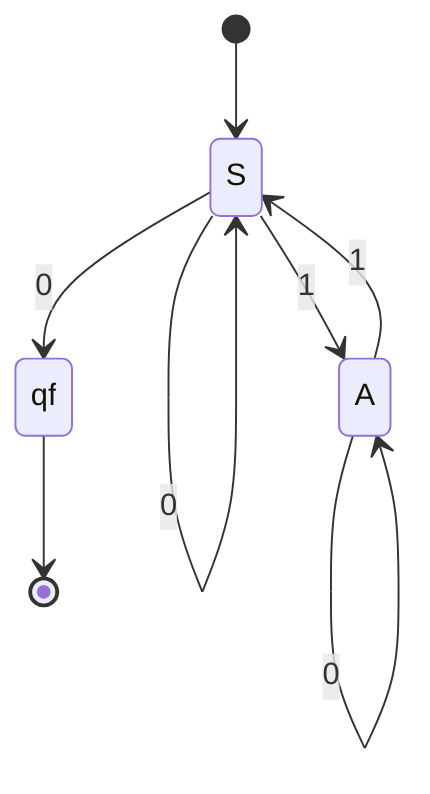

# Autómatas y Lenguajes Formales - Máquinas con un número finito de estados y lenguajes tipo 3

## 2.6 Lenguajes tipo 3.

---

En la jerarquía de Chomsky, los lenguajes de **tipo 3** son los que generan las gramáticas regulares. En los temas anteriores se definieron los lenguajes regulares como los que reconoce un autómata finito. Este tema demuestra que son la misma clase: una gramática regular es, salvo la notación, un autómata finito, y la traducción entre ambos es directa. Con el teorema de Kleene (tema 2.8) se completa el cuadro: autómatas, gramáticas regulares y expresiones regulares describen exactamente los mismos lenguajes.

### Gramáticas regulares

Una gramática $G = (V, \Sigma, P, S)$ es **lineal por la derecha** si todas sus producciones son de la forma

$$ A \rightarrow wB \qquad \text{o} \qquad A \rightarrow w, \qquad \text{con } A, B \in V,\ w \in \Sigma^* $$

y **lineal por la izquierda** si todas son de la forma $A \rightarrow Bw$ o $A \rightarrow w.$ Una gramática **regular** es una gramática lineal por la derecha o una lineal por la izquierda. Un caso particular, al que siempre se puede reducir, es la forma **estricta** $A \rightarrow aB,$ $A \rightarrow a$ o $A \rightarrow \varepsilon,$ con $a \in \Sigma.$

**Reducción a la forma estricta.** Una regla $A \rightarrow a_1a_2 \cdots a_kB$ con $k \geq 2$ se sustituye por una cadena de reglas con no terminales nuevos: $A \rightarrow a_1A_1,$ $A_1 \rightarrow a_2A_2,$ ..., $A_{k-1} \rightarrow a_kB.$ Una regla $A \rightarrow a_1 \cdots a_k$ se trata igual, terminando en $A_{k-1} \rightarrow a_k.$ Las reglas unitarias $A \rightarrow B$ se eliminan como en el tema 4.2, o se interpretan directamente como transiciones $\varepsilon.$

En una gramática lineal por la derecha, toda forma sentencial tiene a lo más un no terminal, y está al final: $S \Rightarrow^* wA.$ Esa es la observación clave: el no terminal funciona como el **estado** de un autómata que ya leyó $w.$

### De gramática lineal por la derecha a autómata

**Teorema.** Si $G$ es lineal por la derecha, $L(G)$ es regular.

**Construcción.** Con $G$ en forma estricta, se construye un AFN $N$ con un estado por cada no terminal y un estado final nuevo $q_f:$

- El estado inicial es $S.$
- Por cada regla $A \rightarrow aB,$ una transición $A \xrightarrow{a} B.$
- Por cada regla $A \rightarrow a,$ una transición $A \xrightarrow{a} q_f.$
- Los estados de aceptación son $q_f$ y los $A$ con una regla $A \rightarrow \varepsilon.$

**Demostración.** Por inducción sobre $|w|$ se demuestra que $S \Rightarrow^* wA$ si y solo si $A \in \hat{\delta}(S, w):$ cada paso de la derivación aplica una regla $A \rightarrow aB,$ que es exactamente una transición. Una derivación completa de $w$ termina con una regla $A \rightarrow \varepsilon$ o $A \rightarrow a,$ que corresponden a terminar en un estado de aceptación. $\blacksquare$

**Ejemplo.** La gramática $S \rightarrow 0S \mid 1A \mid 0,$ $A \rightarrow 0A \mid 1S$ da el AFN



$S$ significa que se ha leído un número par de unos y $A$ un número impar; la regla $S \rightarrow 0$ termina la cadena con un 0 cuando la paridad es par. El lenguaje son las cadenas que terminan en 0 y tienen un número par de unos.

### De autómata a gramática lineal por la derecha

**Teorema.** Todo lenguaje regular es generado por una gramática lineal por la derecha.

**Construcción.** Dado un AFD $M = (Q, \Sigma, \delta, q_0, F),$ la gramática tiene un no terminal por estado, el inicial es $q_0$ y sus reglas son:

- $p \rightarrow aq$ por cada transición $\delta(p, a) = q.$
- $p \rightarrow \varepsilon$ por cada estado de aceptación $p.$

La misma inducción muestra que $q_0 \Rightarrow^* wp$ si y solo si $\hat{\delta}(q_0, w) = p,$ y la derivación puede terminar en $w$ exactamente cuando $p \in F.$ $\blacksquare$

Por ejemplo, el AFD de las cadenas que contienen $00,$ con estados $A$ para nada útil, $B$ para termina en 0 y $C$ para ya apareció $00,$ da

$$ A \rightarrow 0B \mid 1A, \quad B \rightarrow 0C \mid 1A, \quad C \rightarrow 0C \mid 1C \mid \varepsilon $$

### Gramáticas lineales por la izquierda

Una gramática lineal por la izquierda construye la cadena **de derecha a izquierda**: $S \Rightarrow Aw_1 \Rightarrow Bw_2w_1 \Rightarrow \cdots.$ Si se invierten todos los lados derechos, $A \rightarrow Bw$ se vuelve $A \rightarrow w^RB,$ se obtiene una gramática lineal por la derecha que genera $L(G)^R.$ Como la reversa de un lenguaje regular es regular (tema 2.7), $L(G)$ también lo es. Así, las gramáticas lineales por la izquierda generan los mismos lenguajes que las lineales por la derecha.

**Ejemplo.** $S \rightarrow Sa \mid Ab,$ $A \rightarrow Aa \mid Ab \mid a$ es lineal por la izquierda. Invertida da $S \rightarrow aS \mid bA,$ $A \rightarrow aA \mid bA \mid a,$ que genera $a^*b(a + b)^*a:$ cadenas con alguna $b$ que terminan en $a.$ Entonces $L(G)$ es la reversa: $a(a + b)^*ba^*,$ las cadenas que empiezan con $a$ y tienen alguna $b.$

**Advertencia.** Mezclar reglas lineales por la derecha y por la izquierda en una misma gramática rompe todo: $S \rightarrow aA \mid \varepsilon,$ $A \rightarrow Sb$ genera $\{a^nb^n\},$ que no es regular (tema 1.8).

### Ejemplos de lenguajes de tipo 3

**Regulares:**

- Todo **lenguaje finito** $\{w_1, \ldots, w_k\}:$ basta la gramática $S \rightarrow w_1 \mid \cdots \mid w_k.$
- Las cadenas con un número par de $a$ y un número impar de $b.$
- Las representaciones en base $b$ de los múltiplos de $k$ (tema 2.1).
- Las cadenas que contienen, empiezan o terminan con un patrón fijo.
- Los tokens de un lenguaje de programación: identificadores, números, operadores.

**No regulares** (se demuestra en el tema 2.7):

- $\{a^nb^n \mid n \geq 0\}$ y, en general, todo lenguaje que exija **contar** sin cota.
- Los paréntesis balanceados.
- Los palíndromos y $\{ww \mid w \in \{a, b\}^*\}.$
- $\{a^p \mid p \text{ es primo}\}$ y $\{a^{n^2} \mid n \geq 0\}.$

La intuición es que un lenguaje es regular cuando, para decidir si una cadena pertenece, basta recordar una cantidad **acotada** de información sobre lo leído, sin importar la longitud de la entrada.

### Implementación en Python

El programa convierte una gramática lineal por la derecha en AFN y un AFD en gramática, y comprueba ambas conversiones contra la descripción del lenguaje en todas las cadenas binarias de longitud a lo más 8.

```python
from itertools import product

FINAL = 'F'          # estado de aceptación nuevo para las reglas A -> a

def gramatica_a_afn(reglas):
    """Gramática lineal por la derecha con reglas A -> aB, A -> a o A -> ε (no terminales en mayúsculas)
    -> AFN: un estado por no terminal, más un estado final F."""
    delta, finales = {}, {FINAL}
    for A, derecha in reglas:
        if derecha == '':
            finales.add(A)                          # A -> ε: A es de aceptación
        elif len(derecha) == 1:
            delta.setdefault((A, derecha), set()).add(FINAL)   # A -> a
        else:
            delta.setdefault((A, derecha[0]), set()).add(derecha[1])  # A -> aB
    return delta, finales

def acepta(delta, inicial, finales, w):
    actuales = {inicial}
    for a in w:
        actuales = set().union(*(delta.get((q, a), set()) for q in actuales))
    return bool(actuales & finales)

def afd_a_gramatica(delta, finales):
    """AFD -> gramática lineal por la derecha: A -> aB por cada transición, A -> ε si A es final."""
    reglas = [(q, a + r) for (q, a), r in sorted(delta.items())]
    reglas += [(q, '') for q in sorted(finales)]
    return reglas

def generar(reglas, inicial, n):
    """Cadenas de longitud a lo más n generadas por la gramática (búsqueda exhaustiva)."""
    resultado, pendientes = set(), [inicial]
    while pendientes:
        forma = pendientes.pop()
        if not forma or not forma[-1].isupper():
            if len(forma) <= n:
                resultado.add(forma)
            continue
        A, prefijo = forma[-1], forma[:-1]
        for izq, der in reglas:
            if izq == A and len(prefijo) + len(der.rstrip('ABCDEFGHIJKLMNOPQRSTUVWXYZ')) <= n:
                pendientes.append(prefijo + der)
    return resultado

# Cadenas que terminan en 0 y tienen un número par de unos
G = [('S', '0S'), ('S', '1A'), ('S', '0'), ('A', '0A'), ('A', '1S')]
delta, finales = gramatica_a_afn(G)
cadenas = [''.join(t) for k in range(9) for t in product('01', repeat=k)]
esperado = lambda w: w.endswith('0') and w.count('1') % 2 == 0
print(all(acepta(delta, 'S', finales, w) == esperado(w) for w in cadenas))

# AFD de "contiene 00" -> gramática -> mismas cadenas
D = {('A', '0'): 'B', ('A', '1'): 'A', ('B', '0'): 'C', ('B', '1'): 'A', ('C', '0'): 'C', ('C', '1'): 'C'}
G2 = afd_a_gramatica(D, {'C'})
print(' | '.join(f"{i} -> {d or 'ε'}" for i, d in G2))
print(generar(G2, 'A', 8) == {w for w in cadenas if '00' in w})
```

Salida:

```text
True
A -> 0B | A -> 1A | B -> 0C | B -> 1A | C -> 0C | C -> 1C | C -> ε
True
```

### Ejercicios Propuestos

1. **Gramática a autómata.** Convierte a AFN la gramática $S \rightarrow abS \mid aA,$ $A \rightarrow bA \mid b,$ pasándola primero a la forma estricta. Describe su lenguaje.

2. **Autómata a gramática.** Escribe la gramática lineal por la derecha del AFD de la divisibilidad entre 3 del tema 2.1.

3. **Gramática lineal por la izquierda.** Escribe una gramática lineal por la izquierda para las cadenas sobre $\{a, b\}$ que terminan en $ab.$

4. **Lenguajes finitos.** Demuestra que todo lenguaje finito es regular construyendo un AFD.

5. **Clasificación.** Decide si es regular el lenguaje generado por $S \rightarrow aSa \mid bSb \mid a \mid b,$ y si lo es el generado por $S \rightarrow aS \mid Sb \mid \varepsilon.$

### Soluciones

**Ejercicio 1.** En forma estricta: $S \rightarrow aS_1,$ $S_1 \rightarrow bS,$ $S \rightarrow aA,$ $A \rightarrow bA,$ $A \rightarrow b.$ El AFN tiene estados $S,$ $S_1,$ $A$ y $q_f,$ con transiciones $S \xrightarrow{a} S_1,$ $S_1 \xrightarrow{b} S,$ $S \xrightarrow{a} A,$ $A \xrightarrow{b} A$ y $A \xrightarrow{b} q_f.$ Desde $S$ hay un no determinismo con $a.$ El lenguaje es $(ab)^*ab^+.$

**Ejercicio 2.** Con no terminales $R_0,$ $R_1,$ $R_2,$ uno por residuo, y $R_0$ inicial: $R_0 \rightarrow 0R_0 \mid 1R_1 \mid \varepsilon,$ $R_1 \rightarrow 0R_2 \mid 1R_0,$ $R_2 \rightarrow 0R_1 \mid 1R_2.$

**Ejercicio 3.** $S \rightarrow Ab,$ $A \rightarrow Ba,$ $B \rightarrow Ba \mid Bb \mid \varepsilon.$ Leída de derecha a izquierda, la derivación pone primero la $b$ final, luego la $a,$ y $B$ genera cualquier prefijo.

**Ejercicio 4.** Para $L = \{w_1, \ldots, w_k\},$ sea $m$ la máxima longitud. El AFD tiene un estado por cada cadena de longitud a lo más $m,$ que recuerda todo lo leído, más un sumidero para las cadenas más largas; los estados de aceptación son $w_1, \ldots, w_k.$ Es finito porque hay un número finito de cadenas de longitud a lo más $m.$

**Ejercicio 5.** La primera genera los palíndromos de longitud impar, que no son regulares: las cadenas $a^ib$ son distinguibles dos a dos, porque $a^iba^i$ está en el lenguaje y $a^jba^i$ con $j \neq i$ no. La gramática no es regular, porque $S$ aparece en medio. La segunda tampoco es regular como gramática, porque mezcla $S \rightarrow aS$ con $S \rightarrow Sb,$ pero su lenguaje sí lo es: genera $a^*b^*,$ porque las $a$ se agregan a la izquierda y las $b$ a la derecha en cualquier orden.

### Referencias

1. Hopcroft, J. E., Motwani, R., and Ullman, J., _Introduction to Automata Theory, Languages, and Computation_. Pearson, 2007. Secciones 3.1 a 3.4.
2. Linz, P., _An Introduction to Formal Languages and Automata_. Jones & Bartlett, 2016. Sección 3.3.
3. Viso G., E., _Introducción a la teoría de la computación_. Las Prensas de Ciencias, 2008. Capítulo 3.
4. Sipser, M., _Introduction to the Theory of Computation_. Cengage, 2013. Sección 1.4.

### Para profundizar

- Investiga las **gramáticas lineales** generales, con a lo más un no terminal en cada lado derecho pero en cualquier posición: generan una clase estrictamente entre los regulares y los libres de contexto.
- Estudia cómo los generadores de analizadores léxicos traducen las definiciones de tokens, que son gramáticas regulares disfrazadas, a autómatas.
