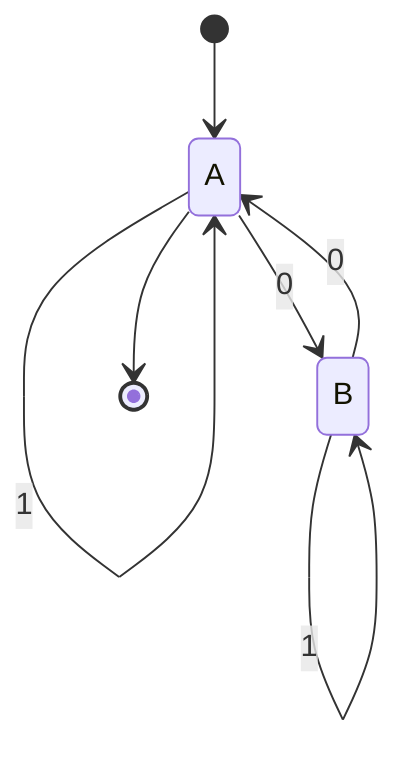

# Autómatas y Lenguajes Formales - Máquinas con un número finito de estados y lenguajes tipo 3

## 2.7 Propiedades de los lenguajes regulares.

---

Los lenguajes regulares (tipo 3) poseen propiedades matemáticas fundamentales que permiten analizar su estructura, determinar su pertenencia a esta clase y realizar operaciones entre ellos. Estas propiedades son esenciales para el diseño de compiladores, procesamiento de lenguajes y teoría de la computación.

### Propiedades de Clausura

#### Definición

Los lenguajes regulares son **cerrados** bajo diversas operaciones, lo que significa que al aplicar estas operaciones a lenguajes regulares, el resultado sigue siendo un lenguaje regular.

#### Operaciones de Clausura

1. **Unión**: Si $L_1$ y $L_2$ son regulares, entonces $L_1 \cup L_2$ es regular.

2. **Concatenación**: Si $L_1$ y $L_2$ son regulares, entonces $L_1 \circ L_2$ es regular.

3. **Clausura de Kleene**: Si $L$ es regular, entonces $L^*$ es regular.

4. **Intersección**: Si $L_1$ y $L_2$ son regulares, entonces $L_1 \cap L_2$ es regular.
   **Demostración**: $L_1 \cap L_2 = \overline{\overline{L_1} \cup \overline{L_2}}$

5. **Complemento**: Si $L$ es regular, entonces $\overline{L} = \Sigma^* - L$ es regular.
   **Demostración**: Sea $M = (Q, \Sigma, \delta, q_0, F)$ un AFD que acepta $L.$ El AFD $M' = (Q, \Sigma, \delta, q_0, Q - F)$ acepta $\overline{L}.$

6. **Diferencia**: Si $L_1$ y $L_2$ son regulares, entonces $L_1 - L_2$ es regular.
   **Demostración**: $L_1 - L_2 = L_1 \cap \overline{L_2}$

7. **Reverso**: Si $L$ es regular, entonces $L^R = \{w^R \mid w \in L\}$ es regular.

8. **Homomorfismo**: Si $L$ es regular y $h: \Sigma^* \rightarrow \Delta^*$ es un homomorfismo, entonces $h(L)$ es regular.

9. **Homomorfismo inverso**: Si $L$ es regular y $h: \Delta^* \rightarrow \Sigma^*$ es un homomorfismo, entonces $h^{-1}(L)$ es regular.

#### Implementación de operaciones de clausura

```python
class OperacionesLenguajesRegulares:
    @staticmethod
    def complemento(afd):
        """Construye el AFD para el complemento de L(afd)"""
        nuevos_estados_aceptacion = set(afd.estados) - set(afd.estados_aceptacion)
        return AFD(afd.estados, afd.alfabeto, afd.transiciones,
                  afd.estado_inicial, nuevos_estados_aceptacion)

    @staticmethod
    def interseccion(afd1, afd2):
        """Construye el AFD para L(afd1) ∩ L(afd2) usando producto cartesiano"""
        # Verificar que los alfabetos sean iguales
        if afd1.alfabeto != afd2.alfabeto:
            raise ValueError("Los AFD deben tener el mismo alfabeto")

        # Estados: pares (q1, q2) donde q1 ∈ Q1, q2 ∈ Q2
        nuevos_estados = set()
        nuevas_transiciones = {}
        estado_inicial = (afd1.estado_inicial, afd2.estado_inicial)
        estados_aceptacion = set()

        # Construir estados y transiciones
        cola = [estado_inicial]
        visitados = set()

        while cola:
            (q1, q2) = cola.pop(0)
            if (q1, q2) in visitados:
                continue

            visitados.add((q1, q2))
            nuevos_estados.add((q1, q2))

            # Verificar si es estado de aceptación
            if q1 in afd1.estados_aceptacion and q2 in afd2.estados_aceptacion:
                estados_aceptacion.add((q1, q2))

            # Construir transiciones
            for simbolo in afd1.alfabeto:
                destino1 = afd1.transiciones.get((q1, simbolo))
                destino2 = afd2.transiciones.get((q2, simbolo))

                if destino1 is not None and destino2 is not None:
                    nuevo_destino = (destino1, destino2)
                    nuevas_transiciones[((q1, q2), simbolo)] = nuevo_destino

                    if nuevo_destino not in visitados:
                        cola.append(nuevo_destino)

        return AFD(nuevos_estados, afd1.alfabeto, nuevas_transiciones,
                  estado_inicial, estados_aceptacion)

    @staticmethod
    def diferencia(afd1, afd2):
        """Construye el AFD para L(afd1) - L(afd2)"""
        afd2_complemento = OperacionesLenguajesRegulares.complemento(afd2)
        return OperacionesLenguajesRegulares.interseccion(afd1, afd2_complemento)
```

### Lema de Bombeo para Lenguajes Regulares

#### Enunciado Formal

Sea $L$ un lenguaje regular. Entonces existe una constante $n \geq 1$ (la **longitud de bombeo**) tal que para toda cadena $w \in L$ con $|w| \geq n,$ existe una descomposición $w = xyz$ que satisface:

1. $|y| \geq 1$
2. $|xy| \leq n$
3. Para todo $k \geq 0,$ $xy^kz \in L$

#### Aplicación del Lema de Bombeo

El lema de bombeo se utiliza principalmente para demostrar que ciertos lenguajes **no son regulares**.

**Ejemplo:** Demostrar que $L = \{a^nb^n \mid n \geq 0\}$ no es regular.

1. Suponemos que $L$ es regular, entonces existe una constante de bombeo $n$
2. Consideramos la cadena $w = a^nb^n$ (|w| = 2n ≥ n)
3. Por el lema de bombeo, $w = xyz$ con |xy| ≤ n y |y| ≥ 1
4. Como |xy| ≤ n, y consiste solo de a's: $y = a^m$ con $m \geq 1$
5. Bombeamos: para $k = 2,$ $xy^2z = a^{n+m}b^n$
6. Como $n + m > n,$ $a^{n+m}b^n \notin L$
7. Contradicción, por lo tanto $L$ no es regular

#### Implementación del verificador de bombeo

```python
def verificar_no_regular_por_bombeo(lenguaje, n):
    """
    Intenta encontrar una contradicción con el lema de bombeo
    para demostrar que un lenguaje no es regular
    """
    # Encontrar una cadena w con |w| >= n
    w = next((cadena for cadena in lenguaje if len(cadena) >= n), None)
    if w is None:
        return False  # No se puede aplicar el lema

    # Para todas las posibles descomposiciones w = xyz
    for i in range(1, n+1):      # Final de x
        for j in range(i, n+1):  # Final de y
            if j - i < 1:        # |y| >= 1
                continue

            x = w[:i]
            y = w[i:j]
            z = w[j:]

            # Verificar si para algún k, xy^kz no está en L
            for k in [0, 2]:  # Probamos con k=0 y k=2
                w_bombeada = x + (y * k) + z
                if w_bombeada not in lenguaje:
                    return True  # Contradicción encontrada

    return False  # No se encontró contradicción
```

### Algoritmos de Decisión

#### Problemas Decidibles para Lenguajes Regulares

1. **Pertenencia**: Dado un AFD $M$ y una cadena $w,$ ¿es $w \in L(M)?$
   - **Complejidad**: $O(|w|)$

2. **Vacuidad**: Dado un AFD $M,$ ¿es $L(M) = \emptyset?$
   - **Algoritmo**: Verificar si ningún estado de aceptación es alcanzable
   - **Complejidad**: $O(|Q| + |\delta|)$

3. **Finitud**: Dado un AFD $M,$ ¿es $L(M)$ finito?
   - **Algoritmo**: Verificar si no hay ciclos que contengan estados de aceptación
   - **Complejidad**: $O(|Q| + |\delta|)$

4. **Equivalencia**: Dados dos AFD $M_1$ y $M_2,$ ¿es $L(M_1) = L(M_2)?$
   - **Algoritmo**: Minimizar ambos AFD y verificar isomorfismo
   - **Complejidad**: $O(|Q_1| \times |Q_2|)$

5. **Inclusión**: Dados dos AFD $M_1$ y $M_2,$ ¿es $L(M_1) \subseteq L(M_2)?$
   - **Algoritmo**: Verificar si $L(M_1) \cap \overline{L(M_2)} = \emptyset$
   - **Complejidad**: $O(|Q_1| \times |Q_2|)$

#### Implementación de algoritmos de decisión

```python
class DecisionesLenguajesRegulares:
    @staticmethod
    def pertenencia(afd, w):
        """Decide si w ∈ L(afd)"""
        estado_actual = afd.estado_inicial
        for simbolo in w:
            if (estado_actual, simbolo) not in afd.transiciones:
                return False
            estado_actual = afd.transiciones[(estado_actual, simbolo)]
        return estado_actual in afd.estados_aceptacion

    @staticmethod
    def vacuidad(afd):
        """Decide si L(afd) = ∅"""
        # BFS desde el estado inicial
        visitados = set()
        cola = [afd.estado_inicial]

        while cola:
            estado = cola.pop(0)
            if estado in afd.estados_aceptacion:
                return False

            visitados.add(estado)
            for simbolo in afd.alfabeto:
                if (estado, simbolo) in afd.transiciones:
                    siguiente = afd.transiciones[(estado, simbolo)]
                    if siguiente not in visitados:
                        cola.append(siguiente)

        return True

    @staticmethod
    def finitud(afd):
        """Decide si L(afd) es finito"""
        # Eliminar estados inalcanzables
        afd_alc = eliminar_estados_inalcanzables(afd)

        # Verificar ciclos en el grafo de estados
        return not tiene_ciclo_aceptacion(afd_alc)

    @staticmethod
    def equivalencia(afd1, afd2):
        """Decide si L(afd1) = L(afd2)"""
        # Minimizar ambos AFD
        afd1_min = minimizar_afd(afd1)
        afd2_min = minimizar_afd(afd2)

        # Verificar isomorfismo
        return son_isomorfos(afd1_min, afd2_min)

    @staticmethod
    def inclusion(afd1, afd2):
        """Decide si L(afd1) ⊆ L(afd2)"""
        # L(afd1) ⊆ L(afd2) sii L(afd1) ∩ complemento(L(afd2)) = ∅
        afd2_comp = OperacionesLenguajesRegulares.complemento(afd2)
        interseccion = OperacionesLenguajesRegulares.interseccion(afd1, afd2_comp)
        return DecisionesLenguajesRegulares.vacuidad(interseccion)
```

### Propiedades Algebraicas

#### Ecuaciones de Lenguajes Regulares

Los lenguajes regulares satisfacen el **lema de Arden**:

Si $L = A \cdot L + B$ y $\varepsilon \notin A,$ entonces $L = A^* \cdot B$

**Aplicación**: Resolución de ecuaciones para obtener expresiones regulares a partir de autómatas.

#### Ejemplo de aplicación del lema de Arden

Para el AFD:



Ecuaciones:

- $A = 1A + 0B + \varepsilon$
- $B = 1B + 0A$

Resolviendo para B: $B = 1B + 0A \Rightarrow B = 1^*0A$ (por lema de Arden)

Sustituyendo en A: $A = 1A + 0(1^*0A) + \varepsilon = (1 + 01^*0)A + \varepsilon$

Aplicando lema de Arden: $ A = ( 1 + 01 ^ * 0 ) ^ * $

### Ejercicios Propuestos

1. **Propiedades de clausura**: Demuestra que si $L$ es regular, entonces el lenguaje $mitad(L) = \{x \mid \exists y : |x| = |y| \text{ y } xy \in L\}$ también es regular.

2. **Lema de bombeo**: Usa el lema de bombeo para demostrar que $L = \{a^p \mid p \text{ es primo}\}$ no es regular.

3. **Algoritmos de decisión**: Implementa una función que determine si un AFD acepta un lenguaje finito o infinito.

4. **Ecuaciones regulares**: Dado el siguiente AFD, encuentra una expresión regular para el lenguaje que acepta:

   ```mermaid
   stateDiagram-v2
       [*] --> A
       A --> B: 0
       A --> A: 1
       B --> A: 0
       B --> B: 1
       B --> [*]
   ```

5. **Homomorfismos**: Sea $L = \{(ab)^n \mid n \geq 0\}$ y $h(a) = 0,$ $h(b) = 11.$ Encuentra una expresión regular para $h(L).$

### Referencias

1. Hopcroft, J. E., Motwani, R. & Ullman, J. (2007). _Introduction to Automata Theory, Languages, and Computation_. Addison-Wesley. (Capítulos 4-5)

2. Sipser, M. (2005). _Introduction to the Theory of Computation_. PWS Publishing Company. (Capítulo 1)

3. Kozen, D. C. (1997). _Automata and Computability_. Springer-Verlag. (Capítulos 6-7)

4. Viso G., E. (2008). _Introducción a la teoría de la computación_. Las Prensas de Ciencias. (Capítulo 3)

5. Rich, E. (2008). _Automata, Computability and Complexity, Theory and Applications_. Pearson Prentice Hall. (Capítulos 5-6)
