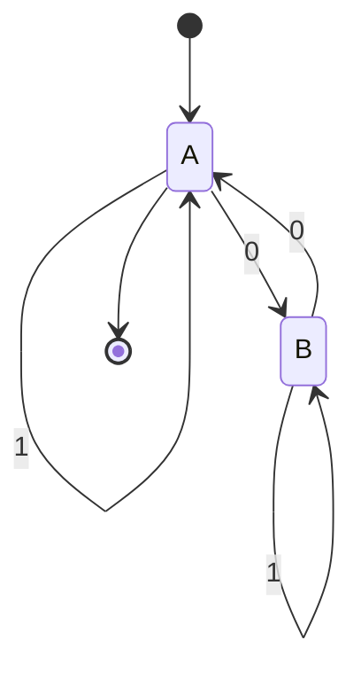

# Autómatas y Lenguajes Formales - Máquinas con un número finito de estados y lenguajes tipo 3

## 2.8 Relación entre autómatas finitos, lenguajes regulares y expresiones regulares.

---

Los autómatas finitos, los lenguajes regulares y las expresiones regulares son tres formalismos equivalentes para describir la misma clase de lenguajes: los **lenguajes regulares** (tipo 3 en la Jerarquía de Chomsky). Esta equivalencia es fundamental en la teoría de la computación y tiene aplicaciones prácticas en el diseño de compiladores, procesamiento de texto y verificación formal.

### Equivalencia Fundamental

#### Teorema de Kleene

**Teorema:** Un lenguaje es regular si y sólo si es aceptado por algún autómata finito.

Esto establece la equivalencia entre:

- Autómatas finitos (AFD, AFN, AFN-ε)
- Lenguajes regulares
- Expresiones regulares

Podemos representar esta relación como:

$$ \text{AF} \iff \text{Lenguajes Regulares} \iff \text{Expresiones Regulares} $$

### Conversión entre Formalismos

#### De Expresión Regular a Autómata Finito

##### Algoritmo de Thompson

Convierte una expresión regular a un AFN-ε mediante construcción recursiva.

**Base:**

- Para ∅: Autómata sin estados de aceptación
- Para ε:
  ```mermaid
  stateDiagram-v2
      [*] --> q0
      q0 --> q1: ε
      q1 --> [*]
  ```
- Para a ∈ Σ:
  ```mermaid
  stateDiagram-v2
      [*] --> q0
      q0 --> q1: a
      q1 --> [*]
  ```

**Paso inductivo:**

- **Unión** (R + S):

  ```mermaid
  stateDiagram-v2
      [*] --> q0
      q0 --> q1: ε
      q1 --> [R]
      q0 --> q2: ε
      q2 --> [S]
      [R] --> q3: ε
      q3 --> [*]
      [S] --> q3: ε
  ```

- **Concatenación** (R · S):

  ```mermaid
  stateDiagram-v2
      [*] --> [R]
      [R] --> [S]
      [S] --> [*]
  ```

- **Clausura de Kleene** (R*):
  ```mermaid
  stateDiagram-v2
      [*] --> q0
      q0 --> q1: ε
      q1 --> [R]
      [R] --> q2: ε
      q2 --> q1: ε
      q0 --> q3: ε
      q3 --> [*]
      q2 --> q3: ε
  ```

##### Implementación del algoritmo de Thompson

```python
class ThompsonConstruction:
    def __init__(self):
        self.contador_estado = 0

    def nuevo_estado(self):
        estado = f"q{self.contador_estado}"
        self.contador_estado += 1
        return estado

    def construir_basico(self, simbolo):
        if simbolo == 'ε':
            inicio = self.nuevo_estado()
            fin = self.nuevo_estado()
            transiciones = {(inicio, 'ε'): {fin}}
            return AFN(inicio, {fin}, transiciones)
        else:
            inicio = self.nuevo_estado()
            fin = self.nuevo_estado()
            transiciones = {(inicio, simbolo): {fin}}
            return AFN(inicio, {fin}, transiciones)

    def construir_union(self, afn1, afn2):
        inicio = self.nuevo_estado()
        fin = self.nuevo_estado()

        transiciones = {}
        # Transiciones desde el nuevo estado inicial
        transiciones.update({(inicio, 'ε'): {afn1.inicio, afn2.inicio}})
        # Transiciones de los AFN originales
        transiciones.update(afn1.transiciones)
        transiciones.update(afn2.transiciones)
        # Transiciones a los nuevos estados finales
        for estado_final in afn1.estados_finales:
            transiciones.update({(estado_final, 'ε'): {fin}})
        for estado_final in afn2.estados_finales:
            transiciones.update({(estado_final, 'ε'): {fin}})

        return AFN(inicio, {fin}, transiciones)

    def construir_concatenacion(self, afn1, afn2):
        transiciones = {}
        transiciones.update(afn1.transiciones)
        transiciones.update(afn2.transiciones)

        # Conectar estados finales de afn1 con estado inicial de afn2
        for estado_final in afn1.estados_finales:
            transiciones.update({(estado_final, 'ε'): {afn2.inicio}})

        return AFN(afn1.inicio, afn2.estados_finales, transiciones)

    def construir_clausura(self, afn):
        inicio = self.nuevo_estado()
        fin = self.nuevo_estado()

        transiciones = {}
        transiciones.update(afn.transiciones)

        # Nuevas transiciones
        transiciones.update({(inicio, 'ε'): {afn.inicio, fin}})
        for estado_final in afn.estados_finales:
            transiciones.update({(estado_final, 'ε'): {afn.inicio, fin}})

        return AFN(inicio, {fin}, transiciones)

    def construir_desde_regex(self, regex):
        """Construye un AFN-ε desde una expresión regular"""
        # Implementación recursiva según la estructura de la expresión regular
        pass
```

#### De Autómata Finito a Expresión Regular

##### Método de Eliminación de Estados

**Algoritmo:**

1. Agregar un nuevo estado inicial y un nuevo estado final con transiciones ε
2. Eliminar estados uno por uno, actualizando las transiciones
3. La expresión regular resultante es la unión de las transiciones del estado inicial al final

**Eliminación de un estado q:**
Para cada par de estados (p, r) donde p ≠ q y r ≠ q:

- Actualizar la transición de p a r:

  $$R_{pr} + R_{pq} \cdot R_{qq}^* \cdot R_{qr}$$

##### Implementación del método de eliminación de estados

```python
def afn_a_expresion_regular(afn):
    """Convierte un AFN a una expresión regular usando eliminación de estados"""
    # Preprocesamiento: agregar nuevo estado inicial y final
    estados = afn.estados.copy()
    estado_inicial_nuevo = 'q_inicio'
    estado_final_nuevo = 'q_fin'
    estados.update({estado_inicial_nuevo, estado_final_nuevo})

    # Inicializar matriz de expresiones regulares
    n = len(estados)
    estados_ordenados = sorted(estados)
    idx = {estado: i for i, estado in enumerate(estados_ordenados)}

    # Crear matriz R[i][j] = expresión regular de estado i a estado j
    R = [[None] * n for _ in range(n)]

    # Inicializar con las transiciones existentes
    for i in range(n):
        for j in range(n):
            R[i][j] = "∅"  # Inicialmente, no hay transición

    # Llenar con transiciones del AFN
    for (estado, simbolo), destinos in afn.transiciones.items():
        i = idx[estado]
        for destino in destinos:
            j = idx[destino]
            if R[i][j] == "∅":
                R[i][j] = simbolo
            else:
                R[i][j] = f"({R[i][j]}+{simbolo})"

    # Agregar transiciones ε del nuevo estado inicial
    i_inicio = idx[estado_inicial_nuevo]
    i_original = idx[afn.inicio]
    R[i_inicio][i_original] = "ε"

    # Agregar transiciones ε al nuevo estado final
    for estado_final in afn.estados_finales:
        i_final_original = idx[estado_final]
        i_final_nuevo = idx[estado_final_nuevo]
        if R[i_final_original][i_final_nuevo] == "∅":
            R[i_final_original][i_final_nuevo] = "ε"
        else:
            R[i_final_original][i_final_nuevo] = f"({R[i_final_original][i_final_nuevo]}+ε)"

    # Eliminar estados uno por uno (excepto inicio y fin nuevos)
    estados_a_eliminar = [estado for estado in estados_ordenados
                         if estado not in {estado_inicial_nuevo, estado_final_nuevo}]

    for q in estados_a_eliminar:
        k = idx[q]
        for i in range(n):
            for j in range(n):
                if i != k and j != k and R[i][k] != "∅" and R[k][j] != "∅":
                    # Actualizar R[i][j]
                    termino = f"{R[i][k]}{R[k][k]}*{R[k][j]}"
                    if R[i][j] == "∅":
                        R[i][j] = termino
                    else:
                        R[i][j] = f"({R[i][j]}+{termino})"

        # Eliminar la fila y columna k
        for i in range(n):
            R[i][k] = "∅"
            R[k][i] = "∅"

    # La expresión regular resultante es R[i_inicio][i_final]
    return R[idx[estado_inicial_nuevo]][idx[estado_final_nuevo]]
```

### Equivalencia con Gramáticas Regulares

#### Conversión entre AFD y Gramáticas Regulares

**De AFD a Gramática Regular:**
Para un AFD $M = (Q, Σ, δ, q_0, F):$

- Variables: $V = Q$
- Terminales: $T = Σ$
- Símbolo inicial: $S = q_0$
- Producciones:
  - Para cada transición $δ(q_i, a) = q_j:$ $q_i → aq_j$
  - Para cada $q_f ∈ F:$ $q_f → ε$

**De Gramática Regular a AFN:**
Para una gramática regular $G = (V, T, S, P):$

- Estados: $Q = V ∪ \{q_f\}$ (q_f es nuevo estado final)
- Estado inicial: $q_0 = S$
- Estados finales: $F = \{q_f\}$
- Transiciones:
  - Para cada producción $A → aB:$ $δ(A, a) = B$
  - Para cada producción $A → a:$ $δ(A, a) = q_f$
  - Para cada producción $A → ε:$ $A ∈ F$

#### Ejemplo de Conversión

**AFD a Gramática:**



Gramática equivalente:

- $A → 1A | 0B | ε$
- $B → 1B | 0A$

### Aplicaciones Prácticas

#### Análisis Léxico en Compiladores

Las expresiones regulares definen los tokens y los autómatas finitos implementan el analizador léxico.

**Ejemplo:** Token para identificadores:

- Expresión regular: `[a-zA-Z_][a-zA-Z0-9_]*`
- AFD equivalente:
  ```mermaid
  stateDiagram-v2
      [*] --> q0
      q0 --> q1: letra o _
      q1 --> q1: letra, dígito o _
      q1 --> [*]
  ```

#### Implementación de Motores de Expresiones Regulares

Los motores modernos usan AFN para matching eficiente con backtracking o convertían a AFD para matching determinístico.

### Ejercicios Propuestos

1. **Conversión ER a AFN**: Usa el algoritmo de Thompson para convertir la expresión regular `(a|b)*abb` a un AFN-ε.

2. **Conversión AFD a ER**: Dado el siguiente AFD, encuentra una expresión regular equivalente:

   ```mermaid
   stateDiagram-v2
       [*] --> A
       A --> B: 0
       A --> A: 1
       B --> A: 0
       B --> B: 1
       B --> [*]
   ```

3. **Equivalencia AF-Gramática**: Convierte la siguiente gramática regular a un AFN:

   $S → aA | bB | ε$

   $A → aS | bC$

   $B → bS | aC$

   $C → aB | bA$

4. **Implementación**: Escribe una función en Python que convierta una expresión regular simple (solo con |, *, concatenación) a un AFN usando el algoritmo de Thompson.

5. **Optimización**: Dado que la conversión de ER a AFN puede generar muchos estados, investiga y describe técnicas para reducir el número de estados en el AFN resultante.

### Referencias

1. Hopcroft, J. E., Motwani, R. & Ullman, J. (2007). _Introduction to Automata Theory, Languages, and Computation_. Addison-Wesley. (Capítulos 3-4)

2. Sipser, M. (2005). _Introduction to the Theory of Computation_. PWS Publishing Company. (Capítulo 1)

3. Aho, A. V., Lam, M., Sethi, S. R. & Ullman, J. D. (2007). _Compilers: Principles, Techniques, & Tools_. Pearson Addison-Wesley. (Capítulo 3)

4. Viso G., E. (2008). _Introducción a la teoría de la computación_. Las Prensas de Ciencias. (Capítulo 3)

5. Rich, E. (2008). _Automata, Computability and Complexity, Theory and Applications_. Pearson Prentice Hall. (Capítulos 5-6)
