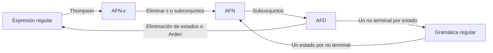

# Autómatas y Lenguajes Formales - Máquinas con un número finito de estados y lenguajes tipo 3

## 2.8 Relación entre autómatas finitos, lenguajes regulares y expresiones regulares.

---

Este tema cierra el estudio de los lenguajes regulares reuniendo sus descripciones. Los autómatas finitos son **reconocedores**: deciden si una cadena pertenece. Las expresiones regulares son **descripciones algebraicas**: dicen cómo se construyen las cadenas con unión, concatenación y estrella. Las gramáticas regulares son **generadores**. El **teorema de Kleene** dice que las tres describen la misma clase de lenguajes, y su demostración da algoritmos para pasar de cualquiera a cualquier otra.

### El teorema de Kleene

**Teorema (Kleene, 1956).** Para un lenguaje $L \subseteq \Sigma^*,$ son equivalentes:

1. $L = L(r)$ para alguna expresión regular $r.$
2. $L$ es reconocido por un AFN con transiciones $\varepsilon.$
3. $L$ es reconocido por un AFN.
4. $L$ es reconocido por un AFD.

Y por el tema 2.6, también:

5. $L$ es generado por una gramática lineal por la derecha (o por la izquierda).



Las flechas de AFN-ε a AFN y de AFN a AFD son las construcciones del tema 2.5, y las de las gramáticas, las del tema 2.6. Faltan dos: de expresión regular a autómata y de autómata a expresión regular.

### De expresión regular a autómata

**Teorema.** Para toda expresión regular $r$ hay un AFN-ε con un único estado inicial, un único estado final, ninguna transición que entre al inicial y ninguna que salga del final, que reconoce $L(r).$

**Demostración.** Por inducción sobre la estructura de $r,$ con la construcción de Thompson (tema 1.3):

- **Casos base.** Para $\emptyset,$ dos estados sin transiciones. Para $\varepsilon,$ dos estados unidos por una transición $\varepsilon.$ Para $a,$ dos estados unidos por una transición con $a.$
- **Unión** $r + s.$ Un estado inicial nuevo con transiciones $\varepsilon$ a los iniciales de los autómatas de $r$ y de $s,$ y transiciones $\varepsilon$ de sus finales a un estado final nuevo. Un camino del inicial al final pasa por exactamente uno de los dos, así que lee una cadena de $L(r)$ o una de $L(s).$
- **Concatenación** $rs.$ Una transición $\varepsilon$ del final de $r$ al inicial de $s.$ Un camino lee primero una cadena de $L(r)$ y luego una de $L(s).$
- **Estrella** $r^*.$ Estados inicial y final nuevos; transiciones $\varepsilon$ del inicial nuevo al inicial de $r$ y al final nuevo; del final de $r$ al inicial de $r$ y al final nuevo. Un camino recorre el autómata de $r$ cero o más veces. $\blacksquare$

Las condiciones sobre el estado inicial y el final son las que hacen que las piezas se puedan pegar sin crear caminos indeseados.

### De autómata a expresión regular

Hay tres métodos clásicos, que dan expresiones distintas pero equivalentes.

#### Método 1: los lenguajes $R_{ij}^{(k)}$ (McNaughton y Yamada)

Se numeran los estados del AFD como $1, \ldots, n.$ Sea $R_{ij}^{(k)}$ el conjunto de cadenas que llevan del estado $i$ al estado $j$ pasando, **en medio**, solo por estados con número a lo más $k.$ Entonces:

- Para $k = 0,$ el camino no pasa por ningún estado intermedio: $R_{ij}^{(0)}$ es la unión de los símbolos $a$ con $\delta(i, a) = j,$ más $\varepsilon$ si $i = j.$
- Para $k \geq 1,$ un camino de $i$ a $j$ por estados de número a lo más $k$ o no pasa por $k,$ o pasa por $k$ una o más veces. En el segundo caso se parte en un tramo de $i$ a $k,$ cero o más vueltas de $k$ a $k,$ y un tramo de $k$ a $j,$ todos sin pasar por $k$ en medio:

$$ R_{ij}^{(k)} = R_{ij}^{(k-1)} + R_{ik}^{(k-1)}\left(R_{kk}^{(k-1)}\right)^*R_{kj}^{(k-1)} $$

El lenguaje del AFD, con estado inicial 1, es la unión de los $R_{1j}^{(n)}$ con $j$ de aceptación. Por inducción sobre $k,$ cada $R_{ij}^{(k)}$ es una expresión regular, lo que demuestra que todo lenguaje reconocido por un AFD es regular. $\blacksquare$

Es la misma recursión del algoritmo de Floyd-Warshall para caminos más cortos, con la unión en lugar del mínimo y la concatenación en lugar de la suma. Como cada paso puede cuadruplicar el tamaño de la expresión, el resultado puede tener tamaño $O(4^n).$

#### Método 2: eliminación de estados

Se trabaja con un **autómata generalizado**, cuyas aristas tienen expresiones regulares en lugar de símbolos.

1. Se agregan un estado inicial nuevo $I,$ con una arista $\varepsilon$ al inicial original, y un estado final nuevo $F,$ con aristas $\varepsilon$ desde los finales originales.
2. Se eliminan uno por uno los estados originales. Para eliminar $k,$ por cada par de aristas $p \xrightarrow{r_1} k$ y $k \xrightarrow{r_3} q,$ con un lazo $k \xrightarrow{r_2} k,$ se agrega la arista $p \xrightarrow{r_1r_2^*r_3} q,$ uniéndola con la que ya hubiera de $p$ a $q.$
3. Al final solo quedan $I$ y $F,$ y la etiqueta de la arista entre ellos es la expresión buscada.

**Ejemplo.** Para el AFD de los múltiplos de 3 en binario, con estados $0, 1, 2$ (el residuo), se elimina primero el 2: tiene un lazo con 1, recibe un 0 desde 1 y le regresa un 0 a 1, así que aparece un lazo nuevo en 1:

$$ 1 \xrightarrow{01^*0} 1 $$

Ahora el estado 1 tiene lazo $01^*0,$ recibe un 1 desde 0 y le regresa un 1 a 0. Al eliminarlo aparece un lazo en 0: $1(01^*0)^*1.$ Junto con el lazo original 0, el estado 0 tiene lazo $0 + 1(01^*0)^*1,$ y como es inicial y final, la expresión es

$$ (0 + 1(01^*0)^*1)^* $$

El orden de eliminación cambia la expresión, a veces mucho, pero no el lenguaje.

#### Método 3: ecuaciones y el lema de Arden

Se escribe una ecuación por estado, $X_q = \sum_a aX_{\delta(q, a)} + [\varepsilon \text{ si } q \in F],$ y se resuelve el sistema por sustitución con el lema de Arden, $X = AX + B \Rightarrow X = A^*B$ si $\varepsilon \notin A.$ El ejemplo completo está en el tema 1.3. Es el mismo cálculo que la eliminación de estados, escrito como álgebra.

### Tamaños y costos de las conversiones

| Conversión | Tamaño del resultado |
| --- | --- |
| Expresión a AFN-ε (Thompson) | lineal en el tamaño de la expresión |
| AFN a AFD (subconjuntos) | hasta $2^n$ estados, y a veces es inevitable |
| AFD a expresión regular | hasta exponencial, y a veces es inevitable |
| AFD a gramática y gramática a AFN | lineal |

Que las conversiones puedan ser exponenciales explica por qué en la práctica se usan las tres representaciones: las expresiones regulares para que las personas escriban los patrones, los AFN para construirlos y combinarlos, y los AFD para ejecutarlos rápido.

### Aplicaciones de la equivalencia

- **Analizadores léxicos.** Las definiciones de tokens se escriben como expresiones regulares, se convierten con Thompson en AFN-ε, se combinan en uno solo con una unión, se determinizan y se minimizan. Es el proceso que automatizan `lex` y `flex`.
- **Motores de expresiones regulares.** RE2, `grep` y el analizador de Rust simulan el AFN o construyen el AFD bajo demanda, con tiempo lineal garantizado. Los motores con retroceso, como los de Perl, Python y Java, recorren las alternativas una por una, lo que permite extensiones no regulares pero puede tardar un tiempo exponencial.
- **Verificación.** Las propiedades de seguridad de un sistema se escriben como expresiones regulares o fórmulas lógicas, se convierten en autómatas y se combinan con el modelo del sistema mediante el producto (tema 2.7).

### Implementación en Python

El programa implementa la eliminación de estados con simplificaciones para $\emptyset$ y $\varepsilon,$ y comprueba las expresiones obtenidas contra el AFD original con el módulo `re`, en todas las cadenas binarias de longitud a lo más 10.

```python
import re
from itertools import product

# Expresiones como cadenas; None representa ∅ y '' representa ε.
def union(r, s):
    if r is None: return s
    if s is None or r == s: return r
    return f"{r}+{s}"

def concat(r, s):
    if r is None or s is None: return None
    return envolver(r) + envolver(s)

def estrella(r):
    if r is None or r == '': return ''
    return (r if len(r) == 1 else f"({r})") + '*'

def envolver(r):
    """Pone paréntesis a una unión para concatenarla sin cambiar su significado."""
    nivel = 0
    for c in r:
        nivel += (c == '(') - (c == ')')
        if c == '+' and nivel == 0:
            return f"({r})"
    return r

def eliminar_estados(Q, delta, inicial, finales):
    """Método de eliminación de estados. delta: dict (p, a) -> q de un AFD."""
    I, F = 'inicio', 'fin'
    R = {}                                          # R[(p, q)] = expresión de la arista p -> q
    def agregar(p, q, r):
        R[(p, q)] = union(R.get((p, q)), r)
    for (p, a), q in delta.items():
        agregar(p, q, a)
    agregar(I, inicial, '')
    for f in finales:
        agregar(f, F, '')
    for k in Q:                                      # eliminar k: p -> k -> q se vuelve p -> q
        lazo = estrella(R.get((k, k)))
        entradas = [p for (p, q) in R if q == k and p != k]
        salidas = [q for (p, q) in R if p == k and q != k]
        for p in entradas:
            for q in salidas:
                agregar(p, q, concat(concat(R[(p, k)], lazo), R[(k, q)]))
        R = {(p, q): r for (p, q), r in R.items() if k not in (p, q)}
    return R.get((I, F))

def a_python(r):
    return r.replace('+', '|')

# Cadenas binarias con un número par de ceros
par0 = {('p', '0'): 'i', ('p', '1'): 'p', ('i', '0'): 'p', ('i', '1'): 'i'}
# Múltiplos de 3 en binario
mod3 = {(r, a): str((2 * int(r) + int(a)) % 3) for r in '012' for a in '01'}

cadenas = [''.join(t) for k in range(11) for t in product('01', repeat=k)]
for nombre, delta, Q, ini, fin in [("par de ceros", par0, ['i', 'p'], 'p', {'p'}),
                                   ("múltiplos de 3", mod3, ['2', '1', '0'], '0', {'0'})]:
    r = eliminar_estados(Q, delta, ini, fin)
    def afd(w, q=ini):
        for a in w:
            q = delta[(q, a)]
        return q in fin
    ok = all(bool(re.fullmatch(a_python(r), w)) == afd(w) for w in cadenas)
    print(f"{nombre}: {r}   coincide con el AFD: {ok}")
```

Salida:

```text
par de ceros: (1+01*0)*   coincide con el AFD: True
múltiplos de 3: (0+1(01*0)*1)*   coincide con el AFD: True
```

### Ejercicios Propuestos

1. **Kleene en un ejemplo.** Para la expresión $(a + b)^*b,$ construye un AFN-ε con Thompson, conviértelo en AFD, minimízalo y vuelve a obtener una expresión regular por eliminación de estados.

2. **Orden de eliminación.** En el AFD de los ceros pares, con estados $p$ (inicial y final) e $i,$ elimina primero $p$ y luego $i.$ Compara con la expresión del programa.

3. **McNaughton y Yamada.** Calcula los $R_{ij}^{(0)}$ y $R_{ij}^{(1)}$ del AFD de dos estados de las cadenas que terminan en $a,$ con estado 1 inicial y estado 2 final, y $\delta(1, a) = 2,$ $\delta(1, b) = 1,$ $\delta(2, a) = 2,$ $\delta(2, b) = 1.$

4. **Gramática.** Escribe una gramática lineal por la derecha para el lenguaje de $(0 + 1(01^*0)^*1)^*.$

5. **Reflexión.** ¿Por qué la construcción de Thompson exige que no entren transiciones al estado inicial ni salgan del final? Da un ejemplo de lo que fallaría en la estrella si no se agregaran estados nuevos.

### Soluciones

**Ejercicio 1.** El AFD mínimo tiene dos estados: $q_0,$ inicial, para las cadenas que no terminan en $b,$ y $q_1,$ final, para las que sí, con $b$ llevando siempre a $q_1$ y $a$ siempre a $q_0.$ Al eliminar $q_0$ queda en $q_1$ un lazo $b + aa^*b$ y la arista del inicio $a^*b;$ al eliminar $q_1,$ la expresión es $a^*b(b + aa^*b)^*,$ equivalente a $(a + b)^*b.$

**Ejercicio 2.** Al eliminar $p$ primero, con $p$ inicial y final, se obtiene $1^* + 1^*0(1 + 01^*0)^*01^*.$ Es más larga que $(1 + 01^*0)^*$ pero denota el mismo lenguaje; el orden de eliminación conviene elegirlo para dejar al final los estados inicial y finales.

**Ejercicio 3.** $R_{11}^{(0)} = \varepsilon + b,$ $R_{12}^{(0)} = a,$ $R_{21}^{(0)} = b,$ $R_{22}^{(0)} = \varepsilon + a.$ Con $k = 1,$ como $(\varepsilon + b)^* = b^*:$ $R_{11}^{(1)} = b^*,$ $R_{12}^{(1)} = b^*a,$ $R_{21}^{(1)} = bb^* = b^+,$ $R_{22}^{(1)} = \varepsilon + a + bb^*a = \varepsilon + b^*a.$ La respuesta final es $R_{12}^{(2)} = R_{12}^{(1)} + R_{12}^{(1)}(R_{22}^{(1)})^*R_{22}^{(1)} = b^*a(b^*a)^*,$ que en efecto denota las cadenas que terminan en $a.$

**Ejercicio 4.** La del ejercicio 2 del tema 2.6: $R_0 \rightarrow 0R_0 \mid 1R_1 \mid \varepsilon,$ $R_1 \rightarrow 0R_2 \mid 1R_0,$ $R_2 \rightarrow 0R_1 \mid 1R_2,$ obtenida del AFD.

**Ejercicio 5.** Si en $r^*$ se usara el estado inicial de $r$ como inicial y final, y $r$ tuviera transiciones que regresan a su inicial, se podrían combinar caminos de formas no previstas. Por ejemplo, con $(a^*b)^*,$ si el autómata de $a^*b$ tiene un lazo con $a$ en su estado inicial y se declara ese estado como final, se aceptaría $a,$ que no está en el lenguaje: la estrella debe aceptar cadenas vacías o terminadas en $b,$ y el atajo convierte en final un estado del que no se debió poder salir sin leer la $b.$

### Referencias

1. Hopcroft, J. E., Motwani, R., and Ullman, J., _Introduction to Automata Theory, Languages, and Computation_. Pearson, 2007. Capítulo 3.
2. Sipser, M., _Introduction to the Theory of Computation_. Cengage, 2013. Sección 1.3.
3. Kleene, S. C. (1956). Representation of events in nerve nets and finite automata. En _Automata Studies_, Princeton University Press, 3-41.
4. McNaughton, R. and Yamada, H. (1960). Regular expressions and state graphs for automata. _IRE Transactions on Electronic Computers_, EC-9(1), 39-47.
5. Aho, A. V., Lam, M., Sethi, R., and Ullman, J. D., _Compilers: Principles, Techniques, and Tools_. Pearson, 2006. Capítulo 3.

### Para profundizar

- Investiga la **altura de estrella** de un lenguaje regular, el anidamiento mínimo de estrellas en una expresión que lo denota, y el problema de la altura de estrella generalizada, todavía abierto.
- Estudia la construcción de **Glushkov** y la de las **derivadas parciales** de Antimirov, que producen AFN sin transiciones $\varepsilon.$
- Revisa cómo RE2 garantiza tiempo lineal y qué extensiones de las expresiones regulares no admite por esa razón.
