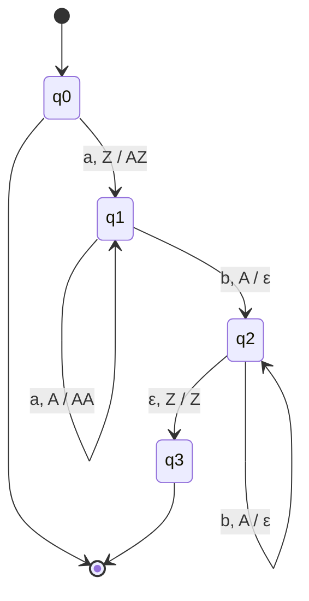

# Autómatas y Lenguajes Formales - Autómatas con pila

## 3.1 Formalización.

---

Un autómata finito no puede reconocer $\{a^nb^n \mid n \geq 0\}$ porque tendría que contar sin límite. Un **autómata con pila** (AP, o PDA por sus siglas en inglés) es un autómata finito al que se le agrega una **pila** de tamaño ilimitado: puede guardar información, pero solo puede consultar y modificar el **tope**. Esa forma restringida de memoria es exactamente la que hace falta para la estructura anidada de los lenguajes de programación (paréntesis, bloques, llamadas), y los autómatas con pila reconocen exactamente los lenguajes libres de contexto (tema 4.4).

### Intuición

En cada paso, el autómata mira tres cosas: su estado, el siguiente símbolo de la entrada (o ninguno) y el símbolo del tope de la pila. Según eso, cambia de estado, consume o no un símbolo de la entrada, y **reemplaza** el tope por una cadena de símbolos de pila: por ninguno para desapilar, por el mismo para dejarla igual, o por varios para apilar.

Para $\{a^nb^n\},$ el autómata apila un símbolo por cada $a$ y desapila uno por cada $b;$ acepta si al terminar la entrada ya no queda ninguno.

### Definición Formal

Un **autómata con pila** es una séptupla

$$ M = (Q, \Sigma, \Gamma, \delta, q_0, Z_0, F) $$

donde:

- $Q$ es un conjunto finito de estados.
- $\Sigma$ es el alfabeto de entrada.
- $\Gamma$ es el **alfabeto de la pila**, que puede contener símbolos que no están en $\Sigma.$
- $\delta : Q \times (\Sigma \cup \{\varepsilon\}) \times \Gamma \rightarrow \mathcal{P}_{\text{fin}}(Q \times \Gamma^*)$ es la función de transición, que da un conjunto **finito** de opciones.
- $q_0 \in Q$ es el estado inicial.
- $Z_0 \in \Gamma$ es el **símbolo inicial de la pila**, que marca el fondo.
- $F \subseteq Q$ es el conjunto de estados de aceptación.

Que $(p, \gamma) \in \delta(q, a, X)$ significa: en el estado $q,$ leyendo $a$ y con $X$ en el tope, el autómata **puede** pasar al estado $p$ y reemplazar $X$ por $\gamma,$ con el primer símbolo de $\gamma$ como nuevo tope. Si $a = \varepsilon,$ el movimiento no consume entrada. En los diagramas, esa transición se escribe como una flecha de $q$ a $p$ con la etiqueta $a, X / \gamma.$

Así definido, el autómata es **no determinista**: puede tener varias opciones en una misma situación, y acepta si alguna de sus computaciones acepta. Además, **siempre** necesita un símbolo en el tope para moverse: con la pila vacía, se detiene.

### Configuraciones y computaciones

Una **configuración** o descripción instantánea es una terna $(q, w, \gamma)$ con el estado actual, la parte de la entrada que falta por leer y el contenido de la pila, escrito con el tope a la izquierda. Un paso se escribe

$$ (q, aw, X\beta) \vdash (p, w, \gamma\beta) \qquad \text{si } (p, \gamma) \in \delta(q, a, X) $$

con $a \in \Sigma \cup \{\varepsilon\};$ el resto de la pila, $\beta,$ no se toca. Se escribe $\vdash^*$ para cero o más pasos.

Una propiedad importante: lo que el autómata hace no depende de la parte de la pila que está debajo, ni de la parte de la entrada que todavía no lee. Si $(q, x, \alpha) \vdash^* (p, \varepsilon, \beta),$ entonces $(q, xy, \alpha\gamma) \vdash^* (p, y, \beta\gamma)$ para cualesquiera $y$ y $\gamma.$

### Dos formas de aceptar

- **Por estado final:** $L(M) = \{w \mid (q_0, w, Z_0) \vdash^* (q, \varepsilon, \gamma) \text{ con } q \in F\},$ sin importar lo que quede en la pila.
- **Por pila vacía:** $N(M) = \{w \mid (q_0, w, Z_0) \vdash^* (q, \varepsilon, \varepsilon)\},$ sin importar el estado; en este caso $F$ no se usa.

**Teorema.** Un lenguaje es aceptado por estado final por algún AP si y solo si es aceptado por pila vacía por algún AP.

**Demostración (construcciones).**

- **De estado final a pila vacía.** Se pone un símbolo nuevo $X_0$ debajo de $Z_0$ al empezar. Desde cada estado de aceptación se agrega un movimiento $\varepsilon$ a un estado nuevo $p_e$ que vacía la pila, incluyendo $X_0.$ El símbolo $X_0$ evita que el autómata original vacíe la pila por accidente sin estar en un estado de aceptación.
- **De pila vacía a estado final.** Se pone un símbolo nuevo $X_0$ debajo de $Z_0.$ Cuando el autómata original vacía su pila, aparece $X_0$ en el tope; en ese momento un movimiento $\varepsilon$ lleva a un estado de aceptación nuevo. $\blacksquare$

### Ejemplo 1: $\{a^nb^n \mid n \geq 0\}$

$M = (\{q_0, q_1, q_2, q_3\}, \{a, b\}, \{A, Z\}, \delta, q_0, Z, \{q_0, q_3\})$ con

| Transición | Significado |
| --- | --- |
| $\delta(q_0, a, Z) = \{(q_1, AZ)\}$ | primera $a:$ apilar |
| $\delta(q_1, a, A) = \{(q_1, AA)\}$ | más letras $a:$ apilar |
| $\delta(q_1, b, A) = \{(q_2, \varepsilon)\}$ | primera $b:$ desapilar |
| $\delta(q_2, b, A) = \{(q_2, \varepsilon)\}$ | más letras $b:$ desapilar |
| $\delta(q_2, \varepsilon, Z) = \{(q_3, Z)\}$ | se vació la parte de las $A:$ aceptar |



La computación con $aabb$ es

$$ (q_0, aabb, Z) \vdash (q_1, abb, AZ) \vdash (q_1, bb, AAZ) \vdash (q_2, b, AZ) \vdash (q_2, \varepsilon, Z) \vdash (q_3, \varepsilon, Z) $$

Con $aab,$ el autómata termina la entrada en $(q_2, \varepsilon, AZ),$ sin movimiento posible y en un estado que no acepta. Con $abb,$ llega a $(q_2, b, Z)$ y se atasca: no hay transición con $b$ y $Z.$ Con $ba,$ no hay ningún movimiento desde $(q_0, ba, Z).$ El estado $q_0$ es de aceptación para aceptar la cadena vacía.

### Ejemplo 2: palíndromos de longitud par, $\{ww^R \mid w \in \{a, b\}^*\}$

Este autómata necesita el no determinismo. Tiene dos estados: en $p$ apila lo que lee, y en algún momento **adivina** que llegó a la mitad y pasa con un movimiento $\varepsilon$ a $q,$ donde compara cada símbolo con el tope y desapila. Acepta por pila vacía.

- $\delta(p, a, X) = \{(p, AX)\}$ y $\delta(p, b, X) = \{(p, BX)\}$ para $X \in \{A, B, Z\}.$
- $\delta(p, \varepsilon, X) = \{(q, X)\}$ para $X \in \{A, B, Z\}:$ adivinar la mitad.
- $\delta(q, a, A) = \{(q, \varepsilon)\}$ y $\delta(q, b, B) = \{(q, \varepsilon)\}:$ comparar.
- $\delta(q, \varepsilon, Z) = \{(q, \varepsilon)\}:$ vaciar el fondo.

Con $abba,$ la computación que acepta es

$$ (p, abba, Z) \vdash (p, bba, AZ) \vdash (p, ba, BAZ) \vdash (q, ba, BAZ) \vdash (q, a, AZ) \vdash (q, \varepsilon, Z) \vdash (q, \varepsilon, \varepsilon) $$

Las demás computaciones, que adivinan la mitad en otro momento, fallan; basta con que una acepte. Se puede demostrar que ningún autómata **determinista** reconoce este lenguaje: al leer una cadena de izquierda a derecha no hay forma de saber dónde está la mitad.

### Autómatas con pila deterministas

Un AP es **determinista** (APD, o DPDA) si en ninguna configuración tiene más de un movimiento posible:

1. $|\delta(q, a, X)| \leq 1$ para todo $q,$ $a \in \Sigma \cup \{\varepsilon\}$ y $X.$
2. Si $\delta(q, \varepsilon, X) \neq \emptyset,$ entonces $\delta(q, a, X) = \emptyset$ para todo $a \in \Sigma:$ si puede moverse sin leer, no puede moverse leyendo.

Los lenguajes que acepta un APD por estado final son los **libres de contexto deterministas**. Forman una clase estrictamente más pequeña que la de los libres de contexto, como muestra $\{ww^R\},$ pero incluye a casi todos los lenguajes de programación: los analizadores LR son autómatas con pila deterministas. A diferencia de los autómatas finitos, en los autómatas con pila el no determinismo **sí agrega poder**.

### Código de Simulación (Python)

El simulador explora en anchura todas las configuraciones alcanzables, que es la forma directa de implementar el no determinismo. Como un AP puede hacer crecer su pila sin leer nada, la búsqueda acota el tamaño de la pila para terminar siempre; esa cota es suficiente para los ejemplos, y en el tema 3.3 se estudia cuándo se puede justificar.

```python
from collections import deque
from itertools import product

class AP:
    """Autómata de pila M = (Q, Σ, Γ, δ, q0, Z0, F).

    delta: dict (estado, símbolo o '', tope) -> lista de (estado, cadena a apilar).
    La cadena a apilar se escribe con el nuevo tope a la izquierda; '' significa desapilar.
    """

    def __init__(self, delta, inicial, fondo, finales=(), por_pila_vacia=False):
        self.delta, self.q0, self.Z0 = delta, inicial, fondo
        self.F, self.por_pila_vacia = set(finales), por_pila_vacia

    def pasos(self, conf, w):
        """Configuraciones siguientes de (estado, posición en w, pila)."""
        q, i, pila = conf
        if not pila:
            return
        X, resto = pila[0], pila[1:]
        for p, gamma in self.delta.get((q, '', X), []):             # movimiento ε
            yield p, i, gamma + resto
        if i < len(w):
            for p, gamma in self.delta.get((q, w[i], X), []):       # lee w[i]
                yield p, i + 1, gamma + resto

    def acepta(self, w, max_pila=None):
        """Búsqueda en anchura de una computación de aceptación.
        max_pila acota el tamaño de la pila para que la búsqueda termine siempre."""
        max_pila = max_pila or 2 * len(w) + 2
        inicio = (self.q0, 0, self.Z0)
        vistas, cola = {inicio}, deque([inicio])
        while cola:
            q, i, pila = cola.popleft()
            if i == len(w) and (q in self.F if not self.por_pila_vacia else pila == ''):
                return True
            for c in self.pasos((q, i, pila), w):
                if len(c[2]) <= max_pila and c not in vistas:
                    vistas.add(c)
                    cola.append(c)
        return False

    def traza(self, w):
        """Una computación de aceptación, como lista de configuraciones (solo para depurar)."""
        inicio = (self.q0, 0, self.Z0)
        padre, cola = {inicio: None}, deque([inicio])
        while cola:
            c = cola.popleft()
            q, i, pila = c
            if i == len(w) and (q in self.F if not self.por_pila_vacia else pila == ''):
                camino = []
                while c:
                    camino.append(f"({c[0]}, {w[c[1]:] or 'ε'}, {c[2] or 'ε'})")
                    c = padre[c]
                return ' ⊢ '.join(reversed(camino))
            for s in self.pasos(c, w):
                if len(s[2]) <= 2 * len(w) + 2 and s not in padre:
                    padre[s] = c
                    cola.append(s)

# a^n b^n, por estado final; es determinista
anbn = AP({('q0', 'a', 'Z'): [('q1', 'AZ')], ('q1', 'a', 'A'): [('q1', 'AA')],
           ('q1', 'b', 'A'): [('q2', '')],   ('q2', 'b', 'A'): [('q2', '')],
           ('q2', '', 'Z'): [('q3', 'Z')]},
          'q0', 'Z', finales={'q0', 'q3'})

# w w^R, por pila vacía: no determinista, adivina la mitad
wwr = {('p', '', 'Z'): [('q', 'Z')], ('q', '', 'Z'): [('q', '')]}
for a, X in product('ab', 'ABZ'):
    wwr[('p', a, X)] = [('p', a.upper() + X)]                  # apilar
for a in 'ab':
    for X in 'AB':
        wwr[('p', '', X)] = [('q', X)]                         # adivinar la mitad
    wwr[('q', a, a.upper())] = [('q', '')]                     # comparar
wwr = AP(wwr, 'p', 'Z', por_pila_vacia=True)

cadenas = [''.join(t) for k in range(9) for t in product('ab', repeat=k)]
print("a^n b^n:", all(anbn.acepta(w) == (w == 'a' * (len(w) // 2) + 'b' * (len(w) // 2)) for w in cadenas))
print("w w^R:  ", all(wwr.acepta(w) == (len(w) % 2 == 0 and w == w[::-1]) for w in cadenas))
print(anbn.traza('aabb'))
print(wwr.traza('abba'))
```

Salida:

```text
a^n b^n: True
w w^R:   True
(q0, aabb, Z) ⊢ (q1, abb, AZ) ⊢ (q1, bb, AAZ) ⊢ (q2, b, AZ) ⊢ (q2, ε, Z) ⊢ (q3, ε, Z)
(p, abba, Z) ⊢ (p, bba, AZ) ⊢ (p, ba, BAZ) ⊢ (q, ba, BAZ) ⊢ (q, a, AZ) ⊢ (q, ε, Z) ⊢ (q, ε, ε)
```

Las dos primeras líneas comparan los autómatas con la definición de sus lenguajes en todas las cadenas sobre $\{a, b\}$ de longitud a lo más 8.

### Ejercicios Propuestos

1. **Diseño.** Construye un AP para $\{a^nb^{2n} \mid n \geq 0\}.$

2. **Diseño.** Construye un AP para $\{w \in \{a, b\}^* \mid |w|_a = |w|_b\}.$

3. **Diseño.** Construye un AP para el lenguaje de los paréntesis balanceados y di si es determinista.

4. **Computaciones.** Escribe todas las computaciones del AP del ejemplo 2 con la entrada $aa,$ e indica cuál acepta.

5. **Determinismo.** Muestra que el lenguaje $\{wcw^R \mid w \in \{a, b\}^*\}$ sí tiene un AP determinista.

### Soluciones

**Ejercicio 1.** Por cada $a$ se apilan **dos** símbolos: $\delta(q_0, a, Z) = \{(q_1, AAZ)\},$ $\delta(q_1, a, A) = \{(q_1, AAA)\};$ por cada $b$ se desapila uno: $\delta(q_1, b, A) = \{(q_2, \varepsilon)\},$ $\delta(q_2, b, A) = \{(q_2, \varepsilon)\};$ y $\delta(q_2, \varepsilon, Z) = \{(q_3, Z)\},$ con $F = \{q_0, q_3\}.$

**Ejercicio 2.** La pila guarda el **exceso** de un símbolo sobre el otro. Con un solo estado $q$ y aceptación por estado final con un estado $f:$ si el tope es $Z$ o del mismo tipo que el símbolo leído, se apila: $a$ apila $A$ y $b$ apila $B.$ Si es del tipo contrario, se desapila, porque se cancelan. Cuando el tope es $Z,$ un movimiento $\varepsilon$ va a $f.$ La pila nunca mezcla $A$ con $B,$ y en todo momento contiene $|w|_a - |w|_b$ letras $A$ o la diferencia contraria en letras $B.$

**Ejercicio 3.** Un primer diseño es $\delta(q, (, X) = \{(q, PX)\}$ para $X \in \{P, Z\},$ $\delta(q, ), P) = \{(q, \varepsilon)\}$ y $\delta(q, \varepsilon, Z) = \{(f, Z)\},$ con $F = \{f\}.$ **No** es determinista: en $q$ con tope $Z$ hay un movimiento $\varepsilon$ y otro que lee un paréntesis, lo que viola la segunda condición. Una versión determinista usa dos estados: $q,$ de aceptación, cuando la pila solo tiene el fondo, y $r$ cuando hay paréntesis abiertos. Las transiciones son $\delta(q, (, Z) = \{(r, PZ)\},$ $\delta(r, (, P) = \{(r, PP)\},$ $\delta(r, ), P) = \{(r, \varepsilon)\}$ y $\delta(r, \varepsilon, Z) = \{(q, Z)\}.$ En $r,$ el movimiento $\varepsilon$ solo existe con tope $Z$ y los que leen solo con tope $P,$ así que nunca hay dos opciones.

**Ejercicio 4.** Desde $(p, aa, Z)$ se puede adivinar la mitad al principio, $(q, aa, Z) \vdash (q, aa, \varepsilon),$ que se detiene sin leer la entrada; después de una $a,$ $(p, a, AZ) \vdash (q, a, AZ) \vdash (q, \varepsilon, Z) \vdash (q, \varepsilon, \varepsilon),$ que acepta; o después de dos, $(p, \varepsilon, AAZ) \vdash (q, \varepsilon, AAZ),$ que se detiene con la pila llena. Solo la segunda acepta.

**Ejercicio 5.** El separador $c$ marca la mitad, así que no hay que adivinar: en $p$ se apila con $a$ y $b,$ con $c$ se pasa a $q$ sin tocar la pila, en $q$ se compara y desapila, y con $Z$ en el tope un movimiento $\varepsilon$ lleva al estado de aceptación. En ninguna situación hay dos opciones.

### Referencias

1. Hopcroft, J. E., Motwani, R., and Ullman, J., _Introduction to Automata Theory, Languages, and Computation_. Pearson, 2007. Secciones 6.1 a 6.4.
2. Sipser, M., _Introduction to the Theory of Computation_. Cengage, 2013. Sección 2.2.
3. Viso G., E., _Introducción a la teoría de la computación_. Las Prensas de Ciencias, 2008. Capítulo 5.
4. Rich, E., _Automata, Computability and Complexity: Theory and Applications_. Pearson, 2008. Capítulo 12.

### Para profundizar

- Investiga los **autómatas con dos pilas**: son tan poderosos como una máquina de Turing, porque las dos pilas pueden simular una cinta.
- Estudia los **autómatas con pila visible** (*visibly pushdown*), en los que cada símbolo de entrada determina si se apila o se desapila; tienen casi todas las buenas propiedades de los lenguajes regulares y se usan para procesar XML.
- Explora cómo la pila de llamadas de un programa recursivo es, literalmente, la pila de un autómata.
