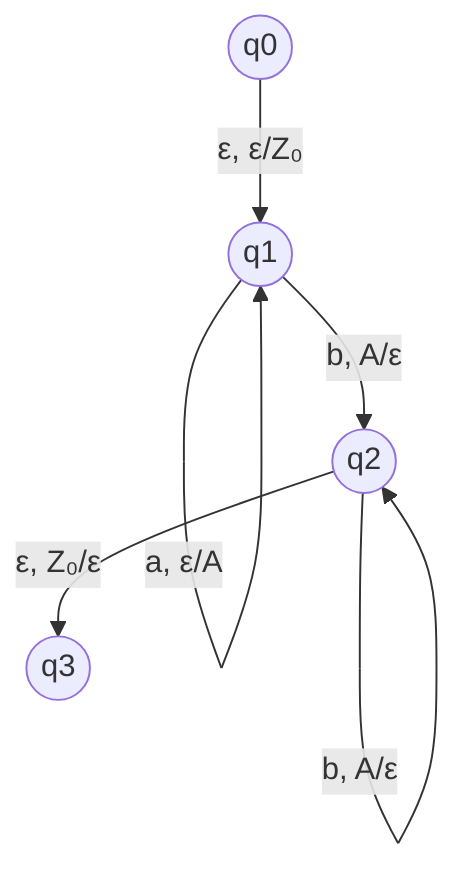

# Autómatas y Lenguajes Formales - Autómatas con pila

## 3.1 Formalización.

---

Los autómatas con pila (AP) son máquinas abstractas que extienden la capacidad de los autómatas finitos mediante la adición de una memoria en forma de pila. Esta guía se enfoca en la **formalización** de estos autómatas, es decir, en su definición matemática precisa y sus componentes.

### Definición Formal

Un autómata con pila (AP) es una 7-tupla definida como:

$$M = (Q, \Sigma, \Gamma, \delta, q_0, Z_0, F)$$

Donde:

- $Q:$ Conjunto finito de estados
- $\Sigma:$ Alfabeto de entrada (finito)
- $\Gamma:$ Alfabeto de la pila (finito)
- $\delta:$ Función de transición: $Q \times (\Sigma \cup \{\varepsilon\}) \times \Gamma \to \mathcal{P}(Q \times \Gamma^*)$
- $q_0:$ Estado inicial $(q_0 \in Q)$
- $Z_0:$ Símbolo inicial de la pila $(Z_0 \in \Gamma)$
- $F:$ Conjunto de estados de aceptación $(F \subseteq Q)$

### Componentes Detallados

#### Función de Transición

La función de transición $\delta$ es el componente central que define el comportamiento del autómata:

$$\delta(q, a, X) = \{(p_1, \gamma_1), (p_2, \gamma_2), ..., (p_k, \gamma_k)\}$$

Donde:

- $q \in Q:$ Estado actual
- $a \in \Sigma \cup \{\varepsilon\}:$ Símbolo de entrada o $\varepsilon$
- $X \in \Gamma:$ Símbolo en el tope de la pila
- $p_i \in Q:$ Nuevo estado
- $\gamma_i \in \Gamma^*:$ Cadena que reemplaza a $X$ en el tope de la pila

#### Configuración Instantánea

La configuración instantánea describe el estado completo del autómata en un momento dado:

$$(q, w, \gamma)$$

Donde:

- $q \in Q:$ Estado actual
- $w \in \Sigma^*:$ Cadena de entrada por procesar
- $\gamma \in \Gamma^*:$ Contenido actual de la pila

#### Relación de Movimiento

La relación $\vdash_M$ entre configuraciones se define como:

$$(q, aw, X\beta) \vdash_M (p, w, \gamma\beta)$$

si y sólo si $(p, \gamma) \in \delta(q, a, X)$

### Representación con Diagramas



Este diagrama representa un AP para el lenguaje $\{a^nb^n \mid n \geq 0\}$

### Ejemplo Formal

#### Autómata para $L = \{a^nb^n \mid n \geq 0\}$

Definamos formalmente $M = (Q, \Sigma, \Gamma, \delta, q_0, Z_0, F):$

- $Q = \{q_0, q_1, q_2, q_3\}$
- $\Sigma = \{a, b\}$
- $\Gamma = \{A, Z_0\}$
- $F = \{q_3\}$
- $\delta$ definida como:
  1. $\delta(q_0, \varepsilon, \varepsilon) = \{(q_1, Z_0)\}$
  2. $\delta(q_1, a, Z_0) = \{(q_1, AZ_0)\}$
  3. $\delta(q_1, a, A) = \{(q_1, AA)\}$
  4. $\delta(q_1, b, A) = \{(q_2, \varepsilon)\}$
  5. $\delta(q_2, b, A) = \{(q_2, \varepsilon)\}$
  6. $\delta(q_2, \varepsilon, Z_0) = \{(q_3, \varepsilon)\}$

### Código de Simulación (Python)

```python
class PushdownAutomaton:
    def __init__(self, states, input_alphabet, stack_alphabet,
                 transitions, start_state, start_stack, accept_states):
        self.states = states
        self.input_alphabet = input_alphabet
        self.stack_alphabet = stack_alphabet
        self.transitions = transitions
        self.start_state = start_state
        self.start_stack = start_stack
        self.accept_states = accept_states
        self.stack = [start_stack]

    def process(self, input_string):
        current_state = self.start_state
        self.stack = [self.start_stack]
        index = 0

        while index < len(input_string) or self.stack:
            current_char = input_string[index] if index < len(input_string) else None

            # Buscar transición válida
            transition_found = False
            for (state, char, stack_top), next_configs in self.transitions.items():
                if state == current_state:
                    if (char == current_char or char == 'ε') and \
                       (stack_top == self.stack[-1] if self.stack else stack_top == 'ε'):
                        # Aplicar transición
                        for next_state, stack_push in next_configs:
                            # Guardar configuración actual para backtracking si es necesario
                            old_state = current_state
                            old_stack = self.stack.copy()

                            # Actualizar estado y pila
                            current_state = next_state
                            if stack_top != 'ε':
                                self.stack.pop()
                            if stack_push != 'ε':
                                self.stack.extend(list(stack_push[::-1]))

                            transition_found = True
                            if char != 'ε':
                                index += 1
                            break
                        if transition_found:
                            break
            if not transition_found:
                return False

        return current_state in self.accept_states and index == len(input_string)

# Ejemplo de uso
if __name__ == "__main__":
    # Definir AP para a^n b^n
    states = {'q0', 'q1', 'q2', 'q3'}
    input_alphabet = {'a', 'b'}
    stack_alphabet = {'A', 'Z0'}
    transitions = {
        ('q0', 'ε', 'ε'): {('q1', 'Z0')},
        ('q1', 'a', 'Z0'): {('q1', 'AZ0')},
        ('q1', 'a', 'A'): {('q1', 'AA')},
        ('q1', 'b', 'A'): {('q2', 'ε')},
        ('q2', 'b', 'A'): {('q2', 'ε')},
        ('q2', 'ε', 'Z0'): {('q3', 'ε')}
    }
    start_state = 'q0'
    start_stack = 'Z0'
    accept_states = {'q3'}

    pda = PushdownAutomaton(states, input_alphabet, stack_alphabet,
                           transitions, start_state, start_stack, accept_states)

    # Probar con algunas cadenas
    test_strings = ['', 'ab', 'aabb', 'aaabbb', 'aab', 'abb']
    for test in test_strings:
        result = pda.process(test)
        print(f"'{test}': {'Aceptada' if result else 'Rechazada'}")
```

### Ejercicios Propuestos

#### Ejercicio 1

Define formalmente un autómata con pila que reconozca el lenguaje de palíndromos sobre $\{a, b\}$ con longitud par: $L = \{ww^R \mid w \in \{a, b\}^*\}$

#### Ejercicio 2

Dado el siguiente autómata con pila:

- $Q = \{q_0, q_1, q_2\}$
- $\Sigma = \{0, 1\}$
- $\Gamma = \{Z_0, X\}$
- $F = \{q_2\}$
- $\delta:$
  1. $\delta(q_0, 0, Z_0) = \{(q_0, XZ_0)\}$
  2. $\delta(q_0, 0, X) = \{(q_0, XX)\}$
  3. $\delta(q_0, 1, X) = \{(q_1, \varepsilon)\}$
  4. $\delta(q_1, 1, X) = \{(q_1, \varepsilon)\}$
  5. $\delta(q_1, \varepsilon, Z_0) = \{(q_2, Z_0)\}$

a) ¿Qué lenguaje reconoce este autómata?
b) Simula el procesamiento de la cadena "0011"

#### Ejercicio 3

Demuestra que la siguiente función de transición no es válida para un autómata con pila determinista y explica por qué:

$$\delta(q_0, a, Z_0) = \{(q_1, AZ_0), (q_2, BZ_0)\}$$

#### Ejercicio 4

Formaliza un autómata con pila que reconozca el lenguaje:

$$L = \{a^ib^jc^k \mid i = j \lor j = k\}$$

### Soluciones a Ejercicios Selectos

#### Solución Ejercicio 2

a) El autómata reconoce el lenguaje $\{0^n1^n \mid n \geq 0\}$

b) Procesamiento de "0011":

1. $(q_0, 0011, Z_0) \vdash (q_0, 011, XZ_0)$ [transición 1]
2. $(q_0, 011, XZ_0) \vdash (q_0, 11, XXZ_0)$ [transición 2]
3. $(q_0, 11, XXZ_0) \vdash (q_1, 1, XZ_0)$ [transición 3]
4. $(q_1, 1, XZ_0) \vdash (q_1, \varepsilon, Z_0)$ [transición 4]
5. $(q_1, \varepsilon, Z_0) \vdash (q_2, \varepsilon, Z_0)$ [transición 5]

La cadena es aceptada ya que se llega a $q_2 \in F$ con la entrada completamente procesada.

### Referencias

1. **Viso G., E.** (2008). _Introducción a la teoría de la computación_. Las Prensas de Ciencias. (Capítulo 5: Autómatas con Pila)
2. **Rich, E.** (2008). _Automata, Computability and Complexity, theory and applications_. Pearson Prentice Hall. (Capítulo 6: Pushdown Automata)
3. **Hopcroft, J. E., Motwani, R., and Ullman, J.** (2007). _Introduction to Automata Theory, Languages, and Computation_. Addison-Wesley. (Capítulo 6: Pushdown Automata)
4. **Sipser, M.** (2005). _Introduction to the Theory of Computation_. PWS Publishing Company. (Capítulo 2: Context-Free Languages)

### Notas Adicionales

- Los autómatas con pila pueden ser **deterministas** (DPDA) o **no deterministas** (PDA)
- Existen lenguajes libres de contexto que no pueden ser reconocidos por autómatas con pila deterministas
- La equivalencia entre autómatas con pila no deterministas y gramáticas libres de contexto es fundamental en la teoría de lenguajes formales
