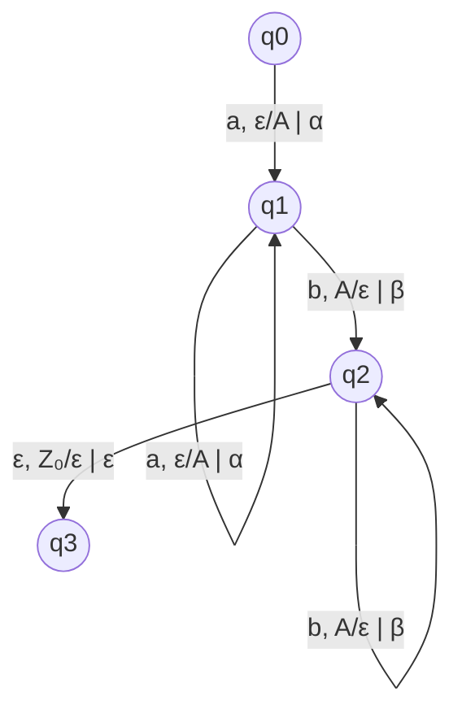
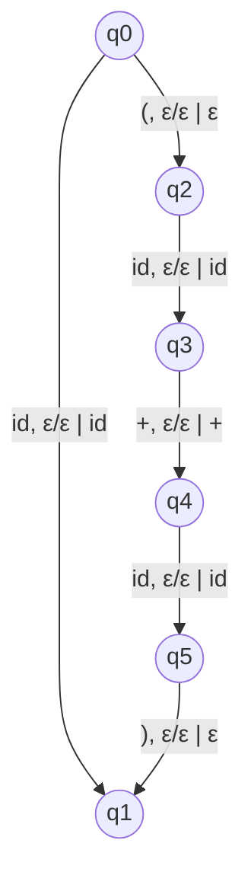

# Autómatas y Lenguajes Formales - Autómatas con pila

## 3.2 Traducción con autómatas con pila.

---

Los autómatas con pila no solo pueden reconocer lenguajes libres de contexto, sino también realizar **traducciones** o transformaciones de cadenas. Esta capacidad los hace particularmente útiles en aplicaciones como compilación y procesamiento de lenguajes naturales.

### Definición Formal de Traductor con Pila

Un traductor con pila es una 8-tupla:

$$T = (Q, \Sigma, \Gamma, \Delta, \delta, q_0, Z_0, F)$$

Donde:

- $Q, \Sigma, \Gamma, q_0, Z_0, F:$ Como en un AP estándar
- $\Delta:$ Alfabeto de salida
- $\delta:$ Función de transición extendida: $Q \times (\Sigma \cup \{\varepsilon\}) \times \Gamma \to \mathcal{P}(Q \times \Gamma^* \times \Delta^*)$

### Función de Transición para Traducción

La función de transición para un traductor produce tripletas:

$$\delta(q, a, X) = \{(p_1, \gamma_1, w_1), (p_2, \gamma_2, w_2), ..., (p_k, \gamma_k, w_k)\}$$

Donde $w_i \in \Delta^*$ es la cadena de salida generada en la transición.

### Configuración Instantánea para Traducción

La configuración se extiende para incluir la salida:

$$(q, w, \gamma, v)$$

Donde:

- $q \in Q:$ Estado actual
- $w \in \Sigma^*:$ Entrada por procesar
- $\gamma \in \Gamma^*:$ Contenido de la pila
- $v \in \Delta^*:$ Salida generada hasta el momento

### Relación de Movimiento para Traducción

$$(q, aw, X\beta, v) \vdash_T (p, w, \gamma\beta, vw')$$

si y sólo si $(p, \gamma, w') \in \delta(q, a, X)$

### Diagrama de un Traductor con Pila



Este traductor convierte $a^nb^n$ a $\alpha^n\beta^n$

### Ejemplo: Traductor de $a^nb^n$ a $\alpha^n\beta^n$

#### Definición Formal

$T = (Q, \Sigma, \Gamma, \Delta, \delta, q_0, Z_0, F)$ donde:

- $Q = \{q_0, q_1, q_2, q_3\}$
- $\Sigma = \{a, b\}$
- $\Gamma = \{A, Z_0\}$
- $\Delta = \{\alpha, \beta\}$
- $F = \{q_3\}$
- $\delta$ definida como:
  1. $\delta(q_0, \varepsilon, \varepsilon) = \{(q_1, Z_0, \varepsilon)\}$
  2. $\delta(q_1, a, Z_0) = \{(q_1, AZ_0, \alpha)\}$
  3. $\delta(q_1, a, A) = \{(q_1, AA, \alpha)\}$
  4. $\delta(q_1, b, A) = \{(q_2, \varepsilon, \beta)\}$
  5. $\delta(q_2, b, A) = \{(q_2, \varepsilon, \beta)\}$
  6. $\delta(q_2, \varepsilon, Z_0) = \{(q_3, \varepsilon, \varepsilon)\}$

#### Simulación de la Traducción

Para la entrada "aabb":

```
(q₀, aabb, ε, ε) ⊢ (q₁, aabb, Z₀, ε)         [transición 1]
⊢ (q₁, abb, AZ₀, α)                         [transición 2]
⊢ (q₁, bb, AAZ₀, αα)                        [transición 3]
⊢ (q₂, b, AZ₀, ααβ)                         [transición 4]
⊢ (q₂, ε, Z₀, ααββ)                         [transición 5]
⊢ (q₃, ε, ε, ααββ)                          [transición 6]
```

Salida: "ααββ"

### Código de Simulación de Traductor

```python
class PushdownTranslator:
    def __init__(self, states, input_alphabet, stack_alphabet, output_alphabet,
                 transitions, start_state, start_stack, accept_states):
        self.states = states
        self.input_alphabet = input_alphabet
        self.stack_alphabet = stack_alphabet
        self.output_alphabet = output_alphabet
        self.transitions = transitions
        self.start_state = start_state
        self.start_stack = start_stack
        self.accept_states = accept_states

    def translate(self, input_string):
        current_state = self.start_state
        stack = [self.start_stack]
        output = ""
        index = 0

        # Para manejar múltiples caminos (no determinismo)
        configurations = [(current_state, index, stack.copy(), output)]

        while configurations:
            state, idx, current_stack, current_output = configurations.pop(0)

            # Si procesamos toda la entrada y estamos en estado de aceptación
            if idx == len(input_string) and state in self.accept_states and \
               (not current_stack or current_stack[-1] == self.start_stack):
                return current_output

            current_char = input_string[idx] if idx < len(input_string) else None

            # Buscar transiciones posibles
            for (trans_state, trans_char, trans_stack), next_configs in self.transitions.items():
                if trans_state == state:
                    # Verificar coincidencia de símbolo de entrada
                    input_match = (trans_char == current_char) or \
                                 (trans_char == 'ε' and current_char is None and idx == len(input_string))

                    # Verificar coincidencia de pila
                    stack_match = False
                    if trans_stack == 'ε':
                        stack_match = True
                    elif current_stack and trans_stack == current_stack[-1]:
                        stack_match = True
                    elif not current_stack and trans_stack == 'ε':
                        stack_match = True

                    if input_match and stack_match:
                        for next_state, stack_push, output_gen in next_configs:
                            new_state = next_state
                            new_idx = idx + (0 if trans_char == 'ε' else 1)
                            new_stack = current_stack.copy()
                            new_output = current_output + output_gen

                            # Manejar la pila
                            if trans_stack != 'ε' and new_stack:
                                new_stack.pop()
                            if stack_push != 'ε':
                                # Apilar en orden inverso (la pila crece hacia la izquierda)
                                for symbol in reversed(stack_push):
                                    new_stack.append(symbol)

                            configurations.append((new_state, new_idx, new_stack, new_output))

        return None  # No se encontró traducción

# Ejemplo de uso
if __name__ == "__main__":
    # Definir traductor para a^n b^n → α^n β^n
    states = {'q0', 'q1', 'q2', 'q3'}
    input_alphabet = {'a', 'b'}
    stack_alphabet = {'A', 'Z0'}
    output_alphabet = {'α', 'β'}

    transitions = {
        ('q0', 'ε', 'ε'): {('q1', 'Z0', '')},
        ('q1', 'a', 'Z0'): {('q1', 'AZ0', 'α')},
        ('q1', 'a', 'A'): {('q1', 'AA', 'α')},
        ('q1', 'b', 'A'): {('q2', '', 'β')},
        ('q2', 'b', 'A'): {('q2', '', 'β')},
        ('q2', 'ε', 'Z0'): {('q3', '', '')}
    }

    start_state = 'q0'
    start_stack = 'Z0'
    accept_states = {'q3'}

    translator = PushdownTranslator(states, input_alphabet, stack_alphabet,
                                   output_alphabet, transitions, start_state,
                                   start_stack, accept_states)

    # Probar traducción
    test_cases = ['', 'ab', 'aabb', 'aaabbb']
    for test in test_cases:
        result = translator.translate(test)
        print(f"Entrada: '{test}' → Salida: '{result}'")
```

### Aplicación: Traductor de Expresiones Infijas a Postfijas

#### Definición del Traductor



#### Implementación Parcial

```python
class InfixToPostfixTranslator(PushdownTranslator):
    def __init__(self):
        # Configuración específica para traducción infija → postfija
        states = {'q0', 'q1', 'q2', 'q3', 'q4', 'q5'}
        input_alphabet = {'id', '+', '*', '(', ')'}
        stack_alphabet = {'E', 'T', 'F', 'Z0'}
        output_alphabet = {'id', '+', '*'}

        transitions = {
            # Transiciones para manejar identificadores
            ('q0', 'id', 'ε'): {('q1', 'ε', 'id')},
            # Transiciones para paréntesis y operadores
            ('q0', '(', 'ε'): {('q2', 'ε', '')},
            ('q2', 'id', 'ε'): {('q3', 'ε', 'id')},
            ('q3', '+', 'ε'): {('q4', 'ε', '+')},
            ('q4', 'id', 'ε'): {('q5', 'ε', 'id')},
            ('q5', ')', 'ε'): {('q1', 'ε', '')},
            # Más transiciones para operadores y precedencia...
        }

        super().__init__(states, input_alphabet, stack_alphabet,
                        output_alphabet, transitions, 'q0', 'Z0', {'q1'})

# Ejemplo de uso
translator = InfixToPostfixTranslator()
result = translator.translate(['id', '+', 'id'])  # Devuelve 'id id +'
```

### Ejercicios Propuestos

#### Ejercicio 1

Diseña un traductor con pila que convierta números binarios a su representación decimal. Por ejemplo:

- Entrada: "1101" → Salida: "13"
- Entrada: "1010" → Salida: "10"

#### Ejercicio 2

Define formalmente un traductor que implemente la siguiente traducción:

- Entrada: $a^nb^mc^m$ donde $n, m \geq 0$
- Salida: $\alpha^n\beta^m$ si $n > 0,$ o $\gamma^m$ si $n = 0$

#### Ejercicio 3

Implementa en Python un traductor con pila que convierta expresiones aritméticas infijas simples (solo + y *) a notación postfija.

#### Ejercicio 4

Analiza la siguiente función de transición y determina qué traducción realiza:

$$\delta(q_0, a, X) = \{(q_1, XX, 0), (q_2, \varepsilon, 1)\}$$

$$\delta(q_1, b, X) = \{(q_1, \varepsilon, \varepsilon)\}$$

$$\delta(q_2, c, X) = \{(q_2, \varepsilon, \varepsilon)\}$$

#### Ejercicio 5

Diseña un traductor que detecte y marque errores de paréntesis balanceados:

- Entrada: "(a + (b * c)" → Salida: "ERROR: Paréntesis no balanceados"
- Entrada: "(a + (b * c))" → Salida: "ERROR: Paréntesis no balanceados"
- Entrada: "(a + (b * c))" → Salida: "EXITO"

### Referencias Bibliográficas

1. **Aho A.V., Lam M., Sethi S.R. and Ullman J.D.** (2007). _Compilers: Principles, Techniques, & Tools_. Pearson Addison-Wesley. (Capítulo 4: Análisis Sintáctico)
2. **Cooper, K. D. and Torkzon, L.** (2004). _Engineering a Compiler_. Morgan Kaufman Publishers. (Capítulo 3: Parsing)
3. **Viso G., E.** (2008). _Introducción a la teoría de la computación_. Las Prensas de Ciencias. (Capítulo 5: Autómatas con Pila)
4. **Hopcroft, J. E., Motwani, R., and Ullman, J.** (2007). _Introduction to Automata Theory, Languages, and Computation_. Addison-Wesley. (Capítulo 6: Pushdown Automata)

### Aplicaciones Prácticas

1. **Compiladores**: Análisis sintáctico y generación de código intermedio
2. **Procesamiento de Lenguaje Natural**: Análisis de estructura gramatical
3. **Validación de Documentos**: Verificación de estructura XML/HTML
4. **Calculadoras**: Conversión de notación infija a postfija
5. **Sistemas de Typesetting**: Procesamiento de lenguajes de marcado
