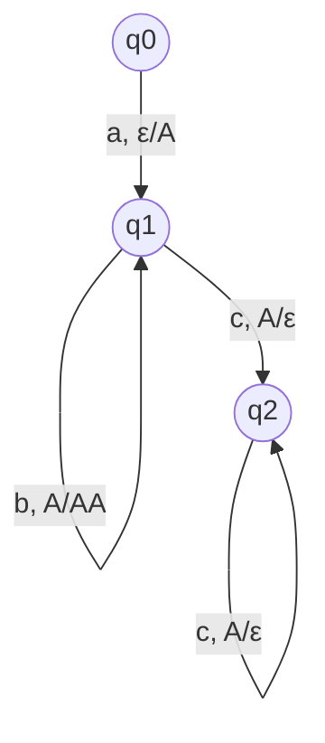

# Autómatas y Lenguajes Formales - Autómatas con pila

## 3.3 Ciclos en los autómatas con pila.

---

Los **ciclos** en autómatas con pila son configuraciones que se repiten indefinidamente, llevando a bucles infinitos. Comprender y detectar ciclos es crucial para analizar la terminación y eficiencia de estos autómatas.

### Definición Formal de Ciclo

Un ciclo en un autómata con pila es una secuencia de configuraciones:

$$(q_1, w_1, \gamma_1) \vdash (q_2, w_2, \gamma_2) \vdash \cdots \vdash (q_k, w_k, \gamma_k) \vdash (q_1, w_1, \gamma_1)$$

Donde después de $k$ movimientos, el autómata regresa a la misma configuración.

### Teorema del Ciclo en AP

Para cualquier autómata con pila $M,$ existe una constante $N$ ( dependiente de $M$ ) tal que si:

$$(q, w, \gamma) \vdash_M^* (p, \varepsilon, \varepsilon)$$

con $|w| > N,$ entonces la computación contiene al menos un ciclo.

### Configuraciones y Repetición

El número de configuraciones distintas posibles está acotado por:

$$|Q| \times (|w| + 1) \times |\Gamma|^{|h|}$$

Donde $h$ es la altura máxima de la pila durante la computación.

### Diagrama de un Autómata con Ciclo



Este autómata tiene un ciclo potencial en el estado $q_1$ cuando procesa 'b'.

### Ejemplo: Autómata con Ciclo Infinito

#### Definición Formal

$M = (Q, \Sigma, \Gamma, \delta, q_0, Z_0, F)$ donde:

- $Q = \{q_0, q_1\}$
- $\Sigma = \{a\}$
- $\Gamma = \{A, Z_0\}$
- $F = \emptyset$
- $\delta:$
  1. $\delta(q_0, a, Z_0) = \{(q_1, AZ_0)\}$
  2. $\delta(q_1, a, A) = \{(q_1, AA)\}$
  3. $\delta(q_1, \varepsilon, A) = \{(q_1, A)\}$ ← Transición épsilon que crea ciclo

#### Simulación del Ciclo

Para la entrada "aaa":

```
(q₀, aaa, Z₀) ⊢ (q₁, aa, AZ₀)       [transición 1]
⊢ (q₁, a, AAZ₀)                    [transición 2]
⊢ (q₁, a, AAZ₀)                    [transición 3 - CICLO]
⊢ (q₁, a, AAZ₀)                    [transición 3 - CICLO]
...
```

### Detección de Ciclos en Código

```python
class CycleDetector:
    def __init__(self, pda):
        self.pda = pda
        self.visited_configs = set()
        self.cycle_detected = False

    def detect_cycles(self, max_steps=1000):
        """Detecta ciclos en la ejecución del autómata"""
        return self._simulate(self.pda.start_state, self.pda.input_string,
                            [self.pda.start_stack], 0, max_steps)

    def _simulate(self, state, input_str, stack, steps, max_steps):
        if steps > max_steps:
            return True  # Posible ciclo infinito

        config_hash = self._hash_configuration(state, input_str, stack)
        if config_hash in self.visited_configs:
            return True  # Ciclo detectado

        self.visited_configs.add(config_hash)

        # Simular todas las transiciones posibles
        for next_state, next_stack, remaining_input in self._get_transitions(state, input_str, stack):
            if self._simulate(next_state, remaining_input, next_stack, steps + 1, max_steps):
                return True

        self.visited_configs.remove(config_hash)
        return False

    def _hash_configuration(self, state, input_str, stack):
        """Crea un hash único para la configuración actual"""
        return f"{state}|{input_str}|{''.join(stack)}"

    def _get_transitions(self, state, input_str, stack):
        """Obtiene todas las transiciones posibles desde la configuración actual"""
        transitions = []
        current_char = input_str[0] if input_str else None

        for (trans_state, trans_char, trans_stack), next_configs in self.pda.transitions.items():
            if trans_state == state:
                # Verificar coincidencia de símbolo de entrada
                input_match = (trans_char == current_char) or \
                             (trans_char == 'ε' and not input_str)

                # Verificar coincidencia de pila
                stack_match = (trans_stack == 'ε') or \
                             (stack and trans_stack == stack[-1])

                if input_match and stack_match:
                    for next_state, stack_push, _ in next_configs:
                        new_input = input_str[1:] if trans_char != 'ε' else input_str
                        new_stack = stack.copy()

                        if trans_stack != 'ε' and new_stack:
                            new_stack.pop()
                        if stack_push != 'ε':
                            new_stack.extend(reversed(stack_push))

                        transitions.append((next_state, new_input, new_stack))

        return transitions

# Ejemplo de uso
if __name__ == "__main__":
    # Definir un AP con ciclo potencial
    class MockPDA:
        def __init__(self):
            self.start_state = 'q0'
            self.input_string = 'aaa'
            self.start_stack = 'Z0'
            self.transitions = {
                ('q0', 'a', 'Z0'): {('q1', 'AZ0', '')},
                ('q1', 'a', 'A'): {('q1', 'AA', '')},
                ('q1', 'ε', 'A'): {('q1', 'A', '')}  # Transición épsilon que causa ciclo
            }

    pda = MockPDA()
    detector = CycleDetector(pda)
    has_cycle = detector.detect_cycles()
    print(f"¿El autómata tiene ciclo? {has_cycle}")
```

### Tipos de Ciclos en AP

#### 1. Ciclos de Estado

$$(q, w, \gamma) \vdash^* (q, w', \gamma')$$

#### 2. Ciclos de Pila

$$(q, w, \gamma\beta) \vdash^* (p, w', \gamma\beta)$$

#### 3. Ciclos Completos

$$(q, w, \gamma) \vdash^* (q, w, \gamma)$$

### Lema del Bombeo para Lenguajes Libres de Contexto

Si $L$ es un lenguaje libre de contexto, entonces existe una constante $n$ tal que si $z \in L$ y $|z| \geq n,$ entonces $z$ puede escribirse como $z = uvwxy$ donde:

1. $|vwx| \leq n$
2. $|vx| \geq 1$
3. Para todo $i \geq 0,$ $uv^iwx^iy \in L$

### Ejercicios Propuestos

#### Ejercicio 1

Dado el siguiente autómata con pila:

- $\delta(q_0, a, Z_0) = \{(q_1, AZ_0)\}$
- $\delta(q_1, b, A) = \{(q_1, AA)\}$
- $\delta(q_1, c, A) = \{(q_2, \varepsilon)\}$
- $\delta(q_2, c, A) = \{(q_2, \varepsilon)\}$

a) Identifica si existe algún ciclo
b) Si existe, describe el ciclo encontrado

#### Ejercicio 2

Demuestra que el siguiente autómata entra en ciclo infinito con la entrada "ab":

- $\delta(q_0, a, Z_0) = \{(q_1, AZ_0)\}$
- $\delta(q_1, b, A) = \{(q_1, A)\}$
- $\delta(q_1, \varepsilon, A) = \{(q_1, A)\}$

#### Ejercicio 3

Implementa un algoritmo que detecte ciclos en autómatas con pila y determine si son:
a) Ciclos productivos (llevan a aceptación)
b) Ciclos no productivos (llevan a rechazo o ciclo infinito)

#### Ejercicio 4

Analiza el siguiente autómata y determina para qué cadenas entra en ciclo:

$M = (Q, \Sigma, \Gamma, \delta, q_0, Z_0, F)$ donde:

- $Q = \{q_0, q_1, q_2\}$
- $\Sigma = \{0, 1\}$
- $\Gamma = \{X, Z_0\}$
- $\delta(q_0, 0, Z_0) = \{(q_1, XZ_0)\}$
- $\delta(q_1, 0, X) = \{(q_1, XX)\}$
- $\delta(q_1, 1, X) = \{(q_2, \varepsilon)\}$
- $\delta(q_2, 1, X) = \{(q_2, \varepsilon)\}$
- $\delta(q_2, \varepsilon, Z_0) = \{(q_0, Z_0)\}$

#### Ejercicio 5

Usando el lema del bombeo, demuestra que el lenguaje $L = \{a^nb^nc^n \mid n \geq 0\}$ no es libre de contexto, mostrando cómo cualquier intento de reconocerlo con un AP llevaría a ciclos no productivos.

### Soluciones a Ejercicios Selectos

#### Solución Ejercicio 1

a) Sí existe un ciclo potencial en el estado $q_1$ cuando procesa 'b':

$$(q_1, b^n, A^kZ_0) \vdash^* (q_1, b^{n-1}, A^{k+1}Z_0)$$

b) Este ciclo incrementa la pila indefinidamente mientras hay símbolos 'b' en la entrada.

#### Solución Ejercicio 4

El autómata entra en ciclo cuando la cantidad de 0's es mayor que la cantidad de 1's, específicamente cuando hay más 0's iniciales que 1's posteriores, ya que la pila crece con cada 0 y solo se reduce con 1's.

### Referencias Bibliográficas

1. **Viso G., E.** (2008). _Introducción a la teoría de la computación_. Las Prensas de Ciencias. (Capítulo 5: Autómatas con Pila)
2. **Hopcroft, J. E., Motwani, R., and Ullman, J.** (2007). _Introduction to Automata Theory, Languages, and Computation_. Addison-Wesley. (Capítulo 6: Pushdown Automata)
3. **Sipser, M.** (2005). _Introduction to the Theory of Computation_. PWS Publishing Company. (Capítulo 2: Context-Free Languages)
4. **Kozen, D. C.** (1997). _Automata and Computability_. Springer-Verlag. (Capítulo 12: Pushdown Automata)

### Técnicas para Evitar Ciclos Infinitos

1. **Límite de Profundidad**: Establecer un máximo de pasos de ejecución
2. **Memoization**: Almacenar configuraciones visitadas
3. **Análisis de Terminación**: Verificar si la pila crece indefinidamente
4. **Transformación a Determinista**: Cuando sea posible, convertir AP no deterministas a deterministas

### Aplicaciones Prácticas

1. **Compiladores**: Detección de recursión infinita
2. **Verificación de Protocolos**: Detección de deadlocks
3. **Procesamiento de Lenguaje Natural**: Análisis de estructuras recursivas
4. **Sistemas de Tipo**: Verificación de terminación de funciones
