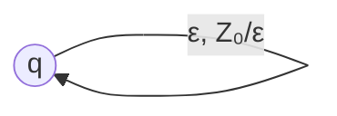

# Autómatas y Lenguajes Formales - Autómatas con pila

## 3.4 Autómatas con pila de un solo estado.

---

Los **autómatas con pila de un solo estado** (1-AP) son una variante restringida de los autómatas con pila donde el conjunto de estados se reduce a un único estado. A pesar de su simplicidad, son equivalentes en poder computacional a los autómatas con pila convencionales.

### Definición Formal

Un autómata con pila de un solo estado es una 6-tupla:

$$M = (\{q\}, \Sigma, \Gamma, \delta, q, Z_0, F)$$

Donde:

- $\{q\}$: Conjunto unitario de estados
- $\Sigma$: Alfabeto de entrada
- $\Gamma$: Alfabeto de la pila
- $\delta$: Función de transición: $\{q\} \times (\Sigma \cup \{\varepsilon\}) \times \Gamma \to \mathcal{P}(\{q\} \times \Gamma^*)$
- $q$: Estado único
- $Z_0$: Símbolo inicial de la pila
- $F \subseteq \{q\}$: Estados de aceptación ( puede ser $\emptyset$ o $\{q\}$ )

### Equivalencia Computacional

#### Teorema de Equivalencia

Para todo autómata con pila convencional $M$, existe un autómata con pila de un solo estado $M'$ tal que $L(M) = L(M')$.

#### Construcción de Equivalencia

La transformación se realiza mediante:

1. Codificar los estados del AP original en el alfabeto de la pila
2. Simular transiciones entre estados mediante operaciones en la pila
3. Usar el contenido de la pila para representar el estado actual

### Función de Transición Simplificada

En un 1-AP, la función de transición se simplifica a:

$$\delta: (\Sigma \cup \{\varepsilon\}) \times \Gamma \to \mathcal{P}(\Gamma^*)$$

Puesto que el estado siempre es $q$ y permanece inalterado.

### Diagrama de un 1-AP



### Ejemplo: 1-AP para $L = \{a^nb^n \mid n \geq 0\}$

#### Definición Formal

$M = (\{q\}, \{a, b\}, \{A, B, Z_0\}, \delta, q, Z_0, \{q\})$

Donde $\delta$ contiene:

1. $\delta(a, Z_0) = \{BAZ_0\}$ // Empilar B y A
2. $\delta(a, A) = \{BA\}$ // Empilar B
3. $\delta(a, B) = \{BB\}$ // Empilar B adicional
4. $\delta(b, B) = \{\varepsilon\}$ // Desempilar B
5. $\delta(\varepsilon, Z_0) = \{\varepsilon\}$ // Aceptar pila vacía

#### Simulación para "aabb"

```
Configuración inicial: (q, aabb, Z₀)
Transición 1: (q, abb, BAZ₀)     [δ(a, Z₀) = BAZ₀]
Transición 2: (q, bb, BBAZ₀)     [δ(a, A) = BA]
Transición 4: (q, b, BAZ₀)       [δ(b, B) = ε]
Transición 4: (q, ε, AZ₀)        [δ(b, B) = ε]
Transición 5: (q, ε, Z₀)         [δ(ε, A) no definida?]
```

### Implementación de un 1-AP

```python
class SingleStatePDA:
    def __init__(self, input_alphabet, stack_alphabet, transitions, start_stack, accept_empty=False):
        self.input_alphabet = input_alphabet
        self.stack_alphabet = stack_alphabet
        self.transitions = transitions  # Dict: (input, stack_top) -> [stack_push]
        self.start_stack = start_stack
        self.accept_empty = accept_empty

    def accepts(self, input_string):
        stack = [self.start_stack]
        index = 0

        while index < len(input_string) or stack:
            current_char = input_string[index] if index < len(input_string) else None

            # Buscar transición para el carácter actual
            found_transition = False
            for trans_char in [current_char, 'ε']:
                if trans_char is None:
                    continue

                stack_top = stack[-1] if stack else 'ε'
                key = (trans_char, stack_top)

                if key in self.transitions:
                    # Aplicar transición
                    stack_pop = stack_top != 'ε'
                    stack_push = self.transitions[key]

                    if stack_pop and stack:
                        stack.pop()

                    if stack_push != 'ε':
                        # Apilar símbolos en orden inverso
                        for symbol in reversed(stack_push):
                            stack.append(symbol)

                    if trans_char != 'ε':
                        index += 1

                    found_transition = True
                    break

            if not found_transition:
                return False

        return self.accept_empty and not stack

# Ejemplo de uso
def test_single_state_pda():
    # 1-AP para a^n b^n
    transitions = {
        ('a', 'Z0'): 'BAZ0',    # Leer a, tope Z0 → empilar B, A, Z0
        ('a', 'A'): 'BA',       # Leer a, tope A → empilar B, A
        ('a', 'B'): 'BB',       # Leer a, tope B → empilar B, B
        ('b', 'B'): '',         # Leer b, tope B → desempilar
        ('ε', 'Z0'): ''         # Transición ε para aceptar
    }

    pda = SingleStatePDA(
        input_alphabet={'a', 'b'},
        stack_alphabet={'A', 'B', 'Z0'},
        transitions=transitions,
        start_stack='Z0',
        accept_empty=True
    )

    # Probar cadenas
    test_cases = ['', 'ab', 'aabb', 'aaabbb', 'aab', 'abb']
    for test in test_cases:
        result = pda.accepts(test)
        print(f"'{test}': {'Aceptada' if result else 'Rechazada'}")

if __name__ == "__main__":
    test_single_state_pda()
```

### Ventajas de los 1-AP

1. **Simplicidad**: Menos componentes que mantener
2. **Análisis más fácil**: Menos configuraciones posibles
3. **Implementación eficiente**: Menos overhead de estado
4. **Mejor para pruebas formales**: Menos casos por considerar

### Transformación de AP a 1-AP

#### Algoritmo de Transformación

Dado $M = (Q, \Sigma, \Gamma, \delta, q_0, Z_0, F)$, construir $M' = (\{q\}, \Sigma, \Gamma', \delta', q, Z_0', F')$:

1. $\Gamma' = Q \times \Gamma$ // Emparejar estado con símbolo de pila
2. $Z_0' = (q_0, Z_0)$
3. Para cada transición $\delta(p, a, X) \ni (r, \gamma)$ en $M$, añadir a $\delta'$:
   - $\delta'(a, (p, X)) = \{(r, Y_1), (q, Y_2), ..., (q, Y_k)\}$ donde $\gamma = Y_1Y_2...Y_k$

### Ejercicios Propuestos

#### Ejercicio 1

Diseña un 1-AP para el lenguaje $L = \{wcw^R \mid w \in \{a, b\}^*\}$

#### Ejercicio 2

Convierte el siguiente AP convencional a un 1-AP:

- $Q = \{q_0, q_1, q_2\}$
- $\Sigma = \{0, 1\}$
- $\Gamma = \{X, Z_0\}$
- $\delta(q_0, 0, Z_0) = \{(q_1, XZ_0)\}$
- $\delta(q_1, 0, X) = \{(q_1, XX)\}$
- $\delta(q_1, 1, X) = \{(q_2, \varepsilon)\}$
- $\delta(q_2, 1, X) = \{(q_2, \varepsilon)\}$
- $\delta(q_2, \varepsilon, Z_0) = \{(q_2, \varepsilon)\}$
- $F = \{q_2\}$

#### Ejercicio 3

Demuestra que todo lenguaje regular puede ser reconocido por un 1-AP.

#### Ejercicio 4

Implementa en Python la transformación de AP convencional a 1-AP.

#### Ejercicio 5

Analiza las limitaciones prácticas de los 1-AP en términos de:
a) Complejidad de la pila
b) Tamaño del alfabeto de pila
c) Legibilidad de las transiciones

### Soluciones a Ejercicios Selectos

#### Solución Ejercicio 1

1-AP para $L = \{wcw^R \mid w \in \{a, b\}^*\}$:

$\delta$ contiene:

- $\delta(a, Z_0) = \{AZ_0\}$
- $\delta(b, Z_0) = \{BZ_0\}$
- $\delta(a, A) = \{AA\}$
- $\delta(b, A) = \{BA\}$
- $\delta(a, B) = \{AB\}$
- $\delta(b, B) = \{BB\}$
- $\delta(c, A) = \{A\}$
- $\delta(c, B) = \{B\}$
- $\delta(a, A) = \{\varepsilon\}$ // Después de c
- $\delta(b, B) = \{\varepsilon\}$
- $\delta(\varepsilon, Z_0) = \{\varepsilon\}$

#### Solución Ejercicio 3

Para cualquier lenguaje regular $L$, existe un AFD que lo reconoce. Podemos simular el AFD con un 1-AP usando la pila para recordar únicamente el estado actual (aunque la pila no es necesaria para lenguajes regulares).

### Referencias Bibliográficas

1. **Viso G., E.** (2008). _Introducción a la teoría de la computación_. Las Prensas de Ciencias. (Capítulo 5: Autómatas con Pila)
2. **Hopcroft, J. E., Motwani, R., and Ullman, J.** (2007). _Introduction to Automata Theory, Languages, and Computation_. Addison-Wesley. (Capítulo 6: Pushdown Automata)
3. **Sipser, M.** (2005). _Introduction to the Theory of Computation_. PWS Publishing Company. (Capítulo 2: Context-Free Languages)
4. **Kozen, D. C.** (1997). _Automata and Computability_. Springer-Verlag. (Capítulo 12: Pushdown Automata)

### Aplicaciones Prácticas

1. **Parsers simplificados**: Implementación de analizadores sintácticos
2. **Procesamiento de lenguajes de marcado**: HTML/XML simplificado
3. **Verificación de protocolos**: Modelado de sistemas de estado simple
4. **Enseñanza**: Introducción más suave a los autómatas con pila

### Limitaciones y Consideraciones

1. **Explosión del alfabeto**: El alfabeto de pila puede crecer significativamente
2. **Transiciones complejas**: Las reglas pueden volverse difíciles de leer
3. **Debugging difícil**: Seguir la traza de ejecución puede ser complejo
4. **Eficiencia**: Puede requerir más operaciones de pila que un AP convencional

Esta guía proporciona una comprensión completa de los autómatas con pila de un solo estado, mostrando su equivalencia teórica con los AP convencionales y sus aplicaciones prácticas en el procesamiento de lenguajes formales.
