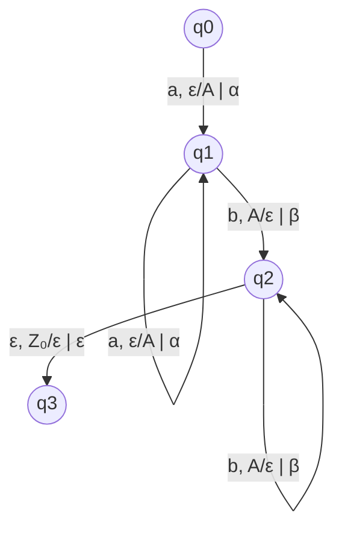

# Autómatas y Lenguajes Formales - Autómatas con pila

## 3.5 Traducción con autómatas de pila.

---

Los **autómatas con pila traductores** extienden la capacidad de reconocimiento de lenguajes para realizar transformaciones o traducciones de cadenas de entrada a cadenas de salida. Esta capacidad es fundamental en aplicaciones como compilación, procesamiento de lenguajes naturales y transformación de datos.

### Definición Formal de Autómata con Pila Traductor

Un autómata con pila traductor (APT) es una 8-tupla:

$$T = (Q, \Sigma, \Gamma, \Delta, \delta, q_0, Z_0, F)$$

Donde:

- $Q:$ Conjunto finito de estados
- $\Sigma:$ Alfabeto de entrada
- $\Gamma:$ Alfabeto de la pila
- $\Delta:$ Alfabeto de salida
- $\delta:$ Función de transición: $Q \times (\Sigma \cup \{\varepsilon\}) \times \Gamma \to \mathcal{P}(Q \times \Gamma^* \times \Delta^*)$
- $q_0 \in Q:$ Estado inicial
- $Z_0 \in \Gamma:$ Símbolo inicial de la pila
- $F \subseteq Q:$ Estados finales

### Función de Transición Extendida

La función de transición produce tripletas:

$$\delta(q, a, X) = \{(p_1, \gamma_1, w_1), (p_2, \gamma_2, w_2), \ldots, (p_k, \gamma_k, w_k)\}$$

Donde:

- $p_i \in Q:$ Nuevo estado
- $\gamma_i \in \Gamma^*:$ Cadena a empilar
- $w_i \in \Delta^*:$ Cadena de salida generada

### Configuración Instantánea para Traducción

La configuración se extiende para incluir la salida:

$$(q, w, \gamma, v)$$

Donde:

- $q \in Q:$ Estado actual
- $w \in \Sigma^*:$ Entrada por procesar
- $\gamma \in \Gamma^*:$ Contenido de la pila
- $v \in \Delta^*:$ Salida generada hasta el momento

### Relación de Movimiento para Traducción

$$(q, aw, X\beta, v) \vdash_T (p, w, \gamma\beta, vw')$$

si y sólo si $(p, \gamma, w') \in \delta(q, a, X)$

### Diagrama de un AP Traductor



Este traductor convierte $a^nb^n$ a $\alpha^n\beta^n$

### Ejemplo: Traductor de Expresiones Infijas a Postfijas

#### Definición Formal

$T = (Q, \Sigma, \Gamma, \Delta, \delta, q_0, Z_0, F)$ donde:

- $Q = \{q_0, q_1, q_2, q_3\}$
- $\Sigma = \{\text{id}, +, *, (, )\}$
- $\Gamma = \{E, T, F, Z_0\}$
- $\Delta = \{\text{id}, +, *\}$
- $F = \{q_3\}$

#### Transiciones

1. $\delta(q_0, \text{id}, Z_0) = \{(q_1, Z_0, \text{id})\}$
2. $\delta(q_0, (, Z_0) = \{(q_2, EZ_0, \varepsilon)\}$
3. $\delta(q_2, \text{id}, E) = \{(q_2, T, \text{id})\}$
4. $\delta(q_2, +, T) = \{(q_2, E, +)\}$
5. $\delta(q_2, *, T) = \{(q_2, F, *)\}$
6. $\delta(q_2, ), E) = \{(q_3, \varepsilon, \varepsilon)\}$

### Implementación de un AP Traductor

```python
class PushdownTranslator:
    def __init__(self, states, input_alphabet, stack_alphabet, output_alphabet,
                 transitions, start_state, start_stack, accept_states):
        self.states = states
        self.input_alphabet = input_alphabet
        self.stack_alphabet = stack_alphabet
        self.output_alphabet = output_alphabet
        self.transitions = transitions
        self.start_state = start_state
        self.start_stack = start_stack
        self.accept_states = accept_states

    def translate(self, input_string):
        from collections import deque

        # Configuración inicial: (estado, índice, pila, salida)
        initial_config = (self.start_state, 0, [self.start_stack], "")
        queue = deque([initial_config])
        visited = set()

        while queue:
            state, index, stack, output = queue.popleft()

            # Si estamos en estado de aceptación con entrada completa
            if (index == len(input_string) and
                state in self.accept_states and
                (not stack or stack[-1] == self.start_stack)):
                return output

            # Evitar ciclos infinitos
            config_hash = (state, index, tuple(stack), output)
            if config_hash in visited:
                continue
            visited.add(config_hash)

            current_char = input_string[index] if index < len(input_string) else None

            # Probar transiciones con símbolo de entrada y épsilon
            for char_option in [current_char, 'ε']:
                if char_option is None:
                    continue

                stack_top = stack[-1] if stack else 'ε'
                transition_key = (state, char_option, stack_top)

                if transition_key in self.transitions:
                    for next_state, stack_push, output_gen in self.transitions[transition_key]:
                        new_index = index + (1 if char_option != 'ε' else 0)
                        new_stack = stack.copy()
                        new_output = output + output_gen

                        # Manejar la pila
                        if stack_top != 'ε' and new_stack:
                            new_stack.pop()
                        if stack_push != 'ε':
                            # Apilar en orden correcto
                            for symbol in reversed(stack_push):
                                new_stack.append(symbol)

                        queue.append((next_state, new_index, new_stack, new_output))

        return None  # No se encontró traducción

# Ejemplo de uso: Traductor a^n b^n → α^n β^n
def create_anbn_translator():
    states = {'q0', 'q1', 'q2', 'q3'}
    input_alphabet = {'a', 'b'}
    stack_alphabet = {'A', 'Z0'}
    output_alphabet = {'α', 'β'}

    transitions = {
        ('q0', 'ε', 'ε'): {('q1', 'Z0', '')},
        ('q1', 'a', 'Z0'): {('q1', 'AZ0', 'α')},
        ('q1', 'a', 'A'): {('q1', 'AA', 'α')},
        ('q1', 'b', 'A'): {('q2', '', 'β')},
        ('q2', 'b', 'A'): {('q2', '', 'β')},
        ('q2', 'ε', 'Z0'): {('q3', '', '')}
    }

    return PushdownTranslator(
        states, input_alphabet, stack_alphabet,
        output_alphabet, transitions, 'q0', 'Z0', {'q3'}
    )

# Probar el traductor
if __name__ == "__main__":
    translator = create_anbn_translator()
    test_cases = ['ab', 'aabb', 'aaabbb', 'aab', 'abb']

    for test in test_cases:
        result = translator.translate(list(test))
        print(f"Entrada: '{test}' → Salida: '{result}'")
```

### Aplicación: Traductor de Notación Infija a Postfija

```python
class InfixToPostfixTranslator(PushdownTranslator):
    def __init__(self):
        states = {'q0', 'q1', 'q2', 'q3', 'q4'}
        input_alphabet = {'id', '+', '*', '(', ')'}
        stack_alphabet = {'E', 'T', 'F', 'Z0'}
        output_alphabet = {'id', '+', '*'}

        transitions = {
            # Manejo de identificadores
            ('q0', 'id', 'Z0'): {('q1', 'Z0', 'id')},
            ('q0', 'id', 'E'): {('q1', 'E', 'id')},
            ('q0', 'id', 'T'): {('q1', 'T', 'id')},
            ('q0', 'id', 'F'): {('q1', 'F', 'id')},

            # Manejo de paréntesis
            ('q0', '(', 'Z0'): {('q2', 'EZ0', '')},
            ('q0', '(', 'E'): {('q2', 'EE', '')},

            # Operadores
            ('q1', '+', 'E'): {('q3', 'T', '+')},
            ('q1', '*', 'T'): {('q4', 'F', '*')},

            # Cierre de paréntesis
            ('q1', ')', 'E'): {('q1', '', '')},

            # Transiciones de finalización
            ('q1', 'ε', 'Z0'): {('q1', '', '')}
        }

        super().__init__(states, input_alphabet, stack_alphabet,
                        output_alphabet, transitions, 'q0', 'Z0', {'q1'})

# Ejemplo de uso
translator = InfixToPostfixTranslator()
expression = ['id', '+', 'id', '*', 'id']  # id + id * id
result = translator.translate(expression)
print(f"Infija: {' '.join(expression)} → Postfija: {result}")
```

### Ejercicios Propuestos

#### Ejercicio 1

Diseña un AP traductor que convierta números romanos a decimales:

- Entrada: "XIV" → Salida: "14"
- Entrada: "MMXXIII" → Salida: "2023"

#### Ejercicio 2

Implementa un traductor que transforme expresiones lógicas infijas a prefijas:

- Entrada: "A ∧ (B ∨ C)" → Salida: "∧ A ∨ B C"

#### Ejercicio 3

Crea un AP traductor que realice conversión de bases:

- Entrada: "1010" (binario) → Salida: "10" (decimal)
- Entrada: "FF" (hexadecimal) → Salida: "255" (decimal)

#### Ejercicio 4

Diseña un traductor que detecte y corrija errores de paréntesis:

- Entrada: "(a + b * (c - d)" → Salida: "ERROR: Paréntesis no balanceados"
- Entrada: "((a + b) * c)" → Salida: "a b + c *"

#### Ejercicio 5

Analiza la complejidad computacional del algoritmo de traducción y propone optimizaciones.

### Referencias Bibliográficas

1. **Aho A.V., Lam M., Sethi S.R. and Ullman J.D.** (2007). _Compilers: Principles, Techniques, & Tools_. Pearson Addison-Wesley. (Capítulo 4: Análisis Sintáctico)
2. **Cooper, K. D. and Torkzon, L.** (2004). _Engineering a Compiler_. Morgan Kaufman Publishers. (Capítulo 3: Parsing)
3. **Viso G., E.** (2008). _Introducción a la teoría de la computación_. Las Prensas de Ciencias. (Capítulo 5: Autómatas con Pila)
4. **Hopcroft, J. E., Motwani, R., and Ullman, J.** (2007). _Introduction to Automata Theory, Languages, and Computation_. Addison-Wesley. (Capítulo 6: Pushdown Automata)

### Aplicaciones Prácticas

1. **Compiladores**: Traducción de código fuente a código intermedio
2. **Procesamiento de XML/HTML**: Transformación de documentos
3. **Calculadoras**: Conversión entre notaciones
4. **Procesamiento de lenguaje natural**: Transformación gramatical
5. **Sistemas de tipos**: Conversión entre representaciones de datos

### Consideraciones de Implementación

1. **Manejo de no determinismo**: Búsqueda en amplitud para explorar todas las posibles traducciones
2. **Control de ciclos**: Memoization para evitar bucles infinitos
3. **Eficiencia**: Límites en la profundidad de búsqueda
4. **Manejo de errores**: Mecanismos para detectar entradas inválidas
