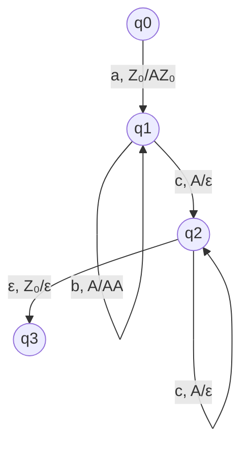

# Autómatas y Lenguajes Formales - Autómatas con pila

## 3.6 Ciclos en los autómatas de pila deterministas.

---

Los **ciclos** en autómatas con pila deterministas (DPDA) representan secuencias de configuraciones que se repiten indefinidamente. Su estudio es crucial para analizar la terminación y el comportamiento de estos autómatas, especialmente en aplicaciones como compilación y verificación formal.

### Definición Formal de DPDA

Un autómata con pila determinista es una 7-tupla:

$$M = (Q, \Sigma, \Gamma, \delta, q_0, Z_0, F)$$

Donde la función de transición $\delta$ satisface:

1. $|\delta(q, a, X)| \leq 1$ para todo $q \in Q,$ $a \in \Sigma \cup \{\varepsilon\},$ $X \in \Gamma$
2. Si $\delta(q, \varepsilon, X) \neq \emptyset,$ entonces $\delta(q, a, X) = \emptyset$ para todo $a \in \Sigma$

### Definición de Ciclo en DPDA

Un ciclo es una secuencia de configuraciones:

$$(q_1, w_1, \gamma_1) \vdash (q_2, w_2, \gamma_2) \vdash \cdots \vdash (q_k, w_k, \gamma_k) \vdash (q_1, w_1, \gamma_1)$$

Donde después de $k$ movimientos, el autómata regresa exactamente a la misma configuración.

### Teorema del Ciclo para DPDAs

Para cualquier DPDA $M,$ existe una constante $N$ ( dependiente de $M$ ) tal que si:

$$(q, w, \gamma) \vdash_M^* (p, \varepsilon, \varepsilon)$$

con $|w| > N,$ entonces la computación contiene al menos un ciclo.

### Configuraciones y Límite de Ciclos

El número máximo de configuraciones distintas está acotado por:

$$|Q| \times (|w| + 1) \times |\Gamma|^{h_{max}}$$

Donde $h_{max}$ es la altura máxima de la pila durante la computación.

### Diagrama de un DPDA con Ciclo



### Ejemplo: DPDA con Ciclo Determinista

#### Definición Formal

$M = (Q, \Sigma, \Gamma, \delta, q_0, Z_0, F)$ donde:

- $Q = \{q_0, q_1, q_2\}$
- $\Sigma = \{a, b, c\}$
- $\Gamma = \{A, Z_0\}$
- $F = \{q_2\}$
- $\delta:$
  1. $\delta(q_0, a, Z_0) = (q_1, AZ_0)$
  2. $\delta(q_1, b, A) = (q_1, AA)$ // Ciclo potencial
  3. $\delta(q_1, c, A) = (q_2, \varepsilon)$
  4. $\delta(q_2, c, A) = (q_2, \varepsilon)$
  5. $\delta(q_2, \varepsilon, Z_0) = (q_2, \varepsilon)$

#### Simulación para "abbc"

```
(q₀, abbc, Z₀) ⊢ (q₁, bbc, AZ₀)       [δ(q₀, a, Z₀)]
⊢ (q₁, bc, AAZ₀)                     [δ(q₁, b, A)] - Ciclo
⊢ (q₁, c, AAAZ₀)                     [δ(q₁, b, A)] - Ciclo
⊢ (q₂, ε, AAZ₀)                      [δ(q₁, c, A)]
⊢ (q₂, ε, AZ₀)                       [δ(q₂, c, A)]
⊢ (q₂, ε, Z₀)                        [δ(q₂, c, A)]
⊢ (q₂, ε, ε)                         [δ(q₂, ε, Z₀)]
```

### Detección de Ciclos en DPDAs

```python
class DPDACycleDetector:
    def __init__(self, dpda):
        self.dpda = dpda
        self.visited_configs = {}
        self.cycle_detected = False

    def detect_cycle(self, input_string, max_steps=1000):
        """Detecta ciclos en la ejecución del DPDA"""
        config_history = []
        return self._simulate(
            self.dpda.start_state,
            input_string,
            [self.dpda.start_stack],
            config_history,
            max_steps
        )

    def _simulate(self, state, input_str, stack, history, max_steps):
        if len(history) > max_steps:
            return True, history  # Posible ciclo infinito

        current_config = (state, input_str, tuple(stack))

        # Verificar si esta configuración ya apareció
        for i, config in enumerate(history):
            if config == current_config:
                # Ciclo detectado desde el paso i hasta el actual
                cycle = history[i:] + [current_config]
                return True, cycle

        history.append(current_config)

        # Obtener la única transición posible (DPDA es determinista)
        transition = self._get_transition(state, input_str, stack)
        if not transition:
            return False, history  # No hay transición, fin de la computación

        next_state, stack_push, consumed = transition
        new_input = input_str[consumed:]
        new_stack = stack.copy()

        # Manejar la pila
        if stack and stack[-1] != 'ε':
            new_stack.pop()
        if stack_push != 'ε':
            for symbol in reversed(stack_push):
                new_stack.append(symbol)

        return self._simulate(next_state, new_input, new_stack, history, max_steps)

    def _get_transition(self, state, input_str, stack):
        """Obtiene la transición determinista"""
        current_char = input_str[0] if input_str else None
        stack_top = stack[-1] if stack else 'ε'

        # Probar primero con símbolo de entrada
        if current_char is not None:
            transition_key = (state, current_char, stack_top)
            if transition_key in self.dpda.transitions:
                next_state, stack_push = self.dpda.transitions[transition_key]
                return next_state, stack_push, 1

        # Probar con transición épsilon
        transition_key = (state, 'ε', stack_top)
        if transition_key in self.dpda.transitions:
            next_state, stack_push = self.dpda.transitions[transition_key]
            return next_state, stack_push, 0

        return None

class DPDA:
    def __init__(self, transitions, start_state, start_stack):
        self.transitions = transitions
        self.start_state = start_state
        self.start_stack = start_stack

# Ejemplo de uso
def create_example_dpda():
    transitions = {
        ('q0', 'a', 'Z0'): ('q1', 'AZ0'),
        ('q1', 'b', 'A'): ('q1', 'AA'),  # Transición que puede causar ciclo
        ('q1', 'c', 'A'): ('q2', ''),
        ('q2', 'c', 'A'): ('q2', ''),
        ('q2', 'ε', 'Z0'): ('q2', '')
    }
    return DPDA(transitions, 'q0', 'Z0')

if __name__ == "__main__":
    dpda = create_example_dpda()
    detector = DPDACycleDetector(dpda)

    test_cases = ['abc', 'abbc', 'abbbc', 'a' + 'b'*100 + 'c']

    for test in test_cases:
        has_cycle, trace = detector.detect_cycle(test)
        print(f"Entrada: '{test}' - Ciclo: {has_cycle}")
        if has_cycle and len(trace) < 20:  # Mostrar solo traces cortos
            print(f"  Trace: {trace[-5:]}")  # Últimas 5 configuraciones
```

### Tipos de Ciclos en DPDAs

#### 1. Ciclos de Estado

$$(q, w, \gamma) \vdash^* (q, w', \gamma')$$

#### 2. Ciclos de Pila

$$(q, w, \gamma\beta) \vdash^* (p, w', \gamma\beta)$$

#### 3. Ciclos Completos

$$(q, w, \gamma) \vdash^* (q, w, \gamma)$$

### Algoritmo de Detección de Ciclos

```python
def detect_cycle_breadth_first(dpda, input_string, max_depth=100):
    """Detección de ciclos usando búsqueda en amplitud"""
    from collections import deque

    queue = deque([(dpda.start_state, 0, [dpda.start_stack], [])])
    visited = set()

    while queue:
        state, index, stack, history = queue.popleft()

        if len(history) > max_depth:
            return True, history  # Posible ciclo

        config_hash = (state, index, tuple(stack))
        if config_hash in visited:
            # Ciclo detectado
            cycle_start = history.index(config_hash)
            return True, history[cycle_start:]
        visited.add(config_hash)

        transition = get_dpda_transition(dpda, state, input_string, index, stack)
        if not transition:
            continue

        next_state, stack_push, consumed = transition
        new_index = index + consumed
        new_stack = stack.copy()

        if stack and stack[-1] != 'ε':
            new_stack.pop()
        if stack_push != 'ε':
            for symbol in reversed(stack_push):
                new_stack.append(symbol)

        new_history = history + [config_hash]
        queue.append((next_state, new_index, new_stack, new_history))

    return False, []
```

### Ejercicios Propuestos

#### Ejercicio 1

Dado el siguiente DPDA:

- $\delta(q_0, a, Z_0) = (q_1, AZ_0)$
- $\delta(q_1, b, A) = (q_1, AA)$
- $\delta(q_1, c, A) = (q_2, \varepsilon)$
- $\delta(q_2, c, A) = (q_2, \varepsilon)$
- $\delta(q_2, \varepsilon, Z_0) = (q_2, \varepsilon)$

a) ¿Para qué entradas entra en ciclo?
b) Implementa un detector de ciclos para este DPDA

#### Ejercicio 2

Demuestra que en un DPDA, todo ciclo eventualmente debe:
a) Consumir entrada, o
b) Reducir el tamaño de la pila, o
c) Ser detectado en un número finito de pasos

#### Ejercicio 3

Diseña un DPDA que tenga un ciclo productivo (que lleve a aceptación) y otro no productivo.

#### Ejercicio 4

Implementa un algoritmo que determine si un ciclo en un DPDA es:
a) Productivo (lleva a aceptación)
b) No productivo (lleva a rechazo)
c) Infinito (nunca termina)

#### Ejercicio 5

Analiza la complejidad computacional del algoritmo de detección de ciclos en DPDAs.

### Soluciones a Ejercicios Selectos

#### Solución Ejercicio 1

a) El DPDA entra en ciclo con entradas de la forma $ab^nc$ donde $n$ puede ser arbitrariamente grande. El ciclo ocurre en el estado $q_1$ procesando las 'b's.

#### Solución Ejercicio 3

DPDA con ciclo productivo:

- $\delta(q_0, a, Z_0) = (q_1, AZ_0)$
- $\delta(q_1, b, A) = (q_1, AA)$ // Ciclo no productivo
- $\delta(q_1, c, A) = (q_2, \varepsilon)$ // Salida del ciclo
- $\delta(q_2, d, A) = (q_2, \varepsilon)$
- $\delta(q_2, \varepsilon, Z_0) = (q_3, \varepsilon)$ // Aceptación

### Referencias Bibliográficas

1. **Viso G., E.** (2008). _Introducción a la teoría de la computación_. Las Prensas de Ciencias. (Capítulo 5: Autómatas con Pila)
2. **Hopcroft, J. E., Motwani, R., and Ullman, J.** (2007). _Introduction to Automata Theory, Languages, and Computation_. Addison-Wesley. (Capítulo 6: Pushdown Automata)
3. **Sipser, M.** (2005). _Introduction to the Theory of Computation_. PWS Publishing Company. (Capítulo 2: Context-Free Languages)
4. **Kozen, D. C.** (1997). _Automata and Computability_. Springer-Verlag. (Capítulo 12: Pushdown Automata)

### Aplicaciones Prácticas

1. **Compiladores**: Detección de recursión infinita
2. **Verificación de software**: Detección de bucles infinitos
3. **Análisis de protocolos**: Detección de deadlocks
4. **Procesamiento de lenguajes**: Análisis de estructuras recursivas

### Técnicas de Prevención de Ciclos

1. **Límite de profundidad**: Establecer máximo de pasos de ejecución
2. **Análisis estático**: Detectar ciclos potenciales antes de la ejecución
3. **Memoization**: Almacenar configuraciones visitadas
4. **Transformación a gramática**: Convertir el DPDA a una gramática libre de contexto equivalente
