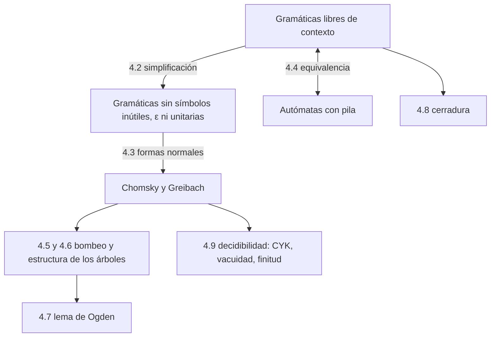

# Autómatas y Lenguajes Formales - Lenguajes libres del contexto

## 4.1 Recapitulación.

---

Los **lenguajes libres del contexto** (LLC) son los de tipo 2 en la jerarquía de Chomsky: más poderosos que los regulares, porque pueden expresar estructuras anidadas, y suficientemente simples para que su análisis sea eficiente. Ya aparecieron dos veces en el curso: como lenguajes generados por gramáticas libres de contexto (temas 1.5 a 1.9) y como lenguajes aceptados por autómatas con pila (tema 3). Este tema los estudia como clase: cómo simplificar sus gramáticas, cómo demostrar que ambas descripciones coinciden, qué operaciones los preservan, cómo demostrar que un lenguaje **no** es libre de contexto y qué preguntas sobre ellos se pueden responder con un algoritmo.

### Lo que ya sabemos

| Concepto | Definición breve | Tema |
| --- | --- | --- |
| Gramática libre de contexto | $G = (V, \Sigma, P, S)$ con producciones $A \rightarrow \alpha,$ $A \in V,$ $\alpha \in (V \cup \Sigma)^*$ | 1.5 |
| Lenguaje libre de contexto | $L = L(G)$ para alguna gramática libre de contexto | 1.5 |
| Derivación por la izquierda y por la derecha | se reescribe siempre el no terminal más a la izquierda, o más a la derecha | 1.6 |
| Árbol de derivación | árbol cuyos nodos interiores son no terminales y cuya frontera es la cadena; corresponde a una única derivación por la izquierda | 1.9 |
| Ambigüedad | alguna cadena tiene dos árboles de derivación | 1.9 |
| Símbolos útiles, anulables, recursión | generadores y alcanzables; $A \Rightarrow^* \varepsilon;$ $A \Rightarrow^+ \alpha A \beta$ | 1.6 |
| Autómata con pila | autómata finito con una pila; acepta por estado final o por pila vacía | 3.1 |
| AP de un solo estado | equivalente a una gramática: expandir y comparar | 3.4 |
| AP determinista | a lo más un movimiento en cada configuración; acepta una subclase propia | 3.1, 3.6 |

### El mapa de este tema



Los resultados principales son:

1. Toda gramática se puede simplificar y poner en **forma normal de Chomsky**, con producciones $A \rightarrow BC$ y $A \rightarrow a,$ o de **Greibach**, con producciones $A \rightarrow a\alpha$ (temas 4.2 y 4.3).
2. Un lenguaje es libre de contexto si y solo si lo acepta un **autómata con pila** (tema 4.4).
3. Los LLC cumplen un **lema de bombeo**: toda cadena larga tiene dos partes que se pueden repetir a la vez. Con él, y con el lema de Ogden, se demuestra que lenguajes como $\{a^nb^nc^n\}$ no son libres de contexto (temas 4.5 a 4.7).
4. Los LLC son cerrados bajo unión, concatenación, estrella, homomorfismo e intersección con regulares, pero **no** bajo intersección ni complemento (tema 4.8).
5. La pertenencia, la vacuidad y la finitud son decidibles; la equivalencia, la ambigüedad y la universalidad no (tema 4.9).

### Comparación con los lenguajes regulares

| Propiedad | Regulares | Libres de contexto |
| --- | --- | --- |
| Gramática | lineal por la derecha | $A \rightarrow \alpha$ arbitraria |
| Autómata | finito | con pila |
| Determinismo | no agrega poder | sí agrega poder |
| Lema de bombeo | $w = xyz,$ se repite $y$ | $w = uvxyz,$ se repiten $v$ y $y$ a la vez |
| Intersección, complemento | cerrados | no cerrados |
| Pertenencia | tiempo lineal | tiempo cúbico (CYK), lineal para gramáticas LR(1) |
| Equivalencia | decidible | indecidible |

### Ejemplos de referencia

Estos lenguajes aparecerán una y otra vez:

- **Libres de contexto:** $\{a^nb^n\},$ los palíndromos, $\{ww^R\},$ los paréntesis balanceados, $\{w \mid |w|_a = |w|_b\},$ las expresiones aritméticas, $\{a^ib^jc^k \mid i = j \text{ o } j = k\}$ (inherentemente ambiguo).
- **No libres de contexto:** $\{a^nb^nc^n\},$ $\{ww\},$ $\{a^{n^2}\},$ $\{a^p \mid p \text{ primo}\},$ $\{a^ib^jc^k \mid i < j < k\}.$

### Implementación en Python

El programa aplica el algoritmo CYK (tema 4.9) a la gramática del ejercicio 4 y comprueba la gramática propuesta en la solución del ejercicio 3.

```python
from itertools import product

def cyk(reglas, w):
    """Algoritmo CYK para una gramática en forma normal de Chomsky.
    reglas: lista de (A, derecha) con derecha = 'a' (terminal) o 'BC' (dos no terminales).
    T[i][l] = no terminales que generan la subcadena de longitud l que empieza en i."""
    n = len(w)
    T = [[set() for _ in range(n + 1)] for _ in range(n)]
    for i, a in enumerate(w):
        T[i][1] = {A for A, d in reglas if d == a}
    for l in range(2, n + 1):
        for i in range(n - l + 1):
            for k in range(1, l):                    # partir en longitudes k y l - k
                for A, d in reglas:
                    if len(d) == 2 and d[0] in T[i][k] and d[1] in T[i + k][l - k]:
                        T[i][l].add(A)
    return T

G = [('S', 'AB'), ('S', 'BC'), ('A', 'BA'), ('A', 'a'), ('B', 'CC'), ('B', 'b'), ('C', 'AB'), ('C', 'a')]
w = 'aabb'
T = cyk(G, w)
for l in range(len(w), 0, -1):
    print(f"l={l}: " + '  '.join('{' + ','.join(sorted(T[i][l])) + '}' for i in range(len(w) - l + 1)))
print("¿aabb ∈ L(G)?", 'S' in T[0][len(w)])

# Ejercicio 3: S -> aSb | aSbb | ε genera {a^n b^m : n <= m <= 2n}
def generar(producciones, n):
    res, pendientes = set(), ['S']
    while pendientes:
        f = pendientes.pop()
        if 'S' not in f:
            res.add(f)
            continue
        for d in producciones:
            g = f.replace('S', d, 1)
            if len(g.replace('S', '')) <= n:
                pendientes.append(g)
    return res

def en_L(x):
    n, m = len(x) - len(x.lstrip('a')), len(x) - len(x.rstrip('b'))
    return x == 'a' * n + 'b' * m and n <= m <= 2 * n

cadenas = {''.join(t) for k in range(10) for t in product('ab', repeat=k)}
print(generar(['aSb', 'aSbb', ''], 9) == {x for x in cadenas if en_L(x)})
```

Salida:

```text
l=4: {}
l=3: {B}  {}
l=2: {B}  {C,S}  {}
l=1: {A,C}  {A,C}  {B}  {B}
¿aabb ∈ L(G)? False
True
```

Cada renglón $l$ de la tabla de CYK lista, para cada posición de inicio, los no terminales que generan la subcadena de longitud $l$ que empieza ahí. La cadena pertenece al lenguaje si $S$ aparece en el renglón de la longitud completa.

### Ejercicios Propuestos

1. **Forma normal de Chomsky.** Convierte $S \rightarrow aSb \mid SS \mid \varepsilon$ a forma normal de Chomsky.

2. **Bombeo.** Demuestra que $L = \{a^ib^jc^k \mid i < j < k\}$ no es libre de contexto.

3. **Autómata y gramática.** Diseña una gramática y un autómata con pila para $L = \{a^nb^m \mid n \leq m \leq 2n\}.$

4. **CYK.** Determina si $aabb$ pertenece al lenguaje de $S \rightarrow AB \mid BC,$ $A \rightarrow BA \mid a,$ $B \rightarrow CC \mid b,$ $C \rightarrow AB \mid a.$

5. **Cerradura.** Demuestra que si $L$ es libre de contexto y $R$ es regular, entonces $L \cap R$ es libre de contexto.

### Soluciones

**Ejercicio 1.** El lenguaje contiene $\varepsilon,$ así que se agrega un símbolo inicial nuevo $S_0 \rightarrow S \mid \varepsilon.$ Al eliminar $S \rightarrow \varepsilon$ quedan $S \rightarrow aSb \mid ab \mid SS \mid S;$ se quita la unitaria $S \rightarrow S.$ Con $A \rightarrow a,$ $B \rightarrow b$ y $X \rightarrow SB:$ $S_0 \rightarrow AX \mid AB \mid SS \mid \varepsilon,$ $S \rightarrow AX \mid AB \mid SS,$ $X \rightarrow SB,$ $A \rightarrow a,$ $B \rightarrow b.$ La regla $S_0 \rightarrow S$ se reemplazó por las producciones de $S.$ El procedimiento completo está en el tema 4.3.

**Ejercicio 2.** Dado $p,$ se toma $w = a^pb^{p+1}c^{p+2}.$ En cualquier descomposición $w = uvxyz$ con $|vxy| \leq p$ y $|vy| \geq 1,$ la parte $vxy$ toca a lo más dos bloques vecinos. Si $v$ o $y$ contienen dos letras distintas, al bombear con $k = 2$ las letras quedan fuera de orden. Si no:

- Si $vy$ contiene alguna $a,$ no contiene $c.$ Con $k = 2:$ si solo tiene letras $a,$ el número de $a$ llega a $p + 1$ o más y ya no es menor que el de $b;$ si también tiene $b,$ el número de $b$ llega a $p + 2$ o más y ya no es menor que el de $c.$
- Si no contiene $a$ pero sí $b,$ con $k = 0$ el número de $b$ baja a $p$ o menos, y ya no es mayor que el de $a.$
- Si solo contiene $c,$ con $k = 0$ el número de $c$ baja a $p + 1$ o menos, y ya no es mayor que el de $b.$

En todos los casos la cadena bombeada sale de $L.$ $\blacksquare$

**Ejercicio 3.** Gramática: $S \rightarrow aSb \mid aSbb \mid \varepsilon:$ cada $a$ se genera con una o dos $b.$ El autómata, no determinista, apila una o dos $A$ por cada $a$ (eligiendo) y desapila una por cada $b;$ acepta cuando la pila se vacía al final.

**Ejercicio 4.** La tabla del programa no tiene $S$ en la casilla de la cadena completa, así que $aabb \notin L(G).$

**Ejercicio 5.** Se construye el **producto** de un AP para $L$ con un AFD para $R:$ los estados son pares (estado del AP, estado del AFD); en cada movimiento que lee $a,$ el AFD avanza con $a,$ y en los movimientos $\varepsilon$ se queda igual. La pila es la del AP. Se acepta si ambos componentes son de aceptación. El detalle está en el tema 4.8. Con dos pilas esta construcción no funcionaría, y por eso la intersección de dos LLC no es libre de contexto en general.

### Referencias

1. Viso G., E., _Introducción a la teoría de la computación_. Las Prensas de Ciencias, 2008. Capítulos 4 y 5.
2. Hopcroft, J. E., Motwani, R., and Ullman, J., _Introduction to Automata Theory, Languages, and Computation_. Pearson, 2007. Capítulos 5 a 7.
3. Sipser, M., _Introduction to the Theory of Computation_. Cengage, 2013. Capítulo 2.
4. Rich, E., _Automata, Computability and Complexity: Theory and Applications_. Pearson, 2008. Capítulos 11 a 14.
