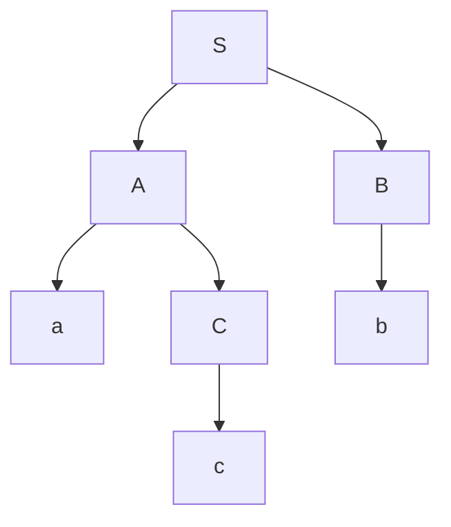
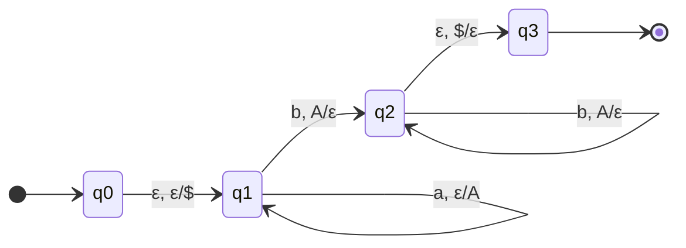

# Autómatas y Lenguajes Formales - Lenguajes libres del contexto

## 4.1 Recapitulación.

---

Los **lenguajes libres del contexto (LLC)** constituyen una clase fundamental en la jerarquía de Chomsky, situándose entre los lenguajes regulares y los sensibles al contexto. Esta guía ofrece una recapitulación integral de los conceptos clave, propiedades y aplicaciones de los LLC.

### Definiciones Fundamentales

#### Gramática Libre de Contexto (GLC)

Una GLC es una 4-tupla $G = (V, \Sigma, P, S)$ donde:

- $V:$ Conjunto finito de variables (símbolos no terminales)
- $\Sigma:$ Alfabeto de símbolos terminales ( $V \cap \Sigma = \emptyset$ )
- $P:$ Conjunto finito de reglas de producción de la forma $A \rightarrow \alpha,$ donde $A \in V$ y $\alpha \in (V \cup \Sigma)^*$
- $S \in V:$ Símbolo inicial

#### Lenguaje Libre de Contexto

Un lenguaje $L$ es libre de contexto si existe una GLC $G$ tal que $L = L(G).$

#### Derivación

Una derivación es una secuencia de pasos que transforma el símbolo inicial en una cadena de terminales:

$$S \Rightarrow \alpha_1 \Rightarrow \alpha_2 \Rightarrow \cdots \Rightarrow w$$

#### Árbol de Derivación

Representación gráfica de una derivación que muestra la estructura jerárquica de cómo se genera una cadena a partir del símbolo inicial.



### Formas Normales

#### Forma Normal de Chomsky (FNC)

Toda GLC $\epsilon\text{-libre}$ puede transformarse en una GLC equivalente donde todas las producciones tienen la forma:

- $A \rightarrow BC$ ( donde $B, C \in V$ )
- $A \rightarrow a$ ( donde $a \in \Sigma$ )

**Algoritmo de conversión a FNC:**

1. Eliminar producciones $\epsilon$ ( excepto posiblemente $S \rightarrow \epsilon$ )
2. Eliminar producciones unitarias ( $A \rightarrow B$ )
3. Reemplazar producciones con más de 2 símbolos
4. Reemplazar terminales mezclados con no terminales

#### Forma Normal de Greibach (FNG)

Toda GLC $\epsilon\text{-libre}$ puede transformarse en una GLC equivalente donde todas las producciones tienen la forma:

$$A \rightarrow a\alpha$$

donde $a \in \Sigma$ y $\alpha \in V^*$

### Propiedades de Clausura

Los LLC son cerrados bajo:

- Unión: $L_1 \cup L_2$
- Concatenación: $L_1 \cdot L_2$
- Cerradura de Kleene: $L^*$
- Homomorfismo: $h(L)$
- Sustitución

Los LLC **no** son cerrados bajo:

- Intersección: $L_1 \cap L_2$
- Complemento: $\overline{L}$
- Diferencia: $L_1 - L_2$

**Excepción importante:** La intersección de un LLC con un lenguaje regular es un LLC.

### Lema de Bombeo para LLC

Para todo LLC $L,$ existe una constante $n$ ( dependiente solo de $L$ ) tal que toda cadena $z \in L$ con $|z| \geq n$ puede escribirse como $z = uvwxy$ donde:

1. $|vwx| \leq n$
2. $|vx| \geq 1$
3. Para todo $i \geq 0,$ $uv^iwx^iy \in L$

#### Aplicación del Lema de Bombeo

El lema se utiliza para demostrar que ciertos lenguajes **no** son libres de contexto.

**Ejemplo:** Demostrar que $L = \{a^nb^nc^n \mid n \geq 0\}$ no es LLC.

1. Suponemos que $L$ es LLC, entonces existe $n$ del lema
2. Consideramos $z = a^nb^nc^n,$ con $|z| = 3n \geq n$
3. Según el lema, $z = uvwxy$ con las condiciones establecidas
4. Analizamos posibles casos para $vwx:$
   - Si $vwx$ contiene solo a's, al bombear se desbalancean los conteos
   - Si $vwx$ contiene a's y b's, al bombear se altera el orden
   - Similarmente para otros casos
5. En todos los casos, al bombear obtenemos cadenas fuera de $L$
6. Contradicción, por lo tanto $L$ no es LLC

### Autómatas de Pila (AP)

#### Definición Formal

Un AP es una 7-tupla $M = (Q, \Sigma, \Gamma, \delta, q_0, Z_0, F)$ donde:

- $Q:$ Conjunto finito de estados
- $\Sigma:$ Alfabeto de entrada
- $\Gamma:$ Alfabeto de pila
- $\delta:$ Función de transición $Q \times (\Sigma \cup \{\epsilon\}) \times \Gamma \rightarrow 2^{Q \times \Gamma^*}$
- $q_0 \in Q:$ Estado inicial
- $Z_0 \in \Gamma:$ Símbolo inicial de pila
- $F \subseteq Q:$ Estados de aceptación

#### Tipos de Aceptación

1. **Por estado final:** $L(M) = \{w \in \Sigma^* \mid (q_0, w, Z_0) \vdash^* (q_f, \epsilon, \gamma), q_f \in F\}$
2. **Por pila vacía:** $N(M) = \{w \in \Sigma^* \mid (q_0, w, Z_0) \vdash^* (q, \epsilon, \epsilon)\}$

#### Equivalencia entre AP y GLC

Para todo LLC $L:$

- Existe un AP $M$ tal que $L = N(M)$
- Existe un AP $M'$ tal que $L = L(M')$
- Existe una GLC $G$ tal que $L = L(G)$

### Algoritmos de Parsing

#### Algoritmo CYK (Cocke-Younger-Kasami)

Algoritmo de parsing para GLC en Forma Normal de Chomsky que determina si una cadena pertenece al lenguaje.

**Complejidad:** $O(n^3 \cdot |G|)$ donde $n$ es la longitud de la cadena.

```python
def cyk_parse(grammar, string):
    n = len(string)
    # Inicializar tabla
    table = [[set() for _ in range(n)] for _ in range(n)]

    # Llenar diagonal principal
    for i in range(n):
        for production in grammar:
            if production[1] == string[i]:
                table[i][i].add(production[0])

    # Llenar el resto de la tabla
    for length in range(2, n+1):
        for i in range(0, n-length+1):
            j = i + length - 1
            for k in range(i, j):
                for production in grammar:
                    if len(production[1]) == 2:
                        B, C = production[1]
                        if B in table[i][k] and C in table[k+1][j]:
                            table[i][j].add(production[0])

    return 'S' in table[0][n-1]  # S es el símbolo inicial
```

### Aplicaciones de los LLC

1. **Parsing de lenguajes de programación:** La mayoría de los lenguajes de programación son LLC o muy cercanos a LLC.
2. **Procesamiento de lenguaje natural:** Muchas estructuras sintácticas pueden modelarse con GLC.
3. **Compiladores e intérpretes:** Análisis sintáctico (parsing) de código fuente.
4. **Procesamiento de documentos:** Análisis de documentos XML/HTML.
5. **Bioinformática:** Análisis de secuencias genéticas.

### Ejercicios Propuestos

#### Ejercicio 1: Conversión a FNC

Convertir la siguiente GLC a Forma Normal de Chomsky:

$$ S \rightarrow aSb \mid SS \mid \epsilon $$

#### Ejercicio 2: Aplicación del Lema de Bombeo

Demostrar que $L = \{a^ib^jc^k \mid i < j < k\}$ no es un lenguaje libre de contexto.

#### Ejercicio 3: Construcción de AP

Diseñar un autómata de pila que acepte el lenguaje $L = \{a^nb^m \mid n \leq m \leq 2n\}.$

#### Ejercicio 4: Algoritmo CYK

Aplicar el algoritmo CYK para determinar si la cadena "aabb" pertenece al lenguaje generado por:

$$ S \rightarrow AB \mid BC $$

$$ A \rightarrow BA \mid a $$

$$ B \rightarrow CC \mid b $$

$$ C \rightarrow AB \mid a $$

#### Ejercicio 5: Propiedades de Clausura

Demostrar que si $L$ es un LLC y $R$ es un lenguaje regular, entonces $L \cap R$ es un LLC.

### Diagramas de Autómatas de Pila



Este diagrama representa un AP que acepta el lenguaje $\{a^nb^n \mid n \geq 0\}$ por pila vacía.

### Referencias

1. Viso G., E., _Introducción a la teoría de la computación_. Las Prensas de Ciencias, 2008. (Capítulos 4-5)
2. Rich, E., _Automata, Computability and Complexity, theory and applications_. Pearson Prentice Hall, 2008. (Capítulos 11-13)
3. Hopcroft, J. E., Motwani, R., and Ullman, J., _Introduction to Automata Theory, Languages, and Computation_. Addison-Wesley, 2007. (Capítulos 5-7)
4. Sipser, M., _Introduction to the Theory of Computation_. PWS Publishing Company, 2005. (Capítulo 2)

### Resumen de Fórmulas Importantes

- **Producciones en FNC:** $A \rightarrow BC$ o $A \rightarrow a$
- **Producciones en FNG:** $A \rightarrow a\alpha$
- **Lema de bombeo:** $z = uvwxy$ con $|vwx| \leq n,$ $|vx| \geq 1$
- **Función de transición de AP:** $\delta: Q \times (\Sigma \cup \{\epsilon\}) \times \Gamma \rightarrow 2^{Q \times \Gamma^*}$
