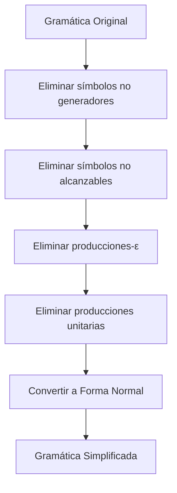

# Autómatas y Lenguajes Formales - Lenguajes libres del contexto

## 4.2 Simplificación de gramáticas libres del contexto.

---

La **simplificación de gramáticas libres de contexto (GLC)** es un proceso fundamental para hacerlas más manejables sin alterar el lenguaje que generan. Esta guía cubre los principales métodos de simplificación y sus aplicaciones.

### Definiciones Fundamentales

#### Gramática Libre de Contexto (GLC)

Una GLC es una 4-tupla $G = (V, \Sigma, P, S)$ donde:

- $V:$ Conjunto finito de variables (símbolos no terminales)
- $\Sigma:$ Alfabeto de símbolos terminales ( $V \cap \Sigma = \emptyset$ )
- $P:$ Conjunto finito de reglas de producción de la forma $A \rightarrow \alpha$
- $S \in V:$ Símbolo inicial

#### Gramática Simplificada

Una GLC está simplificada si:

1. No tiene símbolos inútiles (símbolos que no derivan en cadenas de terminales o no son alcanzables desde S)
2. No tiene producciones-ε ( excepto posiblemente $S \rightarrow \epsilon$ )
3. No tiene producciones unitarias ( de la forma $A \rightarrow B$ )

### Proceso de Simplificación

#### Eliminación de Símbolos Inútiles

##### Símbolos Anulables

Un símbolo $A \in V$ es **anulable** si $A \Rightarrow^* \epsilon.$

**Algoritmo para identificar símbolos anulables:**

1. $Anulables = \{A \mid A \rightarrow \epsilon \in P\}$
2. Repetir hasta que no haya cambios:
   - Si $A \rightarrow B_1B_2...B_n \in P$ y todos los $B_i$ están en $Anulables,$ entonces añadir $A$ a $Anulables$

##### Símbolos Generadores

Un símbolo $X \in V \cup \Sigma$ es **generador** si $X \Rightarrow^* w$ para alguna $w \in \Sigma^*.$

**Algoritmo para identificar símbolos generadores:**

1. $Generadores = \Sigma$ (todos los terminales son generadores)
2. Repetir hasta que no haya cambios:
   - Si $A \rightarrow \alpha \in P$ y todos los símbolos de $\alpha$ están en $Generadores,$ entonces añadir $A$ a $Generadores$

##### Símbolos Alcanzables

Un símbolo $X \in V \cup \Sigma$ es **alcanzable** si $S \Rightarrow^* \alpha X \beta$ para algunas $\alpha, \beta \in (V \cup \Sigma)^*.$

**Algoritmo para identificar símbolos alcanzables:**

1. $Alcanzables = \{S\}$
2. Repetir hasta que no haya cambios:
   - Si $A \in Alcanzables$ y $A \rightarrow \alpha \in P,$ añadir todos los símbolos de $\alpha$ a $Alcanzables$

##### Eliminación de Símbolos Inútiles

Un símbolo es **útil** si es both generador y alcanzable.

**Algoritmo:**

1. Eliminar todos los símbolos no generadores
2. Eliminar todos los símbolos no alcanzables

#### Eliminación de Producciones-ε

**Algoritmo:**

1. Identificar todos los símbolos anulables
2. Para cada producción $A \rightarrow X_1X_2...X_n,$ añadir todas las producciones posibles donde se omiten algunas combinaciones de símbolos anulables
3. Eliminar todas las producciones-ε excepto posiblemente $S \rightarrow \epsilon$

**Ejemplo:**
Sea $G$ con producciones:

- $S \rightarrow aSbS \mid bSaS \mid \epsilon$

Después de eliminar producciones-ε:

- $S \rightarrow aSbS \mid aSb \mid abS \mid ab \mid bSaS \mid bSa \mid baS \mid ba \mid \epsilon$

#### Eliminación de Producciones Unitarias

Una producción unitaria es de la forma $A \rightarrow B$ donde $B \in V.$

**Algoritmo:**

1. Para cada variable $A,$ encontrar todas las variables $B$ tales que $A \Rightarrow^* B$ (cierre unitario)
2. Para cada producción unitaria $A \rightarrow B,$ añadir $A \rightarrow \alpha$ para cada $B \rightarrow \alpha$ que no sea unitaria
3. Eliminar todas las producciones unitarias

**Ejemplo:**
Sea $G$ con producciones:

- $S \rightarrow A \mid a$
- $A \rightarrow B \mid b$
- $B \rightarrow S \mid c$

Después de eliminar producciones unitarias:

- $S \rightarrow a \mid b \mid c$
- $A \rightarrow b \mid c \mid a$
- $B \rightarrow c \mid a \mid b$

### Formas Normales

#### Forma Normal de Chomsky (FNC)

Una GLC está en FNC si todas sus producciones tienen una de estas formas:

- $A \rightarrow BC$ ( donde $B, C \in V$ )
- $A \rightarrow a$ ( donde $a \in \Sigma$ )
- $S \rightarrow \epsilon$ ( solo si $\epsilon \in L(G)$ )

**Algoritmo de conversión a FNC:**

1. Simplificar la gramática (eliminar símbolos inútiles, producciones-ε y unitarias)
2. Para cada terminal $a,$ crear una nueva variable $T_a$ y producción $T_a \rightarrow a$
3. Reemplazar terminales en producciones largas por sus variables correspondientes
4. Descomponer producciones con más de 2 variables:
   - $A \rightarrow B_1B_2...B_n$ se convierte en:
     - $A \rightarrow B_1A_1$
     - $A_1 \rightarrow B_2A_2$
     - ...
     - $A_{n-2} \rightarrow B_{n-1}B_n$

#### Forma Normal de Greibach (FNG)

Una GLC está en FNG si todas sus producciones tienen la forma:

- $A \rightarrow a\alpha$ ( donde $a \in \Sigma$ y $\alpha \in V^*$ )
- $S \rightarrow \epsilon$ ( solo si $\epsilon \in L(G)$ )

**Algoritmo de conversión a FNG** (más complejo, requiere ordenamiento de variables y eliminación de recursión izquierda)

### Implementación de Algoritmos

#### Código para Eliminación de Símbolos Inútiles

```python
def eliminar_simbolos_inutiles(gramatica):
    V, Sigma, P, S = gramatica

    # Paso 1: Eliminar símbolos no generadores
    generadores = set(Sigma)
    cambio = True
    while cambio:
        cambio = False
        for A in V:
            for produccion in P[A]:
                if all(simbolo in generadores for simbolo in produccion):
                    if A not in generadores:
                        generadores.add(A)
                        cambio = True

    # Filtrar producciones con símbolos generadores
    P_generadores = {}
    for A in V:
        if A in generadores:
            P_generadores[A] = []
            for produccion in P[A]:
                if all(simbolo in generadores for simbolo in produccion):
                    P_generadores[A].append(produccion)

    # Paso 2: Eliminar símbolos no alcanzables
    alcanzables = {S}
    cambio = True
    while cambio:
        cambio = False
        for A in list(alcanzables):
            if A in P_generadores:
                for produccion in P_generadores[A]:
                    for simbolo in produccion:
                        if simbolo in V and simbolo not in alcanzables:
                            alcanzables.add(simbolo)
                            cambio = True

    # Construir gramática resultante
    V_nuevo = {A for A in V if A in alcanzables and A in generadores}
    P_nuevo = {}
    for A in V_nuevo:
        P_nuevo[A] = []
        for produccion in P_generadores[A]:
            if all(simbolo in Sigma or simbolo in V_nuevo for simbolo in produccion):
                P_nuevo[A].append(produccion)

    return (V_nuevo, Sigma, P_nuevo, S)
```

### Ejemplos de Simplificación

#### Ejemplo 1: Simplificación Completa

Sea la gramática $G$ con:

- $S \rightarrow AB \mid a$
- $A \rightarrow a$
- $B \rightarrow b \mid C$
- $C \rightarrow D$
- $D \rightarrow E$
- $E \rightarrow F$
- $F \rightarrow S$

**Proceso de simplificación:**

1. **Símbolos generadores:** $a,$ $b,$ $S,$ $A,$ $B$ ( por $A \rightarrow a,$ $B \rightarrow b$ )
2. **Eliminar no generadores:** $C,$ $D,$ $E,$ $F$ no son generadores
3. **Producciones restantes:** $S \rightarrow AB \mid a,$ $A \rightarrow a,$ $B \rightarrow b$
4. **Símbolos alcanzables:** Desde $S:$ $S,$ $A,$ $B,$ $a,$ $b$ (todos alcanzables)
5. **Gramática simplificada:**
   - $S \rightarrow AB \mid a$
   - $A \rightarrow a$
   - $B \rightarrow b$

#### Ejemplo 2: Conversión a FNC

Sea la gramática $G$ con:

- $S \rightarrow aAbB \mid \epsilon$
- $A \rightarrow aA \mid \epsilon$
- $B \rightarrow bB \mid \epsilon$

**Conversión a FNC:**

1. **Eliminar producciones-ε** ( excepto $S \rightarrow \epsilon$ ):
   - $S \rightarrow aAbB \mid abB \mid aAb \mid ab \mid \epsilon$
   - $A \rightarrow aA \mid a$
   - $B \rightarrow bB \mid b$
2. **Eliminar producciones unitarias:** No hay en este caso
3. **Introducir variables para terminales:**
   - $T_a \rightarrow a$
   - $T_b \rightarrow b$
4. **Reemplazar en producciones:**
   - $S \rightarrow T_a A T_b B \mid T_a T_b B \mid T_a A T_b \mid T_a T_b \mid \epsilon$
   - $A \rightarrow T_a A \mid T_a$
   - $B \rightarrow T_b B \mid T_b$
5. **Descomponer producciones largas:**
   - $S \rightarrow T_a C_1$ donde $C_1 \rightarrow A C_2,$ $C_2 \rightarrow T_b B$
   - $S \rightarrow T_a C_3$ donde $C_3 \rightarrow T_b B$
   - $S \rightarrow T_a C_4$ donde $C_4 \rightarrow A T_b$
   - $S \rightarrow T_a T_b$

### Ejercicios Propuestos

#### Ejercicio 1: Identificación de Símbolos Útiles

Dada la gramática:

- $S \rightarrow A \mid B$
- $A \rightarrow aA \mid a$
- $B \rightarrow AB$
- $C \rightarrow cC \mid c$
- $D \rightarrow dD \mid d$

Identificar qué símbolos son útiles y simplificar la gramática.

#### Ejercicio 2: Eliminación de Producciones-ε

Simplificar la gramática eliminando producciones-ε:

- $S \rightarrow aSbS \mid bSaS \mid \epsilon$

#### Ejercicio 3: Eliminación de Producciones Unitarias

Eliminar las producciones unitarias de:

- $S \rightarrow A \mid a$
- $A \rightarrow B \mid b$
- $B \rightarrow C \mid c$
- $C \rightarrow S \mid d$

#### Ejercicio 4: Conversión a FNC

Convertir a Forma Normal de Chomsky:

- $S \rightarrow aAbB \mid \epsilon$
- $A \rightarrow aA \mid a$
- $B \rightarrow bB \mid b$

#### Ejercicio 5: Análisis de Gramática Compleja

Simplificar completamente la gramática:

- $S \rightarrow AB \mid CD$
- $A \rightarrow aA \mid \epsilon$
- $B \rightarrow bBc \mid E$
- $C \rightarrow cC \mid c$
- $D \rightarrow dD \mid d$
- $E \rightarrow eE \mid \epsilon$
- $F \rightarrow fF \mid f$

### Diagramas de Procesos



### Aplicaciones de la Simplificación

1. **Análisis sintáctico:** Las gramáticas simplificadas son más eficientes para parsing
2. **Compiladores:** Mejora el rendimiento de las fases de análisis
3. **Teoría de la computación:** Facilita las demostraciones de propiedades
4. **Procesamiento de lenguaje natural:** Simplifica el análisis de estructuras sintácticas

### Resumen de Algoritmos

| Algoritmo | Complejidad | Propósito |
|-----------|-------------|-----------|
| Eliminación de símbolos no generadores | $ O(\|V\| \cdot \|P\|) $ | Remover símbolos que no derivan en cadenas terminales |
| Eliminación de símbolos no alcanzables | $ O(\|V\| \cdot \|P\|) $ | Remover símbolos inaccesibles desde S |
| Eliminación de producciones-ε | $ O(\|V\|^2 \cdot \|P\|) $ | Remover producciones que derivan en ε |
| Eliminación de producciones unitarias | $ O(\|V\| ^ 3) $ | Remover producciones de la forma A → B |
| Conversión a FNC | $ O(\|P\| ^ 2) $ | Convertir a forma normal estándar |

### Referencias

1. Viso G., E., _Introducción a la teoría de la computación_. Las Prensas de Ciencias, 2008. (Capítulo 4)
2. Hopcroft, J. E., Motwani, R., and Ullman, J., _Introduction to Automata Theory, Languages, and Computation_. Addison-Wesley, 2007. (Capítulo 7)
3. Sipser, M., _Introduction to the Theory of Computation_. PWS Publishing Company, 2005. (Capítulo 2)
4. Aho A.V., Lam M., Sethi S.R. and Ullman J.D., _Compilers: Principles, Techniques, & Tools_. Pearson Addison-Wesley, 2007. (Capítulo 4)
