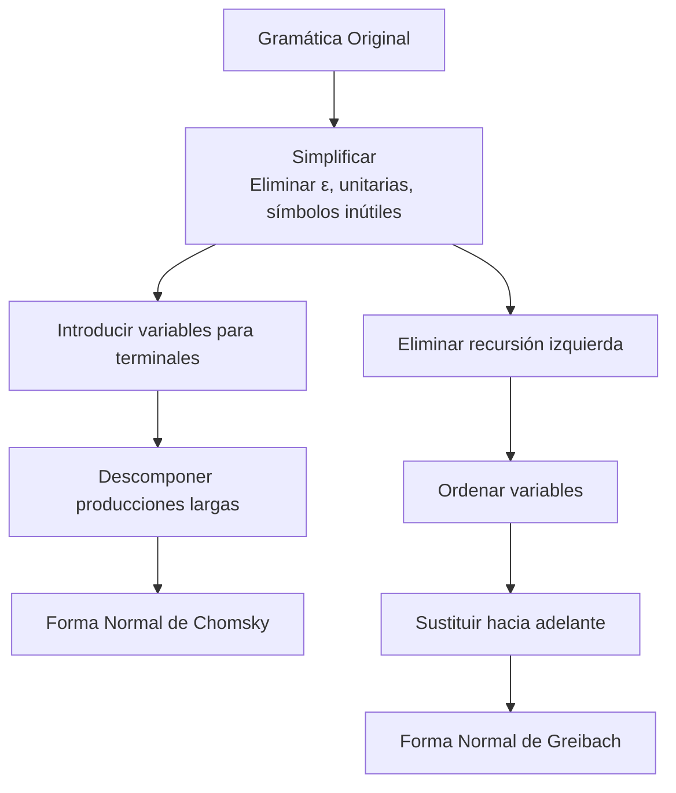

# Autómatas y Lenguajes Formales - Lenguajes libres del contexto

## 4.3 Formas normales.

---

Las **formas normales** son representaciones estandarizadas de gramáticas libres de contexto que facilitan su análisis y procesamiento. Esta guía cubre las principales formas normales y sus aplicaciones.

### Definiciones Fundamentales

#### Gramática Libre de Contexto (GLC)

Una GLC es una 4-tupla $G = (V, \Sigma, P, S)$ donde:

- $V:$ Conjunto finito de variables (símbolos no terminales)
- $\Sigma:$ Alfabeto de símbolos terminales ( $V \cap \Sigma = \emptyset$ )
- $P:$ Conjunto finito de reglas de producción de la forma $A \rightarrow \alpha$
- $S \in V:$ Símbolo inicial

#### Forma Normal de Chomsky (FNC)

Una GLC está en **Forma Normal de Chomsky** si todas sus producciones tienen una de estas formas:

1. $A \rightarrow BC$ ( donde $B, C \in V$ )
2. $A \rightarrow a$ ( donde $a \in \Sigma$ )
3. $S \rightarrow \epsilon$ ( solo si $\epsilon \in L(G)$ )

**Teorema:** Toda GLC $\epsilon\text{-libre}$ puede transformarse en una gramática equivalente en FNC.

#### Forma Normal de Greibach (FNG)

Una GLC está en **Forma Normal de Greibach** si todas sus producciones tienen la forma:

- $A \rightarrow a\alpha$ ( donde $a \in \Sigma$ y $\alpha \in V^*$ )
- $S \rightarrow \epsilon$ ( solo si $\epsilon \in L(G)$ )

**Teorema:** Toda GLC $\epsilon\text{-libre}$ puede transformarse en una gramática equivalente en FNG.

### Conversión a Forma Normal de Chomsky

#### Algoritmo de Conversión a FNC

1. **Simplificar la gramática:**
   - Eliminar símbolos inútiles
   - Eliminar producciones-ε ( excepto posiblemente $S \rightarrow \epsilon$ )
   - Eliminar producciones unitarias

2. **Introducir variables para terminales:**
   - Para cada terminal $a \in \Sigma,$ crear nueva variable $T_a$
   - Añadir producción $T_a \rightarrow a$
   - Reemplazar terminales en producciones largas por sus variables

3. **Descomponer producciones largas:**
   - Para cada producción $A \rightarrow B_1B_2...B_n$ con $n > 2:$
     - Crear nuevas variables $C_1, C_2, ..., C_{n-2}$
     - Reemplazar por:
       - $A \rightarrow B_1C_1$
       - $C_1 \rightarrow B_2C_2$
       - ...
       - $C_{n-2} \rightarrow B_{n-1}B_n$

#### Ejemplo de Conversión a FNC

**Gramática original:**

- $S \rightarrow aAbB \mid \epsilon$
- $A \rightarrow aA \mid a$
- $B \rightarrow bB \mid b$

**Paso 1: Simplificar (eliminar ε-producciones excepto S → ε):**

- $S \rightarrow aAbB \mid abB \mid aAb \mid ab \mid \epsilon$
- $A \rightarrow aA \mid a$
- $B \rightarrow bB \mid b$

**Paso 2: Introducir variables para terminales:**

- $T_a \rightarrow a$
- $T_b \rightarrow b$
- $S \rightarrow T_a A T_b B \mid T_a T_b B \mid T_a A T_b \mid T_a T_b \mid \epsilon$
- $A \rightarrow T_a A \mid T_a$
- $B \rightarrow T_b B \mid T_b$

**Paso 3: Descomponer producciones largas:**
Para $S \rightarrow T_a A T_b B:$

- $S \rightarrow T_a C_1$
- $C_1 \rightarrow A C_2$
- $C_2 \rightarrow T_b B$

Resultado final en FNC:

- $S \rightarrow T_a C_1 \mid T_a C_3 \mid T_a C_4 \mid T_a T_b \mid \epsilon$
- $C_1 \rightarrow A C_2$
- $C_2 \rightarrow T_b B$
- $C_3 \rightarrow T_b B$
- $C_4 \rightarrow A T_b$
- $A \rightarrow T_a A \mid T_a$
- $B \rightarrow T_b B \mid T_b$
- $T_a \rightarrow a$
- $T_b \rightarrow b$

### Conversión a Forma Normal de Greibach

#### Algoritmo de Conversión a FNG

1. **Simplificar la gramática** (igual que para FNC)
2. **Eliminar recursión izquierda directa e indirecta**
3. **Ordenar las variables** $A_1, A_2, ..., A_n$
4. **Transformar producciones** para que comiencen con terminal
5. **Sustituir hacia adelante** para obtener forma $A_i \rightarrow a\alpha$

#### Eliminación de Recursión Izquierda

**Recursión izquierda directa:**
$A \rightarrow A\alpha \mid \beta$ donde $\beta$ no comienza con $A$

Se reemplaza por:

- $A \rightarrow \beta A'$
- $A' \rightarrow \alpha A' \mid \epsilon$

**Recursión izquierda indirecta:**
Ocurre a través de varias derivaciones

#### Ejemplo de Conversión a FNG

**Gramática original:**

- $S \rightarrow AB \mid a$
- $A \rightarrow SA \mid b$
- $B \rightarrow SB \mid c$

**Paso 1: Ordenar variables:** $S, A, B$

**Paso 2: Eliminar recursión izquierda:**
Para $A \rightarrow SA \mid b:$

- Sustituir $S$ en $A:$ $A \rightarrow ABA \mid aA \mid b$
- Eliminar recursión izquierda directa en $A:$
  - $A \rightarrow aAA' \mid bA'$
  - $A' \rightarrow BAA' \mid \epsilon$

**Paso 3: Continuar proceso hasta obtener forma FNG**

### Implementación de Algoritmos

#### Código para Conversión a FNC

```python
def a_fnc(gramatica):
    V, Sigma, P, S = gramatica

    # Paso 1: Simplificar gramática
    gramatica = eliminar_epsilon(gramatica)
    gramatica = eliminar_unitarias(gramatica)

    # Paso 2: Introducir variables para terminales
    nuevas_variables = {}
    nuevas_producciones = {}

    for terminal in Sigma:
        nueva_var = f'T_{terminal}'
        nuevas_variables[terminal] = nueva_var
        nuevas_producciones[nueva_var] = [[terminal]]

    # Paso 3: Reemplazar terminales en producciones
    P_nuevo = {}
    for variable in V:
        P_nuevo[variable] = []
        for produccion in P[variable]:
            nueva_prod = []
            for simbolo in produccion:
                if simbolo in Sigma:
                    nueva_prod.append(nuevas_variables[simbolo])
                else:
                    nueva_prod.append(simbolo)
            P_nuevo[variable].append(nueva_prod)

    # Paso 4: Descomponer producciones largas
    contador = 1
    for variable in list(P_nuevo.keys()):
        nuevas_prods = []
        for produccion in P_nuevo[variable]:
            if len(produccion) > 2:
                # Descomponer producción larga
                actual = variable
                for i in range(len(produccion) - 2):
                    nueva_var = f'C_{contador}'
                    contador += 1
                    nuevas_producciones[nueva_var] = [[produccion[i], nueva_var]]
                    actual = nueva_var
                nuevas_producciones[actual] = [[produccion[-2], produccion[-1]]]
            else:
                nuevas_prods.append(produccion)
        P_nuevo[variable] = nuevas_prods

    # Combinar todas las producciones
    P_final = {**P_nuevo, **nuevas_producciones}

    return (set(P_final.keys()), Sigma, P_final, S)
```

### Aplicaciones de las Formas Normales

#### Ventajas de la FNC

1. **Árboles de derivación binarios:** Todos los nodos internos tienen exactamente 2 hijos
2. **Algoritmo CYK:** Permite parsing en tiempo $O(n^3)$
3. **Análisis estructural:** Facilita el estudio de propiedades del lenguaje

#### Ventajas de la FNG

1. **Derivaciones izquierdas deterministas:** Cada paso consume un terminal
2. **Relación con autómatas de pila:** Facilita la conversión a AP deterministas
3. **Análisis descendente:** Útil para parsing predictivo

### Ejercicios Propuestos

#### Ejercicio 1: Conversión a FNC

Convertir a Forma Normal de Chomsky:

- $S \rightarrow aSb \mid SS \mid \epsilon$

#### Ejercicio 2: Conversión a FNG

Convertir a Forma Normal de Greibach:

- $S \rightarrow AB \mid a$
- $A \rightarrow SA \mid b$
- $B \rightarrow SB \mid c$

#### Ejercicio 3: Eliminación de Recursión Izquierda

Eliminar la recursión izquierda de:

- $A \rightarrow Aa \mid Ab \mid c \mid d$

#### Ejercicio 4: Análisis de Árbol de Derivación

Para la gramática en FNC:

- $S \rightarrow AB \mid BC$
- $A \rightarrow BA \mid a$
- $B \rightarrow CC \mid b$
- $C \rightarrow AB \mid a$

Dibujar el árbol de derivación para la cadena "baaba"

#### Ejercicio 5: Implementación

Implementar en Python el algoritmo de conversión a FNG

### Diagramas de Procesos



### Propiedades y Teoremas

#### Teorema de Chomsky-Schützenberger

Todo lenguaje libre de contexto es la imagen homomórfica de la intersección de un lenguaje regular y el lenguaje de Dyck $D_2^*$ (lenguaje de paréntesis balanceados).

#### Lema de Ogden

Versión más fuerte del lema de bombeo para LLC que permite marcar posiciones en la cadena.

#### Jerarquía de Chomsky

| Tipo | Gramática            | Autómata          | Lenguaje                   |
| ---- | -------------------- | ----------------- | -------------------------- |
| 3    | Regular              | AFD/AFN           | Regulares                  |
| 2    | Libre de contexto    | AP                | LLC                        |
| 1    | Sensible al contexto | ATM               | Sensibles al contexto      |
| 0    | Irrestricta          | Máquina de Turing | Recursivamente enumerables |

### Aplicaciones Prácticas

1. **Compiladores:** Las formas normales facilitan el análisis sintáctico
2. **Procesamiento de lenguaje natural:** Análisis de estructura gramatical
3. **Bioinformática:** Análisis de secuencias de ADN y proteínas
4. **Verificación formal:** Análisis de propiedades de sistemas

### Resumen de Algoritmos

| Algoritmo | Complejidad | Aplicación |
|-----------|-------------|-----------|
| Conversión a FNC | $ O(\|P\|^2) $ | Parsing CYK, análisis estructural |
| Conversión a FNG | $ O(\|V\|^3 \cdot \|P\|) $ | Parsing descendente, conversión a AP |
| Eliminación de recursion izquierda | $ O(\|V\|^3) $ | Preparación para FNG |

### Referencias

1. Hopcroft, J. E., Motwani, R., and Ullman, J., _Introduction to Automata Theory, Languages, and Computation_. Addison-Wesley, 2007. (Capítulos 6-7)
2. Sipser, M., _Introduction to the Theory of Computation_. PWS Publishing Company, 2005. (Capítulo 2)
3. Viso G., E., _Introducción a la teoría de la computación_. Las Prensas de Ciencias, 2008. (Capítulo 4)
4. Aho A.V., Lam M., Sethi S.R. and Ullman J.D., _Compilers: Principles, Techniques, & Tools_. Pearson Addison-Wesley, 2007. (Capítulo 4)
