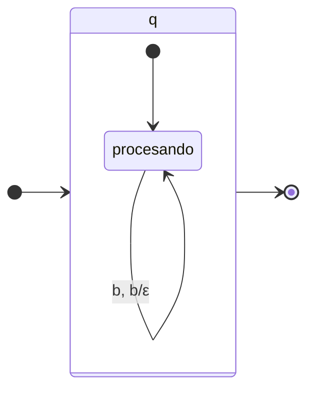
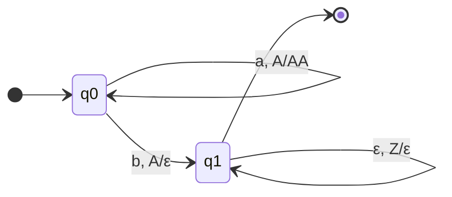

# Autómatas y Lenguajes Formales - Lenguajes libres del contexto

## 4.4 Equivalencia entre autómatas de pila y lenguajes libres del contexto.

---

La **equivalencia** entre autómatas de pila (AP) y lenguajes libres de contexto (LLC) es un resultado fundamental en la teoría de la computación. Establece que la clase de lenguajes reconocidos por autómatas de pila coincide exactamente con la clase de lenguajes generados por gramáticas libres de contexto.

### Definiciones Fundamentales

#### Autómata de Pila (AP)

Un autómata de pila es una 7-tupla $M = (Q, \Sigma, \Gamma, \delta, q_0, Z_0, F)$ donde:

- $Q:$ Conjunto finito de estados
- $\Sigma:$ Alfabeto de entrada
- $\Gamma:$ Alfabeto de pila
- $\delta:$ Función de transición $Q \times (\Sigma \cup \{\epsilon\}) \times \Gamma \rightarrow 2^{Q \times \Gamma^*}$
- $q_0 \in Q:$ Estado inicial
- $Z_0 \in \Gamma:$ Símbolo inicial de pila
- $F \subseteq Q:$ Estados de aceptación

#### Gramática Libre de Contexto (GLC)

Una GLC es una 4-tupla $G = (V, \Sigma, P, S)$ donde:

- $V:$ Conjunto finito de variables (no terminales)
- $\Sigma:$ Alfabeto de terminales
- $P:$ Conjunto de producciones de la forma $A \rightarrow \alpha$
- $S \in V:$ Símbolo inicial

### Teorema Fundamental de Equivalencia

**Teorema:** Un lenguaje $L$ es libre de contexto si y sólo si existe un autómata de pila $M$ tal que $L = N(M)$ (aceptación por pila vacía) o $L = L(M)$ (aceptación por estado final).

### Conversión de GLC a Autómata de Pila

#### Algoritmo de Construcción

Dada una GLC $G = (V, \Sigma, P, S),$ construimos un AP $M = (\{q\}, \Sigma, V \cup \Sigma, \delta, q, S, \emptyset)$ que acepta por pila vacía, donde:

- $\delta(q, \epsilon, A) = \{(q, \alpha) \mid A \rightarrow \alpha \in P\}$ para todo $A \in V$
- $\delta(q, a, a) = \{(q, \epsilon)\}$ para todo $a \in \Sigma$

#### Ejemplo de Conversión

**Gramática:**

- $S \rightarrow aSb \mid \epsilon$

**AP equivalente:**

- $Q = \{q\},$ $\Sigma = \{a, b\},$ $\Gamma = \{S, a, b\},$ $Z_0 = S$
- $\delta(q, \epsilon, S) = \{(q, aSb), (q, \epsilon)\}$
- $\delta(q, a, a) = \{(q, \epsilon)\}$
- $\delta(q, b, b) = \{(q, \epsilon)\}$



### Conversión de Autómata de Pila a GLC

#### Algoritmo de Construcción

Dado un AP $M = (Q, \Sigma, \Gamma, \delta, q_0, Z_0, F),$ construimos una GLC $G$ donde:

- Variables: $V = \{ [qXp] \mid q,p \in Q, X \in \Gamma \} \cup \{S\}$
- Producciones:
  1. $S \rightarrow [q_0 Z_0 p]$ para todo $p \in Q$
  2. Para cada transición $\delta(q, a, X) \ni (p, Y_1 Y_2 ... Y_k):$
     - $[qXr_k] \rightarrow a[pY_1r_1][r_1Y_2r_2]...[r_{k-1}Y_kr_k]$ para todas las secuencias de estados $r_1, r_2, ..., r_k \in Q$
  3. Para cada transición $\delta(q, a, X) \ni (p, \epsilon):$
     - $[qXp] \rightarrow a$

#### Ejemplo de Conversión

**AP:**

- $Q = \{q_0, q_1\},$ $\Sigma = \{a, b\},$ $\Gamma = \{Z, A\},$ $Z_0 = Z$
- $\delta(q_0, a, Z) = \{(q_0, AZ)\}$
- $\delta(q_0, a, A) = \{(q_0, AA)\}$
- $\delta(q_0, b, A) = \{(q_1, \epsilon)\}$
- $\delta(q_1, b, A) = \{(q_1, \epsilon)\}$
- $\delta(q_1, \epsilon, Z) = \{(q_1, \epsilon)\}$

**GLC equivalente:**

- $S \rightarrow [q_0 Z q_0] \mid [q_0 Z q_1]$
- $[q_0 Z q_0] \rightarrow a[q_0 A q_0][q_0 Z q_0] \mid a[q_0 A q_1][q_1 Z q_0]$
- $[q_0 Z q_1] \rightarrow a[q_0 A q_0][q_0 Z q_1] \mid a[q_0 A q_1][q_1 Z q_1]$
- $[q_0 A q_0] \rightarrow a[q_0 A q_0][q_0 A q_0] \mid a[q_0 A q_1][q_1 A q_0]$
- $[q_0 A q_1] \rightarrow a[q_0 A q_0][q_0 A q_1] \mid a[q_0 A q_1][q_1 A q_1] \mid b$
- $[q_1 A q_1] \rightarrow b$
- $[q_1 Z q_1] \rightarrow \epsilon$

### Implementación de Algoritmos

#### Código para Conversión de GLC a AP

```python
def glc_a_ap(gramatica):
    V, Sigma, P, S = gramatica
    Q = {'q'}
    Gamma = V.union(Sigma)
    delta = {}
    q0 = 'q'
    Z0 = S
    F = set()

    # Construir función de transición
    for variable in V:
        for produccion in P[variable]:
            # Para cada producción A -> α
            estado_destino = 'q'
            simbolos_pila = list(produccion)
            delta[('q', '', variable)] = delta.get(('q', '', variable), set())
            delta[('q', '', variable)].add(('q', tuple(simbolos_pila)))

    for terminal in Sigma:
        # Transición para consumir terminales
        delta[('q', terminal, terminal)] = {('q', ())}

    return (Q, Sigma, Gamma, delta, q0, Z0, F)
```

#### Código para Conversión de AP a GLC

```python
def ap_a_glc(ap):
    Q, Sigma, Gamma, delta, q0, Z0, F = ap
    V = set()
    P = {}
    S = 'S'

    # Crear variables [qXp]
    for q in Q:
        for X in Gamma:
            for p in Q:
                variable = f'[{q}{X}{p}]'
                V.add(variable)
                P[variable] = []

    # Producciones iniciales
    P[S] = []
    for p in Q:
        variable_inicial = f'[{q0}{Z0}{p}]'
        P[S].append([variable_inicial])

    # Construir producciones a partir de transiciones
    for (estado_actual, simbolo_entrada, simbolo_pila) in delta:
        for (estado_siguiente, reemplazo_pila) in delta[(estado_actual, simbolo_entrada, simbolo_pila)]:
            if len(reemplazo_pila) == 0:
                # Transición que vacía la pila: [qXp] -> a
                for p in Q:
                    variable = f'[{estado_actual}{simbolo_pila}{p}]'
                    if estado_siguiente == p:
                        produccion = [simbolo_entrada] if simbolo_entrada != '' else []
                        P[variable].append(produccion)
            else:
                # Transición con múltiples símbolos en la pila
                for estados_intermedios in product(Q, repeat=len(reemplazo_pila)-1):
                    estado_final = estados_intermedios[-1] if len(estados_intermedios) > 0 else estado_siguiente
                    for p in Q:
                        variable = f'[{estado_actual}{simbolo_pila}{p}]'
                        if estado_final == p:
                            produccion = [simbolo_entrada] if simbolo_entrada != '' else []
                            # Construir lado derecho de la producción
                            previo = estado_siguiente
                            for i, simbolo in enumerate(reemplazo_pila):
                                if i < len(estados_intermedios):
                                    siguiente_estado = estados_intermedios[i]
                                else:
                                    siguiente_estado = p
                                nueva_variable = f'[{previo}{simbolo}{siguiente_estado}]'
                                produccion.append(nueva_variable)
                                previo = siguiente_estado
                            P[variable].append(produccion)

    return (V, Sigma, P, S)
```

### Tipos de Autómatas de Pila y su Equivalencia

#### Aceptación por Estado Final vs. Pila Vacía

**Teorema:** Para cualquier AP $M$ que acepta por estado final, existe un AP $M'$ que acepta por pila vacía tal que $L(M) = N(M'),$ y viceversa.

#### Autómatas de Pila Deterministas vs. No Deterministas

A diferencia de los autómatas finitos, los autómatas de pila **deterministas** (APD) son menos poderosos que los **no deterministas** (APN).

**Teorema:** La clase de lenguajes aceptados por APD es un subconjunto propio de la clase de lenguajes libres de contexto.

### Ejercicios Propuestos

#### Ejercicio 1: Conversión GLC a AP

Convertir la siguiente gramática a un autómata de pila:

- $S \rightarrow aSa \mid bSb \mid \epsilon$

#### Ejercicio 2: Conversión AP a GLC

Convertir el siguiente autómata de pila a una gramática libre de contexto:

- $Q = \{q_0, q_1\},$ $\Sigma = \{a, b\},$ $\Gamma = \{Z, A\},$ $Z_0 = Z$
- $\delta(q_0, a, Z) = \{(q_0, AZ)\}$
- $\delta(q_0, a, A) = \{(q_0, AA)\}$
- $\delta(q_0, b, A) = \{(q_1, \epsilon)\}$
- $\delta(q_1, b, A) = \{(q_1, \epsilon)\}$
- $\delta(q_1, \epsilon, Z) = \{(q_1, \epsilon)\}$

#### Ejercicio 3: Equivalencia entre Modos de Aceptación

Dado un AP que acepta por estado final, construir uno equivalente que acepte por pila vacía.

#### Ejercicio 4: Análisis de Lenguaje

Demostrar que el lenguaje $L = \{a^nb^nc^n \mid n \geq 0\}$ no es libre de contexto usando el lema de bombeo.

#### Ejercicio 5: Implementación

Implementar en Python el algoritmo de conversión de AP a GLC.

### Diagramas de Autómatas de Pila



### Aplicaciones de la Equivalencia

1. **Compiladores:** Los AP se utilizan para implementar analizadores sintácticos (parsers) para GLC.
2. **Procesamiento de lenguaje natural:** Análisis de estructuras sintácticas.
3. **Verificación de software:** Análisis de protocolos de comunicación.
4. **Bioinformática:** Análisis de secuencias de ADN y proteínas.

### Referencias

1. Hopcroft, J. E., Motwani, R., and Ullman, J., _Introduction to Automata Theory, Languages, and Computation_. Addison-Wesley, 2007. (Capítulos 6-7)
2. Sipser, M., _Introduction to the Theory of Computation_. PWS Publishing Company, 2005. (Capítulo 2)
3. Viso G., E., _Introducción a la teoría de la computación_. Las Prensas de Ciencias, 2008. (Capítulo 5)
4. Aho A.V., Lam M., Sethi S.R. and Ullman J.D., _Compilers: Principles, Techniques, & Tools_. Pearson Addison-Wesley, 2007. (Capítulo 4)

### Resumen de Equivalencias

| Concepto                                   | Equivalencia                                       |
| ------------------------------------------ | -------------------------------------------------- |
| GLC → AP                                   | Siempre posible mediante construcción algorítmica  |
| AP → GLC                                   | Siempre posible mediante construcción algorítmica  |
| AP deterministas vs. no deterministas      | Los APD son menos poderosos que los APN            |
| Aceptación por estado final vs. pila vacía | Son equivalentes para lenguajes libres de contexto |
