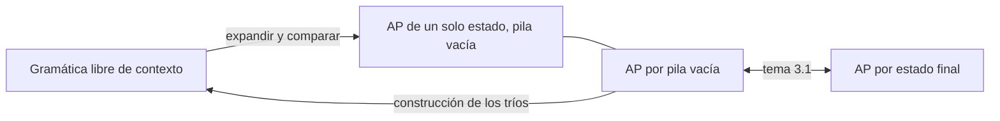

# Autómatas y Lenguajes Formales - Lenguajes libres del contexto

## 4.4 Equivalencia entre autómatas de pila y lenguajes libres del contexto.

---

Los lenguajes libres de contexto se definieron con gramáticas, y los autómatas con pila se introdujeron como reconocedores. Este tema demuestra que describen exactamente la misma clase de lenguajes. Es el análogo, un nivel más arriba en la jerarquía de Chomsky, del teorema de Kleene para los lenguajes regulares: un lenguaje se puede **generar** con una gramática libre de contexto si y solo si se puede **reconocer** con un autómata con pila.

**Teorema.** Para todo lenguaje $L,$ son equivalentes:

1. $L = L(G)$ para alguna gramática libre de contexto $G.$
2. $L = N(M)$ para algún AP $M,$ que acepta por pila vacía.
3. $L = L(M')$ para algún AP $M',$ que acepta por estado final.

La equivalencia entre 2 y 3 se demostró en el tema 3.1. Faltan las dos direcciones entre gramáticas y autómatas, y las dos construcciones ya aparecieron en el tema 3.4.



### De gramática a autómata con pila

Sea $G = (V, \Sigma, P, S).$ El AP de un solo estado $M$ con alfabeto de pila $V \cup \Sigma,$ símbolo inicial $S$ y aceptación por pila vacía tiene:

- $\delta(q, \varepsilon, A) = \{(q, \alpha) \mid A \rightarrow \alpha \in P\}$ para cada no terminal $A:$ **expandir**.
- $\delta(q, a, a) = \{(q, \varepsilon)\}$ para cada terminal $a:$ **comparar**.

**Lema.** Para toda $w \in \Sigma^*$ y toda $\alpha \in (V \cup \Sigma)^*$ que empiece con un no terminal o sea vacía,

$$ S \Rightarrow_{lm}^* w\alpha \iff (q, w, S) \vdash^* (q, \varepsilon, \alpha) $$

**Demostración.** De izquierda a derecha, por inducción sobre el número de pasos de la derivación por la izquierda. Si el último paso es $xA\beta \Rightarrow_{lm} x\gamma\beta,$ con $x \in \Sigma^*,$ por la hipótesis de inducción el AP llega a $(q, \varepsilon, A\beta)$ después de leer $x$ (con el resto de la entrada pendiente). Expande $A$ en $\gamma,$ quedando $\gamma\beta$ en la pila, y compara los terminales del principio de $\gamma\beta$ con la entrada hasta llegar al primer no terminal; lo leído completa $w.$ De derecha a izquierda, por inducción sobre el número de movimientos: las comparaciones no cambian la forma sentencial representada por (lo leído) + (pila), y las expansiones aplican una producción al no terminal más a la izquierda. $\blacksquare$

Con $\alpha = \varepsilon$ se obtiene $N(M) = L(G).$

### De autómata con pila a gramática

Sea $M = (Q, \Sigma, \Gamma, \delta, q_0, Z_0)$ un AP que acepta por pila vacía. La gramática tiene como no terminales un símbolo inicial $S$ y los **tríos** $[p\,X\,r],$ con el significado

$$ [p\,X\,r] \Rightarrow^* w \iff (p, w, X) \vdash^* (r, \varepsilon, \varepsilon) $$

es decir, $[p\,X\,r]$ genera las cadenas que $M$ lee para pasar del estado $p$ con $X$ en el tope al estado $r$ habiendo quitado $X$ (y sin tocar lo que había debajo). Las producciones son:

- $S \rightarrow [q_0\,Z_0\,r]$ para todo $r \in Q.$
- Si $(r, \varepsilon) \in \delta(p, a, X),$ con $a \in \Sigma \cup \{\varepsilon\}:$ $[p\,X\,r] \rightarrow a.$
- Si $(r, Y_1 \cdots Y_k) \in \delta(p, a, X)$ con $k \geq 1:$ para toda elección de estados $r_1, \ldots, r_k,$

$$ [p\,X\,r_k] \rightarrow a\,[r\,Y_1\,r_1]\,[r_1\,Y_2\,r_2] \cdots [r_{k-1}\,Y_k\,r_k] $$

La idea de la última regla: para quitar $X,$ $M$ lo reemplaza por $Y_1 \cdots Y_k$ leyendo $a,$ y luego tiene que quitar $Y_1,$ después $Y_2,$ y así hasta $Y_k.$ Cada uno se quita en un tramo de la computación que empieza en el estado en que terminó el anterior; los estados intermedios $r_i$ no se conocen de antemano, así que la gramática considera todos.

**Demostración del significado.** Por inducción sobre el número de movimientos de $M$ en una dirección y sobre el número de pasos de la derivación en la otra. El caso central: si $(p, w, X) \vdash (r, w', Y_1 \cdots Y_k) \vdash^* (r_k, \varepsilon, \varepsilon),$ la computación posterior se divide en $k$ tramos, cada uno de los cuales quita un $Y_i;$ por la hipótesis de inducción, cada tramo corresponde a una derivación desde un trío. $\blacksquare$

Con $S \rightarrow [q_0\,Z_0\,r]$ se obtiene $L(G) = N(M).$ La gramática tiene $O(|Q|^2|\Gamma|)$ no terminales y muchos de ellos suelen ser inútiles; conviene eliminarlos (tema 4.2).

### Ejemplo

El AP de dos estados con $\delta(p, a, Z) = \{(p, A)\},$ $\delta(p, a, A) = \{(p, AA)\},$ $\delta(p, b, A) = \{(q, \varepsilon)\},$ $\delta(q, b, A) = \{(q, \varepsilon)\}$ acepta por pila vacía $\{a^nb^n \mid n \geq 1\}:$ la primera $a$ reemplaza el fondo $Z$ por $A,$ y la pila se vacía exactamente cuando la última $b$ quita la última $A.$ Las producciones de la construcción mencionan 6 de los 8 tríos posibles; después de quitar los inútiles quedan

$$ S \rightarrow [pZq], \quad [pZq] \rightarrow a\,[pAq], \quad [pAq] \rightarrow a\,[pAq]\,[qAq] \mid b, \quad [qAq] \rightarrow b $$

Los tríos que terminan en $p$ son inútiles porque $M$ nunca regresa a $p$ después de pasar a $q$ y quitar un símbolo en $p$ lo lleva siempre a $q.$ La gramática resultante es, con $A = [pAq]$ y $B = [qAq],$ $A \rightarrow aAB \mid b,$ $B \rightarrow b,$ que genera $a^{n-1}b^n,$ y $S \Rightarrow aA$ completa $a^nb^n.$

### Consecuencias

- Las propiedades de los LLC se pueden demostrar con gramáticas o con autómatas, según convenga: la cerradura bajo unión es más fácil con gramáticas, y la cerradura bajo intersección con regulares, con autómatas (tema 4.8).
- Como los AP de un solo estado bastan, los estados de un AP son **prescindibles**: toda la información se puede guardar en la pila.
- La construcción de los tríos no preserva el determinismo, y la de gramática a autómata produce un AP no determinista. Las gramáticas que corresponden a los AP deterministas son las **LR(k)** (tema 3.5).

### Implementación en Python

El programa implementa las dos construcciones: obtiene la gramática del AP del ejemplo, la limpia de símbolos inútiles y la compara con el AP; después construye el AP de la gramática $S \rightarrow aSbS \mid bSaS \mid \varepsilon$ y lo compara con el lenguaje de las cadenas con tantas $a$ como $b.$ Las comparaciones usan todas las cadenas sobre $\{a, b\}$ de longitud a lo más 8.

```python
from collections import deque
from itertools import product

def ap_a_gramatica(delta, Q, q0, Z0):
    """Construcción de los tríos. delta: (p, a, X) -> lista de (r, cadena a apilar); a = '' es ε.
    Devuelve una gramática: dict no terminal -> conjunto de tuplas de símbolos."""
    G = {'S': {((q0, Z0, q),) for q in Q}}
    for (p, a, X), opciones in delta.items():
        for r, gamma in opciones:
            prefijo = (a,) if a else ()
            if not gamma:
                G.setdefault((p, X, r), set()).add(prefijo)
                continue
            for estados in product(Q, repeat=len(gamma)):
                cuerpo, actual = [], r
                for Y, siguiente in zip(gamma, estados):
                    cuerpo.append((actual, Y, siguiente))
                    actual = siguiente
                G.setdefault((p, X, estados[-1]), set()).add(prefijo + tuple(cuerpo))
    return G

def es_var(s):
    return isinstance(s, tuple) or s == 'S'          # los no terminales son S y los tríos

def utiles(G, S):
    gen, cambio = set(), True
    while cambio:
        cambio = False
        for A, ds in G.items():
            if A not in gen and any(all(s in gen or not es_var(s) for s in d) for d in ds):
                gen.add(A)
                cambio = True
    G = {A: {d for d in ds if all(s in gen or not es_var(s) for s in d)} for A, ds in G.items() if A in gen}
    alc, pila = {S}, [S]
    while pila:
        for d in G.get(pila.pop(), ()):
            for s in d:
                if es_var(s) and s not in alc:
                    alc.add(s)
                    pila.append(s)
    return {A: ds for A, ds in G.items() if A in alc}

def generar(G, S, n):
    res, vistas, cola = set(), {(S,)}, deque([(S,)])
    while cola:
        f = cola.popleft()
        i = next((k for k, s in enumerate(f) if es_var(s)), None)
        if i is None:
            res.add(''.join(f))
            continue
        for d in G[f[i]]:
            g = f[:i] + d + f[i + 1:]
            if sum(not es_var(s) for s in g) <= n and len(g) <= 2 * n + 3 and g not in vistas:
                vistas.add(g)
                cola.append(g)
    return {w for w in res if len(w) <= n}

def acepta_ap(delta, q0, Z0, w):
    inicio = (q0, 0, Z0)
    vistas, cola = {inicio}, deque([inicio])
    while cola:
        q, i, pila = cola.popleft()
        if i == len(w) and not pila:
            return True
        if not pila:
            continue
        X, resto = pila[0], pila[1:]
        movs = [(p, i, g) for p, g in delta.get((q, '', X), [])]
        if i < len(w):
            movs += [(p, i + 1, g) for p, g in delta.get((q, w[i], X), [])]
        for p, j, g in movs:
            c = (p, j, g + resto)
            if len(c[2]) <= 2 * len(w) + 3 and c not in vistas:
                vistas.add(c)
                cola.append(c)
    return False

# AP de dos estados, por pila vacía, para {a^n b^n : n >= 1}
D = {('p', 'a', 'Z'): [('p', 'A')], ('p', 'a', 'A'): [('p', 'AA')],
     ('p', 'b', 'A'): [('q', '')], ('q', 'b', 'A'): [('q', '')]}
G = utiles(ap_a_gramatica(D, ['p', 'q'], 'p', 'Z'), 'S')
nombre = lambda s: ''.join(s) if isinstance(s, tuple) else s
for A in sorted(G, key=str):
    print(f"[{nombre(A)}] ->", ' | '.join(' '.join(f"[{nombre(s)}]" if isinstance(s, tuple) else s for s in d) for d in sorted(G[A], key=str)))
cadenas = [''.join(t) for k in range(9) for t in product('ab', repeat=k)]
print(generar(G, 'S', 8) == {w for w in cadenas if acepta_ap(D, 'p', 'Z', w)})

# De gramática a AP de un estado: expandir no terminales y comparar terminales.
def gramatica_a_ap(G):
    delta = {('•', '', A): [('•', d) for d in sorted(ds)] for A, ds in G.items()}
    for a in {s for ds in G.values() for d in ds for s in d if s not in G}:
        delta[('•', a, a)] = [('•', '')]
    return delta

P = {'S': {'aSbS', 'bSaS', ''}}                     # tantas a como b
AP = gramatica_a_ap(P)
print(all(acepta_ap(AP, '•', 'S', w) == (w.count('a') == w.count('b')) for w in cadenas))
```

Salida:

```text
[pAq] -> a [pAq] [qAq] | b
[pZq] -> a [pAq]
[qAq] -> b
[S] -> [pZq]
True
True
```

### Ejercicios Propuestos

1. **De gramática a AP.** Construye el AP de la gramática $E \rightarrow E + T \mid T,$ $T \rightarrow a$ y escribe la computación con $a + a.$ Relaciónala con la derivación por la izquierda.

2. **Tríos.** Construye la gramática del AP de un estado $q$ con $\delta(q, a, Z) = \{(q, AZ)\},$ $\delta(q, a, A) = \{(q, AA)\},$ $\delta(q, b, A) = \{(q, \varepsilon)\},$ $\delta(q, \varepsilon, Z) = \{(q, \varepsilon)\}.$ ¿Qué lenguaje acepta?

3. **Conteo.** ¿Cuántas producciones genera la construcción de los tríos para una transición que apila $k$ símbolos en un AP con $n$ estados?

4. **Estado final.** Explica cómo obtener una gramática para el lenguaje que un AP acepta **por estado final**.

5. **Lenguajes regulares.** Usa la equivalencia para dar una demostración alternativa de que todo lenguaje regular es libre de contexto.

### Soluciones

**Ejercicio 1.** El AP tiene $\delta(q, \varepsilon, E) = \{(q, E{+}T), (q, T)\},$ $\delta(q, \varepsilon, T) = \{(q, a)\}$ y transiciones de comparación para $a$ y $+.$ La computación que acepta es $(a{+}a, E) \vdash (a{+}a, E{+}T) \vdash (a{+}a, T{+}T) \vdash (a{+}a, a{+}T) \vdash (+a, {+}T) \vdash (a, T) \vdash (a, a) \vdash (\varepsilon, \varepsilon),$ omitiendo el estado. Las expansiones siguen la derivación por la izquierda $E \Rightarrow E + T \Rightarrow T + T \Rightarrow a + T \Rightarrow a + a.$ Este AP también tiene computaciones infinitas, expandiendo $E$ en $E + T$ una y otra vez; por eso un analizador descendente no puede usar esta gramática (tema 3.3).

**Ejercicio 2.** Con un solo estado, los tríos son $[qAq]$ y $[qZq];$ se escriben $A$ y $Z.$ Producciones: $S \rightarrow Z,$ $Z \rightarrow aAZ \mid \varepsilon,$ $A \rightarrow aAA \mid b.$ $A$ genera las cadenas con una $b$ más que letras $a$ en las que todo prefijo propio tiene al menos tantas $a$ como $b;$ $Z$ genera concatenaciones de bloques $aA,$ es decir, las cadenas con tantas $a$ como $b$ en las que ningún prefijo tiene más $b$ que $a:$ los paréntesis balanceados con $a$ y $b.$

**Ejercicio 3.** Una por cada elección de $r_1, \ldots, r_k,$ es decir, $n^k.$ Por eso conviene que los AP apilen a lo más dos símbolos por transición: cualquier AP se puede transformar para que cumpla esto, apilando de uno en uno con estados intermedios.

**Ejercicio 4.** Primero se convierte el AP a uno que acepta por pila vacía (tema 3.1), y luego se aplica la construcción de los tríos.

**Ejercicio 5.** Un AFD es un AP que nunca toca su pila: cada transición $\delta(q, a) = p$ se convierte en $\delta(q, a, Z) = \{(p, Z)\},$ y se acepta por estado final. Por el teorema, su lenguaje es libre de contexto. También se puede ver directamente: una gramática lineal por la derecha es libre de contexto.

### Referencias

1. Hopcroft, J. E., Motwani, R., and Ullman, J., _Introduction to Automata Theory, Languages, and Computation_. Pearson, 2007. Sección 6.3.
2. Sipser, M., _Introduction to the Theory of Computation_. Cengage, 2013. Sección 2.2.
3. Viso G., E., _Introducción a la teoría de la computación_. Las Prensas de Ciencias, 2008. Capítulo 5.
4. Chomsky, N. (1962). Context-free grammars and pushdown storage. _MIT Research Laboratory of Electronics, Quarterly Progress Report_, 65, 187-194.
