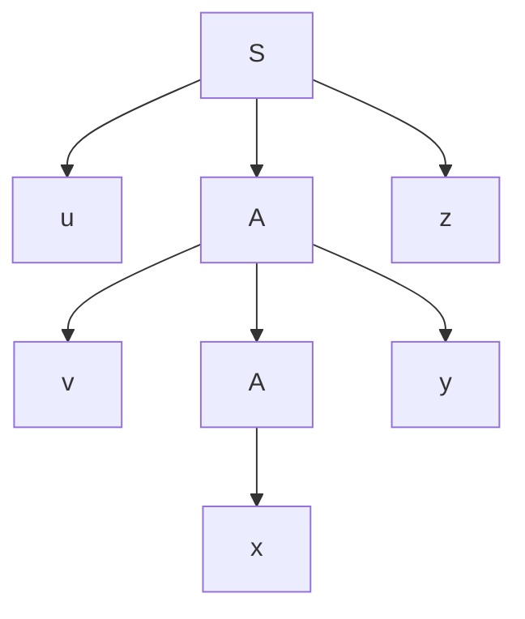

# Autómatas y Lenguajes Formales - Lenguajes libres del contexto

## 4.5 Propiedades de los lenguajes libres del contexto.

---

Los temas 4.6 a 4.9 estudian cuatro familias de propiedades de los lenguajes libres de contexto: el lema de bombeo, el lema de Ogden, las propiedades de cerradura y las de decisión. Este tema presenta el hecho estructural del que se derivan casi todas ellas, la **autoincrustación** en los árboles de derivación, y tres consecuencias que dicen qué tan lejos están los LLC de los lenguajes regulares: la caracterización de Chomsky de las gramáticas que solo generan lenguajes regulares, los lenguajes sobre un solo símbolo y el teorema de Parikh.

### Panorama

| Propiedad | Enunciado | Tema |
| --- | --- | --- |
| Lema de bombeo | toda cadena suficientemente larga se escribe $uvxyz$ y $uv^kxy^kz \in L$ para todo $k$ | 4.6 |
| Lema de Ogden | lo mismo, pero eligiendo qué posiciones deben participar en el bombeo | 4.7 |
| Cerradura | unión, concatenación, estrella, homomorfismos, intersección con regulares; no intersección ni complemento | 4.8 |
| Decisión | pertenencia, vacuidad y finitud decidibles; equivalencia y ambigüedad no | 4.9 |
| Autoincrustación | todo LLC no regular necesita un no terminal $A \Rightarrow^+ \alpha A \beta$ con $\alpha, \beta$ no vacíos | este tema |
| Un solo símbolo | todo LLC sobre $\{a\}$ es regular | este tema |
| Parikh | si se olvida el orden de los símbolos, todo LLC es indistinguible de un regular | este tema |

### Árboles altos y repeticiones

Sea $G$ en forma normal de Chomsky con $m$ no terminales. Por el tema 4.3, un árbol cuyo camino más largo tiene $h$ no terminales produce a lo más $2^{h-1}$ símbolos. Entonces, si una cadena tiene longitud mayor que $2^{m-1},$ su árbol tiene un camino con al menos $m + 1$ no terminales, y por el principio del palomar **algún no terminal $A$ se repite** en ese camino:



El $A$ de arriba genera $vxy$ y el de abajo genera $x,$ así que $S \Rightarrow^* uAz,$ $A \Rightarrow^* vAy$ y $A \Rightarrow^* x.$ Como el subárbol del $A$ de abajo se puede sustituir por el del $A$ de arriba, o al revés, se obtienen todas las cadenas $uv^kxy^kz.$ Esto es el lema de bombeo (tema 4.6), y la repetición de un no terminal en un camino es la versión libre de contexto de la repetición de un estado en un autómata finito.

### Autoincrustación

Un no terminal $A$ es **autoincrustado** si $A \Rightarrow^+ \alpha A \beta$ con $\alpha$ y $\beta$ ambos no vacíos y capaces de generar cadenas no vacías. Una gramática es autoincrustada si tiene algún no terminal autoincrustado.

La autoincrustación es exactamente lo que distingue a las gramáticas libres de contexto de las regulares: en una gramática lineal por la derecha, un no terminal solo puede reaparecer al final, $A \Rightarrow^+ wA,$ nunca rodeado por los dos lados.

**Teorema (Chomsky, 1959).** Si una gramática libre de contexto no es autoincrustada, su lenguaje es regular.

**Idea de la demostración.** Si ningún no terminal se rodea a sí mismo por los dos lados, en toda forma sentencial que se derive por la izquierda el número de no terminales pendientes está acotado por una constante que depende de la gramática. Entonces un autómata finito puede llevar en su estado la lista completa de no terminales pendientes, y simular las derivaciones. $\blacksquare$

**Consecuencia.** Todo lenguaje libre de contexto no regular necesita, en **cualquier** gramática que lo genere, algún no terminal autoincrustado. Es la forma precisa de decir que los LLC sirven para describir **anidamiento**: paréntesis dentro de paréntesis, bloques dentro de bloques.

El recíproco es falso: una gramática autoincrustada puede generar un lenguaje regular. Por ejemplo, $S \rightarrow aS \mid Sb \mid c$ es autoincrustada, porque $S \Rightarrow aS \Rightarrow aSb,$ pero genera $a^*cb^*.$ Decidir si una gramática genera un lenguaje regular es, de hecho, indecidible (tema 4.9).

### Lenguajes sobre un solo símbolo

**Teorema.** Todo lenguaje libre de contexto sobre un alfabeto de un solo símbolo es regular.

**Idea de la demostración.** Sobre $\{a\},$ el orden no importa: $a^ia^j = a^ja^i.$ Con el lema de bombeo, si $a^n \in L$ con $n$ grande, también están $a^{n + k\ell}$ para algún $\ell = |vy| \leq p$ y todo $k \geq 0.$ Se demuestra que $L$ coincide, a partir de cierta longitud, con una unión finita de progresiones aritméticas, y que toda progresión aritmética $\{a^{c + k\ell}\}$ es regular. $\blacksquare$

Por eso $\{a^{n^2}\}$ y $\{a^p \mid p \text{ primo}\}$ no son libres de contexto: no son regulares, y sobre un solo símbolo ser libre de contexto es lo mismo que ser regular.

### El teorema de Parikh

La **imagen de Parikh** de una cadena $w$ sobre $\{a_1, \ldots, a_k\}$ es el vector $\psi(w) = (|w|_{a_1}, \ldots, |w|_{a_k}),$ que cuenta cuántas veces aparece cada símbolo y olvida el orden (tema 1.4). La de un lenguaje es $\psi(L) = \{\psi(w) \mid w \in L\}.$

**Teorema (Parikh, 1966).** Para todo lenguaje libre de contexto $L$ existe un lenguaje regular $R$ con $\psi(L) = \psi(R).$

**Ejemplo.** $\psi(\{a^nb^n\}) = \{(n, n) \mid n \geq 0\} = \psi((ab)^*).$ Y $\psi(\{ww^R \mid w \in \{a, b\}^*\}) = \{(2i, 2j)\} = \psi((aa + bb)^*).$

**Consecuencia.** Si un lenguaje tiene una imagen de Parikh que no es la de ningún regular, no es libre de contexto. Por ejemplo, $\{a^nb^{n^2}\}$ tiene imagen $\{(n, n^2)\},$ y los conjuntos de vectores que son imágenes de lenguajes regulares, los **semilineales**, son uniones finitas de conjuntos de la forma $\{c + k_1p_1 + \cdots + k_rp_r \mid k_i \geq 0\};$ ninguno de ellos es $\{(n, n^2)\}.$

### Implementación en Python

El programa detecta los no terminales autoincrustados con una búsqueda en un grafo cuyos nodos registran si ya se generó algo a la izquierda y algo a la derecha del no terminal, y comprueba un caso del teorema de Parikh.

```python
from collections import deque

def autoincrustados(G):
    """No terminales A con A =>+ α A β, α y β no vacíos (supone una gramática sin
    producciones ε ni símbolos inútiles, así que todo símbolo genera algo no vacío).
    Busca en el grafo de estados (B, ya hay algo a la izquierda, ya hay algo a la derecha)."""
    resultado = set()
    for A in G:
        inicio = (A, False, False)
        vistos, cola = {inicio}, deque([inicio])
        while cola:
            B, izq, der = cola.popleft()
            for d in G[B]:
                for i, X in enumerate(d):
                    if X in G:
                        estado = (X, izq or i > 0, der or i < len(d) - 1)
                        if estado == (A, True, True):
                            resultado.add(A)
                        if estado not in vistos:
                            vistos.add(estado)
                            cola.append(estado)
    return resultado

ejemplos = {
    "S -> aSb | ab":                  {'S': ['aSb', 'ab']},
    "S -> aS | Sb | c":               {'S': ['aS', 'Sb', 'c']},
    "S -> AB, A -> aA | a, B -> Bb | b": {'S': ['AB'], 'A': ['aA', 'a'], 'B': ['Bb', 'b']},
    "E -> E+T | T, T -> T*F | F, F -> (E) | x": {'E': ['E+T', 'T'], 'T': ['T*F', 'F'], 'F': ['(E)', 'x']},
}
for nombre, G in ejemplos.items():
    print(f"{nombre:<42} autoincrustados: {sorted(autoincrustados(G)) or 'ninguno'}")

# Teorema de Parikh: {a^n b^n} y (ab)* tienen la misma imagen de Parikh
def parikh(w):
    return (w.count('a'), w.count('b'))

anbn = {'a' * n + 'b' * n for n in range(6)}
abestrella = {'ab' * n for n in range(6)}
print({parikh(w) for w in anbn} == {parikh(w) for w in abestrella}, sorted({parikh(w) for w in anbn}))
```

Salida:

```text
S -> aSb | ab                              autoincrustados: ['S']
S -> aS | Sb | c                           autoincrustados: ['S']
S -> AB, A -> aA | a, B -> Bb | b          autoincrustados: ninguno
E -> E+T | T, T -> T*F | F, F -> (E) | x   autoincrustados: ['E', 'F', 'T']
True [(0, 0), (1, 1), (2, 2), (3, 3), (4, 4), (5, 5)]
```

La tercera gramática no es autoincrustada y, como dice el teorema, genera un lenguaje regular, $a^+b^+.$ La segunda es autoincrustada y su lenguaje también es regular. En la gramática de expresiones los tres no terminales son autoincrustados por los paréntesis: $E \Rightarrow T \Rightarrow F \Rightarrow (E).$

### Ejercicios Propuestos

1. **Autoincrustación.** Decide cuáles de estas gramáticas son autoincrustadas y describe sus lenguajes:
   - a) $S \rightarrow aSa \mid b.$
   - b) $S \rightarrow aA,$ $A \rightarrow Sb \mid b.$
   - c) $S \rightarrow AA,$ $A \rightarrow aA \mid b.$

2. **Repeticiones.** En una gramática en FNC con 3 no terminales, ¿a partir de qué longitud se garantiza que el árbol de una cadena tiene un no terminal repetido en algún camino?

3. **Un solo símbolo.** Demuestra que $\{a^{2^n} \mid n \geq 0\}$ no es libre de contexto.

4. **Parikh.** Encuentra un lenguaje regular con la misma imagen de Parikh que $\{w \in \{a, b\}^* \mid |w|_a = |w|_b\}.$

5. **Parikh y no libre de contexto.** Muestra que la imagen de Parikh de $\{a^nb^nc^n\}$ es la de un lenguaje regular. ¿Contradice esto que el lenguaje no sea libre de contexto?

### Soluciones

**Ejercicio 1.**

- a) Autoincrustada: $S \Rightarrow aSa.$ Genera $\{a^nba^n\},$ que no es regular.
- b) Autoincrustada: $S \Rightarrow aA \Rightarrow aSb.$ Genera $\{a^nb^n \mid n \geq 1\}.$
- c) No es autoincrustada: $A$ solo reaparece a la derecha de una $a,$ y $S$ no reaparece. Genera $a^*ba^*b,$ regular.

**Ejercicio 2.** Un árbol sin no terminales repetidos en ningún camino tiene caminos con a lo más 3 no terminales, y su frontera tiene a lo más $2^{3-1} = 4$ símbolos. Así, toda cadena de longitud al menos 5 tiene un no terminal repetido en algún camino.

**Ejercicio 3.** Está sobre un solo símbolo, así que si fuera libre de contexto sería regular. Pero no es regular: por el lema de bombeo para regulares, con $w = a^{2^m}$ y $2^m \geq p,$ bombear $y = a^\ell$ con $1 \leq \ell \leq p$ da longitud $2^m + \ell,$ estrictamente entre $2^m$ y $2^{m+1},$ que no es potencia de 2. Por lo tanto no es libre de contexto.

**Ejercicio 4.** Su imagen es $\{(n, n)\},$ la misma que la de $(ab)^*.$

**Ejercicio 5.** $\psi(\{a^nb^nc^n\}) = \{(n, n, n)\} = \psi((abc)^*).$ No hay contradicción: el teorema de Parikh dice que todo LLC tiene imagen semilineal, pero el recíproco es falso. El orden de los símbolos importa, y es ahí donde $\{a^nb^nc^n\}$ deja de ser libre de contexto.

### Referencias

1. Hopcroft, J. E., Motwani, R., and Ullman, J., _Introduction to Automata Theory, Languages, and Computation_. Pearson, 2007. Capítulo 7.
2. Kozen, D. C., _Automata and Computability_. Springer, 1997. Lecture 22 y Supplementary Lecture H.
3. Chomsky, N. (1959). On certain formal properties of grammars. _Information and Control_, 2(2), 137-167.
4. Parikh, R. J. (1966). On context-free languages. _Journal of the ACM_, 13(4), 570-581.
5. Harrison, M. A., _Introduction to Formal Language Theory_. Addison-Wesley, 1978. Capítulo 6.
