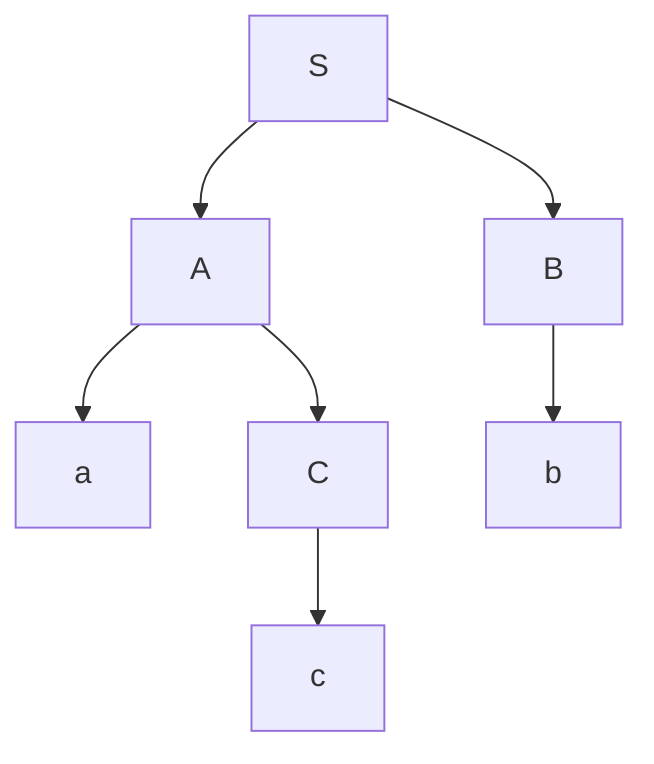
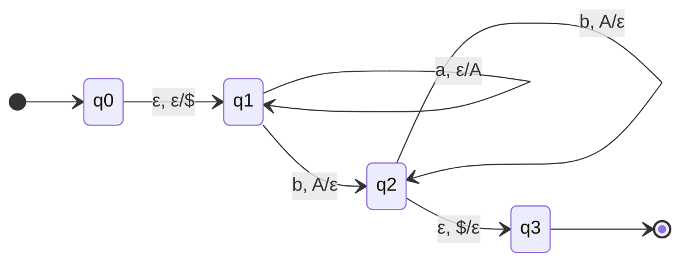

# Autómatas y Lenguajes Formales - Lenguajes libres del contexto

## 4.5 Propiedades de los lenguajes libres del contexto.

---

Los **lenguajes libres de contexto (LLC)** poseen propiedades algebraicas y estructurales importantes que permiten caracterizarlos, analizarlos y determinar su pertenencia a esta clase. Esta guía cubre las principales propiedades de clausura, decisión y caracterización de los LLC.

### Definiciones Fundamentales

#### Lenguaje Libre de Contexto

Un lenguaje $L$ es libre de contexto si existe una gramática libre de contexto (GLC) $G$ tal que $L = L(G).$

#### Autómata de Pila (AP)

Un AP es una 7-tupla $M = (Q, \Sigma, \Gamma, \delta, q_0, Z_0, F)$ que reconoce LLC por estado final o por pila vacía.

### Propiedades de Clausura

#### Operaciones que Preservan LLC

Los lenguajes libres de contexto son cerrados bajo las siguientes operaciones:

1. **Unión:** $L_1 \cup L_2$
2. **Concatenación:** $L_1 \cdot L_2$
3. **Cerradura de Kleene:** $L^*$
4. **Homomorfismo:** $h(L)$
5. **Sustitución:** $\sigma(L)$
6. **Reverso:** $L^R$
7. **Intersección con lenguaje regular:** $L \cap R$

#### Demostración de Clausura bajo Unión

**Teorema:** Si $L_1$ y $L_2$ son LLC, entonces $L_1 \cup L_2$ es LLC.

**Prueba:** Sean $G_1 = (V_1, \Sigma, P_1, S_1)$ y $G_2 = (V_2, \Sigma, P_2, S_2)$ con $V_1 \cap V_2 = \emptyset.$ Construimos:

$$G = (V_1 \cup V_2 \cup \{S\}, \Sigma, P_1 \cup P_2 \cup \{S \rightarrow S_1 \mid S_2\}, S)$$

Entonces $L(G) = L(G_1) \cup L(G_2).$

#### Operaciones que NO Preservan LLC

Los LLC **no** son cerrados bajo:

1. **Intersección:** $L_1 \cap L_2$
2. **Complemento:** $\overline{L}$
3. **Diferencia:** $L_1 - L_2$

**Contraejemplo para intersección:**

$L_1 = \{a^nb^nc^m \mid n, m \geq 0\}$ es LLC

$L_2 = \{a^nb^mc^m \mid n, m \geq 0\}$ es LLC

Pero $L_1 \cap L_2 = \{a^nb^nc^n \mid n \geq 0\}$ no es LLC.

### Lema de Bombeo para LLC

#### Enunciado del Lema

Para todo LLC $L,$ existe una constante $n$ (longitud de bombeo) tal que toda cadena $z \in L$ con $|z| \geq n$ puede escribirse como $z = uvwxy$ donde:

1. $|vwx| \leq n$
2. $|vx| \geq 1$ (al menos una de $v$ o $x$ no es ε)
3. Para todo $i \geq 0,$ $uv^iwx^iy \in L$

#### Aplicación del Lema de Bombeo

El lema se utiliza para demostrar que ciertos lenguajes **no** son libres de contexto.

**Ejemplo:** Demostrar que $L = \{a^nb^nc^n \mid n \geq 0\}$ no es LLC.

1. Suponemos que $L$ es LLC, entonces existe $n$ del lema
2. Consideramos $z = a^nb^nc^n,$ con $|z| = 3n \geq n$
3. Según el lema, $z = uvwxy$ con $|vwx| \leq n$ y $|vx| \geq 1$
4. Analizamos casos:
   - Si $vwx$ contiene solo a's, al bombear se desbalancean los conteos
   - Si $vwx$ contiene a's y b's, al bombear se altera el orden
   - Similarmente para otros casos
5. En todos los casos, al bombear obtenemos cadenas fuera de $L$
6. Contradicción, por lo tanto $L$ no es LLC

### Propiedades de Decisión

#### Problemas Decidibles para LLC

1. **Pertenencia:** Dada una GLC $G$ y una cadena $w,$ ¿es $w \in L(G)?$
   - **Algoritmo:** CYK, complejidad $O(n^3)$

2. **Vacuidad:** Dada una GLC $G,$ ¿es $L(G) = \emptyset?$
   - **Algoritmo:** Verificar si el símbolo inicial es generador

3. **Finitud:** Dada una GLC $G,$ ¿es $L(G)$ finito?
   - **Algoritmo:** Verificar si la gramática no contiene ciclos y no es recursiva

#### Problemas Indecidibles para LLC

1. **Equivalencia:** Dadas dos GLC $G_1$ y $G_2,$ ¿es $L(G_1) = L(G_2)?$
2. **Ambiguidad:** Dada una GLC $G,$ ¿es $G$ ambigua?
3. **Intersección vacía:** Dadas dos GLC $G_1$ y $G_2,$ ¿es $L(G_1) \cap L(G_2) = \emptyset?$
4. **Todo el universo:** Dada una GLC $G,$ ¿es $L(G) = \Sigma^*?$

### Algoritmo CYK para Pertenencia

#### Implementación del Algoritmo

```python
def cyk(grammar, word):
    n = len(word)
    # Convertir gramática a FNC
    grammar_fnc = convertir_a_fnc(grammar)

    # Inicializar tabla
    table = [[set() for _ in range(n)] for _ in range(n)]

    # Llenar diagonal principal (subcadenas de longitud 1)
    for i in range(n):
        for production in grammar_fnc:
            if len(production.rhs) == 1 and production.rhs[0] == word[i]:
                table[i][i].add(production.lhs)

    # Llenar para subcadenas de longitud 2 a n
    for length in range(2, n+1):
        for i in range(n - length + 1):
            j = i + length - 1
            for k in range(i, j):
                for production in grammar_fnc:
                    if len(production.rhs) == 2:
                        B, C = production.rhs
                        if B in table[i][k] and C in table[k+1][j]:
                            table[i][j].add(production.lhs)

    return grammar.start_symbol in table[0][n-1]
```

### Propiedades Estructurales

#### Árboles de Derivación

Para toda cadena $w \in L(G)$ donde $G$ es una GLC, existe un **árbol de derivación** que representa la estructura sintáctica de cómo se genera $w$ a partir del símbolo inicial.



#### Ambigüedad

Una GLC $G$ es **ambigua** si existe alguna cadena $w \in L(G)$ que tiene dos o más árboles de derivación distintos.

**Ejemplo:** La gramática $S \rightarrow S + S \mid S * S \mid a \mid b$ es ambigua porque la expresión "a + b * a" tiene múltiples interpretaciones.

### Lenguajes Deterministas vs. No Deterministas

#### Autómatas de Pila Deterministas (APD)

Un AP $M$ es determinista si para cada configuración $(q, w, \gamma),$ existe a lo sumo una transición posible.

**Teorema:** La clase de lenguajes aceptados por APD es un subconjunto propio de la clase de LLC.

#### Propiedades de los Lenguajes Deterministas

Los lenguajes libres de contexto deterministas (LLCD) tienen propiedades adicionales:

- Son cerrados bajo complemento
- El problema de pertenencia tiene complejidad $O(n)$
- Tienen algoritmos de parsing más eficientes

### Ejercicios Propuestos

#### Ejercicio 1: Propiedades de Clausura

Demostrar que los LLC son cerrados bajo la operación de reverso: si $L$ es LLC, entonces $L^R$ es LLC.

#### Ejercicio 2: Lema de Bombeo

Usar el lema de bombeo para demostrar que $L = \{a^ib^jc^k \mid i < j < k\}$ no es LLC.

#### Ejercicio 3: Algoritmo CYK

Aplicar el algoritmo CYK para determinar si la cadena "aabb" pertenece al lenguaje generado por:

- $S \rightarrow AB \mid BC$
- $A \rightarrow BA \mid a$
- $B \rightarrow CC \mid b$
- $C \rightarrow AB \mid a$

#### Ejercicio 4: Propiedades de Decisión

Dada la gramática:

- $S \rightarrow aS \mid bS \mid \epsilon$

Determinar si:
a) $L(G)$ es vacío
b) $L(G)$ es finito
c) "abab" pertenece a $L(G)$

#### Ejercicio 5: Ambigüedad

Demostrar que la siguiente gramática es ambigua:

- $S \rightarrow S + S \mid S * S \mid (S) \mid a$

Encontrar una cadena con al menos dos árboles de derivación diferentes.

### Diagramas de Autómatas de Pila



Este diagrama representa un AP que acepta el lenguaje $\{a^nb^n \mid n \geq 0\}$ por pila vacía.

### Aplicaciones de las Propiedades

1. **Compiladores:** El algoritmo CYK se utiliza para parsing sintáctico
2. **Procesamiento de lenguaje natural:** Análisis de estructuras gramaticales
3. **Verificación formal:** Análisis de propiedades de sistemas
4. **Diseño de lenguajes de programación:** Garantizar que los lenguajes tengan propiedades deseables

### Resumen de Propiedades

| Propiedad          | LLC         | LLCD        |
| ------------------ | ----------- | ----------- |
| Unión              | Cerrado     | Cerrado     |
| Concatenación      | Cerrado     | Cerrado     |
| Clausura de Kleene | Cerrado     | Cerrado     |
| Intersección       | No cerrado  | No cerrado  |
| Complemento        | No cerrado  | Cerrado     |
| Homomorfismo       | Cerrado     | Cerrado     |
| Reverso            | Cerrado     | Cerrado     |
| Pertenencia        | $O(n^3)$    | $O(n)$      |
| Equivalencia       | Indecidible | Indecidible |
| Ambigüedad         | Indecidible | -           |

### Referencias

1. Hopcroft, J. E., Motwani, R., and Ullman, J., _Introduction to Automata Theory, Languages, and Computation_. Addison-Wesley, 2007. (Capítulos 6-7)
2. Sipser, M., _Introduction to the Theory of Computation_. PWS Publishing Company, 2005. (Capítulo 2)
3. Viso G., E., _Introducción a la teoría de la computación_. Las Prensas de Ciencias, 2008. (Capítulo 5)
4. Kozen, D. C., _Automata and Computability_. Springer-Verlag, 1997. (Capítulo 14)
