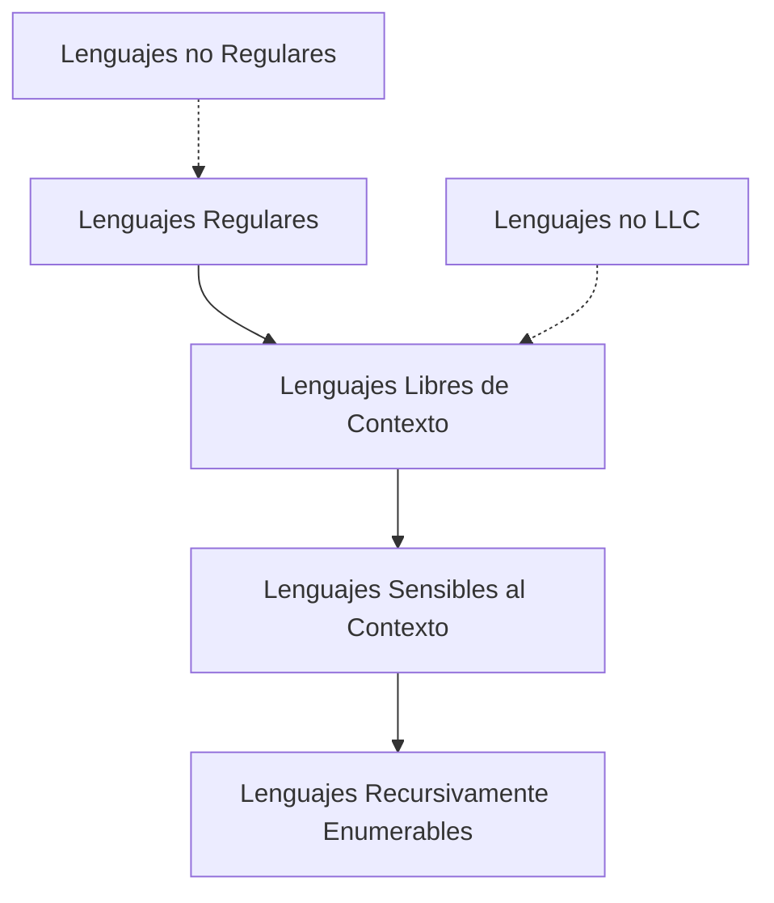

# Autómatas y Lenguajes Formales - Lenguajes libres del contexto

## 4.6 Caracterización de lenguajes que no son libres del contexto.

---

La **caracterización de lenguajes que no son libres de contexto** es fundamental para comprender las limitaciones de las gramáticas libres de contexto y los autómatas de pila. Esta guía cubre las principales técnicas para demostrar que un lenguaje no pertenece a esta clase.

### Definiciones Fundamentales

#### Lenguaje Libre de Contexto (LLC)

Un lenguaje $L$ es libre de contexto si existe una gramática libre de contexto (GLC) $G$ tal que $L = L(G),$ o equivalentemente, si existe un autómata de pila (AP) $M$ tal que $L = L(M).$

#### Jerarquía de Chomsky

| Tipo | Gramática            | Autómata          | Lenguaje                   |
| ---- | -------------------- | ----------------- | -------------------------- |
| 3    | Regular              | AFD/AFN           | Regulares                  |
| 2    | Libre de contexto    | AP                | LLC                        |
| 1    | Sensible al contexto | ATM               | Sensibles al contexto      |
| 0    | Irrestricta          | Máquina de Turing | Recursivamente enumerables |

### Lema de Bombeo para LLC

#### Enunciado Formal

Para todo LLC $L,$ existe una constante $n$ (longitud de bombeo) tal que toda cadena $z \in L$ con $|z| \geq n$ puede escribirse como $z = uvwxy$ donde:

1. $|vwx| \leq n$
2. $|vx| \geq 1$ (al menos una de $v$ o $x$ no es ε)
3. Para todo $i \geq 0,$ $uv^iwx^iy \in L$

#### Aplicación del Lema

El lema de bombeo se utiliza para demostrar que ciertos lenguajes **no** son libres de contexto mediante la técnica de contradicción.

**Estrategia general:**

1. Suponer que $L$ es LLC
2. Sea $n$ la constante del lema
3. Elegir una cadena $z \in L$ con $|z| \geq n$
4. Mostrar que para toda descomposición $z = uvwxy$ que cumpla (1) y (2), existe algún $i$ tal que $uv^iwx^iy \notin L$
5. Concluir que $L$ no es LLC

#### Ejemplo 1: Lenguaje con Tres Conteos

Demostrar que $L = \{a^nb^nc^n \mid n \geq 0\}$ no es LLC.

**Demostración:**

1. Supongamos que $L$ es LLC, entonces existe $n$ del lema
2. Sea $z = a^nb^nc^n,$ con $|z| = 3n \geq n$
3. Por el lema, $z = uvwxy$ con $|vwx| \leq n$ y $|vx| \geq 1$
4. Analizamos casos:
   - **Caso 1:** $vwx$ contiene solo a's
     - Al bombear $(i > 1),$ aumentan las a's pero no las b's o c's
   - **Caso 2:** $vwx$ contiene a's y b's
     - Al bombear, se altera el balance $a^nb^n$
   - **Caso 3:** $vwx$ contiene b's y c's
     - Al bombear, se altera el balance $b^nc^n$
   - **Caso 4:** $vwx$ contiene solo b's o solo c's
     - Similar al caso 1
5. En todos los casos, $uv^2wx^2y \notin L$
6. Contradicción, por lo tanto $L$ no es LLC

#### Ejemplo 2: Lenguaje con Dos Pares de Conteos

Demostrar que $L = \{a^ib^jc^id^j \mid i, j \geq 0\}$ no es LLC.

**Demostración:**

1. Supongamos que $L$ es LLC con constante de bombeo $n$
2. Sea $z = a^nb^nc^nd^n$
3. Por el lema, $z = uvwxy$ con $|vwx| \leq n$ y $|vx| \geq 1$
4. Como $|vwx| \leq n,$ no puede contener tanto a's como c's o tanto b's como d's
5. Al bombear, se desbalancea alguno de los pares $(a^i, c^i)$ o $(b^j, d^j)$
6. Por lo tanto, $uv^2wx^2y \notin L$
7. Contradicción, $L$ no es LLC

### Lema de Ogden

#### Enunciado del Lema de Ogden

Para todo LLC $L,$ existe una constante $n$ tal que para cualquier cadena $z \in L$ con $|z| \geq n,$ si marcamos al menos $n$ posiciones en $z,$ entonces $z$ puede escribirse como $z = uvwxy$ donde:

1. $vx$ contiene al menos una posición marcada
2. $vwx$ contiene a lo sumo $n$ posiciones marcadas
3. Para todo $i \geq 0,$ $uv^iwx^iy \in L$

#### Aplicación del Lema de Ogden

El lema de Ogden es más potente que el lema de bombeo estándar para ciertos lenguajes.

**Ejemplo:** Demostrar que $L = \{a^ib^jc^k \mid i \neq j \neq k \neq i\}$ no es LLC.

1. Suponemos $L$ es LLC con constante $n$
2. Sea $z = a^nb^{n+n!}c^{n+2n!}$ (marcamos las a's)
3. Aplicamos lema de Ogden
4. Mostramos que al bombear se pierde alguna de las desigualdades
5. Obtenemos contradicción

### Propiedades de Clausura

#### Explotación de No Clausura

Los LLC **no** son cerrados bajo:

1. **Intersección:** $L_1 \cap L_2$
2. **Complemento:** $\overline{L}$
3. **Diferencia:** $L_1 - L_2$

Podemos usar estas propiedades para demostrar que ciertos lenguajes no son LLC.

**Ejemplo:** Demostrar que $L = \{a^nb^nc^n \mid n \geq 0\}$ no es LLC usando propiedades de clausura.

**Demostración:**

1. Sabemos que $L_1 = \{a^nb^nc^m \mid n, m \geq 0\}$ es LLC
2. Sabemos que $L_2 = \{a^nb^mc^m \mid n, m \geq 0\}$ es LLC
3. Observamos que $L = L_1 \cap L_2$
4. Si $L$ fuera LLC, entonces $L_1 \cap L_2$ sería LLC
5. Pero los LLC no son cerrados bajo intersección
6. Contradicción, por lo tanto $L$ no es LLC

### Lenguajes Sensibles al Contexto

#### Relación con LLC

Algunos lenguajes que no son LLC son sensibles al contexto:

**Ejemplo:** $L = \{a^nb^nc^n \mid n \geq 0\}$ es sensible al contexto pero no libre de contexto.

#### Autómatas Lineales Acotados

Los lenguajes sensibles al contexto son reconocidos por autómatas lineales acotados (ALA), que son máquinas de Turing no deterministas cuyo espacio de trabajo está acotado por la longitud de la entrada.

### Algoritmos de Decisión

#### Problemas Indecidibles

Para LLC, los siguientes problemas son indecidibles:

1. **Equivalencia:** $L(G_1) = L(G_2)$
2. **Ambiguidad:** ¿Tiene $G$ múltiples derivaciones para alguna cadena?
3. **Intersección vacía:** $L(G_1) \cap L(G_2) = \emptyset$
4. **Todo el universo:** $L(G) = \Sigma^*$

Podemos usar la indecidibilidad de estos problemas para mostrar limitaciones de los LLC.

### Implementación de Verificación

#### Código para Verificar No-LLC usando Bombeo

```python
def verificar_no_llc_por_bombeo(lenguaje, n, generar_cadena):
    """
    Intenta verificar si un lenguaje no es LLC usando el lema de bombeo
    """
    # Generar cadena de longitud al menos n
    z = generar_cadena(n)

    # Suponer que existe descomposición z = uvwxy
    # que cumple |vwx| <= n, |vx| >= 1
    # y uv^iwx^iy ∈ L para todo i

    # Para todas las posibles descomposiciones
    for longitud_vwx in range(1, n + 1):
        for inicio_vwx in range(len(z) - longitud_vwx + 1):
            vwx = z[inicio_vwx:inicio_vwx + longitud_vwx]

            # Para todas las posibles divisiones de vwx en v, w, x
            for longitud_v in range(1, longitud_vwx):
                for longitud_x in range(1, longitud_vwx - longitud_v + 1):
                    v = vwx[:longitud_v]
                    x = vwx[longitud_vwx - longitud_x:]
                    w = vwx[longitud_v:longitud_vwx - longitud_x]

                    u = z[:inicio_vwx]
                    y = z[inicio_vwx + longitud_vwx:]

                    # Verificar si bombeando se sale del lenguaje
                    for i in [0, 2]:  # i = 0 y i = 2
                        cadena_bombeada = u + v*i + w + x*i + y
                        if cadena_bombeada not in lenguaje:
                            return True  # Posible no LLC

    return False  # No se pudo demostrar
```

### Ejercicios Propuestos

#### Ejercicio 1: Lema de Bombeo

Usar el lema de bombeo para demostrar que $L = \{a^ib^jc^k \mid i < j < k\}$ no es LLC.

#### Ejercicio 2: Propiedades de Clausura

Demostrar que $L = \{ww \mid w \in \{a, b\}^*\}$ no es LLC usando propiedades de clausura.

#### Ejercicio 3: Lema de Ogden

Usar el lema de Ogden para demostrar que $L = \{a^ib^jc^id^j \mid i, j \geq 0\}$ no es LLC.

#### Ejercicio 4: Intersección

Demostrar que $L = \{a^nb^ma^nb^m \mid n, m \geq 0\}$ no es LLC.

#### Ejercicio 5: Lenguaje con Múltiples Restricciones

Demostrar que $L = \{a^nb^nc^nd^n \mid n \geq 0\}$ no es LLC.

### Diagramas de Relación entre Clases de Lenguajes



### Técnicas Avanzadas

#### Teorema de Parikh

El teorema de Parikh establece que la imagen de un LLC bajo un homomorfismo que preserva el orden es un conjunto semilineal.

**Aplicación:** Si la imagen de un lenguaje bajo un homomorfismo adecuado no es semilineal, entonces el lenguaje no es LLC.

#### Teorema de Chomsky-Schützenberger

Todo LLC es la imagen homomórfica de la intersección de un lenguaje regular y el lenguaje de Dyck $D_2^*$ (lenguaje de paréntesis balanceados).

### Aplicaciones Prácticas

1. **Compiladores:** Detección de construcciones sintácticas beyond LLC
2. **Procesamiento de lenguaje natural:** Identificación de estructuras no libres de contexto en lenguajes naturales
3. **Verificación de software:** Análisis de protocolos con múltiples restricciones
4. **Bioinformática:** Análisis de secuencias con estructuras complejas

### Referencias

1. Hopcroft, J. E., Motwani, R., and Ullman, J., _Introduction to Automata Theory, Languages, and Computation_. Addison-Wesley, 2007. (Capítulos 6-7)
2. Sipser, M., _Introduction to the Theory of Computation_. PWS Publishing Company, 2005. (Capítulo 2)
3. Kozen, D. C., _Automata and Computability_. Springer-Verlag, 1997. (Capítulo 16)
4. Viso G., E., _Introducción a la teoría de la computación_. Las Prensas de Ciencias, 2008. (Capítulo 5)

### Resumen de Técnicas

| Técnica                 | Aplicación                                   | Limitaciones                     |
| ----------------------- | -------------------------------------------- | -------------------------------- |
| Lema de bombeo          | Lenguajes con múltiples conteos dependientes | No siempre concluyente           |
| Lema de Ogden           | Lenguajes con estructuras complejas          | Más técnico                      |
| Propiedades de clausura | Lenguajes que son intersección de LLC        | Requiere conocer LLC específicos |
| Teorema de Parikh       | Lenguajes con imágenes no semilineales       | Aplicación indirecta             |
