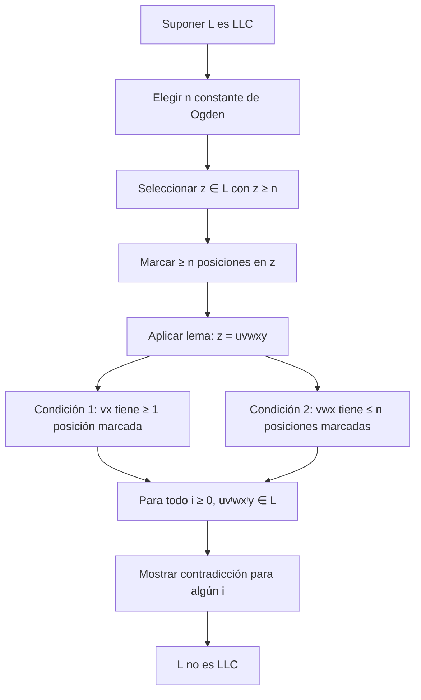

# Autómatas y Lenguajes Formales - Lenguajes libres del contexto

## 4.7 Lema de Ogden.

---

El **lema de Ogden** es una herramienta poderosa en la teoría de lenguajes formales que generaliza el lema de bombeo para lenguajes libres de contexto. Permite demostrar que ciertos lenguajes no son libres de contexto mediante el análisis de posiciones "marcadas" en las cadenas.

### Definición Formal

#### Lema de Ogden

Para todo lenguaje libre de contexto (LLC) $L$, existe una constante $n$ ( dependiente sólo de $L$ ) tal que para cualquier cadena $z \in L$ con $|z| \geq n$, si marcamos al menos $n$ posiciones en $z$, entonces $z$ puede escribirse como $z = uvwxy$ donde:

1. $vx$ contiene al menos una posición marcada
2. $vwx$ contiene a lo sumo $n$ posiciones marcadas
3. Para todo $i \geq 0$, $uv^iwx^iy \in L$

#### Comparación con el Lema de Bombeo Estándar

El lema de bombeo estándar es un caso especial del lema de Ogden donde **todas** las posiciones están marcadas.

### Aplicación del Lema de Ogden

#### Estrategia General

Para demostrar que un lenguaje $L$ **no** es libre de contexto:

1. Suponer que $L$ es LLC
2. Sea $n$ la constante del lema de Ogden
3. Elegir una cadena $z \in L$ con $|z| \geq n$ y marcar posiciones estratégicas
4. Mostrar que para toda descomposición $z = uvwxy$ que cumpla (1) y (2), existe algún $i$ tal que $uv^iwx^iy \notin L$
5. Concluir que $L$ no es LLC

#### Ejemplo 1: Lenguaje con Tres Conteos

Demostrar que $L = \{a^nb^nc^n \mid n \geq 0\}$ no es LLC usando el lema de Ogden.

**Demostración:**

1. Supongamos que $L$ es LLC con constante de Ogden $n$
2. Sea $z = a^nb^nc^n$ (marcamos todas las a's)
3. Por el lema, $z = uvwxy$ con:
   - $vx$ contiene al menos una $a$ marcada (por 1)
   - $vwx$ contiene a lo sumo $n$ a's marcadas (por 2)
4. Analizamos casos:
   - **Caso 1:** $vx$ contiene solo a's
     - Al bombear $(i = 0)$, disminuyen las a's pero no las a's o a's
   - **Caso 2:** $vx$ contiene a's y a's
     - Al bombear, se altera el balance $a^nb^n$
   - **Caso 3:** $vx$ contiene a's y a's
     - Al bombear, se altera el balance $b^nc^n$
5. En todos los casos, $uv^0wx^0y \notin L$
6. Contradicción, por lo tanto $L$ no es LLC

#### Ejemplo 2: Lenguaje con Dos Pares de Conteos

Demostrar que $L = \{a^ib^jc^id^j \mid i, j \geq 0\}$ no es LLC.

**Demostración:**

1. Supongamos que $L$ es LLC con constante $n$
2. Sea $z = a^nb^nc^nd^n$ (marcamos las a's y a's)
3. Por el lema, $z = uvwxy$ con:
   - $vx$ contiene al menos una posición marcada
   - $vwx$ contiene a lo sumo $n$ posiciones marcadas
4. Como $vwx$ tiene ≤ $n$ posiciones marcadas, no puede contener tanto a's como a's marcadas
5. Al bombear, se desbalancea alguno de los pares $(a^i, c^i)$
6. Por lo tanto, $uv^2wx^2y \notin L$
7. Contradicción, $L$ no es LLC

### Implementación del Lema de Ogden

#### Código para Visualizar el Lema

```python
def demostrar_lema_ogden(cadena, posiciones_marcadas, n):
    """
    Visualiza la aplicación del lema de Ogden a una cadena
    """
    print(f"Cadena: {cadena}")
    print(f"Posiciones marcadas: {posiciones_marcadas}")
    print(f"n: {n}")
    print("\nDescomposiciones posibles que cumplen el lema:")

    # Generar todas las descomposiciones posibles
    for i in range(len(cadena)):  # inicio de vwx
        for j in range(1, n+1):   # longitud de vwx
            if i + j > len(cadena):
                continue

            vwx = cadena[i:i+j]
            marcadas_en_vwx = sum(1 for k in range(i, i+j) if k in posiciones_marcadas)

            if marcadas_en_vwx > n:
                continue  # No cumple condición 2

            # Para todas las divisiones de vwx en v, w, x
            for k in range(1, j):      # longitud de v
                for l in range(1, j-k): # longitud de x
                    v = vwx[:k]
                    x = vwx[j-l:]
                    w = vwx[k:j-l]

                    marcadas_en_vx = sum(1 for m in range(i, i+k) if m in posiciones_marcadas) + \
                                     sum(1 for m in range(i+j-l, i+j) if m in posiciones_marcadas)

                    if marcadas_en_vx == 0:
                        continue  # No cumple condición 1

                    u = cadena[:i]
                    y = cadena[i+j:]

                    print(f"u='{u}', v='{v}', w='{w}', x='{x}', y='{y}'")
                    print(f"  Posiciones marcadas en vx: {marcadas_en_vx}")
                    print(f"  Posiciones marcadas en vwx: {marcadas_en_vwx}")

                    # Mostrar ejemplos de bombeo
                    for bombeo in [0, 2]:
                        bombeado = u + v*bombeo + w + x*bombeo + y
                        print(f"  i={bombeo}: '{bombeado}'")
                    print()

# Ejemplo de uso
cadena = "aaabbbccc"
posiciones_marcadas = {0, 1, 2}  # Primeras tres letras
n = 3
demostrar_lema_ogden(cadena, posiciones_marcadas, n)
```

### Ejercicios Propuestos

#### Ejercicio 1: Aplicación Básica

Usar el lema de Ogden para demostrar que $L = \{a^ib^jc^k \mid i < j < k\}$ no es LLC.

#### Ejercicio 2: Lenguaje con Múltiples Restricciones

Demostrar que $L = \{a^nb^nc^nd^n \mid n \geq 0\}$ no es LLC usando el lema de Ogden.

#### Ejercicio 3: Lenguaje con Patrón Específico

Demostrar que $L = \{a^ib^ja^kb^l \mid i = k \text{ o } j = l\}$ no es LLC.

#### Ejercicio 4: Selección de Posiciones Marcadas

Para el lenguaje $L = \{ww \mid w \in \{a, b\}^*\}$, elegir estratégicamente las posiciones a marcar y demostrar que no es LLC.

#### Ejercicio 5: Generalización del Lema

Explicar cómo el lema de Ogden generaliza el lema de bombeo estándar y dar un ejemplo donde Ogden funciona pero el bombeo estándar no.

### Diagrama de la Aplicación del Lema



### Teorema de Ogden

#### Generalización del Lema

El **teorema de Ogden** establece que para todo LLC $L$, existen constantes $n$ y $m$ tales que para cualquier cadena $z \in L$ con $|z| \geq n$, si marcamos al menos $m \cdot n$ posiciones en $z$, entonces $z$ puede escribirse como $z = uvwxy$ con las condiciones del lema.

#### Aplicaciones Avanzadas

El lema de Ogden es particularmente útil para lenguajes con:

- Múltiples patrones anidados
- Restricciones de conteo cruzadas
- Estructuras que requieren análisis de posiciones específicas

### Resumen de Pasos para Aplicar el Lema

| Paso | Descripción                                     | Ejemplo                           |
| ---- | ----------------------------------------------- | --------------------------------- |
| 1    | Suponer que el lenguaje es LLC                  | $L = \{a^nb^nc^n \mid n \geq 0\}$ |
| 2    | Elegir $n$ constante de Ogden                   | $n = 3$                           |
| 3    | Seleccionar cadena $z \in L$ con $\|z\| \geq n$ | $z = a^3b^3c^3$                   |
| 4    | Marcar posiciones estratégicas                  | Marcar todas las a's            |
| 5    | Aplicar lema: $z = uvwxy$                       | $vx$ contiene al menos una $a$    |
| 6    | Mostrar contradicción al bombear                | $uv^0wx^0y \notin L$              |
| 7    | Concluir que no es LLC                          | $L$ no es libre de contexto       |

### Casos Especiales y Consideraciones

#### Cuando el Lema de Bombeo Falla

El lema de Ogden es especialmente útil cuando el lema de bombeo estándar no es suficiente para demostrar que un lenguaje no es LLC.

**Ejemplo:** $L = \{a^ib^jc^k \mid i \neq j \neq k \neq i\}$ requiere el lema de Ogden para su demostración.

#### Estrategias de Marcado

La efectividad del lema de Ogden depende crucialmente de la selección estratégica de las posiciones a marcar:

1. **Marcar símbolos críticos** para preservar restricciones
2. **Evitar marcar símbolos redundantes** que no afectan las condiciones
3. **Concentrar marcas** en áreas donde el bombeo causará desbalance

### Referencias

1. Hopcroft, J. E., Motwani, R., and Ullman, J., _Introduction to Automata Theory, Languages, and Computation_. Addison-Wesley, 2007. (Capítulo 6)
2. Sipser, M., _Introduction to the Theory of Computation_. PWS Publishing Company, 2005. (Capítulo 2)
3. Kozen, D. C., _Automata and Computability_. Springer-Verlag, 1997. (Capítulo 16)
4. Viso G., E., _Introducción a la teoría de la computación_. Las Prensas de Ciencias, 2008. (Capítulo 5)
5. Ogden, W., _A helpful result for proving inherent ambiguity_. Mathematical Systems Theory, 1968.
