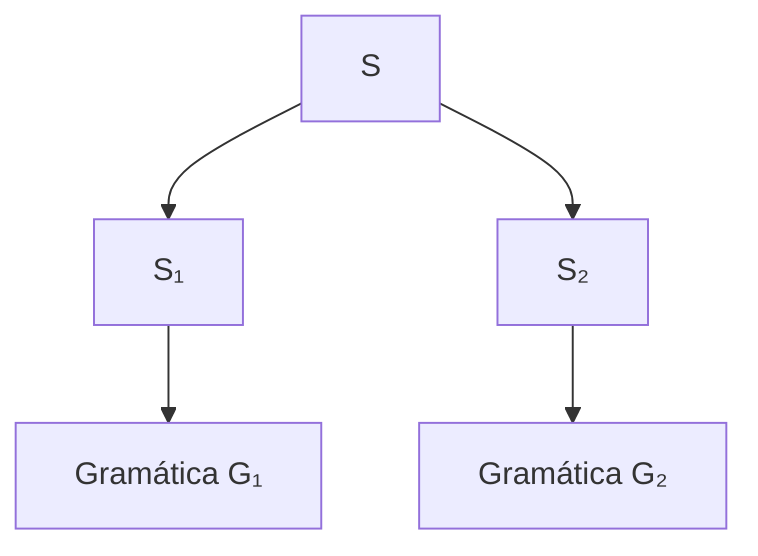
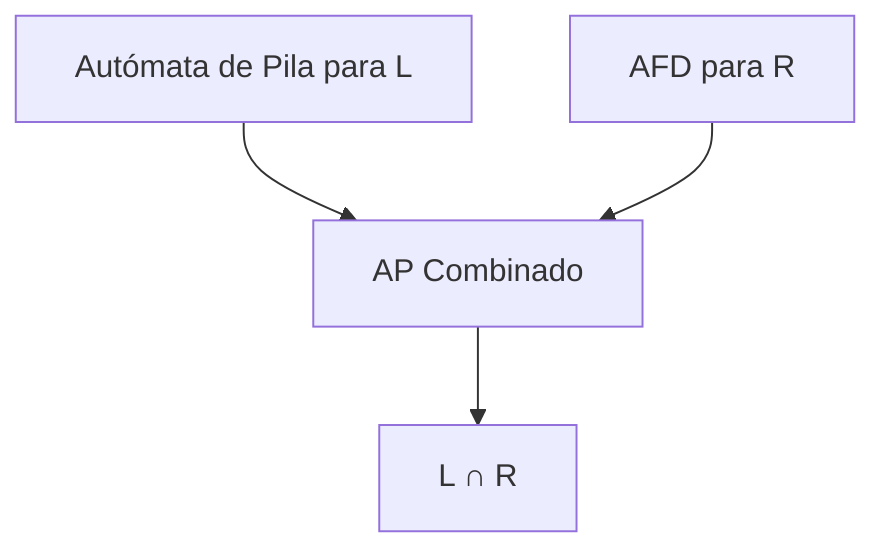

# Autómatas y Lenguajes Formales - Lenguajes libres del contexto

## 4.8 Propiedades de cerradura de LLC.

---

Las **propiedades de cerradura** de los lenguajes libres de contexto (LLC) describen cómo esta clase de lenguajes se comporta bajo diversas operaciones. Comprender estas propiedades es esencial para analizar y manipular LLC en aplicaciones como compiladores y procesamiento de lenguajes.

### Definiciones Fundamentales

#### Lenguaje Libre de Contexto (LLC)

Un lenguaje $L$ es libre de contexto si existe una gramática libre de contexto (GLC) $G$ tal que $L = L(G)$, o equivalentemente, si existe un autómata de pila (AP) $M$ tal que $L = L(M)$.

#### Operaciones sobre Lenguajes

Dados lenguajes $L$, $L_1$, $L_2$ sobre un alfabeto $\Sigma$:

- **Unión:** $L_1 \cup L_2 = \{w \mid w \in L_1 \text{ o } w \in L_2\}$
- **Concatenación:** $L_1 \cdot L_2 = \{w_1w_2 \mid w_1 \in L_1, w_2 \in L_2\}$
- **Cerradura de Kleene:** $L^* = \bigcup_{i=0}^{\infty} L^i$
- **Intersección:** $L_1 \cap L_2 = \{w \mid w \in L_1 \text{ y } w \in L_2\}$
- **Complemento:** $\overline{L} = \{w \in \Sigma^* \mid w \notin L\}$
- **Diferencia:** $L_1 - L_2 = \{w \mid w \in L_1 \text{ y } w \notin L_2\}$

### Propiedades de Cerradura

#### Operaciones que Preservan LLC

Los lenguajes libres de contexto son cerrados bajo las siguientes operaciones:

1. **Unión**
2. **Concatenación**
3. **Cerradura de Kleene**
4. **Homomorfismo**
5. **Sustitución**
6. **Reverso**
7. **Intersección con lenguajes regulares**

#### Operaciones que NO Preservan LLC

Los lenguajes libres de contexto **no** son cerrados bajo:

1. **Intersección**
2. **Complemento**
3. **Diferencia**

### Demostraciones de Cerradura

#### Cerradura bajo Unión

**Teorema:** Si $L_1$ y $L_2$ son LLC, entonces $L_1 \cup L_2$ es LLC.

**Demostración (constructiva):**
Sean $G_1 = (V_1, \Sigma, P_1, S_1)$ y $G_2 = (V_2, \Sigma, P_2, S_2)$ con $V_1 \cap V_2 = \emptyset$.
Construimos $G = (V_1 \cup V_2 \cup \{S\}, \Sigma, P_1 \cup P_2 \cup \{S \rightarrow S_1 \mid S_2\}, S)$.
Entonces $L(G) = L(G_1) \cup L(G_2)$.

**Ejemplo:**

- $L_1 = \{a^nb^n \mid n \geq 0\}$ con $G_1: S_1 \rightarrow aS_1b \mid \epsilon$
- $L_2 = \{c^nd^n \mid n \geq 0\}$ con $G_2: S_2 \rightarrow cS_2d \mid \epsilon$
- $G: S \rightarrow S_1 \mid S_2$, $S_1 \rightarrow aS_1b \mid \epsilon$, $S_2 \rightarrow cS_2d \mid \epsilon$

#### Cerradura bajo Concatenación

**Teorema:** Si $L_1$ y $L_2$ son LLC, entonces $L_1 \cdot L_2$ es LLC.

**Demostración:**
Sean $G_1 = (V_1, \Sigma, P_1, S_1)$ y $G_2 = (V_2, \Sigma, P_2, S_2)$ con $V_1 \cap V_2 = \emptyset$.
Construimos $G = (V_1 \cup V_2 \cup \{S\}, \Sigma, P_1 \cup P_2 \cup \{S \rightarrow S_1S_2\}, S)$.
Entonces $L(G) = L(G_1) \cdot L(G_2)$.

#### Cerradura bajo Cerradura de Kleene

**Teorema:** Si $L$ es LLC, entonces $L^*$ es LLC.

**Demostración:**
Sea $G = (V, \Sigma, P, S)$.
Construimos $G' = (V \cup \{S'\}, \Sigma, P \cup \{S' \rightarrow SS' \mid \epsilon\}, S')$.
Entonces $L(G') = L(G)^*$.

#### Cerradura bajo Homomorfismo

**Teorema:** Si $L$ es LLC y $h: \Sigma^* \rightarrow \Delta^*$ es un homomorfismo, entonces $h(L)$ es LLC.

**Demostración:**
Sea $G = (V, \Sigma, P, S)$ que genera $L$.
Construimos $G' = (V, \Delta, P', S)$ donde $P'$ se obtiene reemplazando cada terminal $a$ en las producciones por $h(a)$.

### No Cerradura bajo Intersección

**Teorema:** Los LLC no son cerrados bajo intersección.

**Demostración (por contradicción):**

- $L_1 = \{a^nb^nc^m \mid n, m \geq 0\}$ es LLC
- $L_2 = \{a^nb^mc^m \mid n, m \geq 0\}$ es LLC
- Pero $L_1 \cap L_2 = \{a^nb^nc^n \mid n \geq 0\}$ no es LLC (por lema de bombeo)

**Corolario:** Los LLC no son cerrados bajo complemento ni diferencia.

### Cerradura bajo Intersección con Lenguajes Regulares

**Teorema:** Si $L$ es LLC y $R$ es regular, entonces $L \cap R$ es LLC.

**Demostración (constructiva con AP):**
Sea $M_1 = (Q_1, \Sigma, \Gamma, \delta_1, q_{01}, Z_0, F_1)$ un AP para $L$.
Sea $M_2 = (Q_2, \Sigma, \delta_2, q_{02}, F_2)$ un AFD para $R$.
Construimos $M = (Q_1 \times Q_2, \Sigma, \Gamma, \delta, (q_{01}, q_{02}), Z_0, F_1 \times F_2)$ donde:

$$\delta((q, p), a, X) = \{((q', p'), \gamma) \mid (q', \gamma) \in \delta_1(q, a, X) \text{ y } p' = \delta_2(p, a)\}$$

### Implementación de Construcciones

#### Código para Cerradura bajo Unión

```python
def union_glc(glc1, glc2):
    """Construye una GLC para la unión de dos LLC"""
    V1, Sigma1, P1, S1 = glc1
    V2, Sigma2, P2, S2 = glc2

    # Asegurar que los conjuntos de variables sean disjuntos
    if V1.intersection(V2):
        # Renombrar variables si es necesario
        mapping = {}
        new_V2 = set()
        new_P2 = set()
        for V in V2:
            new_V = V + "'"
            mapping[V] = new_V
            new_V2.add(new_V)
        for prod in P2:
            left, right = prod
            new_left = mapping[left] if left in mapping else left
            new_right = tuple(mapping[s] if s in mapping else s for s in right)
            new_P2.add((new_left, new_right))
        V2, P2, S2 = new_V2, new_P2, mapping[S2]

    # Nueva gramática
    S_new = 'S'  # Nuevo símbolo inicial
    V_new = V1.union(V2).union({S_new})
    P_new = P1.union(P2).union({(S_new, (S1,)), (S_new, (S2,))})

    return (V_new, Sigma1.union(Sigma2), P_new, S_new)
```

#### Código para Cerradura bajo Concatenación

```python
def concatenacion_glc(glc1, glc2):
    """Construye una GLC para la concatenación de dos LLC"""
    V1, Sigma1, P1, S1 = glc1
    V2, Sigma2, P2, S2 = glc2

    # Asegurar que los conjuntos de variables sean disjuntos
    if V1.intersection(V2):
        # Renombrar variables si es necesario (similar a union_glc)
        pass

    # Nueva gramática
    S_new = 'S'  # Nuevo símbolo inicial
    V_new = V1.union(V2).union({S_new})
    P_new = P1.union(P2).union({(S_new, (S1, S2))})

    return (V_new, Sigma1.union(Sigma2), P_new, S_new)
```

### Ejercicios Propuestos

#### Ejercicio 1: Demostración de Cerradura

Demostrar formalmente que los LLC son cerrados bajo la operación de reverso.

#### Ejercicio 2: Construcción de Gramáticas

Dadas las gramáticas:

- $G_1: S_1 \rightarrow aS_1b \mid \epsilon$
- $G_2: S_2 \rightarrow cS_2d \mid \epsilon$

Construir gramáticas para:
a) $L(G_1) \cup L(G_2)$
b) $L(G_1) \cdot L(G_2)$
c) $L(G_1)^*$

#### Ejercicio 3: No Cerradura

Demostrar que los LLC no son cerrados bajo complemento usando el resultado de no cerradura bajo intersección.

#### Ejercicio 4: Intersección con Regular

Dado el LLC $L = \{a^nb^n \mid n \geq 0\}$ y el lenguaje regular $ R = \set{ a ^ * b ^ * } $, describir $ L \cap R $ y construir un AP para este lenguaje.

#### Ejercicio 5: Aplicación de Homomorfismo

Sea $L = \{a^nb^nc^n \mid n \geq 0\}$ y $h(a) = 0, h(b) = 1, h(c) = 1$. Demostrar que $h(L)$ es LLC a pesar de que $L$ no lo es.

### Diagramas de Construcciones

#### Construcción para Unión



#### Construcción para Concatenación


#### Construcción para Intersección con Regular



### Aplicaciones de las Propiedades de Cerradura

1. **Compiladores:** Análisis sintáctico de construcciones del lenguaje
2. **Procesamiento de lenguaje natural:** Manipulación de estructuras gramaticales
3. **Verificación de software:** Análisis de protocolos de comunicación
4. **Teoría de la computación:** Clasificación de lenguajes y problemas

### Referencias

1. Hopcroft, J. E., Motwani, R., and Ullman, J., _Introduction to Automata Theory, Languages, and Computation_. Addison-Wesley, 2007. (Capítulos 6-7)
2. Sipser, M., _Introduction to the Theory of Computation_. PWS Publishing Company, 2005. (Capítulo 2)
3. Viso G., E., _Introducción a la teoría de la computación_. Las Prensas de Ciencias, 2008. (Capítulo 5)
4. Kozen, D. C., _Automata and Computability_. Springer-Verlag, 1997. (Capítulo 14)

### Resumen de Propiedades de Cerradura

| Operación                | ¿Cerrado? | Construcción                       |
| ------------------------ | --------- | ---------------------------------- |
| Unión                    | Sí        | $S \rightarrow S_1 \mid S_2$       |
| Concatenación            | Sí        | $S \rightarrow S_1S_2$             |
| Clausura de Kleene       | Sí        | $S' \rightarrow SS' \mid \epsilon$ |
| Homomorfismo             | Sí        | Reemplazar terminales              |
| Reverso                  | Sí        | Invertir lados derechos            |
| Intersección             | No        | -                                  |
| Complemento              | No        | -                                  |
| Diferencia               | No        | -                                  |
| Intersección con regular | Sí        | Producto de AP y AFD               |
