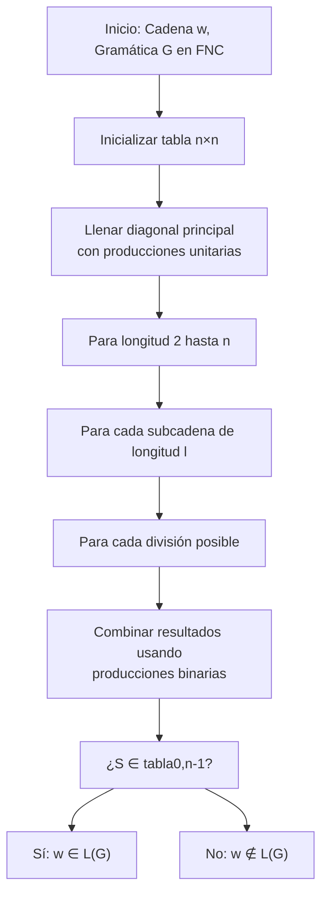
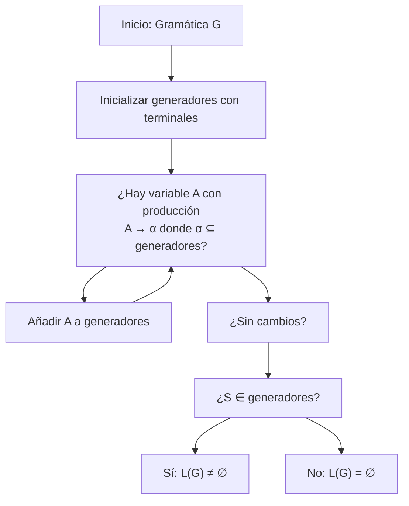

# Autómatas y Lenguajes Formales - Lenguajes libres del contexto

## 4.9 Decidibilidad en lenguajes libres del contexto.

---

La **decidibilidad** en lenguajes libres de contexto (LLC) se refiere a la capacidad de determinar algorítmicamente si ciertas propiedades sobre estos lenguajes pueden resolverse de manera efectiva. Esta guía explora los problemas decidibles e indecidibles para LLC, los algoritmos correspondientes y sus aplicaciones.

### Definiciones Fundamentales

#### Problema Decidible

Un problema es **decidible** si existe un algoritmo que siempre termina y produce la respuesta correcta (sí/no) para cualquier instancia del problema.

#### Lenguaje Libre de Contexto (LLC)

Un lenguaje $L$ es libre de contexto si existe una gramática libre de contexto (GLC) $G$ tal que $L = L(G)$, o equivalentemente, si existe un autómata de pila (AP) $M$ tal que $L = L(M)$.

### Problemas Decidibles para LLC

#### 1. Problema de Pertenencia

**Enunciado:** Dada una GLC $G$ y una cadena $w$, ¿es $w \in L(G)$?

**Algoritmo:** CYK (Cocke-Younger-Kasami)

- **Complejidad:** $O(n^3 \cdot |G|)$ donde $n = |w|$
- **Requisito:** La gramática debe estar en Forma Normal de Chomsky (FNC)

##### Algoritmo CYK

```python
def cyk(grammar, word):
    n = len(word)
    # Convertir gramática a FNC si es necesario
    grammar_fnc = convertir_a_fnc(grammar)

    # Inicializar tabla CYK
    table = [[set() for _ in range(n)] for _ in range(n)]

    # Paso 1: Llenar diagonal principal (subcadenas de longitud 1)
    for i in range(n):
        for production in grammar_fnc.productions:
            if len(production.rhs) == 1 and production.rhs[0] == word[i]:
                table[i][i].add(production.lhs)

    # Paso 2: Llenar para subcadenas de longitud 2 a n
    for length in range(2, n+1):
        for i in range(n - length + 1):
            j = i + length - 1
            for k in range(i, j):
                for production in grammar_fnc.productions:
                    if len(production.rhs) == 2:
                        B, C = production.rhs
                        if B in table[i][k] and C in table[k+1][j]:
                            table[i][j].add(production.lhs)

    return grammar.start_symbol in table[0][n-1]
```

#### 2. Problema de Vacuidad

**Enunciado:** Dada una GLC $G$, ¿es $L(G) = \emptyset$?

**Algoritmo:**

1. Marcar todos los símbolos terminales como generadores
2. Repetidamente marcar variables $A$ si existe producción $A \rightarrow \alpha$ donde todos los símbolos en $\alpha$ están marcados
3. $L(G) \neq \emptyset$ si y sólo si el símbolo inicial está marcado

**Complejidad:** $O(|G|)$

#### 3. Problema de Finitud

**Enunciado:** Dada una GLC $G$, ¿es $L(G)$ finito?

**Algoritmo:**

1. Eliminar símbolos inútiles y simplificar la gramática
2. Construir el grafo de dependencias entre variables
3. Verificar si existe ciclo en el grafo que pueda generar infinitas cadenas

**Complejidad:** $O(|G|)$

### Problemas Indecidibles para LLC

#### 1. Problema de Equivalencia

**Enunciado:** Dadas dos GLC $G_1$ y $G_2$, ¿es $L(G_1) = L(G_2)$?

**Indecidibilidad:** No existe algoritmo general que resuelva este problema para todas las GLC.

#### 2. Problema de Ambiguidad

**Enunciado:** Dada una GLC $G$, ¿es $G$ ambigua?

**Indecidibilidad:** No existe algoritmo general para determinar si una GLC es ambigua.

#### 3. Problema de Intersección Vacía

**Enunciado:** Dadas dos GLC $G_1$ y $G_2$, ¿es $L(G_1) \cap L(G_2) = \emptyset$?

**Indecidibilidad:** No existe algoritmo general para este problema.

#### 4. Problema de Universalidad

**Enunciado:** Dada una GLC $G$, ¿es $L(G) = \Sigma^*$?

**Indecidibilidad:** No existe algoritmo general para este problema.

### Algoritmos para Problemas Decidibles

#### Implementación del Algoritmo de Vacuidad

```python
def es_vacio(grammar):
    """Determina si L(G) = ∅"""
    # Paso 1: Inicializar conjunto de generadores
    generadores = set()

    # Paso 2: Marcar terminales
    for terminal in grammar.terminals:
        generadores.add(terminal)

    # Paso 3: Marcar variables iterativamente
    cambio = True
    while cambio:
        cambio = False
        for production in grammar.productions:
            A = production.lhs
            if A not in generadores:
                # Verificar si todos los símbolos en rhs están en generadores
                todos_generadores = True
                for symbol in production.rhs:
                    if symbol not in generadores:
                        todos_generadores = False
                        break

                if todos_generadores:
                    generadores.add(A)
                    cambio = True

    return grammar.start_symbol not in generadores
```

#### Implementación del Algoritmo de Finitud

```python
def es_finito(grammar):
    """Determina si L(G) es finito"""
    # Simplificar gramática eliminando símbolos inútiles
    grammar_simplified = simplificar_gramatica(grammar)

    # Construir grafo de dependencias
    grafo = construir_grafo_dependencias(grammar_simplified)

    # Verificar ciclos que puedan generar infinitas cadenas
    return not tiene_ciclo_productivo(grafo, grammar_simplified)

def construir_grafo_dependencias(grammar):
    """Construye grafo de dependencias entre variables"""
    grafo = {A: set() for A in grammar.variables}

    for production in grammar.productions:
        A = production.lhs
        for symbol in production.rhs:
            if symbol in grammar.variables:
                grafo[A].add(symbol)

    return grafo
```

### Ejercicios Propuestos

#### Ejercicio 1: Algoritmo CYK

Aplicar el algoritmo CYK para determinar si la cadena "aabb" pertenece al lenguaje generado por:

- $S \rightarrow AB \mid BC$
- $A \rightarrow BA \mid a$
- $B \rightarrow CC \mid b$
- $C \rightarrow AB \mid a$

#### Ejercicio 2: Problema de Vacuidad

Determinar si las siguientes gramáticas generan lenguajes vacíos:
a) $S \rightarrow aSb \mid ab$
b) $S \rightarrow AB$, $A \rightarrow aA$, $B \rightarrow bB$
c) $S \rightarrow aS \mid bS$

#### Ejercicio 3: Problema de Finitud

Determinar si los siguientes lenguajes son finitos:
a) $L = \{a^nb^n \mid n \geq 0\}$
b) $L = \{a^nb^m \mid n, m \geq 0\}$
c) $L = \{a^n \mid n \text{ es primo}\}$

#### Ejercicio 4: Indecidibilidad

Demostrar que el problema de equivalencia es indecidible para LLC, usando el hecho de que la universalidad es indecidible.

#### Ejercicio 5: Implementación

Implementar en Python el algoritmo para determinar la finitud de un lenguaje dado por una GLC.

### Diagramas de Algoritmos

#### Diagrama del Algoritmo CYK



#### Diagrama del Algoritmo de Vacuidad



### Aplicaciones de la Decidibilidad en LLC

1. **Compiladores:** Verificación de sintaxis mediante algoritmos de pertenencia
2. **Procesamiento de lenguaje natural:** Análisis de estructuras gramaticales
3. **Verificación de software:** Análisis de protocolos de comunicación
4. **Bases de datos:** Validación de consultas con estructura gramatical
5. **Bioinformática:** Análisis de secuencias de ADN y proteínas

### Resumen de Decidibilidad para LLC

| Problema           | Decidible | Algoritmo              | Complejidad |
| ------------------ | --------- | ---------------------- | ----------- |
| Pertenencia        | Sí        | CYK                    | $O(n^3)$    |
| Vacuidad           | Sí        | Marcado de generadores | $O(\|G\|)$  |
| Finitud            | Sí        | Análisis de ciclos     | $O(\|G\|)$  |
| Equivalencia       | No        | -                      | -           |
| Ambiguidad         | No        | -                      | -           |
| Intersección vacía | No        | -                      | -           |
| Universalidad      | No        | -                      | -           |

### Referencias

1. Hopcroft, J. E., Motwani, R., and Ullman, J., _Introduction to Automata Theory, Languages, and Computation_. Addison-Wesley, 2007. (Capítulos 6-7)
2. Sipser, M., _Introduction to the Theory of Computation_. PWS Publishing Company, 2005. (Capítulo 4)
3. Viso G., E., _Introducción a la teoría de la computación_. Las Prensas de Ciencias, 2008. (Capítulo 5)
4. Kozen, D. C., _Automata and Computability_. Springer-Verlag, 1997. (Capítulo 17)
