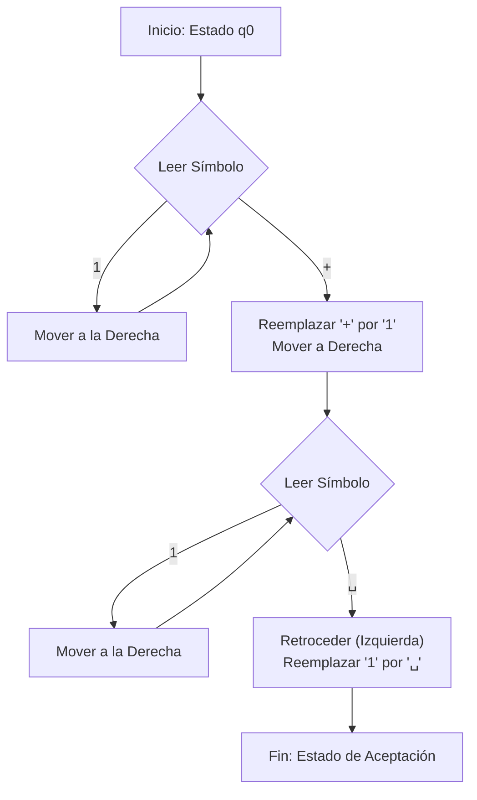

# Autómatas y Lenguajes Formales - Máquinas de Turing

## 5.1 Motivación.

---

### **1. Introducción: El Problema de la Computabilidad**

Antes de la formalización de Alan Turing en 1936, una pregunta fundamental en matemáticas y lógica permanecía sin respuesta: **¿Qué significa "computar" de manera mecánica?** ¿Existen problemas bien definidos para los cuales es imposible construir un algoritmo que los resuelva?

Los matemáticos de la época, como David Hilbert, Kurt Gödel y Alonzo Church, estaban inmersos en la "Crisis de los Fundamentos" de las matemáticas. Se buscaba un método puramente mecánico (un algoritmo) para decidir la verdad o falsedad de cualquier enunciado matemático (el _Entscheidungsproblem_ o "problema de decisión").

Las Máquinas de Turing surgieron como la respuesta de Alan Turing a esta pregunta, proporcionando una **definición precisa y robusta de lo que es un algoritmo** y, por lo tanto, de lo que puede ser computado.

### **2. Los Límites de los Modelos Previos**

Para entender por qué fue necesario un nuevo modelo, debemos ver las limitaciones de los autómatas que ya conocíamos:

- **Autómatas Finitos (AF) y Expresiones Regulares:** Reconocen lenguajes regulares. Son demasiado débiles. No pueden, por ejemplo, verificar si un string tiene el mismo número de 'a' que de 'b' ( $L = \{a^n b^n | n \geq 0\}$ ), ya que carecen de memoria para "contar".
- **Autómatas de Pila (AP):** Reconocen lenguajes libres de contexto. Son más potentes, pero aún limitados. Pueden reconocer $L = \{a^n b^n | n \geq 0\}$ usando la pila como contador, pero **no** pueden reconocer $L = \{a^n b^n c^n | n \geq 0\}$. Solo tienen acceso a un tipo de memoria (LIFO - Last In, First Out), lo que restringe su poder.

Se necesitaba un modelo que superara estas restricciones y capturara la esencia de la computación algorítmica.

### **3. La Intuición de Turing: Un Ser Humano Computando**

Turing se inspiró en una persona realizando un cálculo matemático con lápiz y papel, siguiendo reglas estrictas. Descompuso este proceso en sus elementos más básicos:

1.  **Medio de almacenamiento:** Una larga tira de papel (la **cinta**), dividida en celdas.
2.  **Símbolos:** Cada celda puede contener un solo símbolo de un alfabeto finito.
3.  **Estado mental:** La persona, en un momento dado, solo puede pensar en un aspecto del problema (su **estado** actual).
4.  **Acciones elementales:** En cada paso, la persona:
    - **Lee** el símbolo en la celda que está viendo.
    - Basándose en el símbolo leído y su estado mental, decide:
      - **Escribir** un nuevo símbolo en esa celda (o dejar el mismo).
      - **Moverse** a la celda de la izquierda o a la derecha.
      - **Cambiar** su estado mental.

Esta abstracción, aparentemente simple, resultó ser extraordinariamente poderosa. Turing logró modelar cualquier procedimiento algorítmico paso a paso con estos elementos.

### **4. La Tesis de Church-Turing**

La Tesis de Church-Turing es una hipótesis fundamental, no un teorema demostrable, que establece:

> **Cualquier función que sea efectivamente computable (es decir, computable por un algoritmo intuitivo) es computable por una Máquina de Turing.**

En otras palabras, el modelo de las Máquinas de Turing captura **perfectamente** la noción intuitiva de "computabilidad". Todo lo que una computadora digital moderna (o cualquier otro modelo de computación razonable) puede calcular, una Máquina de Turing también puede hacerlo, quizás más lentamente, pero puede hacerlo.

**Importancia:** Esta tesis nos permite usar las Máquinas de Turing como el modelo definitivo para estudiar los **límites fundamentales de la computación**. Si podemos demostrar que un problema no puede ser resuelto por una Máquina de Turing, entonces es un problema **no computable**.

### **5. Ejemplo Motivacional: La Máquina de Turing como "Sumadora"**

Imaginemos que queremos diseñar un algoritmo (una MT) para sumar dos números naturales, $n$ y $m$, representados en unario (p.ej., el número 3 es '111').

- **Representación en la cinta:** `...␣␣111+111␣␣...` (donde `␣` es el símbolo en blanco)
- **Objetivo del algoritmo:** Borrar el '+' y dejar el resultado: `...␣␣111111␣␣...`

**Descripción intuitiva del algoritmo:**

1.  Avanza hacia la derecha hasta encontrar el símbolo '+'.
2.  Cuando lo encuentres, reemplázalo por un '1'.
3.  Sigue avanzando hasta encontrar el primer símbolo en blanco `␣`.
4.  Retrocede una celda y borra ese '1' (reemplázalo por `␣`).
5.  **¡Hecho!** La cinta ahora contiene la concatenación de los unos, que es la suma.

Este proceso, definido con estados y transiciones, se convierte en una Máquina de Turing formal. Aunque es simple, ilustra cómo un procedimiento mecánico se puede implementar en este modelo.

### **6. Ejercicios Propuestos**

1.  **Análisis:** Explica con tus propias palabras por qué un Autómata de Pila no sería capaz, en general, de simular el funcionamiento de una Máquina de Turing.
2.  **Diseño Conceptual:** Describe a alto nivel, de manera similar al ejemplo de la suma, el algoritmo que seguiría una Máquina de Turing para:
    - Restar 1 a un número en unario (si el resultado es >= 0). Pista: Piensa en buscar el último '1' y reemplazarlo por un blanco.
    - Reconocer el lenguaje $\{a^n b^n c^n | n \geq 0\}$.
3.  **Investigación:** Investiga brevemente en qué consistía el _Entscheidungsproblem_ y por qué la existencia de problemas no computables (como el "Problema de la Parada" que veremos luego) lo resolvió negativamente.

### **7. Referencias**

- **Viso G., E. (2008).** _Introducción a la teoría de la computación._ Las Prensas de Ciencias. (Capítulo 6 o el equivalente donde introduzca MTs).
- **Sipser, M. (2005).** _Introduction to the Theory of Computation._ PWS Publishing Company. (Capítulo 3 - "The Church-Turing Thesis").
- **Sudkamp, T. A. (1997).** _Languages and Machines._ Addisson-Wesley. (Ofrece una perspectiva interesante al empezar con MTs).
- **Ceruzzi, P. E. (2003).** _A History of Modern Computing._ The MIT Press. (Para el contexto histórico de la abstracción de Turing).
