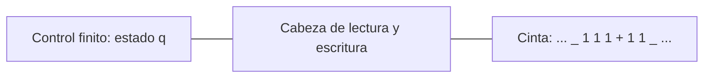

# Autómatas y Lenguajes Formales - Máquinas de Turing

## 5.1 Motivación.

---

### El problema: ¿qué es un algoritmo?

A principios del siglo XX, David Hilbert planteó como uno de los grandes retos de las matemáticas el ***Entscheidungsproblem*** o problema de la decisión: encontrar un procedimiento **mecánico** que, dado cualquier enunciado de la lógica de primer orden, decidiera en un número finito de pasos si es válido. Para responder que tal procedimiento **no existe** hacía falta algo que nadie tenía: una definición matemática precisa de "procedimiento mecánico". Mientras no la hubiera, solo se podía demostrar que un problema tiene solución algorítmica exhibiendo el algoritmo, nunca que no la tiene.

En 1936, de forma independiente, Alonzo Church, con el cálculo lambda, y Alan Turing, con las máquinas que hoy llevan su nombre, dieron esa definición y demostraron que el *Entscheidungsproblem* no tiene solución. La definición de Turing resultó la más convincente, porque se basa en un análisis directo de lo que hace una persona al calcular.

### Los límites de los modelos anteriores

| Modelo | Memoria | Ejemplo que reconoce | Ejemplo que no reconoce |
| --- | --- | --- | --- |
| Autómata finito | finita, en los estados | $(ab)^*$ | $\{a^nb^n\}$ |
| Autómata con pila | una pila, acceso solo al tope | $\{a^nb^n\}$ | $\{a^nb^nc^n\}$ |
| Máquina de Turing | una cinta ilimitada, de lectura y escritura, con acceso a cualquier celda | $\{a^nb^nc^n\},$ $\{ww\},$ $\{a^p \mid p \text{ primo}\}$ | el problema de la detención |

Un autómata con pila puede comparar dos cantidades, pero al comparar destruye la información: después de usar la pila para verificar que hay tantas $b$ como $a,$ ya no sabe cuántas había. Con una cinta en la que se puede leer, escribir y regresar, la información se conserva, se revisa tantas veces como haga falta y se modifica.

### La intuición de Turing

Turing analizó a una persona que calcula con lápiz y papel siguiendo reglas fijas:

1. Escribe en un papel cuadriculado; sin pérdida de generalidad, una **cinta** dividida en celdas, cada una con un símbolo de un alfabeto finito.
2. En cada momento solo **observa** una celda.
3. Su **estado mental** es una de un número finito de posibilidades: la memoria de una persona es limitada, y lo que no recuerda lo escribe.
4. En cada paso, según el símbolo que observa y su estado mental, **escribe** un símbolo, **se mueve** a una celda vecina y **cambia** de estado mental.

Cada una de estas restricciones parece no quitar nada esencial: cualquier cálculo que se pueda hacer con lápiz y papel se puede descomponer en pasos así. El resultado es la **máquina de Turing**: un control finito, una cinta infinita y una cabeza de lectura y escritura.



### La tesis de Church-Turing

> Toda función que se pueda calcular con un procedimiento efectivo se puede calcular con una máquina de Turing.

No es un teorema, porque "procedimiento efectivo" es una noción intuitiva y no matemática; es una propuesta de **definición**. La respaldan tres hechos:

- **Robustez:** todas las variantes razonables de máquinas de Turing (con varias cintas, no deterministas, con cinta bidimensional) calculan exactamente lo mismo (tema 5.5).
- **Coincidencia:** todos los otros modelos propuestos (cálculo lambda, funciones recursivas, gramáticas sin restricciones, máquinas de registros, cualquier lenguaje de programación con memoria ilimitada) calculan exactamente las mismas funciones.
- **Experiencia:** en casi noventa años no se ha encontrado un procedimiento que se reconozca como efectivo y que una máquina de Turing no pueda realizar.

La consecuencia importante es que, para demostrar que un problema **no tiene solución algorítmica**, basta demostrar que ninguna máquina de Turing lo resuelve. Es lo que se hará en el tema 7 con el problema de la detención.

### Ejemplo: una máquina que suma

Para sumar dos números en **unario**, donde $n$ se escribe como $n$ unos, la entrada $1^n{+}1^m$ debe convertirse en $1^{n+m}.$ Basta con:

1. Avanzar a la derecha sobre los unos hasta encontrar el $+.$
2. Reemplazar el $+$ por un 1 y seguir a la derecha hasta el primer blanco.
3. Regresar una celda y borrar ese 1, que sobra porque se agregó uno al cambiar el $+.$

Con estados $q_0$ (primer número), $q_1$ (segundo número), $q_2$ (borrar) y $q_f$ (fin), la máquina es:

| Estado | Lee | Escribe | Se mueve | Nuevo estado |
| --- | --- | --- | --- | --- |
| $q_0$ | 1 | 1 | derecha | $q_0$ |
| $q_0$ | $+$ | 1 | derecha | $q_1$ |
| $q_1$ | 1 | 1 | derecha | $q_1$ |
| $q_1$ | blanco | blanco | izquierda | $q_2$ |
| $q_2$ | 1 | blanco | no se mueve | $q_f$ |

### Implementación en Python

El simulador representa la cinta con un diccionario, de modo que puede crecer en ambas direcciones, y muestra la sucesión de configuraciones: cada una escribe el contenido de la cinta con el estado justo antes del símbolo que lee la cabeza (tema 5.2). El blanco se escribe `_`.

```python
BLANCO = '_'

class MT:
    """Máquina de Turing determinista de una cinta, infinita en ambas direcciones.

    delta: dict (estado, símbolo) -> (estado, símbolo a escribir, movimiento 'L', 'R' o 'S').
    La máquina se detiene al entrar a un estado de aceptación o de rechazo,
    o cuando no hay transición (y entonces rechaza)."""

    def __init__(self, delta, inicial, aceptacion=(), rechazo=()):
        self.delta, self.q0 = delta, inicial
        self.F, self.R = set(aceptacion), set(rechazo)

    def ejecutar(self, w, max_pasos=10_000, traza=False):
        cinta = dict(enumerate(w))
        q, cabeza, pasos, configs = self.q0, 0, 0, []
        while True:
            if traza:
                configs.append(self.configuracion(cinta, q, cabeza))
            if q in self.F or q in self.R:
                break
            simbolo = cinta.get(cabeza, BLANCO)
            if (q, simbolo) not in self.delta or pasos >= max_pasos:
                break
            q, escribir, mov = self.delta[(q, simbolo)]
            cinta[cabeza] = escribir
            cabeza += {'L': -1, 'R': 1, 'S': 0}[mov]
            pasos += 1
        contenido = ''.join(cinta.get(i, BLANCO) for i in range(min(cinta, default=0), max(cinta, default=0) + 1))
        return {'acepta': q in self.F, 'estado': q, 'pasos': pasos,
                'cinta': contenido.strip(BLANCO), 'traza': configs}

    @staticmethod
    def configuracion(cinta, q, cabeza):
        """Descripción instantánea u q v: la cabeza lee el primer símbolo de v."""
        usadas = [i for i, s in cinta.items() if s != BLANCO] + [cabeza]
        izq, der = min(usadas), max(usadas)
        u = ''.join(cinta.get(i, BLANCO) for i in range(izq, cabeza))
        v = ''.join(cinta.get(i, BLANCO) for i in range(cabeza, der + 1))
        return f"{u} {q} {v}".strip()

# Suma en unario: 111+11 -> 11111
suma = MT({
    ('q0', '1'): ('q0', '1', 'R'),     # avanzar sobre el primer número
    ('q0', '+'): ('q1', '1', 'R'),     # cambiar + por 1
    ('q1', '1'): ('q1', '1', 'R'),     # avanzar sobre el segundo número
    ('q1', '_'): ('q2', '_', 'L'),     # al llegar al blanco, regresar una celda
    ('q2', '1'): ('qf', '_', 'S'),     # borrar el 1 sobrante
}, 'q0', aceptacion={'qf'})

for entrada in ['111+11', '1+1', '+111', '11+']:
    r = suma.ejecutar(entrada)
    print(f"{entrada:<7} -> {r['cinta']:<6} ({r['pasos']} pasos)")
print(' ⊢ '.join(suma.ejecutar('1+1', traza=True)['traza']))
```

Salida:

```text
111+11  -> 11111  (8 pasos)
1+1     -> 11     (5 pasos)
+111    -> 111    (6 pasos)
11+     -> 11     (5 pasos)
q0 1+1 ⊢ 1 q0 +1 ⊢ 11 q1 1 ⊢ 111 q1 _ ⊢ 11 q2 1 ⊢ 11 qf _
```

La máquina también funciona cuando uno de los sumandos es 0, como en `+111` y `11+`.

### Ejercicios Propuestos

1. **Análisis.** Explica por qué un autómata con pila no puede, en general, simular una máquina de Turing. ¿Qué pasaría si tuviera **dos** pilas?

2. **Diseño conceptual.** Describe a alto nivel una máquina de Turing que:
   - a) Reste 1 a un número en unario, dejándolo igual si es 0.
   - b) Reconozca $\{a^nb^nc^n \mid n \geq 0\}.$

3. **Máquina concreta.** Escribe la tabla de una máquina de Turing que sume 1 a un número escrito en **binario**.

4. **Investigación.** Investiga en qué consistía el *Entscheidungsproblem* y cómo lo resolvieron Church y Turing.

### Soluciones

**Ejercicio 1.** Un AP solo puede consultar el tope de su pila; para leer algo que está más abajo tiene que desapilar, y lo desapilado se pierde. Una máquina de Turing puede ir y venir por la cinta sin perder nada. Con **dos** pilas, en cambio, sí se simula una cinta: una pila guarda lo que está a la izquierda de la cabeza y la otra lo que está a la derecha; moverse es pasar un símbolo de una pila a la otra. Por eso un autómata con dos pilas es tan poderoso como una máquina de Turing.

**Ejercicio 2.**

- a) Avanzar a la derecha hasta el primer blanco, regresar una celda y, si hay un 1, borrarlo; si hay un blanco, el número era 0 y no se hace nada.
- b) Repetir: marcar la primera $a$ sin marcar, avanzar hasta la primera $b$ sin marcar y marcarla, avanzar hasta la primera $c$ sin marcar y marcarla, y regresar al principio. Si en algún momento falta la $b$ o la $c$ que se busca, rechazar. Cuando no quedan letras $a$ sin marcar, aceptar si tampoco quedan $b$ ni $c$ sin marcar, y si la cadena tenía la forma $a^*b^*c^*,$ lo que se verifica en una pasada inicial.

**Ejercicio 3.** Se va al último dígito, y luego, de derecha a izquierda, se cambian los 1 por 0 mientras haya acarreo; el primer 0, o el blanco a la izquierda del número, se cambia por 1. Estados: $q_0$ con $0 \mapsto 0, R$ y $1 \mapsto 1, R,$ y con blanco pasa a $q_1$ moviéndose a la izquierda; $q_1$ con $1 \mapsto 0, L$ se queda en $q_1;$ con $0 \mapsto 1$ o con blanco $\mapsto 1$ pasa a $q_f.$ Por ejemplo, $1011 \rightarrow 1100.$

**Ejercicio 4.** Hilbert y Ackermann lo plantearon en 1928. Church demostró en 1936 que no hay una expresión del cálculo lambda que decida la equivalencia de expresiones, y de ahí que la validez en lógica de primer orden no es decidible. Turing demostró que ninguna de sus máquinas decide si otra máquina se detiene, y redujo ese problema al *Entscheidungsproblem*.

### Referencias

1. Turing, A. M. (1936). On computable numbers, with an application to the Entscheidungsproblem. _Proceedings of the London Mathematical Society_, 2(42), 230-265.
2. Sipser, M., _Introduction to the Theory of Computation_. Cengage, 2013. Capítulo 3.
3. Viso G., E., _Introducción a la teoría de la computación_. Las Prensas de Ciencias, 2008. Capítulo 6.
4. Petzold, C., _The Annotated Turing_. Wiley, 2008.
5. Copeland, B. J. (2020). The Church-Turing Thesis. _The Stanford Encyclopedia of Philosophy_.
