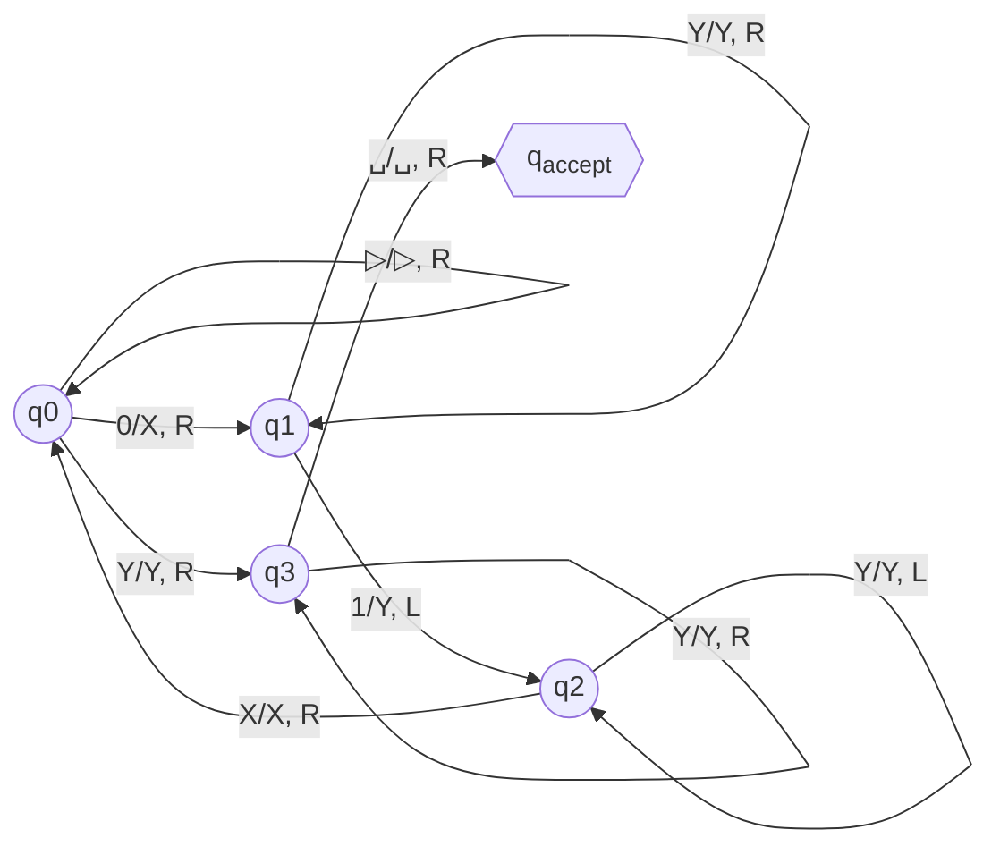

# Autómatas y Lenguajes Formales - Máquinas de Turing

## 5.2 Definiciones y notación.

---

### **1. Definición Formal (Modelo de 7-tupla)**

Una Máquina de Turing (MT) determinista se define formalmente como una 7-tupla:

$$M = (Q, \Sigma, \Gamma, \delta, q_0, q_{\text{accept}}, q_{\text{reject}})$$

Donde:

1.  **$Q$:** Es un conjunto finito de **estados**.
2.  **$\Sigma$:** Es el **alfabeto de entrada**, un conjunto finito de símbolos. No puede incluir el símbolo en blanco `␣`.
3.  **$\Gamma$:** Es el **alfabeto de la cinta**, un conjunto finito de símbolos donde $ \Sigma \subset \Gamma $ y `␣` ∈ $ \Gamma $ (y usualmente un símbolo especial para marcar el inicio de la cinta, `▷`).
4.  **$\delta$:** Es la **función de transición**.
    
    $$ \delta: Q \times \Gamma \to Q \times \Gamma \times \{L, R\} $$

    - $\delta(q, a) = (p, b, D)$ significa: "Si la MT está en el estado $q$ y la cabeza lee el símbolo $a,$ entonces pasa al estado $p,$ escribe el símbolo $b$ en la celda actual y mueve la cabeza en la dirección $D$ (Left/Left o Right/Derecha)".
5.  **$q_0$:** Es el **estado inicial**, donde $q_0 \in Q.$
6.  **$q_{\text{accept}}$:** Es el **estado de aceptación**, donde $q_{\text{accept}} \in Q.$
7.  **$q_{\text{reject}}$:** Es el **estado de rechazo**, donde $q_{\text{reject}} \in Q$ y $q_{\text{reject}} \neq q_{\text{accept}}.$

**Nota Crucial:** La máquina se detiene inmediatamente al entrar en $q_{\text{accept}}$ o $q_{\text{reject}}.$

### **2. Componentes y Configuración**

Una MT tiene tres componentes principales:

1.  **Cinta:** Infinita en una o ambas direcciones, dividida en celdas. Cada celda contiene un símbolo de $\Gamma.$
2.  **Cabeza Lectora/Escritora:** Apunta a una celda de la cinta, puede leer su contenido, escribir un nuevo símbolo y moverse left/left o right/derecha.
3.  **Control de Estados:** Almacena el estado actual de la MT $(q \in Q)$ y gobierna su operación según la función $\delta.$

La **configuración** o **descripción instantánea** de una MT captura su estado completo en un momento dado. Se representa como una string:

$$ u \; q \; v $$

donde:

- $q \in Q$ es el estado actual.
- $uv$ es el contenido de la cinta desde la celda más a la left/left hasta el último símbolo no blanco.
- La cabeza está leyendo el **primer símbolo de $v$**.
- Si $v$ es la string vacía, la cabeza está leyendo un blanco.

**Ejemplo:** La configuración `1011 q7 0111` significa que el estado es $q_7,$ la cinta contiene `...␣10110111␣...` y la cabeza está sobre el `0` después del `q7`.

### **3. La Función de Transición y Computación**

La función $\delta$ define el paso computacional. Decimos que la configuración $C_1$ **produce** la configuración $C_2$ en un paso $(C_1 \vdash C_2)$ si se aplica una transición válida de $\delta.$

Una **computación** es una secuencia de configuraciones $C_1, C_2, C_3, ..., C_k$ donde cada $C_i \vdash C_{i+1}.$ Puede ser:

- **Finita y aceptadora:** Termina en una configuración con estado $q_{\text{accept}}.$
- **Finita y rechazadora:** Termina en una configuración con estado $q_{\text{reject}}.$
- **Infinita (ciclo):** Nunca termina.

### **4. Lenguaje Reconocido por una MT**

Una MT **acepta** una string de entrada $w$ si, comenzando en la configuración inicial $q_0 w$ ( con la cabeza sobre el primer símbolo de $w$ ), la computación resultante llega al estado $q_{\text{accept}}.$

El **lenguaje reconocido** por una MT $M$ es el conjunto de todas las strings que $M$ acepta:

$$ L(M) = \{ w \in \Sigma^* \mid M \text{ acepta } w \} $$

Un lenguaje $L$ se llama **Turing-reconocible** (o recursivamente enumerable) si existe una MT $M$ tal que $L = L(M).$

### **5. Ejemplo: Máquina para $\{0^n1^n \mid n \geq 0\}$**

**Idea:** Cruzar unos 0s con unos 1s. Reemplazar el 0 más a la left/left por `X`, buscar el 1 más a la left/left y reemplazarlo por `Y`. Repetir. Si al final solo quedan `X` e `Y`, aceptar.

**Definición Formal:**

- $ Q = \{q_0, q_1, q_2, q_3, q_4\} $
- $ \Sigma = \{0, 1\}$
- $ \Gamma = \lbrace 0, 1, X, Y,$ `␣`, `▷` $, \rbrace $ (usamos `▷` para marcar el inicio)
- $q_0:$ estado inicial
- $q_4 = q_{\text{accept}}$
- No definimos $q_{\text{reject}}$ explícitamente; se rechaza si no hay transición definida.

**Función $\delta$ (parcial):**

| Estado | Símbolo Leído | $\delta$ (Nvo. Estado, Escribir, Movimiento) |
| :----: | :-----------: | :------------------------------------------: |
| $q_0$  |      `▷`      |        $ (q_0,$ `▷` $, R) $ (avanza)         |
| $q_0$  |      $0$      |           $(q_1, X, R)$ (marca 0)            |
| $q_0$  |      $Y$      |           $(q_3, Y, R)$ (verifica)           |
| $q_1$  |      $0$      |           $(q_1, 0, R)$ (busca 1)            |
| $q_1$  |      $1$      |           $(q_2, Y, L)$ (marca 1)            |
| $q_1$  |      $Y$      |           $(q_1, Y, R)$ (ignora Y)           |
| $q_2$  |      $0$      |           $(q_2, 0, L)$ (regresa)            |
| $q_2$  |      $X$      |            $(q_0, X, R)$ (repite)            |
| $q_2$  |      $Y$      |           $(q_2, Y, L)$ (regresa)            |
| $q_3$  |      $Y$      |            $(q_3, Y, R)$ (avanza)            |
| $q_3$  |      `␣`      |         $(q_4,$ `␣` $,R)$ (¡acepta!)         |

**Diagrama de Estados (Mermaid):**

### **6. Ejercicios Propuestos**

1.  **Definición Formal:** Para la MT del ejemplo anterior, completa la definición formal listando todos los conjuntos $Q,$ $\Sigma,$ $\Gamma,$ $q_0,$ $q_{\text{accept}}.$
2.  **Simulación:** Simula la computación de la MT para la entrada `w = 0011`. Muestra las primeras 5 configuraciones usando la notación `u q v`.
    - _Ejemplo de primera configuración:_ `q0 ▷0011`
3.  **Diseño de Transiciones:** La MT del ejemplo no tiene un estado $q_{\text{reject}}$ definido. ¿En qué situaciones rechazaría una entrada como `010`? Modifica la función $\delta$ agregando explícitamente transiciones a un nuevo estado $q_5 = q_{\text{reject}}$ para manejar entradas inválidas (e.g., si en $q_1$ se lee un `␣` o en $q_0$ se lee un `1`).
4.  **Configuración:** Dada la configuración `X0 q2 Y11X` para una MT con $\Gamma = \lbrace 0,1,X,Y,$ `␣` $\rbrace ,$ dibuja un diagrama de la cinta que represente esta situación. Marca claramente la posición de la cabeza.

### **7. Referencias**

- **Viso G., E. (2008).** _Introducción a la teoría de la computación._ Las Prensas de Ciencias. (Capítulo 6.1 - 6.3 para la definición formal y configuraciones).
- **Sipser, M. (2005).** _Introduction to the Theory of Computation._ PWS Publishing Company. (Sección 3.1 - "Turing Machines").
- **Hopcroft, J. E., et al. (2007).** _Introduction to Automata Theory, Languages, and Computation._ (Capítulo 8 - "Turing Machines").
- **Linz, P. (2006).** _An Introduction to Formal Languages and Automata._ (Capítulo 9 - "Turing Machines").
