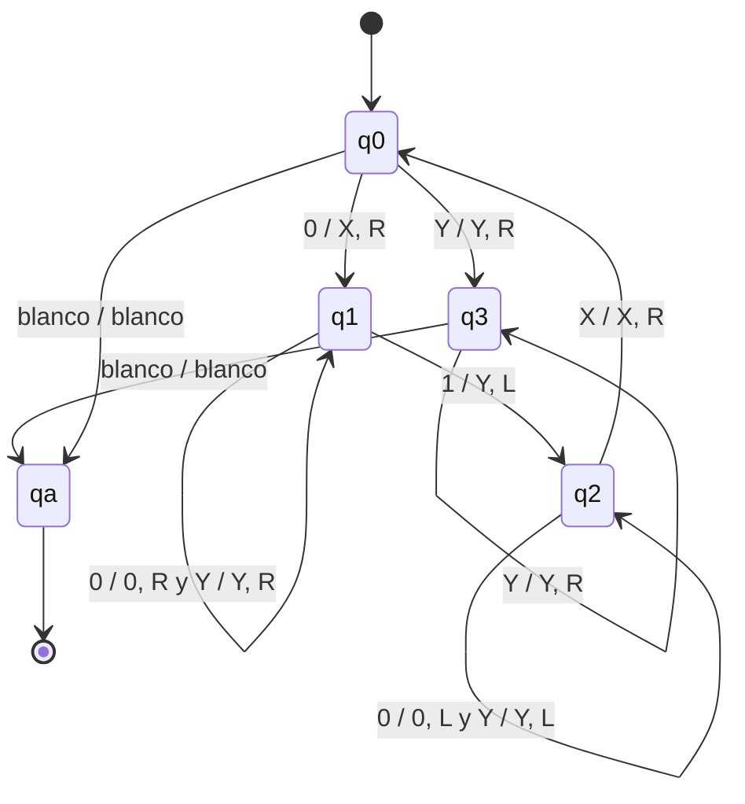

# Autómatas y Lenguajes Formales - Máquinas de Turing

## 5.2 Definiciones y notación.

---

### Definición formal

Una **máquina de Turing** (MT) determinista es una séptupla

$$ M = (Q, \Sigma, \Gamma, \delta, q_0, q_a, q_r) $$

donde:

- $Q$ es un conjunto finito de estados.
- $\Sigma$ es el alfabeto de entrada, que no contiene al símbolo **blanco** $\sqcup.$
- $\Gamma$ es el alfabeto de la cinta, con $\Sigma \subseteq \Gamma$ y $\sqcup \in \Gamma.$ Puede tener símbolos auxiliares, como marcas.
- $\delta : (Q \setminus \{q_a, q_r\}) \times \Gamma \rightarrow Q \times \Gamma \times \{L, R\}$ es la función de transición.
- $q_0$ es el estado inicial, $q_a$ el estado de aceptación y $q_r$ el de rechazo, con $q_a \neq q_r.$

Que $\delta(q, X) = (p, Y, D)$ significa: si la máquina está en el estado $q$ y la cabeza lee $X,$ escribe $Y$ en esa celda, mueve la cabeza una celda a la izquierda, $L,$ o a la derecha, $R,$ y pasa al estado $p.$ La máquina **se detiene** al entrar a $q_a$ o a $q_r.$

Al empezar, la cinta contiene la entrada $w$ rodeada de blancos, en la que es la única parte no blanca, y la cabeza está sobre el primer símbolo de $w.$ La cinta es infinita, pero en todo momento solo un número finito de celdas tiene algo distinto del blanco.

Hay muchas variantes de la definición en los libros: la cinta infinita solo a la derecha, la cabeza que puede quedarse quieta con el movimiento $S,$ la función $\delta$ parcial, en la que si no hay transición la máquina se detiene y rechaza, varios estados de aceptación. Todas son equivalentes, y en este curso se usan con libertad cuando simplifican; el tema 5.5 explica por qué.

### Configuraciones

Una **configuración** o descripción instantánea describe la situación completa de la máquina: el contenido de la cinta, el estado y la posición de la cabeza. Se escribe como la cadena

$$ u\,q\,v $$

donde $uv$ es el contenido de la parte relevante de la cinta, $q$ el estado y la cabeza lee el primer símbolo de $v,$ o un blanco si $v$ es vacía. Por ejemplo, $X0\,q_2\,Y1$ significa que la cinta contiene $X0Y1,$ el estado es $q_2$ y la cabeza está sobre la $Y.$

Un paso de la máquina, $C \vdash C',$ se define según el movimiento. Si $\delta(q, b) = (p, c, R),$ entonces

$$ u\,q\,bv \vdash uc\,p\,v $$

y si $\delta(q, b) = (p, c, L),$ entonces

$$ ua\,q\,bv \vdash u\,p\,acv $$

La configuración inicial con entrada $w$ es $q_0\,w.$ Una **computación** es una sucesión de configuraciones $C_0 \vdash C_1 \vdash \cdots$ que empieza en la inicial.

### Aceptar, rechazar, ciclar

Con una entrada $w,$ una MT puede:

- **Aceptar:** llegar a una configuración con estado $q_a.$
- **Rechazar:** llegar a una configuración con estado $q_r.$
- **Ciclar:** no detenerse nunca.

El **lenguaje reconocido** por $M$ es $L(M) = \{w \in \Sigma^* \mid M \text{ acepta } w\}.$ Las cadenas que no están en $L(M)$ pueden rechazarse o hacer que la máquina cicle.

Esto da lugar a las dos clases de lenguajes más importantes del curso:

- $L$ es **recursivamente enumerable** (o Turing-reconocible) si $L = L(M)$ para alguna MT $M.$
- $L$ es **recursivo** (o decidible) si $L = L(M)$ para alguna MT $M$ que **se detiene con toda entrada**. Se dice que $M$ **decide** $L.$

Todo lenguaje recursivo es recursivamente enumerable. Que la contención sea estricta, es decir, que haya problemas que una máquina puede reconocer pero no decidir, es el resultado central del tema 7.

### Ejemplo: $\{0^n1^n \mid n \geq 0\}$

**Idea.** Se cruzan los ceros con los unos: se marca el primer 0 sin marcar con $X,$ se busca a la derecha el primer 1 sin marcar y se marca con $Y,$ se regresa, y se repite. Cuando ya no hay ceros sin marcar, se verifica que tampoco queden unos.

| Estado | Lee | Acción | Significado |
| --- | --- | --- | --- |
| $q_0$ | $0$ | escribe $X,$ derecha, pasa a $q_1$ | marcar un 0 |
| $q_0$ | $Y$ | derecha, pasa a $q_3$ | no quedan ceros: verificar |
| $q_0$ | $\sqcup$ | pasa a $q_a$ | entrada vacía |
| $q_1$ | $0$ o $Y$ | derecha | buscar el primer 1 sin marcar |
| $q_1$ | $1$ | escribe $Y,$ izquierda, pasa a $q_2$ | marcarlo |
| $q_2$ | $0$ o $Y$ | izquierda | regresar |
| $q_2$ | $X$ | derecha, pasa a $q_0$ | repetir desde el siguiente 0 |
| $q_3$ | $Y$ | derecha | saltar las $Y$ |
| $q_3$ | $\sqcup$ | pasa a $q_a$ | solo había ceros y unos marcados |

Toda combinación que no aparece en la tabla lleva a $q_r:$ por ejemplo, $q_0$ con un 1 (un 1 antes de terminar los ceros) o $q_1$ con un blanco (falta un 1).



La computación con $0011$ es

$$ q_00011 \vdash Xq_1011 \vdash X0q_111 \vdash Xq_20Y1 \vdash q_2X0Y1 \vdash Xq_00Y1 \vdash XXq_1Y1 \vdash XXYq_11 $$

$$ \vdash XXq_2YY \vdash Xq_2XYY \vdash XXq_0YY \vdash XXYq_3Y \vdash XXYYq_3\sqcup \vdash XXYYq_a\sqcup $$

La máquina hace del orden de $2n^2$ pasos con una entrada de longitud $2n:$ por cada 0 recorre la cinta de ida y vuelta.

### Implementación en Python

El simulador del tema 5.1 ahora tiene estados de aceptación y de rechazo; la tabla se completa enviando a $q_r$ todas las combinaciones que faltan. Además de la traza con $0011,$ compara la máquina con la definición del lenguaje en todas las cadenas binarias de longitud a lo más 8 y mide el número de pasos.

```python
BLANCO = '_'

class MT:
    """Máquina de Turing determinista de una cinta, infinita en ambas direcciones.

    delta: dict (estado, símbolo) -> (estado, símbolo a escribir, movimiento 'L', 'R' o 'S').
    La máquina se detiene al entrar a un estado de aceptación o de rechazo,
    o cuando no hay transición (y entonces rechaza)."""

    def __init__(self, delta, inicial, aceptacion=(), rechazo=()):
        self.delta, self.q0 = delta, inicial
        self.F, self.R = set(aceptacion), set(rechazo)

    def ejecutar(self, w, max_pasos=10_000, traza=False):
        cinta = dict(enumerate(w))
        q, cabeza, pasos, configs = self.q0, 0, 0, []
        while True:
            if traza:
                configs.append(self.configuracion(cinta, q, cabeza))
            if q in self.F or q in self.R:
                break
            simbolo = cinta.get(cabeza, BLANCO)
            if (q, simbolo) not in self.delta or pasos >= max_pasos:
                break
            q, escribir, mov = self.delta[(q, simbolo)]
            cinta[cabeza] = escribir
            cabeza += {'L': -1, 'R': 1, 'S': 0}[mov]
            pasos += 1
        contenido = ''.join(cinta.get(i, BLANCO) for i in range(min(cinta, default=0), max(cinta, default=0) + 1))
        return {'acepta': q in self.F, 'estado': q, 'pasos': pasos,
                'cinta': contenido.strip(BLANCO), 'traza': configs}

    @staticmethod
    def configuracion(cinta, q, cabeza):
        """Descripción instantánea u q v: la cabeza lee el primer símbolo de v."""
        usadas = [i for i, s in cinta.items() if s != BLANCO] + [cabeza]
        izq, der = min(usadas), max(usadas)
        u = ''.join(cinta.get(i, BLANCO) for i in range(izq, cabeza))
        v = ''.join(cinta.get(i, BLANCO) for i in range(cabeza, der + 1))
        return f"{u} {q} {v}".strip()

from itertools import product

# Máquina para {0^n 1^n : n >= 0}: marca un 0 con X y el primer 1 sin marcar con Y, y repite.
delta = {
    ('q0', '0'): ('q1', 'X', 'R'),   # marcar el primer 0 sin marcar
    ('q0', 'Y'): ('q3', 'Y', 'R'),   # ya no hay 0 sin marcar: verificar que tampoco haya 1
    ('q0', '_'): ('qa', '_', 'S'),   # cadena vacía
    ('q1', '0'): ('q1', '0', 'R'),   # buscar el primer 1 sin marcar
    ('q1', 'Y'): ('q1', 'Y', 'R'),
    ('q1', '1'): ('q2', 'Y', 'L'),   # marcarlo
    ('q2', '0'): ('q2', '0', 'L'),   # regresar hasta la última X
    ('q2', 'Y'): ('q2', 'Y', 'L'),
    ('q2', 'X'): ('q0', 'X', 'R'),
    ('q3', 'Y'): ('q3', 'Y', 'R'),
    ('q3', '_'): ('qa', '_', 'S'),   # solo había X y Y: aceptar
}
# Toda combinación sin transición lleva al rechazo
for q, s in product(['q0', 'q1', 'q2', 'q3'], '01XY_'):
    delta.setdefault((q, s), ('qr', s, 'S'))
M = MT(delta, 'q0', aceptacion={'qa'}, rechazo={'qr'})

print('\n'.join(M.ejecutar('0011', traza=True)['traza']))
cadenas = [''.join(t) for k in range(9) for t in product('01', repeat=k)]
print(all(M.ejecutar(w)['acepta'] == (w == '0' * (len(w) // 2) + '1' * (len(w) // 2)) for w in cadenas))
print([(n, M.ejecutar('0' * n + '1' * n)['pasos']) for n in (1, 2, 4, 8, 16)])
```

Salida:

```text
q0 0011
X q1 011
X0 q1 11
X q2 0Y1
q2 X0Y1
X q0 0Y1
XX q1 Y1
XXY q1 1
XX q2 YY
X q2 XYY
XX q0 YY
XXY q3 Y
XXYY q3 _
XXYY qa _
True
[(1, 5), (2, 13), (4, 41), (8, 145), (16, 545)]
```

Al duplicar $n,$ el número de pasos se multiplica por casi 4: crece como $2n^2.$

### Ejercicios Propuestos

1. **Configuraciones.** Dibuja la cinta que corresponde a la configuración $X0\,q_2\,Y11X$ e indica qué símbolo lee la cabeza.

2. **Rechazo.** Escribe la computación de la máquina del ejemplo con la entrada $010$ hasta que se detenga. ¿En qué configuración rechaza?

3. **Diseño.** Diseña una MT que decida $\{w \in \{a, b\}^* \mid w \text{ es un palíndromo}\}.$

4. **Reconocer y decidir.** Da una MT que reconozca $\{a^n \mid n \geq 1\}$ pero que no lo decida, porque cicla con algunas entradas que no están en el lenguaje. Luego modifícala para que lo decida.

5. **Movimientos.** Demuestra que si se permite que la cabeza se quede quieta, con un movimiento $S,$ el modelo no gana poder.

### Soluciones

**Ejercicio 1.** La cinta contiene $X,$ $0,$ $Y,$ $1,$ $1,$ $X,$ con blancos a los lados; la máquina está en $q_2$ y la cabeza está sobre la $Y,$ la tercera celda.

**Ejercicio 2.** $q_0010 \vdash Xq_110 \vdash q_2XY0 \vdash Xq_0Y0 \vdash XYq_30.$ En $q_3$ con un 0 no hay transición en la tabla, así que pasa a $q_r:$ la configuración $XYq_r0.$

**Ejercicio 3.** Se borra el primer símbolo recordándolo en el estado, que puede ser $q_a'$ o $q_b',$ se avanza hasta el último símbolo no blanco y se compara: si coincide, se borra y se regresa al principio; si no, se rechaza. Cuando la cinta queda vacía o con un solo símbolo, se acepta. Hace del orden de $n^2/2$ pasos.

**Ejercicio 4.** Para reconocer sin decidir: en $q_0,$ con $a$ pasa a $q_1;$ en $q_1,$ con $a$ avanza y con $\sqcup$ acepta. Cuando encuentra algo inesperado, una $b$ o un blanco en $q_0,$ pasa a un estado $q_\infty$ que se mueve a la derecha para siempre. Acepta exactamente $a^+,$ pero cicla con las demás entradas. Para decidirlo, basta cambiar $q_\infty$ por $q_r:$ en $q_0,$ con $a$ pasa a $q_1;$ con $\sqcup$ o $b,$ rechaza. En $q_1,$ con $a$ avanza; con $\sqcup,$ acepta; con $b,$ rechaza. Siempre se detiene.

**Ejercicio 5.** Una transición $\delta(q, X) = (p, Y, S)$ se simula con dos: $\delta(q, X) = (p', Y, R)$ con un estado nuevo $p',$ y $\delta(p', Z) = (p, Z, L)$ para todo $Z \in \Gamma:$ se mueve a la derecha y regresa sin cambiar nada.

### Referencias

1. Sipser, M., _Introduction to the Theory of Computation_. Cengage, 2013. Sección 3.1.
2. Hopcroft, J. E., Motwani, R., and Ullman, J., _Introduction to Automata Theory, Languages, and Computation_. Pearson, 2007. Sección 8.2.
3. Viso G., E., _Introducción a la teoría de la computación_. Las Prensas de Ciencias, 2008. Capítulo 6.
4. Linz, P., _An Introduction to Formal Languages and Automata_. Jones & Bartlett, 2016. Capítulo 9.
