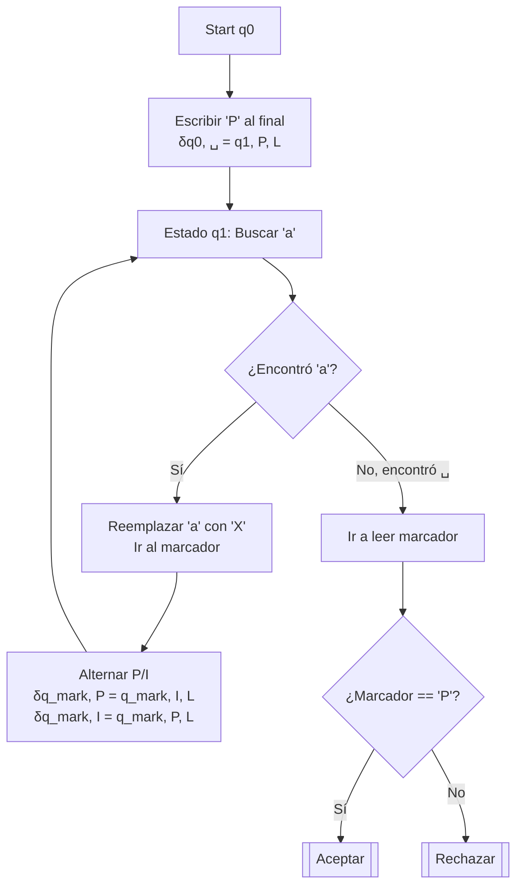

# Autómatas y Lenguajes Formales - Máquinas de Turing

## 5.3 Técnicas para la construcción de máquinas de Turing.

---

### **1. Introducción: El Arte de Diseñar MTs**

Diseñar una Máquina de Turing desde cero usando solo la definición formal de la 7-tupla es complejo y propenso a errores. Las **técnicas de construcción** son estrategias de alto nivel que nos permiten:

1.  **Gestionar la complejidad:** Dividir un problema complejo en subproblemas más simples.
2.  **Incrementar la claridad:** Hacer el diseño más comprensible y fácil de razonar.
3.  **Facilitar la reutilización:** Usar máquinas previamente diseñadas como componentes de nuevas máquinas.

Estas técnicas no extienden el poder de cómputo de las MTs (la Tesis de Church-Turing establece que ya son lo suficientemente poderosas), pero hacen factible la descripción de algoritmos complejos.

### **2. Técnica 1: Uso de Almacenamiento en la Cinta**

La cinta no solo almacena la entrada y salida, sino que también puede usarse como **memoria de trabajo**. Se pueden usar símbolos especiales (marcadores) para rastrear información.

**Ejemplo:** Contar símbolos. Diseñar una MT que acepte si el número de 'a's en la string es par.

- **Idea:** Usar un símbolo especial, digamos `P` (Par) o `I` (Impar), escrito en una sección especial de la cinta, para llevar la cuenta. Cada vez que se encuentra una 'a', se alterna entre `P` e `I`.
- **Implementación:** La máquina puede escribir `P` al final de la entrada. Luego, se mueve de left/left a right/derecha. Por cada 'a', reemplázala por un símbolo tachado (e.g., `X`) y va al final para cambiar `P` por `I` o viceversa. Al final, si el marcador es `P`, acepta.

### **3. Técnica 2: Subrutinas y Módulos**

Podemos diseñar MTs que realicen tareas específicas bien definidas (como "buscar el final de la cinta", "copiar un símbolo" o "comparar dos símbolos") y luego **componerlas** para construir MTs más complejas.

**Ejemplo:** MT para `{ww | w ∈ {0,1}*}`.

- **Diseño Modular:**
  1.  **Marca el centro:** `M1` reemplaza el primer y último símbolo con marcas (e.g., `A` y `Z`), luego el segundo y el penúltimo, y así sucesivamente hasta encontrar el centro.
  2.  **Compara:** `M2` se posiciona al inicio de la segunda `w` y va comparando símbolo a símbolo con la primera `w`, moviéndose en zig-zag.
- La MT principal **invoca** estos módulos en secuencia.

### **4. Técnica 3: Máquinas de Múltiples Pistas (Multi-Track)**

Una poderosa técnica conceptual es imaginar la cinta dividida en **pistas** (o tracks). Cada celda física de la cinta contiene en realidad un símbolo compuesto, un vector de $k$ símbolos, uno por cada pista.

$$ \text{Símbolo en la cinta} = \begin{bmatrix} \text{símbolo pista 1} \\ \text{símbolo pista 2} \\ \vdots \\ \text{símbolo pista k} \end{bmatrix} $$

El alfabeto de la cinta se convierte en: $\Gamma = (\Gamma_1 \times \Gamma_2 \times \ldots \times \Gamma_k)$
**Ventaja:** Mantener diferentes tipos de información (entrada original, cálculos, marcas) separadas pero alineadas espacialmente.

**Ejemplo:** Resta binaria. Diseñar una MT que reste dos números binarios de $n$ bits, almacenados inicialmente en la cinta separados por un símbolo especial (e.g., `#`).

- **Pista 1:** Almacena el minuendo.
- **Pista 2:** Almacena el sustraendo.
- **Pista 3:** Almacena el resultado y el acarreo (`borrow`).

La MT recorre las pistas de right/derecha a left/left, bit a bit, aplicando las reglas de la resta con borrow, y escribiendo el resultado en la Pista 3.

### **5. Técnica 4: Máquinas de Múltiples Cintas**

Una generalización más potente es una MT con $k$ **cintas** independientes, cada una con su propia cabeza de lectura/escritura. La función de transición depende del estado actual y de los $k$ símbolos leídos, y produce un nuevo estado, $k$ símbolos a escribir y $k$ movimientos (uno por cada cinta).

$$ \delta: Q \times \Gamma^k \to Q \times \Gamma^k \times \{L, R\}^k $$

**Ejemplo:** Reconocer `{0ⁿ1ⁿ | n ≥ 0}` con 2 cintas.

1.  **Cinta 1:** Almacena la entrada.
2.  **Cinta 2:** Se usa como contador.

- **Algoritmo:**
  1.  Copia todos los `0`s de la Cinta 1 a la Cinta 2.
  2.  Por cada `1` leído en la Cinta 1, borra un `0` de la Cinta 2.
  3.  Acepta si al final la Cinta 1 no tiene `1`s sobrantes y la Cinta 2 está vacía.

**Teorema:** Para toda MT de $k$ cintas existe una MT de 1 cinta que simula su comportamiento (aunque mucho más lenta). Esto demuestra que las MT multicinta no son más **poderosas**, pero son mucho más **eficientes** para diseñar algoritmos.

### **6. Ejercicios Propuestos**

1.  **Diseño con Almacenamiento:** Diseña a alto nivel una MT que acepte el lenguaje $\{a^ib^jc^k \mid i \times j = k \text{ y } i, j, k \geq 1\}$. Describe qué información almacenarías en la cinta y cómo la usarías para realizar la multiplicación. (Pista: necesitarás bucles anidados).
2.  **Diseño Modular:** Describe los módulos (subrutinas) que necesitarías para construir una MT que calcule el máximo común divisor (MCD) de dos números representados en unario (e.g., `11` y `1111` para MCD=2). Por ejemplo, necesitarás un módulo para comparar dos números y otro para restar el menor del mayor.
3.  **Diseño con Múltiples Pistas:** Diseña la función de transición para el primer paso (el bit menos significativo) de la MT restadora binaria de 3 pistas descrita anteriormente. Considera los posibles casos: (0-0), (0-1), (1-0), (1-1). Define claramente el contenido de las pistas.
4.  **Simulación:** Explica cómo simularías una MT de 2 cintas con una MT de 1 cinta usando la técnica de 3 pistas. ¿Qué almacenaría cada pista? (Pista: una pista para el contenido de la Cinta 1, otra para la Cinta 2, y una tercera para marcar la posición de las cabezas).

### **7. Referencias**

- **Sipser, M. (2005).** _Introduction to the Theory of Computation._ (Sección 3.2 - "Variants of Turing Machines"). Excelente para técnicas multi-cinta y su equivalencia.
- **Hopcroft, J. E., et al. (2007).** _Introduction to Automata Theory, Languages, and Computation._ (Sección 8.4 - "Extensions to the Basic Turing Machine"). Cubre multitrack, multicinta y no determinismo.
- **Viso G., E. (2008).** _Introducción a la teoría de la computación._ (Secciones relevantes sobre extensiones y técnicas de diseño).
- **Linz, P. (2006).** _An Introduction to Formal Languages and Automata._ (Capítulo 9 - "Turing Machines"). Incluye ejemplos de construcción paso a paso.

> La clave para dominar el diseño de MTs es la práctica. Comienza con problemas simples, aplica estas técnicas y luego avanza hacia problemas más complejos.
