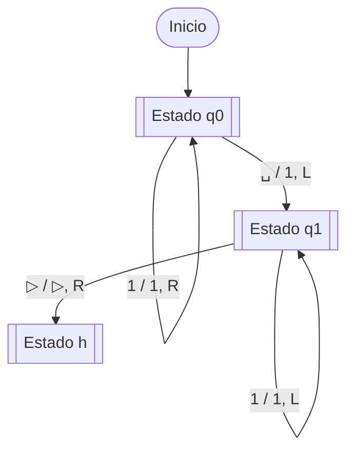
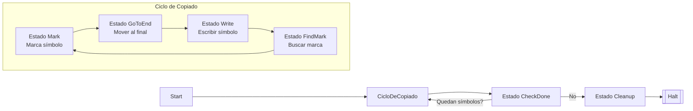

# Autómatas y Lenguajes Formales - Máquinas de Turing

## 5.4 La máquina de Turing como un procedimiento.

---

### **1. Introducción: Más allá del Reconocimiento de Lenguajes**

Hasta ahora hemos visto las MTs principalmente como **reconocedoras de lenguajes**: aceptan o rechazan una cadena de entrada. Sin embargo, su poder va mucho más allá. Una MT puede calcular **funciones**, transformando una entrada en una salida siguiendo un procedimiento algorítmico. Esto las convierte en el modelo formal de **algoritmo**.

### **2. Máquinas de Turing Computadoras de Funciones**

Una MT $ M $ **computa una función** $ f: \Sigma^* \to \Sigma^* $ si para toda cadena de entrada $ w \in \Sigma^* :$

1.  $M$ se detiene (llega a un estado de halt) con la cadena $f(w)$ escrita en su cinta.
2.  La cabeza debe estar posicionada al inicio de $f(w).$
3.  El resto de la cinta debe estar en blanco.

Definimos formalmente el **estado de parada** $(h)$ que no es de aceptación ni rechazo, sino finalización del cómputo. La función de transición $\delta$ es indefinida para $h.$

**Definición:** Una función $f$ es **Turing-computable** si existe una MT $M$ que la compute.

### **3. Especificación de un Procedimiento**

Diseñar una MT como procedimiento implica:

1.  **Definir la representación de la entrada y salida.**
2.  **Describir el algoritmo paso a paso** usando operaciones básicas:
    - Escaneo ( movimiento $L/R$ )
    - Comparación de símbolos
    - Escritura/borrado
    - Bifurcación condicional (cambio de estado)

**Ejemplo: Función Sucesor en Unario**

- **Representación:** $n$ se representa como $1^{n+1}$ ( ej. $0 = 1,$ $3 = 1111$ ).
- **Procedimiento:**
  1.  Mover a la derecha hasta encontrar el primer blanco (`␣`).
  2.  Escribir un $1.$
  3.  Volver al inicio.



### **4. Construcción de Procedimientos Complejos: Notación de Alto Nivel**

Para manejar la complejidad, usamos **pseudocódigo** y **subrutinas**.

**Ejemplo: Función de Resta (Monus) en Unario** $ m$ `∸` $n = \max\lparen m - n, 0 \rparen $

- **Representación:** Entrada: `1^m 0 1^n` ( ej. `111011` para $3$ `∸` $2 $ )
- **Procedimiento:**
  ```
  1. REPETIR:
      a. Buscar el 1 más a la izquierda de m.
      b. Si se encuentra, reemplazarlo por un 0.
      c. Buscar el 1 más a la izquierda de n.
      d. Si se encuentra, reemplazarlo por un 0.
      d. SI no se encuentra en n, restaurar el 1 en m y TERMINAR.
  2. El resultado es el número de 1's restantes en m.
  ```

### **5. La MT como Algoritmo: Decidibilidad y Computabilidad**

Un **procedimiento efectivo** debe ser:

1.  **Determinista:** Cada paso está definido sin ambigüedad.
2.  **Mecánico:** No requiere creatividad o intuición.
3.  **Finitamente descrito:** La especificación ( la función $\delta$ ) es finita.
4.  **General:** Funciona para cualquier entrada del dominio.

La MT captura perfectamente estas nociones. Un problema es **decidible** si existe una MT que siempre se para y produce la salida correcta (SÍ/NO) para cualquier entrada.

### **6. Ejemplo Detallado: Copiado de una Cadena**

**Problema:** Construir una MT que compute la función $f(w) = ww.$

**Técnica:** Usar símbolos marcados $(\bar{a})$ y copiar de right/derecha a left/left.

**Algoritmo:**

1.  Marcar el primer símbolo $a$ como $\bar{a}.$
2.  Moverse al final, escribir un blanco, y luego escribir $a.$
3.  Volver al símbolo marcado $\bar{a},$ restaurarlo a $a.$
4.  Repetir para el siguiente símbolo hasta que todos estén copiados.

**Diagrama de Estados Simplificado:**



### **7. Ejercicios Propuestos**

1.  **Diseño de Procedimiento:** Diseña el diagrama de estados completo para la función sucesor en unario.
2.  **Pseudocódigo a MT:** Convierte el siguiente procedimiento en una descripción formal de MT $(\delta).$
    - **Entrada:** $a^n b^n$ (verificar)
    - **Procedimiento:**
      ```
      MIENTRAS haya una 'a' y una 'b' HACER
          Reemplazar la 'a' más a la izq. por X
          Reemplazar la 'b' más a la der. por Y
      FIN MIENTRAS
      SI no quedan símbolos sin marcar ENTONCES ACEPTAR
      SINO RECHAZAR
      ```
3.  **Problema de Decisión:** ¿Es decidible el problema de determinar si una MT dada $M$ se para sobre la cinta en blanco? Explica por qué sí o por qué no en términos de la existencia de un procedimiento.
4.  **Función Computable:** Diseña a alto nivel una MT que compute la función $f(m, n) = m + n$ para números representados en decimal. Describe tu representación de entrada/salida y el algoritmo.

### **8. Referencias**

- **Viso G., E. (2008).** _Introducción a la teoría de la computación._ Capítulo 6.4 - "Máquinas de Turing como generadoras de lenguaje y computadoras de funciones".
- **Sipser, M. (2005).** _Introduction to the Theory of Computation._ Sección 3.3 - "The Definition of Algorithm" (explica la definición de algoritmo a través de la MT).
- **Hopcroft, J. E., et al. (2007).** _Introduction to Automata Theory, Languages, and Computation._ Sección 8.2.2 - "Turing Machines as Language Enumerators".
- **Linz, P. (2006).** _An Introduction to Formal Languages and Automata._ Capítulo 10.2 - "Computable Functions".

> Esta perspectiva de la MT como procedimiento es fundamental para entender los límites de la computación algorítmica y conduce directamente al estudio de problemas no decidibles como el Problema de la Parada.
