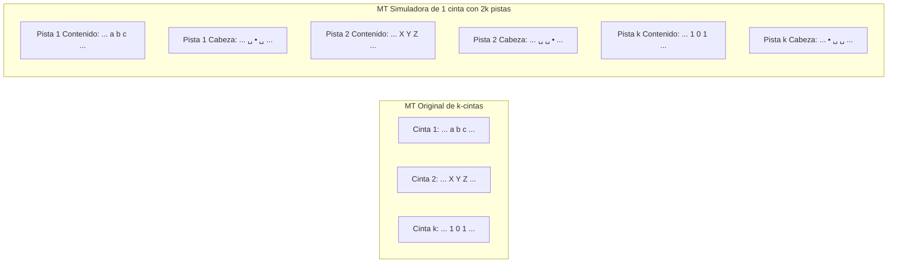

# Autómatas y Lenguajes Formales - Máquinas de Turing

## 5.5 Distintos tipos de máquinas de Turing.

---

### **1. Introducción: La Búsqueda de Modelos Equivalentes**

El modelo estándar de MT es poderoso, pero a menudo es complejo para diseñar algoritmos específicos. Surgen entonces **variantes** o **tipos** de MTs que, a primera vista, parecen más poderosas o convenientes. Un resultado fundamental de la teoría es que estas variantes **no son más poderosas** que la MT estándar en términos de lo que pueden computar (lenguajes reconocidos/funciones computadas). Son **equivalentes en poder de cómputo**.

### **2. Máquinas de Turing con Cinta Infinita en una Dirección**

La MT estándar tiene una cinta infinita en ambas direcciones. Una variante común es una MT cuya cinta es infinita solo hacia la derecha, teniendo una **celda del extremo izquierdo** que no se puede sobrepasar hacia la izquierda.

**Equivalencia:** Son equivalentes. Una MT estándar puede simular una cinta semi-infinita usando dos pistas: una para el lado derecho del origen y otra para el izquierdo, o simplemente desplazando toda la cinta hacia la derecha cuando sea necesario.

### **3. Máquinas de Turing con Múltiples Cintas (k-tapes)**

Una MT de **k-cintas** tiene $k$ cintas independientes, cada una con su propia cabeza de lectura/escritura. La función de transición se define como:

$$\delta: Q \times \Gamma^k \to Q \times \Gamma^k \times \{L, R, S\}^k$$

donde $S$ significa "permanecer" o "no moverse".

**Ventaja:** Son mucho más fáciles de programar para muchos problemas (e.g., copiar datos, llevar contadores).

**Ejemplo: Reconocer $\{ww^R \mid w \in \{0,1\}^*\}$ (palíndromos pares) con 2 cintas.**

1.  **Cinta 1:** Almacena la entrada.
2.  **Cinta 2:** Se usa para comparar.

- **Algoritmo:**
  1.  Copiar la entrada de la Cinta 1 a la Cinta 2.
  2.  Mover la cabeza de la Cinta 2 al final.
  3.  Mover la cabeza de la Cinta 1 al inicio.
  4.  Comparar símbolo a símbolo moviendo la Cinta 1 a la derecha y la Cinta 2 a la izquierda.

**Teorema de Equivalencia:** Para toda MT de k-cintas existe una MT de una cinta que la simula.

**Simulación (Idea):** Usar una MT de 1 cinta con **$2k$ pistas**. Para cada cinta $i$ de la máquina original, se usan dos pistas: una para el contenido y otra para marcar la posición de la cabeza con un símbolo especial ( e.g., $\dot{X}$ ) sobre el símbolo $X$ actual.

### **4. Máquinas de Turing No Deterministas (MTND)**

Una MT **No Determinista (MTND)** tiene una función de transición $\delta$ que, para un estado y un símbolo leído dados, ofrece **múltiples opciones posibles** ( un conjunto de triplas $(q', \gamma', D')$ ).

$$\delta: Q \times \Gamma \to \mathcal{P}(Q \times \Gamma \times \{L, R\})$$

**Interpretación:** En cada punto de elección, la máquina "adivina" la transición correcta que la llevará a la aceptación, si existe.

**Ejemplo:** Reconocer $\{w \mid w \text{ tiene la subcadena } 01 \text{ o } 10\}$.
Desde el estado inicial, la MTND puede "adivinar" si buscará un patrón u otro, bifurcando su ejecución.

**Teorema de Equivalencia (Fundamental):** Para toda MTND $N$ existe una MT determinista $M$ tal que $L(N) = L(M)$.

**Simulación (Idea):** La MT determinista $M$ simula todas las posibles computaciones de $N$ sobre la entrada $w$ mediante **búsqueda en amplitud** (breadth-first search). Representa cada punto de decisión y explora sistemáticamente todos los caminos computacionales.

- Si existe al menos un camino de aceptación en $N$, $M$ lo encontrará y aceptará.
- Si ningún camino acepta, $M$ puede no detenerse (si $L(N)$ es solo Turing-reconocible) o rechazar (si $L(N)$ es decidible).

### **5. Máquinas de Turing con Múltiples Cabezas**

Una variante tiene una **cinta** pero **$k$ cabezas** independientes. La transición depende del estado y de los $k$ símbolos leídos, y produce $k$ símbolos a escribir y $k$ movimientos.

**Equivalencia:** Son equivalentes a la MT estándar. Se pueden simular con una MT de $k+1$ pistas: una para el contenido de la cinta y $k$ pistas para marcar las posiciones de las $k$ cabezas.

### **6. Máquinas de Turing de Cinta Multidimensional**

La cinta no es una cinta lineal, sino una **rejilla** o **grid** n-dimensional (e.g., 2D como un plano infinito). Las cabezas se mueven en las direcciones de los ejes (e.g., `Left/Left`, `Right/Derecha`, `Up/Arriba`, `Down/Abajo`).

**Equivalencia:** Son equivalentes. Una MT estándar puede simular una cinta 2D "aplanándola" en una dimensión mediante una **función de empaquetamiento** (pairing function) que codifica coordenadas $(i, j)$ en una única posición en una cinta 1D (e.g., orden diagonal o por filas).

### **7. Resumen de Equivalencia**

| Tipo de Máquina de Turing    | ¿Equivalente al modelo estándar?                         |
| :--------------------------- | :------------------------------------------------------- |
| Cinta semi-infinita          | **Sí**                                                   |
| Múltiples cintas (k-tapes) | **Sí**                                                   |
| No determinista (MTND)       | **Sí**                                                   |
| Múltiples cabezas            | **Sí**                                                   |
| Cinta multidimensional       | **Sí**                                                   |
| **Máquina con Oracle**       | **No** (Mayor poder, define la **Jerarquía Aritmética**) |

### **8. Ejercicios Propuestos**

1.  **Diseño:** Diseña una MT de 2 cintas para el lenguaje $\{a^nb^nc^n \mid n \geq 0\}$. Explica el algoritmo paso a paso.
2.  **Simulación:** Describe en detalle cómo una MT de 1 cinta con 4 pistas simularía el primer paso de una MT de 2 cintas cuya transición es $\delta(q_0, (a, X)) = (q_1, (b, Y), (R, L))$.
3.  **No Determinismo:** Diseña una MTND para el lenguaje de las strings sobre $\{0,1\}$ que contienen dos ceros separados por un número de símbolos que es un múltiplo de 3. (Pista: el no determinismo es útil para "adivinar" dónde está el primer cero).
4.  **Demostración Conceptual:** Explica por qué la capacidad de "adivinar" correctamente de una MTND no viola la Tesis de Church-Turing, dado que puede ser simulada por una MT determinista.

### **9. Referencias**

- **Sipser, M. (2005).** _Introduction to the Theory of Computation._ (Sección 3.2 - "Variants of Turing Machines"). La mejor referencia para la equivalencia de variantes.
- **Hopcroft, J. E., et al. (2007).** _Introduction to Automata Theory, Languages, and Computation._ (Sección 8.4 - "Extensions to the Basic Turing Machine").
- **Viso G., E. (2008).** _Introducción a la teoría de la computación._ (Capítulo sobre extensiones de la MT).
- **Kozen, D. C. (1997).** _Automata and Computability._ (Presentación concisa y formal de las equivalencias).
