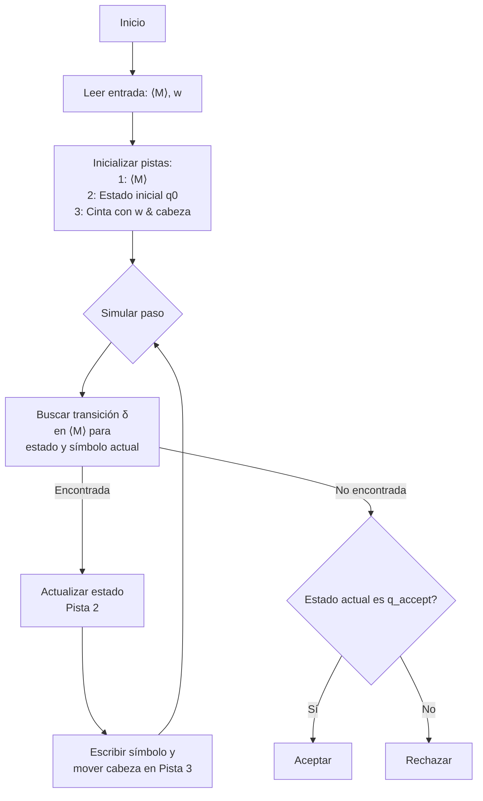

# Autómatas y Lenguajes Formales - Máquinas de Turing

## 5.6 La máquina universal de Turing.

---

### **1. Introducción: La Idea de una Máquina Única**

Hasta ahora, cada MT $M$ está diseñada para resolver un problema específico ( reconocer un lenguaje $L(M)$ o calcular una función $f_M$ ). Esto es análogo a tener una máquina dedicada para cada tarea (una para sumar, otra para cortar pan, etc.).

La **Máquina Universal de Turing ( UTM o $U$ )** es la conceptualización de una **máquina de propósito general**. Es una MT única que puede **simular el comportamiento de cualquier otra Máquina de Turing** $M,$ cuando se le proporciona tanto la **descripción de $M$** como su **cadena de entrada $w$**.

Esta es la base teórica de las **computadoras modernas de programa almacenado**, donde los datos y el programa que los procesa residen en la misma memoria.

### **2. Codificación de una Máquina de Turing**

Para que $U$ pueda interpretar a $M,$ necesitamos una forma de **codificar** o **representar** a $M$ como una cadena de símbolos sobre un alfabeto fijo ( e.g., $\{0, 1\}$ ). Esta representación se denota como $\langle M \rangle.$

**Esquema de Codificación (Ejemplo):**
Supongamos que $M = (Q, \Sigma, \Gamma, \delta, q_0, q_a, q_r).$

1.  Asignamos números a cada elemento:
    - Estados: $q_0 = 1, q_1 = 11, q_2 = 111, ...$
    - Símbolos de cinta: $s_0 = 0, s_1 = 1, s_2 = 00, s_3 = 01, s_4 = 10, ...$ (usualmente $s_0 =$ `␣` )
    - Direcciones: $L = 0, R = 1, S = 00$ (si se usa)
2.  Codificamos cada transición $\delta(q_i, s_j) = (q_k, s_l, D_m)$ como una cadena. Por ejemplo:
    - $0$ separador.
    - Código de $q_i.$
    - $0$ separador.
    - Código de $s_j.$
    - $0$ separador.
    - Código de $q_k.$
    - $0$ separador.
    - Código de $s_l.$
    - $0$ separador.
    - Código de $D_m.$
3.  Codificamos la MT completa como la concatenación de todas sus transiciones, separadas por `00`.

**Ejemplo:** Una transición simple $\delta(q_0, 0) = (q_1, 1, R)$ podría codificarse como:
`0 1 0 1 0 11 0 11 0 1 0` ( usando `1` para $q_0,$ `1` para el símbolo `0`, `11` para $q_1,$ `11` para escribir `1`, y `1` para $R$ ).

### **3. Descripción de la Máquina Universal de Turing $(U)$**

La UTM $U$ tiene como alfabeto de entrada un alfabeto fijo $\Sigma_U$ ( suficiente para contener $\{0, 1\}$ ).

**Entrada de $U$:** La concatenación de la descripción de $M$ y la cadena de entrada $w,$ separadas por un delimitador especial (e.g., `111`).

$$\langle U \rangle = \langle M \rangle 111 w$$

**Comportamiento de $U$:**

$$U(\langle M \rangle, w) = M(w)$$

Es decir, $U$ simula $M$ sobre $w:$

- Si $M$ acepta $w,$ entonces $U$ acepta $(\langle M \rangle, w).$
- Si $M$ rechaza $w,$ entonces $U$ rechaza $(\langle M \rangle, w).$
- Si $M$ no se detiene con $w,$ entonces $U$ no se detiene.

**Algoritmo de $U$ (a alto nivel):**

1.  **Verificar la entrada:** Asegurarse de que $\langle M \rangle$ es una codificación válida.
2.  **Inicializar la cinta de simulación:** La cinta de $U$ tendrá al menos tres pistas:
    - **Pista 1:** Almacena la descripción de $M$ $(\langle M \rangle).$ (Siempre accesible).
    - **Pista 2:** Almacena el **estado actual** de $M$ (codificado).
    - **Pista 3:** Almacena el **contenido de la cinta** de la máquina $M$ que se está simulando, con una marca en la posición actual de la cabeza de $M.$
3.  **Ciclo de Simulación:**
    - Lee el estado actual de $M$ (de la Pista 2) y el símbolo bajo la cabeza simulada (de la Pista 3).
    - Busca en la descripción de $M$ (Pista 1) una transición $\delta(\text{estado}, \text{símbolo}).$
    - **Si la encuentra:** Actualiza el estado en la Pista 2, escribe el nuevo símbolo en la Pista 3 y mueve la marca de la cabeza simulada según la dirección $(L/R).$
    - **Si no la encuentra:** $M$ se habría detenido. $U$ verifica si el estado actual es de aceptación o rechazo y actúa en consecuencia.

### **4. Implicaciones e Importancia**

1.  **Fundamento de la Computación Moderna:** $U$ es el modelo teórico de una **computadora de propósito general**. El programa $(\langle M \rangle)$ y los datos $(w)$ se almacenan en la memoria (la cinta), y un hardware fijo $(U)$ los interpreta y ejecuta.
2.  **Posibilidad del Software:** Permite que una sola máquina física $(U)$ realice una infinidad de tareas diferentes, dependiendo del "programa" $(\langle M \rangle)$ que se le feed.
3.  **Origen de los Problemas No Decidibles:** La existencia de $U$ es crucial para plantear el **Problema de la Parada** ("¿Se detendrá $M$ con entrada $w$?"). Demostrar que este problema es indecidible para $U$ implica que es indecidible para cualquier modelo de computación equivalente.

### **5. Ejercicios Propuestos**

1.  **Codificación:** Usando el esquema simplificado del punto 2, codifica la transición $\delta(q_1, 1) = (q_2, 0, L).$ Asume $q_1 = 11,$ $q_2 = 111,$ el símbolo `1` se codifica como `1`, `0` como `11`, y $L$ como `0`.
2.  **Simulación Mental:** Supón que le damos a $U$ la entrada $\langle M \rangle 111 000,$ donde $\langle M \rangle$ describe una MT que acepta si la entrada tiene un número par de `0`s. Describe los primeros pasos de la simulación de $U:$ ¿cómo busca la transición inicial?
3.  **Diseño de Alto Nivel:** Describe, en pseudocódigo, el algoritmo que usaría la UTM $U$ para buscar una transición en la descripción $\langle M \rangle$ dado un estado $q_i$ y un símbolo $s_j.$
4.  **Implicación:** Explica por qué la existencia de la UTM $U$ no contradice la Tesis de Church-Turing, sino que la fortalece.

### **6. Referencias**

- **Sipser, M. (2005).** _Introduction to the Theory of Computation._ (Sección 3.2 - "Variants of Turing Machines" y Sección 4.2 - "The Halting Problem"). La explicación de Sipser es muy clara.
- **Hopcroft, J. E., et al. (2007).** _Introduction to Automata Theory, Languages, and Computation._ (Sección 8.6.2 - "A Universal Turing Machine").
- **Viso G., E. (2008).** _Introducción a la teoría de la computación._ (Capítulo sobre indecidibilidad y la UTM).
- **Kozen, D. C. (1997).** _Automata and Computability._ (Presentación formal y concisa de la codificación y la UTM).

> La Máquina Universal de Turing es, posiblemente, el concepto más profundo e importante en la teoría de la computación, ya que establece los límites y posibilidades de lo que puede ser computado de manera mecánica.
