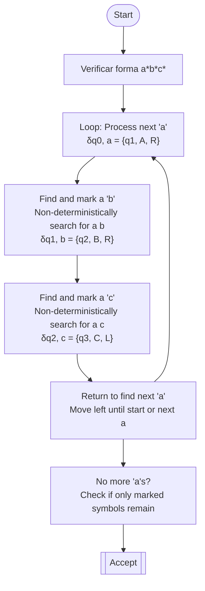

# Autómatas y Lenguajes Formales - Máquinas de Turing

## 5.7 Autómatas linealmente acotados.

---

### **1. Introducción: Una Restricción de Memoria**

Un **Autómata Linealmente Acotado (ALA o LBA por sus siglas en inglés)** es un tipo **especial** de Máquina de Turing que resuelve una de las limitaciones prácticas más importantes de la MT estándar: el uso **infinito** de memoria.

Un ALA es una MT **no determinista** cuya cinta está **acotada** o limitada. La cantidad de cinta disponible para computar es una **función lineal** de la longitud de la entrada. Por convención, se asigna exactamente una celda por símbolo de entrada más dos celda delimitadoras (marcadores de izquierda y derecha, `[` y `]`).

### **2. Definición Formal**

Un Autómata Linealmente Acotado se define como una 6-tupla:

$$M = (Q, \Sigma, \Gamma, \delta, q_0, q_{\text{accept}}, q_{\text{reject}})$$

Donde los componentes son idénticos a los de una MT estándar, **excepto por la función de transición $\delta$**, la cual debe garantizar que la cabeza **nunca se salga** de los límites de la cinta.

La función de transición es de la forma:

$$\delta: Q \times \Gamma \to \mathcal{P}(Q \times \Gamma \times \{L, R\})$$

**Restricción Crucial:** Si la cabeza está sobre el marcador de izquierda (`[`), cualquier transición que la haga moverse a la izquierda debe ser indefinida. De manera análoga, si está sobre el marcador de derecha (`]`), no puede moverse a la derecha. El autómata puede _rewrite_ estos delimitadores, pero no puede moverse más allá de ellos.

### **3. Configuración Inicial y Espacio**

Para una cadena de entrada $w = w_1w_2...w_n,$ la **configuración inicial** del ALA es:

$$[ \; q_0 \; w_1 \; w_2 \; ... \; w_n \; ]$$

- Los delimitadores `[` y `]` son símbolos especiales de $\Gamma$ ( $\triangleright, \triangleleft$ también son notaciones comunes ).
- La cabeza está posicionada sobre el primer símbolo de $w.$
- El **espacio de trabajo** total es de $n + 2$ celdas.

### **4. El Lenguaje de un ALA y la Clase CSL**

El **lenguaje aceptado** por un ALA $M$ es:

$$L(M) = \{ w \in \Sigma^* \mid M \text{ acepta } w \}$$

La **clase de lenguajes** reconocidos por los Autómatas Linealmente Acotados es exactamente la clase de los **Lenguajes Sensibles al Contexto (CSL)**.

Un Lenguaje Sensible al Contexto es aquel generado por una Gramática Sensible al Contexto (GSC), donde toda regla de producción es de la forma $\alpha \rightarrow \beta,$ cumpliendo que $|\alpha| \leq |\beta|$ (excepto posiblemente $S \to \epsilon,$ manejada como caso especial).

**Relación:** $\text{CLS} = \text{L(ALA)}$

### **5. Ejemplo: Reconocimiento de $\{a^n b^n c^n \mid n \geq 0\}$ con un ALA**

Este lenguaje no es libre de contexto, pero **sí es sensible al contexto** y puede ser reconocido por un ALA.

**Algoritmo no determinista:**

1.  Verificar que la entrada esté en la forma $ a^* b^* c^* .$
2.  Por cada `a` encontrada:
    - Marcar la `a` (convertirla en `A`).
    - "Adivinar" y marcar una `b` correspondiente (convertirla en `B`).
    - "Adivinar" y marcar una `c` correspondiente (convertirla en `C`).
3.  Verificar que no sobren símbolos sin marcar.

La clave es que el no determinismo permite "adivinar" los pares correctos, y el espacio lineal es suficiente para realizar estas marcas sin necesidad de memoria adicional.

### **6. Poder Computacional: ¿ALA vs. MT?**

Esta es una de las **preguntas abiertas** más famosas en la teoría de la computación.

- **Se sabe que:** Todo ALA es una MT. Por lo tanto, los lenguajes sensibles al contexto (L(ALA)) son un subconjunto de los lenguajes recursivamente enumerables (L(MT)).
  
  $$\text{CLS} \subseteq \text{RE}$$

- **Se sabe que:** Existen lenguajes recursivos (decidibles) que no son sensibles al contexto.
- **La pregunta abierta es:** ¿Todo lenguaje sensible al contexto es decidible? En otras palabras, **¿todo ALA se detiene siempre?** O, de forma equivalente, ¿es $\text{CLS} \subseteq \text{R}?$

La conjetura general es que **sí**, que los ALAs siempre se detienen, pero no existe una demostración general que lo pruebe. Esto se conoce como el **Problema de Kuroda**.

### **7. Ejercicios Propuestos**

1.  **Diseño:** Diseña a alto nivel un ALA (describe sus estados y la lógica de sus transiciones) para el lenguaje $\{ww \mid w \in \{a,b\}^+\}.$
2.  **Demostración:** Explica por qué el lenguaje $\{a^{2^n} \mid n \geq 0\}$ **no puede** ser reconocido por un ALA. (Pista: Necesita espacio exponencial para verificar la longitud).
3.  **Comparación:** ¿En qué se diferencia fundamentalmente la cinta de un ALA de la pila de un Autómata de Pila? ¿Por qué esta diferencia le da más poder al ALA?
4.  **Problema Abierto:** Investiga y explica brevemente en qué consiste el "Problema de Kuroda" mencionado en la sección 6.

### **8. Referencias**

- **Hopcroft, J. E., Motwani, R., and Ullman, J. (2007).** _Introduction to Automata Theory, Languages, and Computation._ (Sección 8.5 - "Restricted Turing Machines"). La mejor fuente para este tema.
- **Sipser, M. (2005).** _Introduction to the Theory of Computation._ (Mención en el contexto de la Jerarquía de Chomsky).
- **Viso G., E. (2008).** _Introducción a la teoría de la computación._ (Capítulo sobre Gramáticas Sensibles al Contexto y su equivalencia con los ALA).
- **Sudkamp, T. A. (1997).** _Languages and Machines._ (Presenta un enfoque detallado sobre los ALA).
