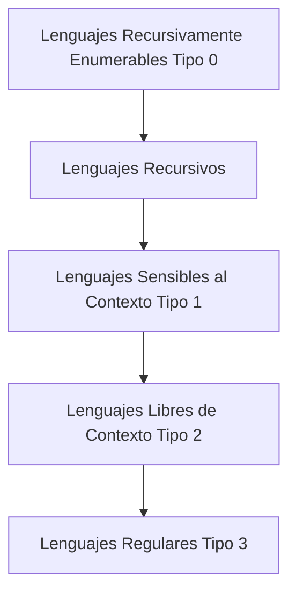

# Autómatas y Lenguajes Formales - La Jerarquía de Chomsky

## 6.1 Lenguajes recursivos y recursivamente numerables.

---

En la Jerarquía de Chomsky, los lenguajes recursivos y recursivamente numerables ocupan los niveles más altos de expresividad, correspondientes a los tipos 0 y 1. Esta guía se enfoca en comprender estas clases de lenguajes y su relación con los límites de la computación.

### Marco Teórico

#### La Jerarquía de Chomsky

La Jerarquía de Chomsky clasifica los lenguajes formales en cuatro tipos según la complejidad de sus gramáticas:

| Tipo | Lenguaje                  | Gramática            | Autómata            |
| ---- | ------------------------- | -------------------- | ------------------- |
| 0    | Recursivamente enumerable | Irrestricta          | Máquina de Turing   |
| 1    | Sensible al contexto      | Sensible al contexto | MT con cinta lineal |
| 2    | Libre de contexto         | Libre de contexto    | Autómata con pila   |
| 3    | Regular                   | Regular              | Autómata finito     |

<br>



### Lenguajes Recursivamente Enumerables

#### Definición Formal

Un lenguaje $L$ es **recursivamente enumerable** (RE) si existe una máquina de Turing $M$ tal que:

- Si $w \in L$, entonces $M$ acepta $w$ (se detiene en estado de aceptación)
- Si $w \notin L$, entonces $M$ puede:
  - Rechazar $w$ (detenerse en estado de rechazo), o
  - No detenerse (ciclar infinitamente)

Matemáticamente:

$$L \text{ es RE} \iff \exists M \text{ tal que } L = L(M) = \{w \mid M \text{ acepta } w\}$$

#### Características

- Son aceptados por máquinas de Turing
- Pueden ser semidecidibles: existe un procedimiento efectivo para verificar membresía, pero no necesariamente para verificar no membresía
- La clase RE es cerrada bajo unión, intersección y concatenación

#### Ejemplo

El **problema de la parada** (Halting Problem) es el lenguaje recursivamente enumerable más conocido:

$$H = \{\langle M, w \rangle \mid M \text{ es una MT que se detiene con entrada } w\}$$

Este lenguaje es RE pero no recursivo.

### Lenguajes Recursivos

#### Definición Formal

Un lenguaje $L$ es **recursivo** (o decidible) si existe una máquina de Turing $M$ tal que:

- Si $w \in L$, entonces $M$ acepta $w$
- Si $w \notin L$, entonces $M$ rechaza $w$
- $M$ siempre se detiene para cualquier entrada

Matemáticamente:

$$ L \text{ es recursivo} \iff \exists M \text{ tal que } M \text{ siempre se detiene y } L = L(M) $$

#### Características

- Son decidibles: existe un algoritmo que siempre responde "sí" o "no" correctamente
- La clase recursiva es cerrada bajo complemento, unión, intersección y concatenación
- Todo lenguaje recursivo es recursivamente enumerable

#### Ejemplo

El lenguaje de los números primos es recursivo:

$$PRIMOS = \{w \mid w \text{ representa un número primo en binario}\}$$

Existe un algoritmo (como la criba de Eratóstenes) que siempre determina si un número es primo.

### Relación entre las Clases

#### Teorema Fundamental

Todo lenguaje recursivo es recursivamente enumerable, pero no viceversa:

$$Recursivos \subsetneq RE$$

#### Demostración de la Properidad

El lenguaje del problema de la parada $H$ es RE pero no recursivo (como demostró Turing).

### Máquinas de Turing y Decidibilidad

#### Implementación de una MT para Lenguajes Recursivos

```python
# Pseudocódigo para una MT que decide si un número es primo
def mt_primos(n):
    """
    Decide si n es primo (lenguaje recursivo)
    """
    if n < 2:
        return False  # Rechaza
    if n == 2:
        return True   # Acepta

    # Verifica divisibilidad
    for i in range(2, int(n**0.5) + 1):
        if n % i == 0:
            return False  # Rechaza

    return True  # Acepta

# Esta MT siempre se detiene, por lo tanto decide un lenguaje recursivo
```

#### MT para Lenguaje RE no Recursivo

```python
# Pseudocódigo para el problema de la parada (RE pero no recursivo)
def mt_problema_parada(M, w):
    """
    Intenta determinar si M se detiene con entrada w
    """
    # Simula M con entrada w
    try:
        resultado = simular_mt(M, w, tiempo_max=1000000)
        return True  # Si se detuvo, acepta
    except TimeoutError:
        # No sabemos si eventualmente se detendría
        # Podría ciclar infinitamente aquí
        while True:  # Ciclo infinito
            pass

    # Nunca llega aquí para algunas entradas
```

### Aplicaciones y Significado

#### En Teoría de la Computación

- Los límites de la computabilidad están definidos por la distinción entre lenguajes recursivos y RE
- El problema de la parada muestra que existen problemas bien definidos que no pueden ser decididos algorítmicamente

#### En Compiladores

El análisis sintáctico utiliza principalmente lenguajes libres de contexto (tipo 2), pero el análisis semántico puede involucrar problemas que son recursivos o RE.

### Ejercicios Propuestos

#### Ejercicio 1: Clasificación

Clasifica los siguientes lenguajes como recursivos, RE no recursivos, o no RE:

1. $\{\langle M \rangle \mid M \text{ es una MT que acepta al menos 3 cadenas}\}$
2. $\{\langle M \rangle \mid M \text{ es una MT que no acepta ninguna cadena}\}$
3. $\{\langle M, w \rangle \mid M \text{ es una MT que acepta } w \text{ en a lo más 100 pasos}\}$

#### Ejercicio 2: Demostración

Demuestra que si $L$ y $\overline{L}$ son ambos RE, entonces $L$ es recursivo.

#### Ejercicio 3: Construcción de MT

Diseña una máquina de Turing que decida el lenguaje:

$$L = \{a^n b^n c^n \mid n \geq 0\}$$

¿A qué tipo de la jerarquía de Chomsky pertenece este lenguaje?

#### Ejercicio 4: Análisis

Explica por qué el siguiente lenguaje es RE pero no recursivo:

$$L = \{\langle M \rangle \mid M \text{ es una MT que se detiene con entrada vacía}\}$$

### Soluciones a Ejercicios Selectos

#### Solución Ejercicio 2

**Teorema:** Si $L$ y $\overline{L}$ son ambos RE, entonces $L$ es recursivo.

**Demostración:**
Sean $M_1$ y $M_2$ máquinas de Turing que aceptan $L$ y $\overline{L}$ respectivamente. Construimos una máquina $M$ que decide $L$ de la siguiente manera:

$M$ con entrada $w$:

1. Ejecuta $M_1$ y $M_2$ en paralelo con entrada $w$
2. Si $M_1$ acepta, entonces $M$ acepta
3. Si $M_2$ acepta, entonces $M$ rechaza

Como $w \in L$ o $w \in \overline{L}$ (y nunca ambos), una de las dos máquinas eventualmente aceptará. Por lo tanto, $M$ siempre se detiene y decide $L$ correctamente.

### Referencias

1. Viso G., E., _Introducción a la teoría de la computación_. Las Prensas de Ciencias, 2008. (Capítulo 6)
2. Rich, E., _Automata, Computability and Complexity_. Pearson Prentice Hall, 2008. (Capítulo 9)
3. Sipser, M., _Introduction to the Theory of Computation_. PWS Publishing, 2005. (Capítulo 4)
4. Hopcroft, J. E., et al., _Introduction to Automata Theory, Languages, and Computation_. Addison-Wesley, 2007. (Capítulo 9)

### Recursos Adicionales

- Diagramas de máquinas de Turing para lenguajes específicos
- Simuladores de MT online para experimentar con implementaciones
- Problemas de práctica sobre reducibilidad y completitud
