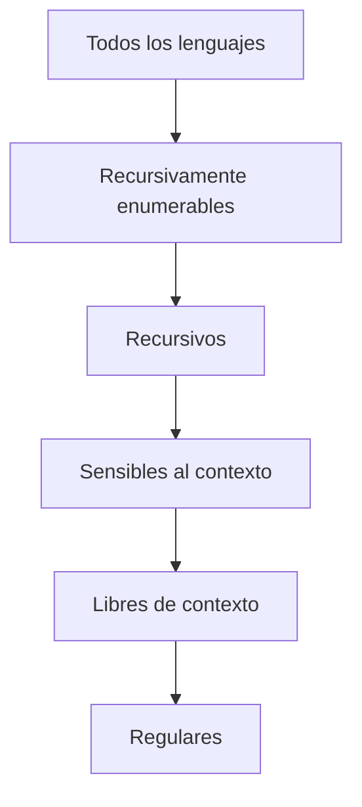

# Autómatas y Lenguajes Formales - La Jerarquía de Chomsky

## 6.1 Lenguajes recursivos y recursivamente numerables.

---

En la cima de la jerarquía de Chomsky están los lenguajes de **tipo 0**, los que reconocen las máquinas de Turing. Dentro de ellos hay una distinción que no aparece en la clasificación original de Chomsky pero que es la más importante de la teoría de la computación: la de los lenguajes que una máquina puede **decidir**, respondiendo siempre sí o no, y los que solo puede **reconocer**, respondiendo sí cuando corresponde pero quizá sin terminar nunca cuando la respuesta es no.

### La jerarquía completa

| Clase | Gramática | Máquina | ¿La pertenencia es decidible? |
| --- | --- | --- | --- |
| Recursivamente enumerables (tipo 0) | sin restricciones | máquina de Turing | no en general |
| Recursivos | (no tienen una forma de gramática propia) | MT que siempre se detiene | sí, por definición |
| Sensibles al contexto (tipo 1) | monótona | autómata linealmente acotado | sí |
| Libres de contexto (tipo 2) | libre de contexto | autómata con pila | sí, en tiempo cúbico |
| Regulares (tipo 3) | regular | autómata finito | sí, en tiempo lineal |



Cada flecha va a una subclase **propia**. Que haya lenguajes que no son recursivamente enumerables, y lenguajes recursivamente enumerables que no son recursivos, es lo que se demuestra en este tema.

### Definiciones

Un lenguaje $L$ es **recursivamente enumerable** (RE) si existe una MT $M$ con $L(M) = L:$ $M$ acepta las cadenas de $L,$ y con las demás rechaza o cicla. Se dice también que $L$ es **semidecidible** o Turing-reconocible.

Un lenguaje $L$ es **recursivo** si existe una MT $M$ con $L(M) = L$ que **se detiene con toda entrada**. Se dice también que $L$ es **decidible**.

El nombre de "recursivamente enumerable" viene de la caracterización con enumeradores (tema 5.4): $L$ es RE si y solo si alguna máquina lista, una por una, todas sus cadenas y solo ellas.

**Ejemplos.**

- Todo lenguaje sensible al contexto es recursivo (tema 5.7); en particular, todos los regulares y los libres de contexto.
- El lenguaje de los números primos escritos en binario es recursivo: probar divisores hasta $\sqrt{n}$ siempre termina.
- El **lenguaje universal** $L_u = \{\langle M, w \rangle \mid M \text{ acepta } w\}$ es RE: la máquina universal lo reconoce (tema 5.6). No es recursivo (tema 7.2).

### Propiedades de cerradura

| Operación | Recursivos | Recursivamente enumerables |
| --- | --- | --- |
| Unión | Sí | Sí |
| Intersección | Sí | Sí |
| Concatenación | Sí | Sí |
| Estrella | Sí | Sí |
| Complemento | Sí | **No** |

- **Complemento de un recursivo:** si $M$ decide $L,$ la máquina que intercambia $q_a$ y $q_r$ decide $\overline{L}.$ Funciona porque $M$ siempre se detiene.
- **Unión de RE:** con $M_1$ y $M_2$ que reconocen $L_1$ y $L_2,$ no basta ejecutar $M_1$ y luego $M_2,$ porque $M_1$ puede ciclar con una cadena que $M_2$ acepta. Se ejecutan **en paralelo**, alternando un paso de cada una (con dos cintas, o intercalando en una), y se acepta si cualquiera acepta.
- **Intersección de RE:** se ejecuta $M_1$ y, si acepta, se ejecuta $M_2.$ Si alguna cicla, la cadena no estaba en la intersección de todos modos.
- **Concatenación y estrella de RE:** se usa el no determinismo para adivinar dónde partir la cadena, y luego se simulan las máquinas en paralelo sobre las partes.

### El teorema del complemento

**Teorema.** $L$ es recursivo si y solo si $L$ y $\overline{L}$ son recursivamente enumerables.

**Demostración.** Si $L$ es recursivo, $\overline{L}$ también, y todo recursivo es RE. Al revés, sean $M_1$ y $M_2$ que reconocen $L$ y $\overline{L}.$ Toda cadena $w$ está en exactamente uno de los dos, así que exactamente una de las dos máquinas la acepta en algún número finito de pasos. La máquina $M$ ejecuta $M_1$ y $M_2$ con $w$ **intercalando sus pasos** y acepta si $M_1$ acepta, o rechaza si $M_2$ acepta. Como una de las dos termina aceptando, $M$ siempre se detiene. $\blacksquare$

**Corolario.** Si $L$ es RE pero no recursivo, $\overline{L}$ no es RE. Así, el complemento de $L_u$ no es RE, y la clase RE no es cerrada bajo complemento.

Por lo tanto, para un lenguaje y su complemento solo hay tres posibilidades:

1. Ambos recursivos.
2. Uno RE y no recursivo, y el otro no RE.
3. Ninguno es RE.

### Un lenguaje que no es recursivamente enumerable

Las máquinas de Turing se pueden enumerar como $M_1, M_2, \ldots$ y las cadenas binarias como $w_1, w_2, \ldots$ (temas 1.4 y 5.6). Se define el **lenguaje diagonal**

$$ L_d = \{w_i \mid w_i \notin L(M_i)\} $$

**Teorema.** $L_d$ no es recursivamente enumerable.

**Demostración.** Si lo fuera, sería $L(M_j)$ para alguna $j.$ Se pregunta si $w_j \in L_d:$ si $w_j \in L_d,$ por definición $w_j \notin L(M_j) = L_d;$ si $w_j \notin L_d,$ entonces $w_j \notin L(M_j),$ y por la definición de $L_d,$ $w_j \in L_d.$ Ambos casos son contradictorios. $\blacksquare$

Es el argumento diagonal de Cantor: en la tabla infinita cuyas filas son las máquinas y cuyas columnas son las cadenas, con un 1 si $M_i$ acepta $w_k,$ el lenguaje $L_d$ se obtiene invirtiendo la diagonal, y por eso difiere de cada fila en al menos una posición.

### Implementación en Python

El programa modela los reconocedores como generadores de Python: cada llamada a `next` es un paso de cómputo, y el generador produce `True` al aceptar o sigue para siempre. Con un reconocedor de los primos y uno de los compuestos, ninguno de los cuales rechaza nunca, la función `decidir` construye un decisor intercalando sus pasos, como en la demostración del teorema del complemento. Al final, el argumento diagonal aplicado a una lista finita de lenguajes.

```python
from itertools import count

# Un "reconocedor" se modela como un generador: cada next() es un paso de cómputo.
# Produce True cuando acepta; si la cadena no está en el lenguaje, puede no terminar nunca.

def reconoce_compuestos(n):
    """Acepta si n es compuesto buscando un divisor; si n es primo, busca para siempre."""
    for d in count(2):
        if d < n and n % d == 0:
            yield True
            return
        yield None

def reconoce_primos(n):
    """Acepta si n es primo revisando los posibles divisores uno por paso.
    Si encuentra un divisor, o si n < 2, no rechaza: sigue para siempre."""
    for d in range(2, n):
        if n % d == 0:
            break
        yield None
    else:
        if n >= 2:
            yield True
            return
    while True:
        yield None

def decidir(w, reconoce_L, reconoce_complemento):
    """Si L y su complemento son recursivamente enumerables, L es recursivo:
    se ejecutan los dos reconocedores intercalando sus pasos; uno de ellos acepta."""
    m1, m2 = reconoce_L(w), reconoce_complemento(w)
    for paso in count(1):
        if next(m1, None):
            return True, paso
        if next(m2, None):
            return False, paso

for n in [7, 12, 25, 29]:
    print(n, decidir(n, reconoce_primos, reconoce_compuestos))

# Diagonalización: dada una lista de lenguajes (aquí, decidibles y finitos de describir),
# el lenguaje diagonal difiere de cada uno en la cadena correspondiente.
lenguajes = [lambda i: i % 2 == 0, lambda i: i > 3, lambda i: True, lambda i: False, lambda i: i % 3 == 0]
diagonal = [i for i in range(len(lenguajes)) if not lenguajes[i](i)]
print("L_d contiene las posiciones", diagonal)
print(all((i in diagonal) != lenguajes[i](i) for i in range(len(lenguajes))))
```

Salida:

```text
7 (True, 6)
12 (False, 1)
25 (False, 4)
29 (True, 28)
L_d contiene las posiciones [1, 3, 4]
True
```

Para 29, el reconocedor de compuestos busca divisores para siempre; el de primos acepta después de 28 pasos, y el decisor responde. Con la lista de cinco lenguajes, el diagonal contiene la posición $i$ exactamente cuando el lenguaje $i$ no la contiene, así que difiere de todos.

### Ejercicios Propuestos

1. **Cerradura.** Demuestra que los lenguajes recursivos son cerrados bajo intersección y bajo concatenación.

2. **Paralelismo.** Explica por qué, para la unión de dos lenguajes RE, no basta con ejecutar una máquina y luego la otra.

3. **Clasificación.** Para cada lenguaje, di si es recursivo, RE no recursivo o no RE:
   - a) $\{\langle M \rangle \mid M \text{ acepta } \varepsilon\}.$
   - b) $\{\langle M \rangle \mid M \text{ no acepta ninguna cadena}\}.$
   - c) $\{\langle M \rangle \mid M \text{ tiene a lo más 10 estados}\}.$

4. **Enumeradores.** Demuestra que $L$ es recursivo si y solo si algún enumerador lista sus cadenas en **orden canónico**.

5. **Diagonal.** ¿Por qué el argumento diagonal no demuestra que todo lenguaje es no RE?

### Soluciones

**Ejercicio 1.** Intersección: se ejecuta el decisor de $L_1$ y, si acepta, el de $L_2;$ ambos terminan. Concatenación: para $w$ de longitud $n$ se prueban los $n + 1$ cortes $w = xy,$ ejecutando los decisores con $x$ y con $y;$ son finitos cortes y cada prueba termina.

**Ejercicio 2.** Si $M_1$ cicla con una cadena que está en $L_2,$ la segunda máquina nunca se ejecuta y la cadena no se acepta. Intercalando los pasos, la aceptación de $M_2$ ocurre en un número finito de pasos sin importar lo que haga $M_1.$

**Ejercicio 3.**

- a) RE no recursivo: se reconoce simulando $M$ con $\varepsilon;$ que no es recursivo se sigue del teorema de Rice (tema 7.5).
- b) No RE: su complemento, $\{\langle M \rangle \mid L(M) \neq \emptyset\},$ es RE (se busca intercalando simulaciones una cadena aceptada) y no recursivo, así que él no es RE.
- c) Recursivo: basta leer el código y contar los estados.

**Ejercicio 4.** Si $L$ es recursivo, el enumerador recorre las cadenas en orden canónico, decide cada una y lista las aceptadas. Al revés, si un enumerador lista $L$ en orden canónico, para decidir $w$ se espera a que liste $w$ o una cadena posterior a $w;$ si $L$ es finito se decide trivialmente. Como el orden es canónico, cuando aparece una cadena posterior a $w$ sin que $w$ haya aparecido, $w \notin L.$

**Ejercicio 5.** El argumento construye **un** lenguaje específico, $L_d,$ que difiere de cada $L(M_i)$ en la cadena $w_i.$ Para otros lenguajes no hay razón para que difieran de todas las máquinas; de hecho, cada $L(M_i)$ es RE.

### Referencias

1. Hopcroft, J. E., Motwani, R., and Ullman, J., _Introduction to Automata Theory, Languages, and Computation_. Pearson, 2007. Secciones 9.1 y 9.2.
2. Sipser, M., _Introduction to the Theory of Computation_. Cengage, 2013. Sección 4.2.
3. Viso G., E., _Introducción a la teoría de la computación_. Las Prensas de Ciencias, 2008. Capítulo 7.
4. Post, E. L. (1944). Recursively enumerable sets of positive integers and their decision problems. _Bulletin of the AMS_, 50(5), 284-316.
