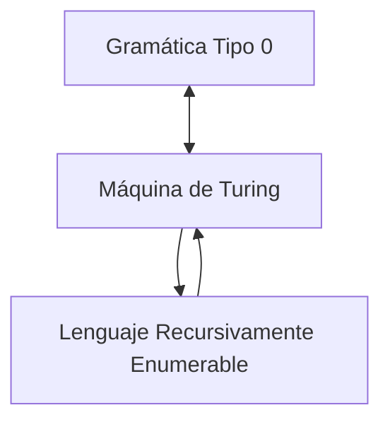
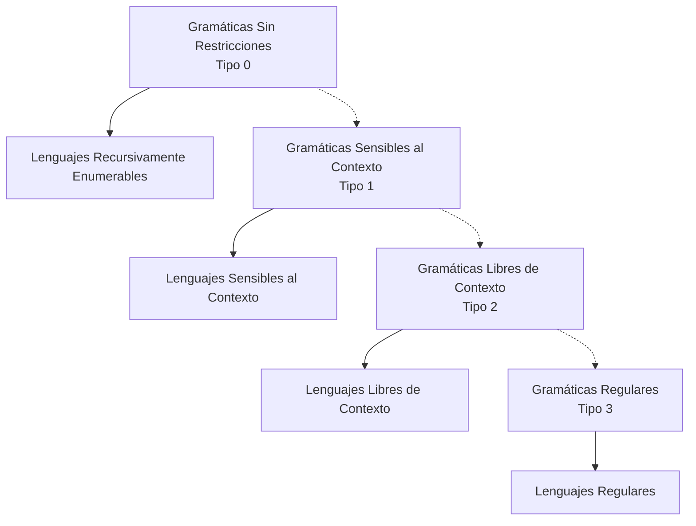

# Autómatas y Lenguajes Formales - La Jerarquía de Chomsky

## 6.2 Gramáticas sin restricciones.

---

Las gramáticas sin restricciones, también conocidas como gramáticas de tipo 0 en la Jerarquía de Chomsky, representan el modelo más general de gramática formal. Estas gramáticas generan exactamente los lenguajes recursivamente enumerables, que corresponden a lo que las máquinas de Turing pueden aceptar.

### Definición Formal

#### Gramática Irrestricta

Una **gramática sin restricciones** (tipo 0) es una 4-tupla $G = (V, \Sigma, P, S)$ donde:

- $V$ es un alfabeto de variables o no terminales
- $\Sigma$ es un alfabeto de terminales ( $V \cap \Sigma = \emptyset$ )
- $P$ es un conjunto de reglas de producción de la forma $\alpha \rightarrow \beta$
- $S \in V$ es el símbolo inicial

Donde $\alpha, \beta \in (V \cup \Sigma)^*$ y la única restricción es que $\alpha$ no puede ser la cadena vacía $\epsilon.$

#### Lenguaje Generado

El lenguaje generado por una gramática $G$ es:

$$L(G) = \{w \in \Sigma^* \mid S \Rightarrow^* w\}$$

### Características de las Producciones

En las gramáticas tipo 0, las producciones tienen la forma:

$$\alpha \rightarrow \beta$$

donde:

- $\alpha \in (V \cup \Sigma)^+$ (no puede ser ε)
- $\beta \in (V \cup \Sigma)^*$ (puede ser ε)

#### Ejemplo de Producciones Válidas

1. $aBc \rightarrow DeF$
2. $AB \rightarrow C$
3. $S \rightarrow aSb$
4. $aS \rightarrow \epsilon$

#### Ejemplo de Producciones No Válidas

1. $\epsilon \rightarrow A$ (No permitida: α no puede ser ε)

### Equivalencia con Máquinas de Turing

#### Teorema Fundamental

**Un lenguaje es recursivamente enumerable si y sólo si es generado por una gramática sin restricciones.**



#### Construcción de la Equivalencia

Para convertir una MT $M$ a una gramática $G$ equivalente:

1. Simular la computación de $M$ usando la gramática
2. Las producciones representan transiciones de la MT
3. La derivación simula el movimiento del cabezal y cambios de estado

Para convertir una gramática $G$ a una MT $M$ equivalente:

1. $M$ no determinísticamente genera derivaciones de $G$
2. Si deriva la cadena de entrada, acepta

### Ejemplos de Gramáticas Sin Restricciones

#### Ejemplo 1: Lenguaje $a^n b^n c^n$

Gramática para $L = \{a^n b^n c^n \mid n \geq 0\}:$

$$
\begin{aligned}
S &\rightarrow \epsilon \mid aSBC \mid aBC \\
CB &\rightarrow BC \\
aB &\rightarrow ab \\
bB &\rightarrow bb \\
bC &\rightarrow bc \\
cC &\rightarrow cc \\
\end{aligned}
$$

**Derivación de $a^2 b^2 c^2$:**

$$ S \Rightarrow aSBC \Rightarrow aaBCBC \Rightarrow aaBBCC \Rightarrow aabBCC \Rightarrow aabbCC \Rightarrow aabbcC \Rightarrow aabbcc $$

#### Ejemplo 2: Duplicación de Cadena

Gramática para $L = \{ww \mid w \in \{a, b\}^*\}:$

$$
\begin{aligned}
S &\rightarrow \epsilon \mid aSA \mid bSB \\
A &\rightarrow a \\
B &\rightarrow b \\
\end{aligned}
$$

### Propiedades de Clausura

Los lenguajes tipo 0 son cerrados bajo:

- **Unión**: $L_1 \cup L_2$
- **Concatenación**: $L_1 \cdot L_2$
- **Clausura de Kleene**: $L^*$
- **Intersección**: $L_1 \cap L_2$
- **Homomorfismo**: $h(L)$

**No son cerrados bajo complemento**: $\overline{L}$ no necesariamente es tipo 0.

### Limitaciones y Problemas Indecidibles

#### Problema de la Parada para Gramáticas

Dada una gramática $G$ y una cadena $w,$ determinar si $w \in L(G)$ es:

- **Semidecidible**: Existe un algoritmo que dice "sí" si $w \in L(G)$
- **No decidible**: No existe algoritmo que siempre termine para $w \notin L(G)$

#### Otros Problemas Indecidibles

1. ¿Es $L(G) = \emptyset?$
2. ¿Es $L(G) = \Sigma^*?$
3. ¿Es $L(G_1) = L(G_2)?$
4. ¿Es $L(G_1) \subseteq L(G_2)?$

### Aplicaciones Prácticas

#### En Lingüística Computacional

- Modelado de fenómenos lingüísticos complejos
- Estructuras de dependencia no locales

#### En Procesamiento de Lenguaje Natural

- Análisis sintáctico de oraciones complejas
- Sistemas de traducción automática

#### En Programación

- Análisis de programas con características avanzadas
- Sistemas de transformación de código

### Implementación Computacional

#### Algoritmo de Análisis Sintáctico (Parsing)

```python
def parse(grammar, input_string, max_derivations=1000):
    """
    Algoritmo de parsing no determinístico para gramáticas tipo 0
    """
    derivations = [('S',)]  # Comenzar con el símbolo inicial
    visited = set()

    for _ in range(max_derivations):
        new_derivations = []

        for sentential_form in derivations:
            if sentential_form in visited:
                continue
            visited.add(sentential_form)

            # Si encontramos la cadena de entrada, retornar éxito
            if ''.join(sentential_form) == input_string:
                return True

            # Aplicar todas las producciones posibles
            for i in range(len(sentential_form)):
                for production in grammar.productions:
                    left, right = production
                    if sentential_form[i:i+len(left)] == tuple(left):
                        new_form = (sentential_form[:i] +
                                   tuple(right) +
                                   sentential_form[i+len(left):])
                        new_derivations.append(new_form)

        if not new_derivations:
            break

        derivations = new_derivations

    return False  # No se pudo derivar la cadena (puede ser por límite de iteraciones)
```

### Ejercicios Propuestos

#### Ejercicio 1: Diseño de Gramática

Diseña una gramática sin restricciones para el lenguaje:

$$L = \{a^{2^n} \mid n \geq 0\} = \{a, aa, aaaa, aaaaaaaa, \ldots\}$$

#### Ejercicio 2: Derivación

Para la gramática del ejemplo $a^n b^n c^n,$ muestra la derivación completa de la cadena "abc".

#### Ejercicio 3: Propiedades

Demuestra que la clase de lenguajes tipo 0 es cerrada bajo la operación de unión.

#### Ejercicio 4: Problema de Decisión

Explica por qué el problema de determinar si $L(G) = \emptyset$ para una gramática tipo 0 $G$ es indecidible.

#### Ejercicio 5: Conversión

Describe cómo convertirías una máquina de Turing que acepta un lenguaje $L$ en una gramática tipo 0 que genera $L.$

### Soluciones a Ejercicios Selectos

#### Solución Ejercicio 2: Derivación de "abc"

$$ S \Rightarrow aBC \Rightarrow abC \Rightarrow abc $$

#### Solución Ejercicio 3: Clausura bajo Unión

Dadas dos gramáticas $G_1 = (V_1, \Sigma, P_1, S_1)$ y $G_2 = (V_2, \Sigma, P_2, S_2)$ con $V_1 \cap V_2 = \emptyset,$ construimos:

$$G = (V_1 \cup V_2 \cup \{S\}, \Sigma, P_1 \cup P_2 \cup \{S \rightarrow S_1, S \rightarrow S_2\}, S)$$

Claramente, $L(G) = L(G_1) \cup L(G_2).$

### Diagrama de la Jerarquía de Chomsky



### Referencias Bibliográficas

1. **Viso G., E.**, _Introducción a la teoría de la computación_. Las Prensas de Ciencias, 2008. (Capítulo 7)
2. **Rich, E.**, _Automata, Computability and Complexity_. Pearson Prentice Hall, 2008. (Capítulo 9)
3. **Hopcroft, J. E., Motwani, R., and Ullman, J.**, _Introduction to Automata Theory, Languages, and Computation_. Addison-Wesley, 2007. (Capítulo 7)
4. **Sipser, M.**, _Introduction to the Theory of Computation_. PWS Publishing, 2005. (Capítulo 3)

### Recursos Adicionales

- Simuladores de máquinas de Turing para visualizar la equivalencia
- Herramientas para experimentar con gramáticas tipo 0
- Casos de estudio de fenómenos lingüísticos que requieren gramáticas sin restricciones
