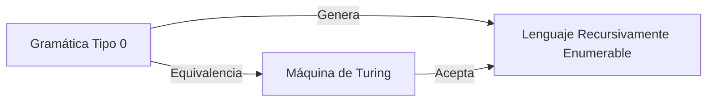
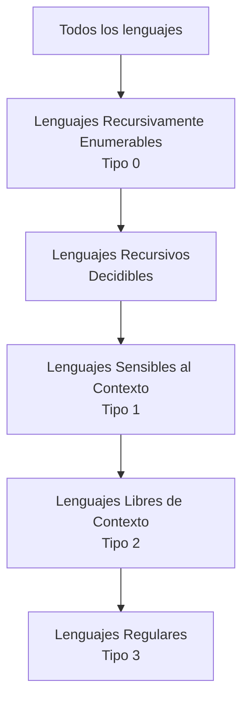

# Autómatas y Lenguajes Formales - La Jerarquía de Chomsky

## 6.3 Lenguajes generales y máquinas de Turing.

---

Los lenguajes generales o tipo 0 en la Jerarquía de Chomsky representan la clase más amplia de lenguajes formales. Estos lenguajes están caracterizados por las máquinas de Turing, el modelo de computación más general que existe. Esta guía explora la relación fundamental entre lenguajes generales y máquinas de Turing.

### Máquinas de Turing: Definición Formal

#### Definición Matemática

Una **máquina de Turing** (MT) es una 7-tupla:

$$M = (Q, \Sigma, \Gamma, \delta, q_0, q_{accept}, q_{reject})$$

Donde:

- $Q:$ Conjunto finito de estados
- $\Sigma:$ Alfabeto de entrada ( $\Sigma \subseteq \Gamma \setminus \{B\}$ )
- $\Gamma:$ Alfabeto de la cinta ( incluye el símbolo blanco $B$ )
- $\delta:$ Función de transición $\delta: Q \times \Gamma \rightarrow Q \times \Gamma \times \{L, R\}$
- $q_0 \in Q:$ Estado inicial
- $q_{accept} \in Q:$ Estado de aceptación
- $q_{reject} \in Q:$ Estado de rechazo $(q_{accept} \neq q_{reject})$

#### Configuración de una MT

Una **configuración** instantánea de una MT se representa como:

$$u \; q \; v$$

donde:

- $uv$ es el contenido de la cinta
- $q$ es el estado actual
- La cabeza lee el primer símbolo de $v$

### Lenguajes Recursivamente Enumerables

#### Definición

Un lenguaje $L$ es **recursivamente enumerable** (tipo 0) si existe una máquina de Turing $M$ tal que:

$$L = L(M) = \{w \in \Sigma^* \mid M \text{ acepta } w\}$$

**Nota:** Para $w \notin L,$ $M$ puede rechazar o no terminar (ciclar infinitamente).

#### Equivalencia con Gramáticas Tipo 0

**Teorema:** Un lenguaje es recursivamente enumerable si y sólo si es generado por una gramática sin restricciones (tipo 0).



### Lenguajes Recursivos o Decidibles

#### Definición

Un lenguaje $L$ es **recursivo** o **decidible** si existe una máquina de Turing $M$ que:

1. Acepta todas las cadenas $w \in L$
2. Rechaza todas las cadenas $w \notin L$
3. Siempre se detiene (para cualquier entrada)

#### Relación entre Clases

$$Recursivos \subsetneq Recursivamente\;Enumerables$$

### Ejemplos de Lenguajes y sus Máquinas de Turing

#### Ejemplo 1: Lenguaje $a^nb^nc^n$

**Máquina de Turing para $L = \{a^nb^nc^n \mid n \geq 0\}$:**

```python
# Pseudocódigo para MT que decide a^n b^n c^n
def mt_anbncn(cinta):
    # Reemplazar a por X, b por Y, c por Z de izquierda a derecha
    estado = 'q0'
    cabeza = 0

    while estado != 'accept' and estado != 'reject':
        if estado == 'q0':
            if cinta[cabeza] == 'a':
                cinta[cabeza] = 'X'
                cabeza += 1
            elif cinta[cabeza] == 'Y':
                estado = 'q3'
                cabeza += 1
            else:
                estado = 'reject'

        elif estado == 'q1':
            if cinta[cabeza] == 'a':
                cabeza += 1
            elif cinta[cabeza] == 'Y':
                cabeza += 1
            elif cinta[cabeza] == 'b':
                cinta[cabeza] = 'Y'
                cabeza += 1
                estado = 'q2'
            else:
                estado = 'reject'

        # ... más estados ...

        elif estado == 'q_accept':
            return True

        elif estado == 'q_reject':
            return False

    return estado == 'accept'
```

#### Ejemplo 2: Problema de la Parada

El lenguaje del **problema de la parada** es el ejemplo clásico de lenguaje RE no recursivo:

$$H = \{\langle M, w \rangle \mid M \text{ es una MT que se detiene con entrada } w\}$$

### Propiedades de Clausura

#### Lenguajes Recursivamente Enumerables

- (✓) Cerrados bajo: Unión, Intersección, Concatenación, Clausura de Kleene
- (X) NO cerrados bajo: Complemento

#### Lenguajes Recursivos

- (✓) Cerrados bajo: Unión, Intersección, Concatenación, Clausura de Kleene, Complemento

### Problemas Indecidibles

#### Teorema de Rice

**Todo propiedad no trivial de los lenguajes recursivamente enumerables es indecidible.**

Ejemplos de problemas indecidibles:

1. ¿$L(M) = \emptyset?$
2. ¿$L(M) = \Sigma^*?$
3. ¿$L(M)$ es finito?
4. ¿$L(M_1) = L(M_2)?$

### Implementación de una Máquina de Turing

```python
class MaquinaTuring:
    def __init__(self, estados, alfabeto, cinta_alfabeto, transiciones,
                 estado_inicial, estado_aceptar, estado_rechazar):
        self.estados = estados
        self.alfabeto = alfabeto
        self.cinta_alfabeto = cinta_alfabeto
        self.transiciones = transiciones  # Dict: (estado, simbolo) -> (nuevo_estado, nuevo_simbolo, movimiento)
        self.estado_inicial = estado_inicial
        self.estado_aceptar = estado_aceptar
        self.estado_rechazar = estado_rechazar

    def ejecutar(self, entrada, max_pasos=1000):
        cinta = list(entrada) + ['B']  # B representa blanco
        estado_actual = self.estado_inicial
        posicion = 0
        pasos = 0

        while estado_actual not in [self.estado_aceptar, self.estado_rechazar] and pasos < max_pasos:
            simbolo_actual = cinta[posicion]
            clave = (estado_actual, simbolo_actual)

            if clave not in self.transiciones:
                return False, pasos  # Rechaza

            nuevo_estado, nuevo_simbolo, movimiento = self.transiciones[clave]

            # Actualizar cinta y posición
            cinta[posicion] = nuevo_simbolo
            if movimiento == 'R':
                posicion += 1
                if posicion >= len(cinta):
                    cinta.append('B')
            elif movimiento == 'L':
                posicion = max(0, posicion - 1)

            estado_actual = nuevo_estado
            pasos += 1

        return estado_actual == self.estado_aceptar, pasos
```

### Ejercicios Propuestos

#### Ejercicio 1: Diseño de MT

Diseña una máquina de Turing que decida el lenguaje:

$$L = \{w \in \{0, 1\}^* \mid w \text{ contiene igual número de 0s y 1s}\}$$

#### Ejercicio 2: Clasificación

Clasifica los siguientes lenguajes como recursivos, RE no recursivos, o no RE:

1. $\lbrace \langle M \rangle \mid M \text{ acepta al menos 5 cadenas} \rbrace$
2. $\lbrace \langle M \rangle \mid M \text{ no acepta ninguna cadena} \rbrace$
3. $\lbrace \langle M \rangle \mid M \text{ se detiene en a lo más 100 pasos para }\epsilon\rbrace$

#### Ejercicio 3: Demostración

Demuestra que si $L$ es recursivo, entonces $\overline{L}$ también es recursivo.

#### Ejercicio 4: Construcción

Construye una MT que compute la función $f(n) = n + 1$ para números naturales representados en binario.

#### Ejercicio 5: Análisis

Explica por qué el siguiente lenguaje es RE pero no recursivo:

$$L = \{\langle M \rangle \mid M \text{ acepta alguna cadena de longitud par}\}$$

### Soluciones a Ejercicios Selectos

#### Solución Ejercicio 3

**Demostración:** Si $L$ es recursivo, existe una MT $M$ que siempre se detiene y decide $L.$ Construimos una MT $M'$ que decide $\overline{L}:$

$M'$ con entrada $w:$

1. Ejecuta $M$ con entrada $w$
2. Si $M$ acepta, $M'$ rechaza
3. Si $M$ rechaza, $M'$ acepta

Como $M$ siempre se detiene, $M'$ también siempre se detiene y decide $\overline{L}$ correctamente. Por lo tanto, $\overline{L}$ es recursivo.

### Diagrama de Relaciones entre Clases



### Referencias Bibliográficas

1. **Viso G., E.**, _Introducción a la teoría de la computación_. Las Prensas de Ciencias, 2008. (Capítulos 5-7)
2. **Rich, E.**, _Automata, Computability and Complexity_. Pearson Prentice Hall, 2008. (Capítulos 9-11)
3. **Sipser, M.**, _Introduction to the Theory of Computation_. PWS Publishing, 2005. (Capítulos 3-4)
4. **Hopcroft, J. E., et al.**, _Introduction to Automata Theory, Languages, and Computation_. Addison-Wesley, 2007. (Capítulos 8-9)

### Recursos Adicionales

- Simuladores de máquinas de Turing online
- Visualizadores de la jerarquía de Chomsky
- Problemas de práctica sobre reducibilidad y completitud
