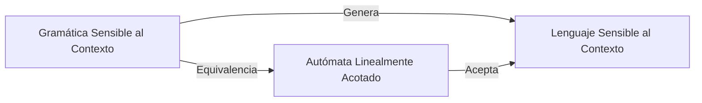
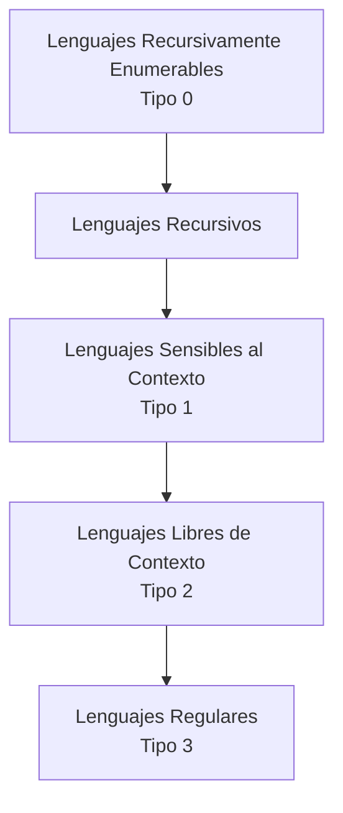

# Autómatas y Lenguajes Formales - La Jerarquía de Chomsky

## 6.4 Lenguajes dependientes del contexto y autómatas linealmente acotados.

---

Los lenguajes sensibles al contexto (tipo 1 en la Jerarquía de Chomsky) representan una clase importante de lenguajes formales que son más expresivos que los lenguajes libres de contexto pero menos que los lenguajes recursivamente enumerables. Estos lenguajes están caracterizados por los autómatas linealmente acotados.

### Definición Formal

#### Gramática Sensible al Contexto

Una **gramática sensible al contexto** (GSC) es una 4-tupla $G = (V, \Sigma, P, S)$ donde:

- $V$ es un conjunto finito de variables (no terminales)
- $\Sigma$ es un conjunto finito de terminales ( $V \cap \Sigma = \emptyset$ )
- $P$ es un conjunto finito de reglas de producción de la forma:
  - $\alpha A \beta \rightarrow \alpha \gamma \beta$ donde $A \in V$, $\alpha, \beta \in (V \cup \Sigma)^*$, $\gamma \in (V \cup \Sigma)^+$
  - O equivalentemente: $\alpha \rightarrow \beta$ donde $|\alpha| \leq |\beta|$ y $\alpha \in (V \cup \Sigma)^+$, $\beta \in (V \cup \Sigma)^*$
- $S \in V$ es el símbolo inicial

**Excepción:** Se permite $S \rightarrow \epsilon$ siempre que $S$ no aparezca en el lado derecho de ninguna producción.

#### Lenguaje Generado

El lenguaje generado por una gramática $G$ es:

$$L(G) = \{w \in \Sigma^* \mid S \Rightarrow^* w\}$$

### Autómata Linealmente Acotado (ALA)

#### Definición Formal

Un **autómata linealmente acotado** es una 6-tupla $M = (Q, \Sigma, \Gamma, \delta, q_0, F)$ donde:

- $Q$: Conjunto finito de estados
- $\Sigma$: Alfabeto de entrada
- $\Gamma$: Alfabeto de la cinta ( $\Sigma \subseteq \Gamma$, incluye símbolos especiales )
- $\delta$: Función de transición $Q \times \Gamma \rightarrow Q \times \Gamma \times \{L, R, S\}$
- $q_0 \in Q$: Estado inicial
- $F \subseteq Q$: Estados de aceptación

**Restricción:** El autómata solo puede usar el espacio ocupado por la entrada inicial (espacio lineal).

#### Equivalencia Fundamental

**Teorema:** Un lenguaje es sensible al contexto si y sólo si es aceptado por un autómata linealmente acotado.



### Ejemplos y Aplicaciones

#### Ejemplo 1: Lenguaje $a^nb^nc^n$

Gramática sensible al contexto para $L = \{a^nb^nc^n \mid n \geq 1\}$:

$$ \begin{aligned} S &\rightarrow aSBC \mid aBC \\\ CB &\rightarrow BC \\\ aB &\rightarrow ab \\\ bB &\rightarrow bb \\\ bC &\rightarrow bc \\\ cC &\rightarrow cc \\\ \end{aligned} $$

**Derivación de $a^2b^2c^2$:**

$$ S \Rightarrow aSBC \Rightarrow aaBCBC \Rightarrow aaBBCC \Rightarrow aabBCC \Rightarrow aabbCC \Rightarrow aabbcC \Rightarrow aabbcc $$

#### Ejemplo 2: Lenguaje $ww$

Gramática para $L = \{ww \mid w \in \{a, b\}^+\}$:

$$ \begin{aligned} S &\rightarrow aSA \mid bSB \mid T \\\ TA &\rightarrow aT \\\ TB &\rightarrow bT \\\ T &\rightarrow \epsilon \\\ \end{aligned} $$

### Propiedades de los Lenguajes Sensibles al Contexto

#### Propiedades de Clausura

Los lenguajes sensibles al contexto son cerrados bajo:

- **Unión**: $L_1 \cup L_2$
- **Concatenación**: $L_1 \cdot L_2$
- **Intersección**: $L_1 \cap L_2$
- **Clausura de Kleene**: $L^*$
- **Complemento**: $\overline{L}$ (teorema de Immerman-Szelepcsényi)

**No son cerrados bajo homomorfismo arbitrario.**

#### Relación con Otras Clases

$$Regular \subsetneq Libre\;de\;Contexto \subsetneq Sensible\;al\;Contexto \subsetneq Recursivo$$

### Problemas de Decisión

#### Problemas Decidibles

Para lenguajes sensibles al contexto:

- **Membresía**: $w \in L$ (decidible en tiempo polinomial no determinístico)
- **Vacuidad**: $L = \emptyset$ (decidible)
- **Finitud**: $L$ es finito (decidible)

#### Problemas Indecidibles

- **Equivalencia**: $L(G_1) = L(G_2)$ (indecidible)
- **Inclusión**: $L(G_1) \subseteq L(G_2)$ (indecidible)

### Implementación de un Autómata Linealmente Acotado

```python
class AutomataLinealmenteAcotado:
    def __init__(self, estados, alfabeto, cinta_alfabeto, transiciones,
                 estado_inicial, estados_aceptacion):
        self.estados = estados
        self.alfabeto = alfabeto
        self.cinta_alfabeto = cinta_alfabeto
        self.transiciones = transiciones  # Dict: (estado, simbolo) -> [(nuevo_estado, nuevo_simbolo, movimiento)]
        self.estado_inicial = estado_inicial
        self.estados_aceptacion = estados_aceptacion

    def ejecutar(self, entrada, max_pasos=10000):
        # Configuración inicial
        cinta = ['#'] + list(entrada) + ['#']  # Marcadores de inicio/fin
        estado_actual = self.estado_inicial
        posicion = 1  # Empezar en el primer símbolo de la entrada
        pasos = 0

        while estado_actual not in self.estados_aceptacion and pasos < max_pasos:
            simbolo_actual = cinta[posicion]
            clave = (estado_actual, simbolo_actual)

            if clave not in self.transiciones:
                return False, pasos  # Rechaza

            # Elegir transición no determinísticamente
            transiciones_posibles = self.transiciones[clave]
            # En implementación real, se explorarían todas las ramas no determinísticas
            nuevo_estado, nuevo_simbolo, movimiento = transiciones_posibles[0]

            # Actualizar cinta
            cinta[posicion] = nuevo_simbolo

            # Mover cabeza
            if movimiento == 'R':
                posicion += 1
            elif movimiento == 'L':
                posicion -= 1
            # 'S' significa quedarse en la misma posición

            # Verificar límites de la cinta
            if posicion < 0 or posicion >= len(cinta):
                return False, pasos

            estado_actual = nuevo_estado
            pasos += 1

        return estado_actual in self.estados_aceptacion, pasos
```

### Aplicaciones Prácticas

#### En Lingüística Computacional

- Modelado de dependencias sintácticas de largo alcance
- Análisis de lenguajes naturales con concordancia compleja

#### En Verificación de Programas

- Análisis de programas con estructuras de datos anidadas
- Verificación de propiedades de sistemas con recursos limitados

#### En Bioinformática

- Análisis de secuencias genéticas con patrones complejos
- Modelado de estructuras secundarias de proteínas

### Ejercicios Propuestos

#### Ejercicio 1: Diseño de Gramática

Diseña una gramática sensible al contexto para el lenguaje:

$$L = \{a^nb^mc^nd^m \mid n, m \geq 1\}$$

#### Ejercicio 2: Construcción de ALA

Diseña un autómata linealmente acotado que acepte el lenguaje:

$$L = \{w \in \{a, b, c\}^* \mid |w|_a = |w|_b = |w|_c\}$$

#### Ejercicio 3: Propiedades

Demuestra que la clase de lenguajes sensibles al contexto es cerrada bajo concatenación.

#### Ejercicio 4: Análisis

¿El lenguaje $\{a^nb^nc^nd^n \mid n \geq 1\}$ es sensible al contexto? Justifica tu respuesta.

#### Ejercicio 5: Implementación

Implementa en Python la gramática del ejemplo $a^nb^nc^n$ y verifica su funcionamiento con varias cadenas.

### Soluciones a Ejercicios Selectos

#### Solución Ejercicio 3: Clausura bajo Concatenación

**Demostración:** Dadas dos gramáticas sensibles al contexto $G_1 = (V_1, \Sigma, P_1, S_1)$ y $G_2 = (V_2, \Sigma, P_2, S_2)$ con $V_1 \cap V_2 = \emptyset$, construimos:

$G = (V_1 \cup V_2 \cup \{S\}, \Sigma, P_1 \cup P_2 \cup \{S \rightarrow S_1S_2\}, S)$

Como $|S_1S_2| \geq |S| = 1$, la producción $S \rightarrow S_1S_2$ cumple con $|\alpha| \leq |\beta|$. Claramente, $L(G) = L(G_1) \cdot L(G_2)$.

### Diagrama de la Jerarquía de Chomsky



### Referencias Bibliográficas

1. **Viso G., E.**, _Introducción a la teoría de la computación_. Las Prensas de Ciencias, 2008. (Capítulo 6)
2. **Rich, E.**, _Automata, Computability and Complexity_. Pearson Prentice Hall, 2008. (Capítulo 10)
3. **Hopcroft, J. E., et al.**, _Introduction to Automata Theory, Languages, and Computation_. Addison-Wesley, 2007. (Capítulo 8)
4. **Sipser, M.**, _Introduction to the Theory of Computation_. PWS Publishing, 2005. (Capítulo 8)

### Recursos Adicionales

- Visualizadores de autómatas linealmente acotados
- Herramientas para experimentar con gramáticas sensibles al contexto
- Casos de estudio de aplicaciones en procesamiento de lenguaje natural
