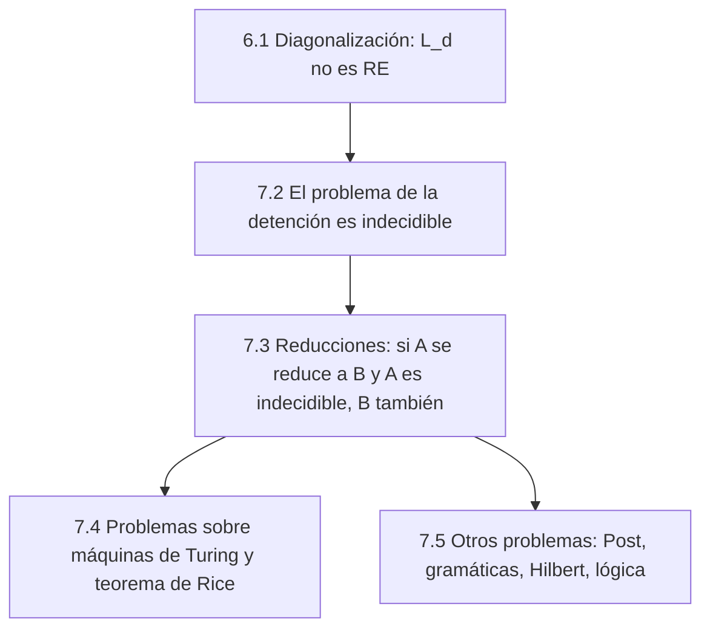

# Autómatas y Lenguajes Formales - Introducción a decidibilidad

## 7.1 Significado de "indecidibilidad".

---

Que un problema sea **indecidible** no significa que sea difícil, ni que nadie haya encontrado todavía cómo resolverlo, ni que ciertas instancias no se puedan responder. Significa algo preciso y más fuerte: **no existe ningún algoritmo** que responda correctamente a **todas** sus instancias. Este tema fija el significado del término, lo distingue de nociones parecidas y presenta el panorama del capítulo.

### Problemas de decisión como lenguajes

Un **problema de decisión** es una pregunta de sí o no con un parámetro: si un número $n$ es primo, si una gramática $G$ genera una cadena $w,$ si un programa $P$ se detiene con una entrada $x.$ Cada valor del parámetro es una **instancia**. Codificando las instancias como cadenas, el problema se convierte en el lenguaje de las instancias con respuesta sí:

$$ \text{PRIMOS} = \{\langle n \rangle \mid n \text{ es primo}\}, \qquad A_{MT} = \{\langle M, w \rangle \mid M \text{ acepta } w\} $$

Con esta traducción, las clases del tema 6.1 se aplican a los problemas:

| El problema es | Si su lenguaje es | Significa |
| --- | --- | --- |
| **Decidible** | recursivo | un algoritmo responde sí o no a toda instancia |
| **Semidecidible** | recursivamente enumerable | un procedimiento responde sí cuando la respuesta es sí; si es no, puede no terminar |
| **Indecidible** | no recursivo | ningún algoritmo responde correctamente a todas las instancias |

Un problema indecidible puede ser semidecidible, como $A_{MT},$ o ni siquiera eso, como su complemento.

### Lo que la indecidibilidad no significa

- **No es dificultad.** Hay problemas decidibles extremadamente costosos, como decidir la validez en la aritmética de Presburger, que requiere tiempo doblemente exponencial. Siguen siendo decidibles: el algoritmo existe.
- **No es ignorancia.** Una pregunta sola, sin parámetro, siempre es decidible, aunque no sepamos la respuesta. "¿Es cierta la conjetura de Goldbach?" lo decide **alguna** de dos máquinas triviales: la que siempre responde sí o la que siempre responde no. No sabemos cuál, pero existe. La indecidibilidad solo tiene sentido para familias **infinitas** de instancias.
- **No afecta a cada instancia por separado.** Para muchos programas concretos se puede demostrar que se detienen o que no. Lo indecidible es tener **un solo** método que funcione para todos.
- **No depende del modelo.** Por la tesis de Church-Turing, si ninguna máquina de Turing decide un problema, tampoco lo decide ningún programa en ningún lenguaje, ni ninguna computadora futura, mientras sea un procedimiento mecánico.

### Por qué no basta con esperar

Para saber si un programa se detiene, la idea natural es ejecutarlo. Si se detiene, se sabe la respuesta. Pero si no se ha detenido después de un millón de pasos, ¿hay que esperar más o declararlo un ciclo infinito? Cualquier límite de paciencia fallará con algún programa que se detiene un paso después del límite. Ejecutar da un **semialgoritmo**: responde sí correctamente, y no responde nunca en los demás casos.

Un ejemplo célebre es la conjetura de **Collatz**: el programa que, empezando en $n,$ divide entre 2 si $n$ es par y calcula $3n + 1$ si es impar, ¿llega siempre a 1? Se ha verificado para todos los $n$ hasta más de $10^{20},$ pero nadie sabe demostrarlo. Esto no prueba que el problema sea indecidible (es una sola pregunta, así que es decidible en el sentido trivial), pero muestra que ejecutar un programa no basta para saber si termina.

### El mapa del capítulo



1. Con un argumento diagonal se demuestra que el **problema de la detención** es indecidible (tema 7.2).
2. Con **reducciones**, la indecidibilidad se transfiere a otros problemas: si resolver $B$ permitiría resolver un problema indecidible $A,$ entonces $B$ también es indecidible (tema 7.3).
3. El **teorema de Rice** generaliza: toda propiedad no trivial del **lenguaje** que reconoce una máquina es indecidible (tema 7.4).
4. La indecidibilidad aparece en problemas que no hablan de máquinas: palabras de Post, gramáticas libres de contexto, ecuaciones diofánticas, lógica de primer orden (tema 7.5).

### Implementación en Python

El programa ejecuta las sucesiones de Collatz para algunos valores y luego simula programas con un **límite de paciencia**, contando las líneas que ejecuta Python. Cuando el programa termina antes del límite, la respuesta es segura; cuando no, la respuesta es "no sé".

```python
def collatz(n):
    """Programa cuya terminación con cualquier n >= 1 es un problema abierto (conjetura de Collatz)."""
    pasos = 0
    while n != 1:
        n = n // 2 if n % 2 == 0 else 3 * n + 1
        pasos += 1
    return pasos

def ciclo(n):
    """Programa que nunca termina si n es par."""
    while n % 2 == 0:
        pass
    return 0

def con_paciencia(programa, entrada, limite):
    """Simula a lo más `limite` pasos. Si termina antes, la respuesta 'se detiene' es segura;
    si no, solo se sabe que no ha terminado TODAVÍA."""
    import sys
    pasos = 0
    def contar(frame, evento, arg):
        nonlocal pasos
        pasos += 1
        if pasos > limite:
            raise TimeoutError
        return contar
    sys.settrace(contar)
    try:
        programa(entrada)
        return "se detiene"
    except TimeoutError:
        return "¿?"
    finally:
        sys.settrace(None)

print([(n, collatz(n)) for n in (6, 7, 27, 97)])
for prog, x in [(collatz, 27), (collatz, 97), (ciclo, 3), (ciclo, 4)]:
    print(f"{prog.__name__}({x}):", con_paciencia(prog, x, 200), con_paciencia(prog, x, 5000))
```

Salida:

```text
[(6, 8), (7, 16), (27, 111), (97, 118)]
collatz(27): ¿? se detiene
collatz(97): ¿? se detiene
ciclo(3): se detiene se detiene
ciclo(4): ¿? ¿?
```

Con un límite pequeño, `collatz(27)` parece no terminar, pero con uno mayor termina. Con `ciclo(4)` ningún límite da la respuesta, porque realmente no termina, y desde fuera las dos situaciones se ven igual mientras no se agote la paciencia.

### Ejercicios Propuestos

1. **Instancias.** Explica por qué el problema "¿se detiene este programa específico con la entrada 0?" es decidible, aunque el problema de la detención no lo sea.

2. **Clasificación.** Clasifica como decidible, semidecidible no decidible o ni siquiera semidecidible:
   - a) ¿Contiene la cadena $w$ la subcadena $abba?$
   - b) ¿Acepta la MT $M$ la cadena $w?$
   - c) ¿Rechaza o cicla la MT $M$ con la cadena $w?$

3. **Depuradores.** Explica por qué no puede existir un depurador que detecte todos los ciclos infinitos de todos los programas, y qué hacen en la práctica las herramientas de análisis estático.

4. **Paciencia.** Demuestra que para cualquier límite $N$ existe un programa que se detiene después de más de $N$ pasos con la entrada vacía.

### Soluciones

**Ejercicio 1.** Una sola pregunta tiene una respuesta, sí o no, y una de las dos máquinas constantes la da. Que no sepamos cuál es irrelevante para la decidibilidad. Lo indecidible es la familia de todas las preguntas de ese tipo.

**Ejercicio 2.**

- a) Decidible: un AFD lo resuelve.
- b) Semidecidible y no decidible: la máquina universal acepta cuando $M$ acepta, y el problema es indecidible (tema 7.2).
- c) Ni siquiera semidecidible: es el complemento de $A_{MT},$ que es RE y no recursivo (tema 6.1).

**Ejercicio 3.** Un depurador así decidiría el problema de la detención: bastaría preguntarle si el programa tiene un ciclo infinito con esa entrada. Las herramientas reales son **conservadoras**: o detectan algunos ciclos y dejan pasar otros, o advierten de ciclos que no existen, o solo funcionan para clases restringidas de programas (por ejemplo, ciclos con contadores que solo crecen).

**Ejercicio 4.** El programa "cuenta hasta $N + 1$ y termina" se detiene después de más de $N$ pasos. Por eso ningún límite fijo de paciencia distingue a los programas que terminan de los que no.

### Referencias

1. Sipser, M., _Introduction to the Theory of Computation_. Cengage, 2013. Capítulo 4.
2. Hopcroft, J. E., Motwani, R., and Ullman, J., _Introduction to Automata Theory, Languages, and Computation_. Pearson, 2007. Capítulo 9.
3. Viso G., E., _Introducción a la teoría de la computación_. Las Prensas de Ciencias, 2008. Capítulo 7.
4. Lagarias, J. C. (ed.), _The Ultimate Challenge: The 3x+1 Problem_. AMS, 2010.
