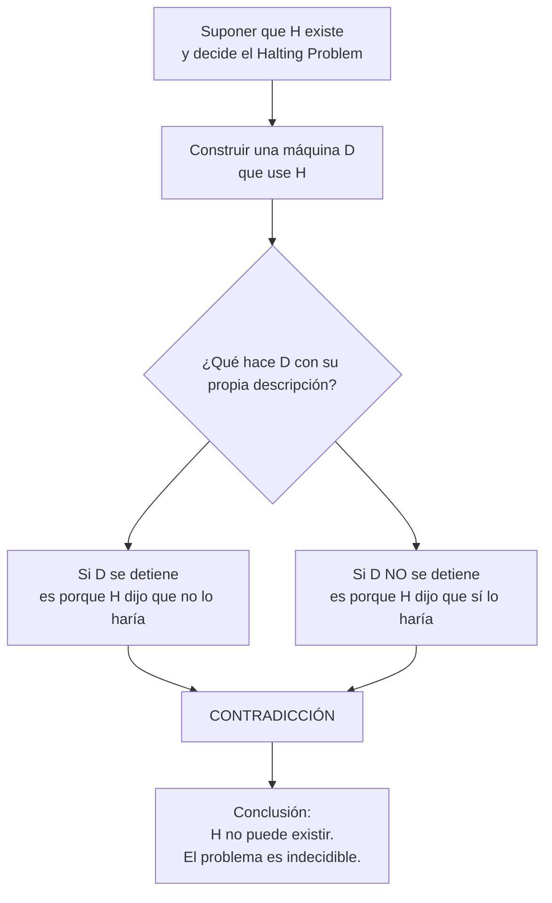

# Autómatas y Lenguajes Formales - Introducción a decidibilidad

## 7.1 Significado de "indecidibilidad".

---

### **1. Objetivo de Aprendizaje**

Al final de esta guía, serás capaz de:

- Definir formalmente el concepto de **indecidibilidad**.
- Diferenciar claramente entre un problema **decidible** y uno **indecidible**.
- Comprender las implicaciones prácticas de la indecidibilidad en la teoría de la computación y más allá.
- Identificar el problema indecidible más famoso: el **Problema de la Parada** (_Halting Problem_).

### **2. Revisión Conceptual: Decidibilidad**

Antes de entender la indecidibilidad, debemos recordar qué es un problema decidible.

Un problema de decisión es una pregunta de **sí o no** sobre una entrada infinita de cadenas. Un problema es **decidible** si existe una **Máquina de Turing (MT)** que lo resuelve. Formalmente:

> Un lenguaje $L$ es **decibible** (o recursivo) si existe una Máquina de Turing $M$ que se detiene para toda cadena de entrada $w$ y:
> 
>   $ w \in L \implies M \text{ acepta } w $
>
>   $ w \notin L \implies M \text{ rechaza } w $
>
> Es decir, $M$ siempre da una respuesta ("sí" o "no") en un tiempo finito.

**Ejemplo Decidible:** El lenguaje $L = \{ w \in \{a, b\}^* \mid w \text{ contiene la subcadena "abba"} \}$ es decidible. Una MT puede recorrer la cadena, buscar el patrón "abba" y aceptar o rechazar en base a su presencia o ausencia.

### **3. Definición de Indecidibilidad**

La **indecidibilidad** es la propiedad de un problema para el cual es **imposible** construir un algoritmo (representado por una Máquina de Turing) que **siempre** proporcione una respuesta correcta (sí/no) en un tiempo finito para **todas** sus posibles entradas.

> Un lenguaje $L$ es **indecidible** si **no es decidible**. No existe ninguna Máquina de Turing $M$ que lo decida.

Esto no significa que el problema sea imposible de resolver para _algunas_ entradas específicas. Significa que no existe una única MT que sea capaz de manejar **cualquier** entrada arbitraria que le proporciones.

**Analogía:** No es que no puedas hornear _ningún_ pastel. Es que no existe una única receta que te permita hornear _cualquier_ tipo de pastel que alguien pueda imaginarse.

### **4. El Problema de la Parada (The Halting Problem)**

Es el ejemplo paradigmático y el primer problema que se demostró ser indecidible (Alan Turing, 1936).

**Problema:** Dado un programa (código de una MT) $P$ y una entrada $I$ para ese programa, ¿se detendrá $P$ al ejecutarse con $I$ o entrará en un bucle infinito?

**Definición Formal:** El lenguaje del Problema de la Parada es:

$$
HALT_{TM} = \{ \langle M, w \rangle \mid M \text{ es una MT y } M \text{ se detiene con la entrada } w \}
$$

**Teorema:** $HALT_{TM}$ es **indecidible**.

#### **Esquema de la Demostración (por contradicción):**

1.  **Suposición:** Supongamos que existe una MT $H$ que decide $HALT_{TM}$. $H(\langle M, w \rangle)$ acepta si $M$ se detiene con $w$, y rechaza si $M$ no se detiene (entra en loop).
2.  **Construcción:** Creamos una nueva MT $D$ (Diagonalizadora) que usa a $H$ como subrutina. $D$ toma como entrada la descripción de una MT $\langle M \rangle$ y hace lo siguiente:
    - Ejecuta $H(\langle M, \langle M \rangle \rangle)$ (pregunta si $M$ se detiene cuando se da a sí misma como entrada).
    - Si $H$ dice "sí" (se detiene), entonces $D$ entra en un bucle infinito.
    - Si $H$ dice "no" (no se detiene), entonces $D$ se detiene inmediatamente.
3.  **Contradicción:** ¿Qué pasa cuando le damos a $D$ su propia descripción como entrada, es decir, ejecutamos $D(\langle D \rangle)$?
    - Si $D$ se detiene con $\langle D \rangle$, significa que $H$ predijo que $D$ **no** se detendría. ¡Contradicción!
    - Si $D$ no se detiene con $\langle D \rangle$, significa que $H$ predijo que $D$ **sí** se detendría. ¡Contradicción!
4.  **Conclusión:** Nuestra suposición inicial (que $H$ existe) debe ser falsa. Por lo tanto, $HALT_{TM}$ es indecidible.

### **5. Implicaciones y Otros Problemas Indecidibles**

La indecidibilidad del Problema de la Parada tiene un efecto dominó. Se puede usar para demostrar que muchos otros problemas también son indecidibles mediante la técnica de **reducción**.

> Si un problema $A$ es indecidible, y podemos **reducir** $A$ a un problema $B$ ( es decir, resolver $B$ nos permitiría resolver $A$ ), entonces $B$ también debe ser indecidible.

**Ejemplos de problemas indecidibles:**

1.  **Problema de la Equivalencia:** Dadas dos MT $M_1$ y $M_2$, ¿aceptan el mismo lenguaje? ( $L(M_1) = L(M_2)$ ?).
2.  **Problema de la Pertenencia **$(A_{TM})$**:** Dada una MT $M$ y una cadena $w$, ¿acepta $M$ a $w$? ( $A_{TM} = \{ \langle M, w \rangle \mid M \text{ acepta } w \}$ ).
3.  **El Problema de la Terminación (_Termination Problem_):** ¿Terminará un programa dado con una entrada dada? (Muy relacionado al Halting Problem).
4.  **El Problema de Hilbert (10mo problema):** Dada una ecuación diofántica (polinómica con coeficientes enteros), ¿tiene solución entera?
5.  **Problema de la Verificación de Programas:** ¿Satisface un programa dado una especificación formal para _todas_ las entradas?

### **6. Ejercicios Propuestos**

1.  **Análisis Conceptual:** Explica con tus propias palabras por qué la indecidibilidad del Problema de la Parada implica que no puede existir un depurador de programas perfecto que detecte todos los bucles infinitos.
2.  **Investigación:** Busca y describe brevemente un problema indecidible que no sea el Problema de la Parada. Explica por qué es relevante en áreas como la compilación o la verificación de software.
3.  **Reducción (Avanzado):** Sabiendo que $A_{TM}$ (el problema de la pertenencia para MTs) es indecidible, ¿cómo podrías argumentar que el problema de la equivalencia de dos MTs también debe serlo? (Pista: Piensa en reducir $A_{TM}$ al problema de equivalencia).

### **7. Resumen**

- **Indecidible ≠ Difícil:** Un problema indecidible es aquel para el cual **no existe ningún algoritmo general** que lo resuelva para todas sus entradas, no solo uno que sea difícil de encontrar.
- **Origen:** La indecidibilidad surge de los límites fundamentales de la computación, establecidos por Alan Turing.
- **Implicación Práctica:** Existen preguntas bien definidas sobre programas de computadora que son **imposibles** de responder de manera automática y perfecta. Los ingenieros de software deben ser conscientes de estas limitaciones (e.g., en el diseño de compiladores o herramientas de verificación).
- **Método de Demostración:** La técnica principal para demostrar indecidibilidad es la **prueba por contradicción** y el uso de **reducciones** a partir de problemas ya conocidos como indecidibles ( como $HALT_{TM}$ o $A_{TM}$ ).

### **8. Referencias**

- **Viso G., E., Introducción a la teoría de la computación.** (2008). Capítulo sobre Máquinas de Turing y Computabilidad. Exposición fundamental para el curso.
- **Sipser, M., Introduction to the Theory of Computation.** (2005). Capítulo 4: "Decidibility". Explica el Halting Problem y las reducciones de forma muy clara.
- **Hopcroft, J. E., Motwani, R., and Ullman, J., Introduction to Automata Theory, Languages, and Computation.** (2007). Capítulo 9: "Undecidability". Tratamiento clásico y completo del tema.
- **Aho A.V., et al., Compilers: Principles, Techniques, & Tools.** (2007). Menciona problemas indecidibles en el contexto del análisis de código y la optimización de compiladores.
