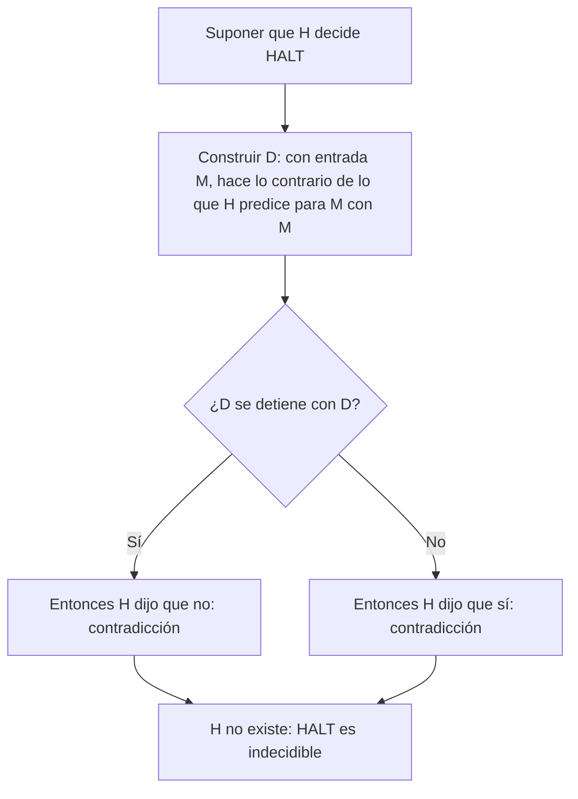

# Autómatas y Lenguajes Formales - Introducción a decidibilidad

## 7.2 El problema de la detención (Halting Problem).

---

El **problema de la detención** pregunta, dado un programa y una entrada, si el programa termina. Es la pregunta más natural que se puede hacer sobre un programa, y Turing demostró en 1936 que ningún algoritmo la responde en general. Este tema presenta la demostración, que es un argumento diagonal en el que la máquina hipotética se aplica a sí misma, y sus consecuencias inmediatas.

### Enunciado

Los dos lenguajes centrales son

$$ \text{HALT} = \{\langle M, w \rangle \mid M \text{ se detiene con la entrada } w\} $$

$$ A_{MT} = \{\langle M, w \rangle \mid M \text{ acepta } w\} = L_u $$

**Teorema (Turing, 1936).** HALT y $A_{MT}$ son recursivamente enumerables pero no recursivos.

Que sean RE es fácil: la máquina universal (tema 5.6) simula $M$ con $w$ y acepta si $M$ se detiene, para HALT, o si $M$ acepta, para $A_{MT}.$ Lo difícil es que no sean recursivos.

### La demostración

Supongamos, para llegar a una contradicción, que existe una máquina $H$ que **decide** HALT: con la entrada $\langle M, w \rangle,$ $H$ siempre se detiene, y acepta si $M$ se detiene con $w$ y rechaza si no.

**Paso 1: la máquina diagonal.** Con $H$ como subrutina se construye una máquina $D$ que, con la entrada $\langle M \rangle,$ hace lo siguiente:

1. Ejecuta $H$ con la entrada $\langle M, \langle M \rangle \rangle:$ pregunta si $M$ se detiene cuando recibe su propia descripción.
2. Si $H$ acepta, $D$ entra en un ciclo infinito.
3. Si $H$ rechaza, $D$ se detiene.

$D$ hace exactamente **lo contrario** de lo que $H$ predice que hará $M$ con su propia descripción.

**Paso 2: aplicar $D$ a sí misma.** ¿Se detiene $D$ con la entrada $\langle D \rangle?$

- Si se detiene, es porque en el paso 3 $H$ rechazó $\langle D, \langle D \rangle \rangle,$ es decir, $H$ dijo que $D$ **no** se detiene con $\langle D \rangle.$ Como $H$ es correcta, $D$ no se detiene. Contradicción.
- Si no se detiene, es porque en el paso 2 $H$ aceptó, es decir, dijo que $D$ **sí** se detiene con $\langle D \rangle.$ Contradicción.

**Paso 3: conclusión.** Ambas posibilidades son imposibles, así que la suposición es falsa: no existe $H.$ HALT no es recursivo. $\blacksquare$



**La diagonal.** En la tabla infinita cuyas filas son las máquinas $M_1, M_2, \ldots$ y cuyas columnas son sus códigos $\langle M_1 \rangle, \langle M_2 \rangle, \ldots,$ con una marca si $M_i$ se detiene con $\langle M_j \rangle,$ la máquina $D$ se comporta en la columna $j$ al revés que $M_j.$ Por eso no puede ser ninguna fila de la tabla; pero es una máquina de Turing, así que tendría que serlo. La única salida es que $H,$ con la que se construyó $D,$ no existe.

### $A_{MT}$ también es indecidible

El mismo argumento funciona con aceptar en lugar de detenerse. Supongamos que $H$ decide $A_{MT}.$ La máquina $D,$ con entrada $\langle M \rangle,$ ejecuta $H$ con $\langle M, \langle M \rangle \rangle$ y **acepta si $H$ rechaza y rechaza si $H$ acepta**; $D$ siempre se detiene. Entonces $D$ acepta $\langle D \rangle$ si y solo si $H$ dice que $D$ no acepta $\langle D \rangle,$ una contradicción. $\blacksquare$

Otra forma de verlo: $A_{MT}$ decidible implicaría que el lenguaje diagonal $L_d$ (tema 6.1) es decidible, porque $w_i \in L_d$ si y solo si $\langle M_i, w_i \rangle \notin A_{MT}.$ Pero $L_d$ ni siquiera es RE.

### Consecuencias

- **Complementos.** Como HALT y $A_{MT}$ son RE pero no recursivos, sus complementos **no son RE** (tema 6.1): no hay ni siquiera un procedimiento que confirme que un programa no termina.
- **Programas que analizan programas.** No existe un compilador, verificador o antivirus que decida, para todos los programas, si terminan, si llegan a cierta línea o si alguna vez escriben en cierta dirección de memoria: cualquiera de esas preguntas permitiría responder la de la detención (temas 7.3 y 7.4).
- **Funciones no computables.** Sea $S(n)$ el máximo número de pasos que hace una máquina de $n$ estados que se detiene empezando con la cinta en blanco; es la función del **castor afanoso** de Radó, junto con $\Sigma(n),$ el máximo número de unos que puede dejar. $S$ no es computable: con ella se decidiría la detención de las máquinas de $n$ estados con la cinta en blanco, simulando $S(n)$ pasos. Ambas crecen más rápido que cualquier función computable; se sabe que $S(2) = 6,$ $S(3) = 21,$ $S(4) = 107$ y, desde 2024, $S(5) = 47\,176\,870.$

### Implementación en Python

El programa hace concreta la construcción diagonal. Toma tres candidatos a decidir la detención, uno que siempre dice que sí, uno que siempre dice que no y una heurística de análisis estático que busca `while True` en el código, y construye para cada uno su programa diagonal $D.$ Después ejecuta $D$ con un límite de pasos y compara con la predicción.

```python
import inspect

# Candidatos a "decidir la detención": reciben un programa (una función sin argumentos)
# y responden True si creen que se detiene.
def siempre_si(programa):
    return True

def siempre_no(programa):
    return False

def sin_ciclos_infinitos(programa):
    """Heurística de análisis estático: un programa sin 'while True' se detiene."""
    return 'while True' not in inspect.getsource(programa)

def diagonal(H):
    """La construcción de Turing: un programa que hace lo contrario de lo que H predice de él."""
    def D():
        if H(D):            # si H dice que D se detiene...
            while True:     # ...D cicla para siempre
                pass
        return              # si H dice que no se detiene, D termina de inmediato
    return D

def se_detiene(programa, limite=10**6):
    """Ejecuta el programa con un límite de pasos (solo para la demostración)."""
    import sys
    pasos = 0
    def contar(frame, evento, arg):
        nonlocal pasos
        pasos += 1
        if pasos > limite:
            raise TimeoutError
        return contar
    sys.settrace(contar)
    try:
        programa()
        return True
    except TimeoutError:
        return False
    finally:
        sys.settrace(None)

for H in (siempre_si, siempre_no, sin_ciclos_infinitos):
    D = diagonal(H)
    prediccion, realidad = H(D), se_detiene(D)
    print(f"{H.__name__:<22} predice {prediccion!s:<5}  D en realidad se detiene: {realidad!s:<5}  "
          f"{'falla' if prediccion != realidad else 'acierta'}")
```

Salida:

```text
siempre_si             predice True   D en realidad se detiene: False  falla
siempre_no             predice False  D en realidad se detiene: True   falla
sin_ciclos_infinitos   predice False  D en realidad se detiene: True   falla
```

Todos fallan, y no por mala suerte: el programa diagonal está construido para que el candidato falle **con él**. La heurística ve `while True` en el código de $D$ y predice que no termina, y por eso $D$ toma la otra rama y termina. El teorema dice que lo mismo le pasará a cualquier candidato, por sofisticado que sea.

### Ejercicios Propuestos

1. **Reconstrucción.** Escribe con tus palabras la demostración de que HALT es indecidible, sin mirar el texto.

2. **Variante.** Demuestra que el problema "¿se detiene $M$ con la entrada vacía?" es indecidible, suponiendo que HALT lo es.

3. **Simulación.** ¿Por qué el candidato "ejecutar $M$ con $w$ y responder" no decide HALT? ¿Qué pasa si se le aplica la construcción diagonal?

4. **Castor afanoso.** Explica por qué, si $S(n)$ fuera computable, también lo sería decidir si una máquina de $n$ estados se detiene empezando con la cinta en blanco.

5. **Lenguajes de programación.** Explica por qué la demostración se aplica a programas en Python, Java o C, y no solo a máquinas de Turing.

### Soluciones

**Ejercicio 1.** Respuesta abierta. Debe incluir: la suposición de un decisor $H;$ la construcción de $D,$ que hace lo contrario de lo que $H$ predice para $M$ con su propio código; el análisis de $D$ con su propio código, en los dos casos; y la conclusión.

**Ejercicio 2.** Dado $\langle M, w \rangle,$ se construye una máquina $M_w$ que borra su entrada, escribe $w$ y simula a $M.$ Entonces $M_w$ se detiene con la entrada vacía si y solo si $M$ se detiene con $w.$ Si se pudiera decidir la detención con la entrada vacía, se decidiría HALT. Es una **reducción** (tema 7.3).

**Ejercicio 3.** Si $M$ no se detiene con $w,$ la simulación tampoco, y el candidato nunca responde: no es un decisor. Al aplicarle la construcción diagonal, $D$ simula a $D$ con $\langle D \rangle,$ que vuelve a simularse, en una regresión infinita: $D$ no se detiene, y el candidato nunca da la respuesta "no".

**Ejercicio 4.** Por definición, una máquina de $n$ estados que se detiene con la cinta en blanco lo hace en a lo más $S(n)$ pasos. Si $S(n)$ se pudiera calcular, bastaría simular la máquina $S(n)$ pasos: si no se detuvo, nunca lo hará. Como la detención con la cinta en blanco es indecidible (es una variante del ejercicio 2), $S$ no puede ser computable.

**Ejercicio 5.** La demostración solo usa que los programas se pueden escribir como datos, que un programa puede llamar a otro como subrutina y que se puede construir un programa que haga lo contrario de lo que otro predice. Todo lenguaje de programación de propósito general tiene esas capacidades; por la tesis de Church-Turing, son equivalentes a las máquinas de Turing.

### Referencias

1. Turing, A. M. (1936). On computable numbers, with an application to the Entscheidungsproblem. _Proceedings of the London Mathematical Society_, 2(42), 230-265.
2. Sipser, M., _Introduction to the Theory of Computation_. Cengage, 2013. Sección 4.2.
3. Hopcroft, J. E., Motwani, R., and Ullman, J., _Introduction to Automata Theory, Languages, and Computation_. Pearson, 2007. Sección 9.2.
4. Radó, T. (1962). On non-computable functions. _Bell System Technical Journal_, 41(3), 877-884.
